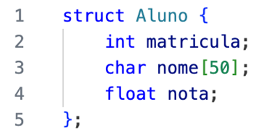
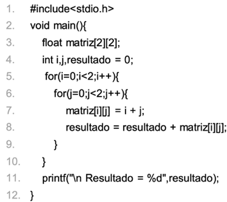

# Exercícios de Revisão — Unidade 3

## Questão 1 ✅

Os ponteiros são elementos fundamentais em algumas linguagens de programação, como C e C++. Eles permitem manipular diretamente os endereços de memória, proporcionando maior controle e eficiência em algumas operações. Abaixo estão algumas afirmativas sobre conceitos básicos de ponteiros:

- **I.** Um ponteiro é uma variável que contém o valor de uma outra variável.
- **II.** Um ponteiro pode apontar para qualquer tipo de dado, independentemente do seu tamanho.
- **III.** O operador de referência (`&`) é utilizado para acessar o valor apontado por um ponteiro.
- **IV.** O operador (`*`) é utilizado para obter o endereço de memória de uma variável.

**Pergunta:** Considerando o contexto apresentado, é correto o que se afirma em:

**Resposta assinalada:** II, apenas. ✅

**Comentário:**

- **I. Incorreta.** Um ponteiro armazena o endereço de memória de outra variável, não o valor.
- **II. Correta.** Ponteiros podem apontar para variáveis de qualquer tipo de dado, independentemente do tamanho.
- **III. Incorreta.** O operador de referência (`&`) é utilizado para obter o endereço de memória de uma variável, não para acessar o valor apontado por um ponteiro.
- **IV. Incorreta.** O operador `*` (de desreferência) é usado para acessar o valor apontado por um ponteiro, não para obter o endereço de memória de uma variável.

> 💡 III e IV trocam os papéis dos operadores: **`&x`** → endereço de `x`; **`*p`** → valor guardado no endereço que `p` contém.

## Questão 2 ✅

Considere o trecho de código a seguir que define uma struct `Aluno` em C, usada para armazenar informações sobre estudantes, incluindo matrícula, nome e nota.

Agora suponha que você tenha um objeto `Aluno` chamado `aluno1` com a seguinte informação: matrícula = 12345, nome = "João", nota = 8.5.

**Pergunta:** Qual seria a forma correta de imprimir o nome desse aluno?

**Resposta assinalada:** `printf("%s", aluno1.nome);` ✅

**Comentário:**

- **`printf("%s", aluno1->nome);`** Incorreta. Usa o operador seta (`->`), que é usado para acessar campos em ponteiros para structs, e não em structs diretamente.
- **`printf("%s", Aluno.nome(aluno1));`** Incorreta. Mistura sintaxes de operadores e chama incorretamente uma função `nome` da struct `Aluno`.
- **`printf("%s", aluno1[nome]);`** Incorreta. Tenta acessar um campo usando a notação de vetor, que não é aplicável a structs.
- **`printf("%s", &nome);`** Incorreta. Usa o operador de endereço (`&`) em um campo que não é um ponteiro, o que está incorreto.
- **`printf("%s", aluno1.nome);`** ✅ Correta. Usa o operador ponto (`.`) para acessar o campo `nome` da struct `Aluno` armazenada no objeto `aluno1`. O formato de impressão `%s` é usado para imprimir strings em C, o que torna essa a maneira correta de acessar e imprimir o nome do aluno armazenado no objeto `aluno1`.

## Questão 3 ✅

Considere as afirmações a seguir sobre structs:

- **I.** As structs podem conter apenas variáveis de tipos primitivos, como inteiros, floats e caracteres.
- **II.** Não é possível criar vetores ou matrizes de tipos de dados definidos por structs.
- **III.** Em C, a palavra-chave `typedef` pode ser usada para criar um nome (ou um alias) para uma estrutura.

**Pergunta:** Considerando o contexto apresentado, é correto o que se afirma em:

**Resposta assinalada:** III, apenas. ✅

**Comentário:**

- **I. Falso.** As structs podem conter variáveis de tipos primitivos, bem como outras structs, permitindo a criação de estruturas de dados mais complexas.
- **II. Falso.** É possível criar vetores ou matrizes de tipos de dados definidos por structs em C.
- **III. Verdadeiro.** Em C, a palavra-chave `typedef` pode ser usada para criar um novo nome ou alias para uma estrutura, o que pode tornar o código mais legível e fácil de entender.

## Questão 4 ✅

Quando se utiliza uma solução com matrizes é preciso ter clareza sobre a ordem de inserção dos dados. Tanto o índice da linha quanto da coluna inicia-se em zero, portanto a primeira posição a ser ocupada é linha 0 - coluna 0. Considere o programa abaixo:

**Pergunta:** Assinale a alternativa que contém o que será impresso na linha 11.

**Resposta assinalada:** Resultado = 4 ✅

**Comentário:**

No programa, uma matriz de números de ponto flutuante 2x2 é criada e preenchida com os valores da soma dos índices das linhas e colunas. O resultado é inicializado como 0 e é atualizado a cada iteração do loop interno para somar o valor atual da matriz. A matriz resultante é a seguinte:

| Posição | Cálculo | Valor |
|---|---|:---:|
| `matriz[0][0]` | 0 + 0 | 0 |
| `matriz[0][1]` | 0 + 1 | 1 |
| `matriz[1][0]` | 1 + 0 | 1 |
| `matriz[1][1]` | 1 + 1 | 2 |

Assim, o valor de `resultado` será a soma desses valores, ou seja, $0 + 1 + 1 + 2 = 4$. Portanto, o programa imprimirá **"Resultado = 4"** na linha 11.

## Questão 5 ✅

Em programação de computadores, uma struct (ou estrutura) é uma forma de definir um novo tipo de dado composto, agrupando diversos elementos de tipos diferentes em uma única unidade. As structs são amplamente utilizadas em diversas linguagens de programação para criar estruturas de dados personalizadas, representando entidades ou objetos com propriedades distintas. Ao criar uma struct, você está efetivamente definindo um novo tipo de dado que contém uma coleção de campos com diferentes tipos de dados. Esses campos podem ser variáveis primitivas, como inteiros, caracteres ou números de ponto flutuante, ou até mesmo outras structs, permitindo a criação de estruturas de dados complexas.

**Pergunta:** Considerando o contexto apresentado, assinale a alternativa correta.

**Resposta assinalada:** Uma struct é uma forma de definir um novo tipo de dado composto, agrupando diversos elementos de tipos diferentes em uma única unidade. Elas são amplamente utilizadas para criar estruturas de dados personalizadas com propriedades distintas. ✅

**Comentário:**

- **"Uma struct é uma função que cria tipos de dados em uma linguagem de programação, permitindo agrupar diferentes funções em um único objeto."** Falso. Uma struct não é uma função, mas sim uma forma de definir um novo tipo de dado composto.
- **"Uma struct é uma biblioteca de funções prontas para uso em uma linguagem de programação, permitindo o agrupamento de funções relacionadas em um único arquivo."** Falso. Uma struct não é uma biblioteca de funções prontas para uso, mas sim uma forma de definir um novo tipo de dado composto.
- **"Uma struct é uma estrutura de controle utilizada para criar repetições em uma linguagem de programação, permitindo a execução de um bloco de código várias vezes."** Falso. Uma struct não é uma estrutura de controle utilizada para criar repetições.
- **"Uma struct é uma variável especial em uma linguagem de programação que permite armazenar diversos valores em uma única unidade, substituindo a necessidade de criar variáveis individuais."** Falso. Uma struct não é uma variável especial, mas sim um novo tipo de dado que permite agrupar diferentes variáveis em uma única unidade.
- **"Uma struct é uma forma de definir um novo tipo de dado composto, agrupando diversos elementos de tipos diferentes em uma única unidade..."** ✅ Verdadeiro. Uma struct é uma forma de definir um novo tipo de dado composto, agrupando diversos elementos de tipos diferentes em uma única unidade. Elas são amplamente utilizadas para criar estruturas de dados personalizadas com propriedades distintas.
