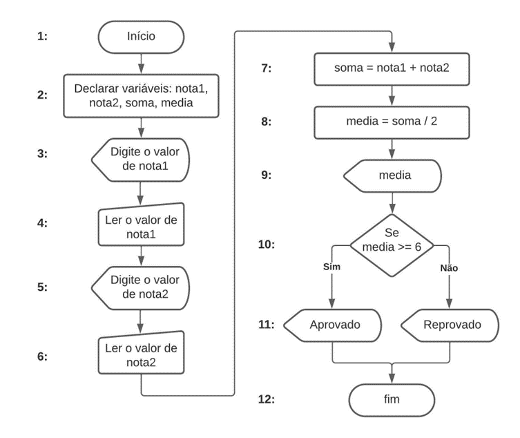

# Aula 1 — Definição e Representação de Algoritmos

## Ponto de Partida

É importante ter em mente que um algoritmo consiste em uma sequência limitada de etapas que podem ser seguidas para criar e executar uma tarefa específica com o objetivo de resolver um problema. Portanto, é crucial compreender as definições de um algoritmo, suas aplicações e seus diferentes tipos antes de prosseguir para os próximos estágios deste material.

> Você está iniciando agora seu trabalho em uma empresa que se dedica à criação de softwares educacionais. Sua responsabilidade é treinar os estagiários recém-contratados para trabalhar com o desenvolvimento de sistemas na empresa. É importante lembrar que esses estagiários não possuem experiência prévia com algoritmos ou linguagens de programação.
>
> Para despertar o interesse dos estagiários, vamos criar dois algoritmos: um que permita o cadastro dos dados pessoais dos alunos que precisam ser registrados, como nome, endereço, cidade e estado; e outro que verifica se um número qualquer é positivo ou negativo. Os algoritmos devem ser elaborados nos seguintes formatos:
>
> - Explicação em linguagem natural.
> - Representação gráfica por meio de um diagrama de blocos (fluxograma).

Ao analisar os resultados obtidos, os algoritmos podem desempenhar um papel significativo na criação de códigos de programação. Agora é o momento de iniciar esta jornada. Preste muita atenção nas aulas e tenha um excelente estudo!

---

## Vamos Começar!

Olá! Daqui para frente, você vai desvendar o funcionamento dos algoritmos e compreender suas utilidades no âmbito da programação. Com esse propósito, será introduzido aos conceitos, aplicações e variedades de algoritmos.

### Definição de Algoritmo

Um **algoritmo** pode ser definido como uma sequência lógica e finita de passos (instruções) para resolver um determinado problema. Nesse contexto, um algoritmo pode guiá-lo na identificação do caminho mais eficiente para resolver um problema utilizando o computador. A criação de algoritmos é um passo crucial no processo de construção de um programa de computador (ou software), pois, ao elaborar algoritmos para resolver um problema específico, é possível posteriormente traduzi-los para uma linguagem de programação específica. Como destacado, para qualquer atividade cotidiana, podemos elaborar um algoritmo. Por exemplo, a sequência de etapas para preparar um bolo de chocolate, como ilustrado a seguir:

1. Bata 4 claras em neve.
2. Adicione 2 xícaras de açúcar, 2 colheres de farinha de trigo, 4 gemas, 1 colher de fermento e duas colheres de chocolate.
3. Bata por 3 minutos.
4. Unte uma assadeira com margarina e farinha de trigo, e despeje a mistura.
5. Coloque o bolo para assar por 20 minutos.

Perceba que assim como existem diversas receitas diferentes para se fazer um mesmo bolo de chocolate, há várias maneiras de desenvolver um algoritmo! No entanto, existe uma ordem lógica para a execução da tarefa. Por exemplo, o passo 5 (colocar para assar) só pode ser feito após realizar o passo 4 (despejar a mistura em uma forma untada). No entanto, é possível criar outras abordagens e ordens para alcançar o mesmo objetivo predeterminado.

Para uma compreensão mais abrangente dos algoritmos, é crucial dividi-los em três componentes principais: **entrada**, **processamento** e **saída**.

| Componente | Descrição |
|---|---|
| **Entrada** | refere-se aos dados ou elementos de entrada do algoritmo (informações utilizadas no processamento, para gerar um resultado esperado). No contexto do algoritmo de receita de bolo, esses dados de entrada seriam os ingredientes necessários. |
| **Processamento** | são as etapas e os procedimentos necessários para alcançar o resultado final, ou seja, o bolo. |
| **Saída** | representa o resultado que o algoritmo busca alcançar após o processamento dos dados de entrada, ou seja, o bolo pronto para ser servido. |

### Linguagem Natural

A **linguagem natural** constitui um meio de comunicação utilizado por pessoas de diferentes idiomas, podendo manifestar-se por meio da fala, da escrita, dos gestos, e outras formas de interação. A linguagem natural desempenha um papel fundamental no desenvolvimento de aplicações computacionais, uma vez que facilita de maneira direta e eficaz a descrição de problemas e suas respectivas soluções.

Para ilustrar os princípios da linguagem natural, podemos tomar como exemplo o registro das notas de alguns alunos em seu curso. O desafio consiste no seguinte: o usuário deve inserir dois valores que representam as notas de cada bimestre, e o computador retornará a média desses valores (média das notas). Caso a média seja igual ou superior a seis, o aluno será considerado aprovado; caso contrário, será reprovado. Para realizar a solução desse problema, podemos fazer uso da seguinte estrutura:

```text
Início.
Entrar com o primeiro valor (nota do primeiro bimestre).
Entrar com o segundo valor (nota do segundo bimestre).
Realizar a soma do primeiro valor com o segundo.
Realizar a divisão da soma dos valores por dois (média das notas dos bimestres).
Armazenar o valor encontrado.
Mostrar na tela o resultado da média.
Se a média do aluno for maior ou igual a seis.
    O aluno será considerado aprovado.
Senão está reprovado.
Fim.
```

| ✅ Vantagem | ❌ Desvantagem |
|---|---|
| Não é necessário aprender nenhum conceito novo, pois a língua natural, o português, já é conhecida. | Abre espaço para diferentes interpretações e ambiguidades, o que posteriormente dificultará a transição deste algoritmo para o programa. |

---

## Siga em Frente...

### Diagramas de Bloco (Fluxogramas)

Antes de entrarmos no estudo de diagramas de blocos, é importante compreender de forma resumida o conceito de variáveis e atribuições, a fim de que você tenha condições de interpretar e progredir em seus estudos de algoritmos.

As **variáveis**, como o próprio nome indica, são elementos que podem ser alterados (sofrer variações), ou seja, estão relacionadas à identificação de informações. Já uma **atribuição** (`←`) serve para designar valores às variáveis, ou seja, para atribuir informações a elas. Por exemplo:

```text
valor1 ← 6
nome ← joao
```

Significa que o número "6" está sendo atribuído para variável `valor1` e que o texto "joao" está sendo atribuído para variável `nome`.

Um **diagrama de blocos** (ou **fluxograma**) pode ser descrito como uma coleção de símbolos gráficos, em que cada um desses símbolos representa ações específicas a serem executadas pelo computador. É importante ressaltar que o diagrama de blocos estabelece a sequência lógica adotada pelo desenvolvedor para resolver um problema. Ao criar um diagrama de blocos, o desenvolvedor precisa assegurar que os símbolos utilizados sejam coerentes e de fácil compreensão. Para garantir a consistência dos diagramas de blocos, seus símbolos foram padronizados pela **ANSI** (Instituto Nacional Americano de Padrões), sendo os principais deles ilustrados na Tabela 1.

| Significado | Descrição |
|---|---|
| **Terminal** | Representa o início ou o fim de um fluxograma. |
| **Entrada manual** | Determina a entrada manual dos dados, geralmente por meio de um teclado. |
| **Processamento** | Representa a execução de ações de processamento. Por exemplo, a execução de uma soma. |
| **Exibição** | Mostra o resultado de uma ação ou exibição de alguma informação, geralmente por meio da tela de um computador. |
| **Decisão/Condicional** | Representa os desvios condicionais nas operações de tomada de decisão e laços condicionais para repetição de alguns trechos do programa. |

*Tabela 1 | Principais símbolos utilizados em diagramas de blocos. (As imagens dos símbolos não foram preservadas na extração do material.)*

A Figura 1 traz um exemplo de algoritmo representado em fluxograma.



*Figura 1 | Fluxograma - algoritmo.*

Este fluxograma ilustra um algoritmo que calcula a média entre duas notas, e exibe como saída se o aluno está aprovado ou reprovado. Vejamos a seguir a explicação de cada passo do fluxograma, de acordo com a numeração da figura.

1. O símbolo **terminal** deu início ao diagrama de blocos.
2. O símbolo de **processamento** definiu as variáveis.
3. O símbolo **exibição** mostra na tela o que o usuário deve fazer.
4. O símbolo de **entrada manual** libera para o usuário entrar com a primeira nota.
5. O símbolo **exibição** mostra na tela o que o usuário deve fazer.
6. O símbolo de **entrada manual** libera para o usuário entrar com a segunda nota.
7. O símbolo de **processamento** realiza a soma das notas 1 e 2, e atribui o resultado à variável `soma`.
8. O símbolo de **processamento** realiza a divisão da variável `soma` por 2 e atribui o resultado à variável `media`.
9. O símbolo de **exibição** mostra na tela o resultado da média calculada.
10. O símbolo de **decisão** define a condicional (verdadeiro ou falso) para a variável `media`.
11. Se a condição for verdadeira, a resposta será "Aprovado". Se a condição for falsa, a resposta será "Reprovado".
12. O símbolo **terminal** finaliza o programa.

Vejamos agora algumas dicas para construir um diagrama de blocos (fluxograma):

- Estar atento aos níveis.
- O diagrama de blocos (fluxograma) deve começar de cima para baixo e da esquerda para direita.
- Ficar atento para não cruzar as linhas, principalmente as linhas de fluxos de dados.
- As instruções devem seguir um fluxo lógico.

| ✅ Vantagem | ❌ Desvantagem |
|---|---|
| A compreensão de elementos gráficos é mais fácil do que a de textos, além de diminuir a ambiguidade presente na representação por linguagem natural. | É necessário aprender a simbologia dos fluxogramas e, além disso, o algoritmo resultante não apresenta muitos detalhes, dificultando a sua transcrição para um programa. |

---

## Vamos Exercitar?

Agora, é hora de aplicar todo o conhecimento adquirido até aqui! Vale lembrar que a sua tarefa era introduzir aos estagiários um algoritmo que utilize linguagem natural e/ou diagramas de blocos (fluxogramas) para realizar duas tarefas: registrar os dados pessoais de um aluno (nome, endereço, cidade e estado) e exibir o resultado ao final; e verificar se um número é positivo ou negativo.

Seguem as dicas para realizar a solução do nosso problema:

- Quando falamos em linguagem natural, quer dizer que devemos escrever a situação o mais próximo possível da linguagem convencional. Não se preocupe com os passos a serem realizados, foque na solução do problema.

Segue um exemplo de resolução em linguagem natural:

**Algoritmo para cadastro:**

1. Declarar as variáveis nome, endereço, cidade e estado.
2. Ler o nome do aluno, do endereço, da cidade e do estado.
3. Armazenar cada informação lida em sua respectiva variável.
4. Exibir os valores de nome, endereço, cidade e estado.

**Algoritmo para verificar se um número é positivo ou negativo:**

1. Declarar uma variável `num`.
2. Pedir para o usuário inserir um número qualquer.
3. Atribuir o valor informado pelo usuário à variável `num`.
4. Verificar se `num` é maior ou igual a zero.
5. Se for verdade, o número é positivo.
6. Se for falso, o número é negativo.

Agora só falta construir o diagrama de blocos (fluxograma) para as duas tarefas.

- Concentre-se na descrição e nos significados dos símbolos, bem como na sequência lógica de passos para se chegar no objetivo final.

> Lembrando que não há uma única resposta correta. Há vários caminhos para se chegar no mesmo resultado, e esta é a beleza dos algoritmos!

---

## Saiba mais

Para entender melhor o conceito de algoritmos e sua importância no desenvolvimento de softwares sugerimos a leitura do **Capítulo 1 - Introdução** do livro *Simplificando Algoritmos*, disponível na Biblioteca Virtual.

Já o **Capítulo 4 - Algoritmos** do mesmo livro traz conceitos complementares sobre a representação de algoritmos estudados nesta aula.

> MENÉNDEZ, A. **Simplificando algoritmos**. 1. ed. Rio de Janeiro: LTC, 2023.

Para auxiliar no desenvolvimento de diagramas de bloco (fluxogramas), você pode utilizar a ferramenta on-line gratuita **Draw.io**, que possui suporte para diversos tipos de diagramas.

---

## Referências

- CORMEN, T. H. **Desmistificando algoritmos**. 1. ed. Rio de Janeiro: Elsevier, 2014.
- MENÉNDEZ, A. **Simplificando algoritmos**. 1. ed. Rio de Janeiro: LTC, 2023.
- PIVA JUNIOR, D. **Algoritmos e programação de computadores**. 2. ed. Rio de Janeiro: Elsevier, 2019.
