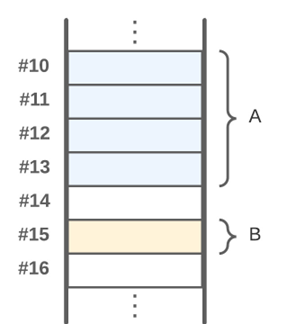
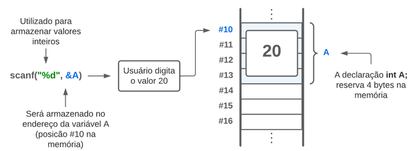

# Aula 3 — Variáveis e Constantes

## Ponto de Partida

Uma linguagem de programação é um conjunto de regras e símbolos usados para escrever códigos que o computador pode executar. Ela serve como uma ferramenta para os programadores comunicarem instruções precisas ao computador, permitindo que desenvolvam software e aplicativos para uma ampla gama de propósitos.

> Você está trabalhando em uma empresa que está desenvolvendo um software para uma loja de eletrodomésticos. Nesse sistema, temos a necessidade de calcular o preço final de um produto com base no preço de venda e na incidência de taxas fixas de impostos e descontos aplicáveis. Por exemplo, suponha que o preço de venda de um televisor seja de **R$ 1500.00**. Vamos considerar que a taxa de imposto aplicável seja de **10%**, e que haja um desconto padrão de **5%** para esse produto em particular.
>
> Para concluir este desafio, será importante definir e manipular corretamente as variáveis e constantes na linguagem C.

Agora é o momento de iniciar esta jornada. Preste muita atenção na aula e tenha um excelente estudo!

---

## Vamos Começar!

Olá! Com o conhecimento sobre algoritmos e como criá-los por meio de linguagem natural e fluxogramas, o próximo é a representação por meio de uma linguagem de programação. Portanto, você irá agora aprofundar no estudo da linguagem de programação C.

### Definição, tipos e declaração de variáveis na linguagem C

Considere a seguinte equação para o cálculo da área de uma circunferência:

$$A = \pi r^2$$

em que $\pi$ (pi) equivale a aproximadamente 3,14 e $r$ é o raio. Podemos observar que o valor do raio pode variar de acordo com a circunferência que se deseja calcular a área, e consequentemente o valor da área também muda (varia). Porém, independente da circunferência, o valor de $\pi$ é sempre o mesmo (constante). Há inúmeros exemplos que ilustram situações em que os valores podem variar ou permanecer fixos, refletindo a natureza diversa do nosso mundo, sujeito a condições específicas. Dado que os sistemas computacionais são projetados para resolver uma ampla variedade de problemas, é crucial que sejam capazes de lidar com essa característica – isto é, realizar cálculos com valores variáveis ou constantes. No contexto da programação, essas capacidades são conhecidas como **variáveis** e **constantes**, as quais desempenham a função primordial de temporariamente armazenar dados na memória de trabalho.

Uma **variável** pode ser definida como uma localização temporária na memória em que um valor pode ser armazenado e utilizado por um programa. Esta localização na memória é identificada por meio de **endereços de memória**. Sendo assim, quando criadas, essas entidades realmente existem na memória de trabalho, ocupando um espaço físico. O mesmo princípio se aplica às constantes, embora, neste caso, o valor armazenado permaneça inalterado.

Agora, observe a Figura 1, que apresenta uma ilustração simbólica da memória de um computador com a alocação de duas variáveis, A e B, sendo cada espaço equivalente a 1 byte. É evidente que o espaço reservado para A é maior do que o reservado para B. No entanto, como ocorre essa distinção de tamanho? A especificação do espaço alocado para uma variável pode ser determinada de duas maneiras: a primeira relaciona-se com o **tipo de dado** a ser armazenado no espaço designado, no qual o programador não tem controle direto sobre o tamanho alocado. Em contraste, a segunda abordagem é realizada **manualmente pelo programador**, por meio da utilização de funções e estruturas específicas que serão abordadas mais adiante.



*Figura 1 | Exemplo de variáveis na memória.*

Todas as linguagens de programação contêm tipos de dados primitivos e compostos. Entre os **tipos primitivos**, temos as seguintes categorias:

| Tipo | Descrição |
|---|---|
| **Inteiro** (`int`) | refere-se a valores inteiros que podem ser negativos, positivos ou zero. Exemplos comuns incluem variáveis que armazenam idade, quantidade de produtos, códigos de identificação, entre outros. |
| **Ponto flutuante** (`float` / `double`) | armazena valores que pertencem ao conjunto dos números reais, ou seja, valores que podem conter casas decimais. Peso, altura, dinheiro são exemplos de variáveis que se enquadram nessa categoria. |
| **Caractere** (`char`) | é o tipo utilizado para armazenar letras. Um exemplo típico é o armazenamento do gênero de uma pessoa, em que `'F'` é utilizado para representar feminino e `'M'` para masculino. |
| **Booleano** (`bool`) | variáveis desse tipo são capazes de armazenar apenas um de dois valores possíveis: verdadeiro ou falso. Geralmente, são empregadas em validações, como para verificar se um usuário digitou um valor específico ou se selecionou uma opção determinada em uma lista. Para utilizá-lo em C, devemos incluir a biblioteca `<stdbool.h>`. |

Para se usar uma variável em uma linguagem de programação é preciso criá-la e, para isso, usa-se a seguinte sintaxe:

```c
<tipo> <nome_da_variavel>;
```

Esta sintaxe é amplamente reconhecida em todas as linguagens de programação, embora algumas permitam certas modificações. Na linguagem de programação C essa norma é obrigatória, e o campo `<tipo>` pode ser qualquer um dos tipos primitivos definidos anteriormente, como `int` (inteiros), `float` ou `double` (ponto flutuante) e `char` (caracteres).

Já para o `<nome_da_variavel>` devemos seguir algumas regras, tais como:

- Devem começar com uma letra.
- Os próximos caracteres podem ser letras ou números.
- Não pode utilizar nenhum símbolo, exceto underline (`_`).
- Não pode conter espaços em branco.
- Não pode conter letras com acentos.

Veja a seguir alguns exemplos de criações de variáveis no Quadro 1:

```c
#include <stdbool.h>
int main(){
    int idade, num2;
    float salario = 7500;
    double qtd_atomos;
    bool confirma = false;
    char genero = 'M';
    return 0;
}
```

*Quadro 1 | Exemplos de variáveis em C.*

Note que ao criar uma variável, o programador tem a opção de atribuir um valor imediatamente ou deixá-la sem valor inicial. Outro ponto importante é que a maioria das linguagens de programação é **sensível a maiúsculas e minúsculas** (*case sensitive*), o que implica que letras maiúsculas e minúsculas são tratadas como diferentes. Portanto, a variável `valor` é diferente da variável `Valor`.

---

## Siga em Frente...

### O endereço de memória de uma variável

O espaço alocado para uma variável depende do seu tipo. Por exemplo, para uma variável do tipo `int`, 4 bytes são reservados na memória. O tamanho alocado na memória com base no tipo de variável limita o valor que pode ser armazenado nesse espaço. Por exemplo, seria inviável armazenar o valor de 10 trilhões em uma variável do tipo `int`. Em um cálculo simples, 4 bytes correspondem a 32 bits. Cada bit pode armazenar apenas 0 ou 1. Assim, a quantidade de valores distintos que uma variável inteira pode representar é:

$$2^{32} = 4.294.967.296$$

No entanto, esse valor deve ser dividido por dois, uma vez que um `int` pode armazenar números negativos e positivos. Consequentemente, uma variável `int` pode ter um valor entre **-2.147.483.648** e **2.147.483.647**.

Para contornar as limitações dos valores que uma variável pode assumir com base em seu tipo, foram desenvolvidos **modificadores de tipos**, os quais são comandos utilizados na declaração da variável para ajustar sua capacidade padrão. Os três principais modificadores são:

| Modificador | Efeito |
|---|---|
| `unsigned` | especifica que a variável armazenará apenas a parte positiva do número. |
| `short` | reduz o espaço reservado na memória. |
| `long` | aumenta a capacidade padrão. |

A Tabela 1 apresenta o tamanho e os possíveis valores de alguns tipos, incluindo os modificadores.

| Tipo | Tamanho (bytes) | Faixa de valores |
|---|:---:|---|
| `int` | 4 | -2.147.483.648 até 2.147.483.647 |
| `float` | 4 | $-3{,}4 \times 10^{38}$ até $3{,}4 \times 10^{38}$ |
| `double` | 8 | $-1{,}7 \times 10^{308}$ até $1{,}7 \times 10^{308}$ |
| `char` | 1 | -128 até 127 |
| `unsigned int` | 4 | 0 até 4.294.967.295 |
| `short int` | 2 | -32.768 até 32.767 |
| `long double` | 16 | $-3{,}4 \times 10^{4932}$ até $3{,}4 \times 10^{4932}$ |

*Tabela 1 | Principais tipos primitivos e modificadores.*

> **Nota de revisão:** no material original, a faixa do `int` aparecia como "-2.147.423.648 até 2.147.423.648" e a do `unsigned int` como "0 até 4.294.967.296" — os valores corretos são -2.147.483.648 até 2.147.483.647 e 0 até 4.294.967.295 (o maior valor é sempre $2^n - 1$, porque o zero também ocupa uma combinação). Os expoentes das faixas de `float`, `double` e `long double` haviam se perdido na extração ("3,438", "1,7308", "3,44932") e foram reconstruídos acima. Os tamanhos são os típicos em plataformas de 64 bits; o padrão C só garante tamanhos mínimos.

A memória de um computador é fragmentada em blocos de bytes, sendo que cada bloco consiste em 8 bits, e cada um possui um endereço distinto para identificação. Podemos fazer uma simples analogia com os endereços das residências, em que cada casa possui uma localização exclusiva, e a duplicação de endereços geraria problemas significativos. Sabemos que as variáveis são utilizadas para reservar temporariamente espaços na memória, e cada uma possui um endereço único para identificação. É possível obter o endereço de alocação de uma variável ao utilizar o operador `&` no momento da impressão da variável.

O operador `&` é de extrema importância na linguagem C, uma vez que permite o acesso direto aos endereços de memória das variáveis. À medida que progredimos em nossos estudos, utilizaremos esse operador para alocar espaços na memória.

Como já estudamos previamente, para armazenar valores digitados pelo usuário em uma variável, podemos usar a função `scanf()`, com a seguinte estrutura:

```c
scanf("especificador", &variavel);
```

A Figura 2 apresenta um exemplo no qual se utilizou o especificador `%d` para indicar ao compilador que o valor que será digitado deve ser um inteiro, e este valor será guardado no endereço de memória da variável `x`.



*Figura 2 | Exemplo de leitura de dados com `scanf` e sua relação com a memória.*

Para obter acesso ao endereço de memória de uma variável e armazenar valores inseridos pelo usuário, vamos desenvolver um programa em linguagem C que guarda dois valores, cada um em sua respectiva variável. Para isso, o usuário será solicitado a fornecer as entradas, que serão então armazenadas nas variáveis `valor1` e `valor2`. A solução para este problema pode ser vista no Quadro 2. É importante observar que na linha 4, todas as variáveis, sendo do mesmo tipo, são declaradas na mesma linha, separadas por vírgula. Nas linhas 7, 9 e 11, os valores inseridos pelo usuário serão armazenados nos endereços das variáveis `caractere`, `valor1` e `valor2`, respectivamente.

```c
#include <stdio.h>
int main(){
    char caractere;
    float valor1, valor2;

    printf("\n Digite um caractere qualquer:");
    scanf("%c", &caractere);
    printf("\n Digite o primeiro valor:");
    scanf("%f", &valor1);
    printf("\n Digite o segundo valor:");
    scanf("%f", &valor2);

    printf("Variável 1 = %c\n", caractere);
    printf("Variável 2 = %.2f\n", valor1);
    printf("Variável 3 = %.2f\n", valor2);
    return 0;
}
```

*Quadro 2 | Exemplo de entrada e saída em C.*

### Constantes

Como já vimos, **constante** se refere a um valor que permanece inalterado ao longo do programa. Na linguagem C, existem duas maneiras de criar valores constantes.

#### 1. Diretiva `#define`

A primeira envolve o uso da diretiva `#define`, que é colocada logo após a inclusão das bibliotecas. Nesse caso, a sintaxe seria a seguinte:

```c
#define <nome_da_constante> <valor>
```

É importante observar que **não deve haver ponto e vírgula no final**. Além disso, é fundamental notar que a diretiva não utiliza espaço na memória; ela simplesmente cria um rótulo associado a um valor. Como nenhum espaço é alocado na memória, o operador `&` não pode ser usado nesse contexto.

#### 2. Comando `const`

A segunda maneira de criar valores constantes é semelhante à declaração de variáveis, exceto pelo uso do comando `const` antes do tipo. Portanto, a sintaxe seria:

```c
const <tipo> <nome_da_constante> = <valor>;
```

Quando se utiliza a segunda forma de declaração, a alocação de espaço na memória segue os mesmos princípios das variáveis, ou seja, `int` alocará 4 bytes, `char` 1 byte, e assim por diante. A diferença fundamental entre constantes e variáveis é que o valor de uma constante nunca pode ser alterado. Se uma constante, por exemplo `const int x = 5;`, for criada e for feita uma tentativa de modificar seu valor durante a execução do código, o compilador emitirá um erro e não gerará o arquivo executável.

> Vale ressaltar que tanto para a primeira quanto para a segunda forma de criar constantes, valem as mesmas regras de nomenclatura de variáveis.

No exemplo do Quadro 3 há duas formas de sintaxes para constantes. Na linha 2 definimos uma constante (rótulo) chamada `pi` com valor 3.14. Na linha 4 criamos uma constante usando o comando `const`. Nas linhas 5 e 6 imprimimos o valor de cada constante; veja que nada difere da impressão de variáveis.

```c
#include <stdio.h>
#define pi 3.14
int main(){
    const float g = 9.8;
    printf("\n pi = %f", pi);
    printf("\n g = %f", g);
    return 0;
}
```

*Quadro 3 | Utilização de constantes em C.*

| | `#define` | `const` |
|---|---|---|
| **Ocupa memória?** | Não — é apenas um rótulo substituído antes da compilação | Sim — segue o tamanho do tipo |
| **Tem tipo?** | Não | Sim |
| **Aceita `&`?** | Não | Sim |
| **Termina com `;`?** | Não | Sim |

---

## Vamos Exercitar?

Agora é a sua vez de aplicar todo o conhecimento adquirido sobre variáveis e constantes! Lembre-se que você está desenvolvendo um software para uma loja de eletrodomésticos, e este deve calcular o preço final de um produto com base no preço de venda, impostos e descontos aplicáveis.

Nesse contexto, podemos usar **variáveis** para armazenar o preço de venda do produto, o valor dos impostos e o valor do desconto. Podemos usar **constantes** para representar as taxas de impostos aplicáveis e os descontos padrão para determinados produtos.

Suponha que o preço de venda de um televisor seja de R$ 1500.00. Vamos considerar que a taxa de imposto aplicável seja de 10%, e que haja um desconto padrão de 5% para esse produto em particular.

Aqui está um exemplo simplificado em linguagem C que poderia ser usado para calcular o preço final do televisor após a aplicação dos impostos e descontos:

```c
#include <stdio.h>
int main(){
    // Variáveis
    float precoVenda, valorImposto, valorDesconto, precoFinal;
    // Constantes
    const float taxaImposto = 0.1;
    const float descontoPadrao = 0.05;
    // Entrada
    printf("Informe o preço de venda do produto: ");
    scanf("%f", &precoVenda);
    // Processamento
    valorImposto = precoVenda * taxaImposto;
    valorDesconto = precoVenda * descontoPadrao;
    precoFinal = precoVenda + valorImposto - valorDesconto;
    // Saída
    printf("O preço final do televisor é: R$ %.2f", precoFinal);
    return 0;
}
```

---

## Saiba mais

Para entender melhor o conceito de variáveis e como elas são utilizadas e declaradas na linguagem C, sugerimos a leitura do **Capítulo 2 - Lendo e escrevendo nas variáveis** do livro *Linguagem C: Completa e Descomplicada*, disponível na Biblioteca Virtual.

> BACKES, A. **Linguagem C**: completa e descomplicada. 2. ed. Rio de Janeiro: LTC, 2023. cap. 2, p. 25-47.

Com relação aos tipos de variáveis que podemos utilizar, o **Capítulo 2 - Tipos de Dados Básicos** do livro *Linguagem C* complementa bem o assunto.

> DAMAS, L. **Linguagem C**. 10. ed. Rio de Janeiro: LTC, 2023. cap. 2, p. 21-50.

Para auxiliar no desenvolvimento de programas na linguagem C, uma ótima prática é verificar a documentação da linguagem para entender em detalhes os principais tipos de funções e elementos utilizados. Para isso, sugerimos a consulta da seguinte documentação sempre que achar necessário. Nela você encontra todas as bibliotecas utilizadas na linguagem e como utilizar suas principais funções: **Referência da Linguagem C**.

---

## Referências

- BACKES, A. **Linguagem C**: completa e descomplicada. 2. ed. Rio de Janeiro: LTC, 2023.
- CORMEN, T. H. **Desmistificando algoritmos**. 1. ed. Rio de Janeiro: Elsevier, 2014.
- DAMAS, L. **Linguagem C**. 10. ed. Rio de Janeiro: LTC, 2023. [Minha biblioteca].
- MENÉNDEZ, A. **Simplificando algoritmos**. 1. ed. Rio de Janeiro: LTC, 2023.
- PIVA JUNIOR, D. **Algoritmos e programação de computadores**. 2. ed. Rio de Janeiro: Elsevier, 2019.
