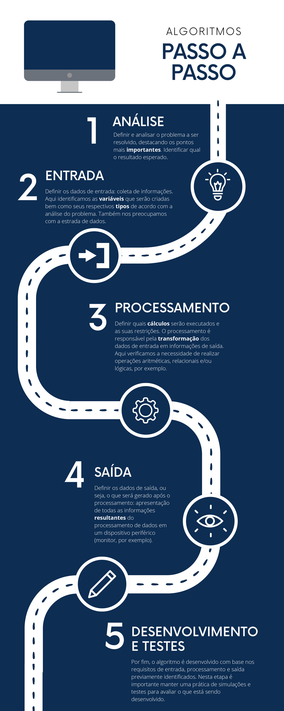

# Aula 5 — Encerramento da Unidade: Fundamentos de Algoritmos e Programação

## Ponto de Chegada

Olá, estudante! Para desenvolver a competência desta Unidade, que é **"compreender a utilização dos fundamentos de algoritmos para utilizar na linguagem de programação"**, você deverá primeiramente conhecer os conceitos fundamentais de algoritmos, que são conjuntos de instruções sequenciais que permitem resolver problemas passo a passo. Esses algoritmos podem ser representados de diferentes maneiras, como por meio de fluxogramas ou de forma textual, usando linguagem natural.

Na linguagem de programação C, os conceitos básicos da estrutura de programação são fundamentais para iniciar o desenvolvimento de aplicativos. A estrutura de programação em C é baseada em **funções**, que são blocos de código que realizam tarefas específicas. A função `main` é o ponto de entrada de qualquer programa em C. Dentro das funções, as variáveis e constantes são elementos-chave. As **variáveis** são espaços na memória que armazenam valores temporários, enquanto as **constantes** representam valores fixos que não podem ser alterados durante a execução do programa.

Os principais tipos de variáveis em C incluem inteiros, pontos flutuantes, caracteres, entre outros. Cada tipo possui um tamanho específico na memória, o que influencia o intervalo de valores que pode ser armazenado. Além disso:

| Grupo de operadores | Papel |
|---|---|
| **Aritméticos** | adição, subtração, multiplicação e divisão — essenciais para realizar cálculos matemáticos. |
| **Relacionais** | comparar valores e avaliar se uma condição é verdadeira ou falsa. |
| **Lógicos** | combinar ou inverter condições lógicas para tomar decisões em um programa. |

Dominar esses conceitos é crucial para desenvolver algoritmos eficientes e criar programas robustos e funcionais em linguagem C. A compreensão desses fundamentos capacita os programadores a resolver uma ampla variedade de problemas e a criar soluções adaptáveis e de alto desempenho.

---

## É Hora de Praticar!

### Estudo de Caso: Caixa da pizzaria

> Você acabou de se formar e possui um amplo conhecimento a respeito de programação, e por isso está à procura de trabalhos de desenvolvimento de software para enriquecer seu portfólio.
>
> Sabendo disso, uma pizzaria do bairro onde mora o procurou, pois gostaria de automatizar seu caixa. A princípio, foi lhe solicitado apenas implementar um cálculo simples, em que, dado o valor total da conta de uma mesa, o programa divide esse valor pela quantidade de integrantes da mesa e calcula o desconto concedido. O programa deve receber como dados o **valor da conta**, a **quantidade de pessoas** e o **percentual de desconto (%)**. Com os dados no programa, como deverá ser feito o cálculo do valor total da conta com o desconto e o valor que cada pessoa deverá pagar?

### Reflita

- Há outras maneiras de representar algoritmos além de fluxogramas e linguagem natural?
- Por que a elaboração de fluxogramas é importante no desenvolvimento de algoritmos no estudo da programação?
- Qual a importância da precedência de operadores em linguagem de programação?

---

## Resolução do Estudo de Caso

O código a seguir apresenta o resultado do problema. Um ponto importante é o cálculo do desconto feito na linha 13, para cuja montagem utilizamos uma regra de três simples. Outro ponto é o cálculo do valor por pessoa, feito na linha 16 diretamente dentro do comando de impressão. Esse recurso pode ser usado quando não é preciso armazenar o valor.

```c
#include<stdio.h>
int main(){
    float valor_bruto=0;
    float valor_liquido=0;
    float desconto=0;
    int qtd_pessoas=0;
    printf("\n Digite o valor total da conta: ");
    scanf("%f",&valor_bruto);
    printf("\n Digite a quantidade de pessoas: ");
    scanf("%d",&qtd_pessoas);
    printf("\n Digite o desconto (em porcentagem): ");
    scanf("%f",&desconto);
    valor_liquido = valor_bruto - (valor_bruto * desconto/100);
    printf("\n Valor da conta com desconto = %f",valor_liquido);
    printf("\n Valor a ser pago por pessoa = ");
    printf("\%f", valor_liquido/qtd_pessoas);
}
```

> **Nota de revisão:** o código está como no material original, mas tem dois detalhes: `"\%f"` usa uma sequência de escape inválida (`\%`) — o correto é apenas `"%f"`; e a função `int main()` termina sem `return 0;`. Em C99+ o `main` retorna 0 implicitamente, mas é boa prática mantê-lo, como visto na Aula 2.

Agora vamos analisar o código sob todos os aspectos estudados a respeito de algoritmos e fundamentos de programação:

| Trecho | Análise |
|---|---|
| `#include<stdio.h>` | diretiva de pré-processador que inclui a biblioteca de entrada e saída padrão em C, permitindo o uso de funções como `printf` e `scanf`. |
| `main() { ... }` | função principal do programa em C. O programa começa a execução a partir desta função. |
| **Declaração de variáveis** | as variáveis `valor_bruto`, `valor_liquido`, `desconto` e `qtd_pessoas` são declaradas e inicializadas. `valor_bruto`, `valor_liquido` e `desconto` são variáveis de ponto flutuante que armazenam valores monetários e percentuais, enquanto `qtd_pessoas` é uma variável inteira que armazena o número de pessoas. |
| **Entrada do usuário** | o programa solicita ao usuário que insira o valor total da conta, a quantidade de pessoas e o desconto em porcentagem. A função `scanf` é usada para armazenar os valores fornecidos pelo usuário nas variáveis apropriadas. |
| **Processamento (valor líquido)** | o valor líquido é calculado subtraindo do valor bruto o produto do valor bruto pelo desconto, convertido em um valor decimal (`desconto/100`). |
| **Saída de resultados** | os valores do valor líquido da conta com desconto e do valor a ser pago por pessoa são impressos na tela utilizando a função `printf`. |

---

## Assimile

O infográfico a seguir ilustra e identifica o passo a passo para se construir um algoritmo adequadamente, identificando principalmente os seus três principais componentes: **entrada**, **processamento** e **saída**.



---

## Referências

- BACKES, A. **Linguagem C**: completa e descomplicada. 2. ed. Rio de Janeiro: LTC, 2023.
- CORMEN, T. H. **Desmistificando algoritmos**. 1. ed. Rio de Janeiro: Elsevier, 2014.
- DAMAS, L. **Linguagem C**. 10. ed. Rio de Janeiro: LTC, 2023.
- MENÉNDEZ, A. **Simplificando algoritmos**. 1. ed. Rio de Janeiro: LTC, 2023.
- PIVA JUNIOR, D. **Algoritmos e programação de computadores**. 2. ed. Rio de Janeiro: Elsevier, 2019.
