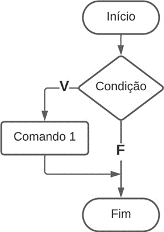
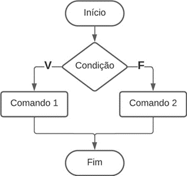
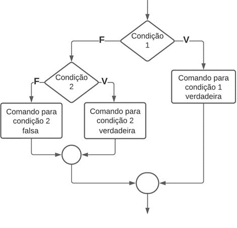
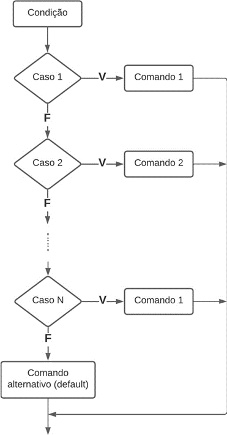

# Aula 1 — Estruturas de Decisão Condicional

## Ponto de Partida

Olá! Até aqui você já estudou os conceitos de algoritmos, a linguagem de programação, os tipos de dados, as variáveis, as constantes, os operadores e as expressões, portanto, agora é o momento de avançar! Nesta seção, você estudará as **estruturas de decisão condicional e seleção**.

> A instituição de ensino que você trabalha está atualmente em meio a um esforço para melhorar suas operações, e lançou o seguinte desafio para você: criar um programa em linguagem C que determine o **salário líquido** de cada colaborador, considerando as deduções do **INSS** e **Imposto de Renda** conforme especificado nas Tabelas 1 e 2 a seguir. Como parte do processo de documentação, ao concluir a compilação do programa, você deve gerar um relatório que inclua o código-fonte.

| Salário de Contribuição (R$) | Alíquota INSS |
|---|:---:|
| Até R$ 1.320,00 | 7,5% |
| De R$ 1.320,01 até R$ 2.571,29 | 9% |
| De R$ 2.571,30 até R$ 3.856,94 | 12% |
| De R$ 3.856,95 a R$ 7.507,49 | 14% |

*Tabela 1 | Descontos INSS.*

| Salário de Contribuição (R$) | Alíquota IR |
|---|:---:|
| Até 1.903,98 | – |
| De 1.903,99 até 2.826,65 | 7,5% |
| De 2.826,66 até 3.751,05 | 15,0% |
| De 3.751,06 até 4.664,68 | 22,5% |
| Acima de 4.664,68 | 27,5% |

*Tabela 2 | Descontos IR.*

Agora é o momento de iniciar esta jornada. Preste muita atenção nas aulas e tenha um excelente estudo!

---

## Vamos Começar!

### Estrutura condicional `if-else`

Ao lidar com determinadas situações para resolver um problema, podemos empregar a instrução **`if`** (em português, "se"), a qual tem a função de tomar uma decisão e criar um desvio no programa, permitindo assim a avaliação de uma condição como verdadeira ou falsa. É importante lembrar que essa instrução pode receber valores em ambas as situações.

Na linguagem de programação C, usamos chaves (`{` e `}`) para delimitar o início e o fim de um bloco de instruções. Na Tabela 3, é ilustrada a **estrutura condicional simples** utilizando um fluxograma juntamente com sua sintaxe em C.



```c
if (condição de teste)
{
    // conjunto de comandos;
}
```

*Tabela 3 | Instrução IF — fluxograma (Início → Condição → V: Comando 1 / F → Fim) e sintaxe em C.*

Agora vamos analisar uma aplicação prática de uma estrutura condicional simples com `if`, em que será realizado um teste lógico no qual, se o resultado for verdadeiro, uma resposta será fornecida; caso contrário, não será exibido nada. No exemplo do Quadro 1, consideramos a situação de um jovem que verifica se está ou não apto a obter a carteira de habilitação.

```c
#include <stdio.h>
int main(){
    float idade;
    printf("Digite sua idade: \n");
    scanf("%f", &idade);
    if (idade>=18)
    {
        printf("Você já pode tirar sua carteira de Habilitação você é maior de 18");
    }
    return 0;
}
```

*Quadro 1 | Exemplo de código com estrutura condicional simples.*

Neste exemplo em particular, o "senão" (`else`) não é levado em conta. Em outras palavras, se a condição não for verdadeira, nenhuma resposta será exibida. Agora, vamos analisar a **estrutura condicional composta**, que complementa nossa condição inicial com o uso do comando `else`, o qual indica "caso contrário". Vamos observar a representação dessa estrutura no fluxograma mostrado na Tabela 4.



```c
if (condição de teste)
{
    /* conjunto de comandos se condição verdadeira */
}
else
{
    /* conjunto de comandos se condição falsa */
}
```

*Tabela 4 | Instrução IF-ELSE — fluxograma (Início → Condição → V: Comando 1 / F: Comando 2 → Fim) e sintaxe em C.*

Vamos analisar outro exemplo para ilustrar a estrutura condicional composta em linguagem C. Veja no Quadro 2 um programa que exibe uma mensagem na tela informando se o valor de um número digitado é positivo ou negativo.

```c
#include <stdio.h>
int main(){
    int num;
    printf ("Digite um número: ");
    scanf ("%d",&num);
    if (num>0) {
        printf ("\n\nO número e positivo\n");
    }
    else {
        printf ("O número e negativo");
    }
    return 0;
}
```

*Quadro 2 | Exemplo de código com estrutura condicional composta.*

> **Nota de revisão:** com a condição `num > 0`, o valor `0` cai no `else` e é exibido como "negativo". Para tratar o zero corretamente seria preciso um terceiro caso (ver estrutura encadeada a seguir) ou usar `num >= 0` se o zero deve contar como positivo, como fez o exercício da Aula 1 da Unidade 1.

### Estrutura condicional encadeada

Vamos examinar o funcionamento da **estrutura condicional encadeada**, também chamada de "**IFs aninhados**". Este tipo de estrutura é um comando `if` que é dependente de outros `if`s e `else`s. Em resumo, um comando `else` sempre estará associado ao comando `if` no seu nível de aninhamento. A Tabela 5 ilustra um dos tipos de fluxogramas que representa uma estrutura condicional encadeada.



```c
if (condição 1)
    // comando;
else if (condição 2)
    // comando;
else if (condição 3)
    // comando;
...
else
    // comando;
```

*Tabela 5 | Instrução IF-ELSE-IF (estrutura condicional encadeada) — fluxograma e sintaxe em C.*

Veja agora um exemplo do uso de uma estrutura condicional aninhada no Quadro 3. Perceba as seguintes características do código com `if-else-if`:

- As condições são avaliadas de cima para baixo.
- Assim que uma condição verdadeira é encontrada, o comando associado a ela é executado.
- O restante das condições não é executado.
- Se nenhuma das condições for verdadeira, o último `else` é executado.

```c
#include <stdio.h>
int main(){
    int num = 10;
    if(num < 100)
        printf("Menor que 100");
    else if(num < 1000)
        printf("Menor que 1000");
    else if(num < 10000)
        printf("Menor que 10000");
    else
        printf("Maior ou igual a 10000");
    return 0;
}
```

*Quadro 3 | Exemplo de código com `if-else-if`.*

---

## Siga em Frente...

### Estrutura condicional de seleção de casos: `switch`

Agora vamos estudar a estrutura condicional de seleção de casos, conhecida como **`switch-case`**. Esta estrutura avalia sucessivamente o valor de uma expressão em relação a uma lista de constantes inteiras ou caracteres (lista de "casos"). Quando o valor é encontrado nesta lista de "casos", o comando correspondente é executado.

É fundamental estar atento a algumas peculiaridades do comando `switch-case`:

- Se nenhum dos valores for encontrado, o comando `default` será executado.
- Os comandos são executados até que o comando `break` seja encontrado.

A Tabela 6 a seguir ilustra o fluxograma e a sintaxe de um comando `switch-case`. Perceba que o uso do comando `break` é destinado a interromper a execução do `switch`. Em outras palavras, ele sai do comando sem executar as instruções subsequentes. Se o comando `break` não for incluído, o programa continua executando os comandos dos casos seguintes até o término do `switch` ou até encontrar um `break`.



```c
switch (variável)
{
    case constante1:
        // conjunto de comandos
        break;

    case constante2:
        // conjunto de comandos
        break;

    ...

    default:
        // conjunto de comandos
}
```

*Tabela 6 | Fluxograma e sintaxe da instrução `switch-case`.*

Vamos agora a um exemplo no Quadro 4. O código aplica uma porcentagem de desconto no valor da compra de acordo com uma opção selecionada.

```c
#include <stdio.h>
int main(){
    char opcao;
    float valor, total;
    printf("\n Digite o valor da compra \n");
    scanf("%f", &valor);
    printf("\n Digite a letra que representa o desconto a ser aplicado:\n");
    printf("\ta - 10%% de desconto\n");
    printf("\tb - 15%% de desconto\n");
    printf("\n Digite sua opção:");
    scanf("%s", &opcao);
    switch(opcao)
    {
        case 'a':
            total = valor - (valor*0.10);
            printf(" \nValor final da compra: R$ %.2f\n", total);
            break;
        case 'b':
            total = valor - (valor*0.20);
            printf(" \nValor final da compra: R$ %.2f\n", total);
            break;
        default:
            printf("opcao invalida\n");
    }
    return 0;
}
```

*Quadro 4 | Exemplo de código utilizando `switch-case`.*

> **Nota de revisão:** dois problemas no código original, mantido acima como está:
> - `scanf("%s", &opcao)` lê uma **string** para dentro de um único `char` — a string ocupa ao menos 2 bytes (letra + `'\0'`), então escreve fora da variável. O correto é `scanf(" %c", &opcao);` (o espaço antes de `%c` descarta o `Enter` que sobrou da leitura anterior).
> - O menu anuncia **15%** para a opção `b`, mas o cálculo usa `0.20` (20%). Um dos dois deveria ser ajustado.

---

## Vamos Exercitar?

Prezado estudante, é hora de aplicar todo o conhecimento adquirido até aqui! Vale lembrar que a sua tarefa era criar um programa em linguagem C que determine o salário líquido de cada colaborador, considerando as deduções do INSS e Imposto de Renda conforme especificado nas Tabelas 1 e 2.

O cálculo das alíquotas do INSS e IR é feito de forma **progressiva**, dividindo o salário de acordo com as faixas e aplicando cada porcentagem na parte específica do salário. Por exemplo: em um salário de 1.500,00, incide 7,5% em cima de 1.320,00 (primeira faixa), e incide 9% em cima de 180,00 (que é o que excede a primeira faixa salarial). Porém, para simplificar os cálculos, vamos resolver este problema de forma **direta**, ou seja, aplicando a porcentagem no salário total. Por exemplo: em um salário de 1.500,00, como ele está entre 1.320,00 e 2.571,29, incide a taxa de 9% sobre todo o salário. O cálculo do IR também não é feito de forma direta, mas para simplificar também vamos aplicar o desconto de forma direta, ou seja, aplicando a porcentagem no salário total.

```c
#include <stdio.h>
int main(){
    float salário, inss, ir, sal_liquido;
    printf("Calculo de Salario Liquido Com desconto do IR e INSS\n\n");
    printf("\nDigite seu salario Bruto\n");
    scanf("%f", &salario);
    // Calcular o INSS
    if ( salario <= 1320)
        inss = salario * 0.075;
    else if ( salario >= 1320 && salario <= 2571.29)
        inss = salario * 0.09;
    else if ( salario >= 2571.30 && salario <= 3856.94)
        inss = salario * 0.12;
    else if ( salario >= 3856.95 && salario <= 7507.49)
        inss = salario * 0.14;
    else
        inss = 1051,04; // teto de contribuição

    //Calcular o IR
    if ( salario <= 1903.98 )
        ir = salario*0;
    else if ( salario >= 1903.99 && salario <= 2826.65)
        ir = salario * 0.075;
    else if ( salario >= 2826.66 && salario <= 3751.05 )
        ir = salario * 0.15;
    else if ( salario >= 3751.06 && salario <= 4664.68 )
        ir = salario * 0.225;
    else if ( salario > 4664.69 )
        ir = salario * 0.275;
    //Calculo do Salario liquido
    sal_liquido = (salario - inss) - ir;
    //Resultados
    printf( "\nDesconto do INSS e: %.2f\n\n", inss);
    printf( "Desconto do imposto de renda e: %.2f\n\n", ir);
    printf( "Salário líquido: %.2f\n\n", sal_liquido);
    return 0;
}
```

*Quadro 5 | Exemplo de código utilizando `if-else-if`.*

> **Nota de revisão:** no material original, a legenda do Quadro 5 dizia "utilizando switch-case", mas o código usa `if-else-if`. Além disso, o código **não compila** como está:
> - a variável é declarada como `salário` (com acento — inválido, ver regras de nomes na Aula 3 da Unidade 1) mas usada como `salario`; declare `float salario, ...`;
> - `inss = 1051,04;` usa **vírgula** como separador decimal. Em C, a vírgula é o *operador vírgula*: a linha atribui `1051` e descarta `04`. O correto é `1051.04`;
> - a última condição do IR (`salario > 4664.69`) deixa de fora salários entre 4.664,68 e 4.664,69 — um `else` simples resolveria;
> - como o `if-else-if` já descarta as faixas anteriores, os testes `salario >= ...` à esquerda do `&&` são redundantes.

> Lembrando que não há uma única resposta correta. Há vários caminhos para se chegar no mesmo resultado! Você poderia utilizar `switch-case`, ou então implementar o cálculo de desconto de INSS e IR da forma completa como é feito atualmente pelo governo. Fica o desafio para você!

---

## Saiba mais

Para entender melhor o conceito de estruturas condicionais e de seleção na linguagem C, sugerimos a leitura do **Capítulo 3 - Testes e Condições**, do livro *Linguagem C*, disponível na Biblioteca Virtual.

> DAMAS, L. **Linguagem C**. 10. ed. Rio de Janeiro: LTC, 2023. cap. 3, p. 51-79.

Também sugerimos a leitura do **Capítulo 4 - Comandos de controle condicional**, do livro *Linguagem C: Completa e Descomplicada*, disponível na Biblioteca Virtual, para complementar os estudos sobre `if` e `else`.

> BACKES, A. **Linguagem C**: completa e descomplicada. 2. ed. Rio de Janeiro: LTC, 2023. cap. 4, p. 67-87.

Para auxiliar no desenvolvimento de programas na linguagem C, uma ótima prática é verificar a documentação da linguagem para entender em detalhes os principais tipos de funções e elementos utilizados. Para isso, sugerimos a consulta da seguinte documentação sempre que achar necessário. Nela você encontra todas as bibliotecas utilizadas na linguagem e como utilizar suas principais funções: **Referência da Linguagem C**.

---

## Referências

- BACKES, A. **Linguagem C**: completa e descomplicada. 2. ed. Rio de Janeiro: LTC, 2023. cap. 4, p. 67-87.
- DAMAS, L. **Linguagem C**. 10. ed. Rio de Janeiro: LTC, 2023. cap. 3, p. 51-79.
- PIVA JUNIOR, D. **Algoritmos e programação de computadores**. 2. ed. Rio de Janeiro: Elsevier, 2019.
