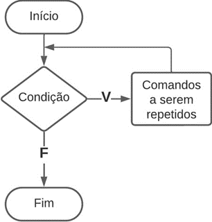

# Aula 2 — Estruturas de Repetição

## Ponto de Partida

Olá! Até aqui você já estudou as estruturas de decisão condicional e seleção, e como podemos aplicá-las em alguns contextos. Agora vamos avançar para as **estruturas de repetição**, mais precisamente, a instrução `while`!

> Muito bem, agora você precisa desenvolver mais um programa em linguagem C para ajudar a instituição de ensino para a qual você trabalha. Foi solicitado o desenvolvimento de um programa que colete as notas de um semestre de uma disciplina específica, no qual o professor deve ter a capacidade de inserir quantas avaliações achar necessário para calcular a nota final do aluno e, por fim, exibir a média final. Apresente o código sem erros em um documento de texto.
>
> Neste caso particular, qual é a melhor abordagem: usar um teste de repetição **no início** ou **no final**? Realize o teste e otimize ao máximo as possíveis soluções para o problema. Boa sorte e tenha uma ótima sessão de programação!

---

## Vamos Começar!

### Estrutura de repetição com teste no início: `while`

Sabemos que podemos utilizar a declaração `if` para tomar decisões e criar desvios dentro de um programa com base em uma condição verdadeira ou falsa. Seguindo essa abordagem, vamos começar nossos estudos sobre laços de repetição com o comando `while`. Atenção que temos dois tipos de laços com `while`:

- Laço com teste no início (`while`).
- Laço com teste no final (`do...while`).

Nesta aula, vamos iniciar os estudos do comando `while` com teste no início!

Quando falamos de laços de repetição, é importante ter em mente que algo será repetidamente executado **enquanto** uma condição verdadeira for atendida e que essa repetição será interrompida somente quando a condição não for mais satisfeita. Uma estrutura de repetição com teste no início não iniciará nenhuma repetição (e os comandos programados dentro dela) sem primeiro verificar uma condição. Ao realizar essa verificação, utilizaremos o comando iterativo `while`, que em português significa "enquanto". Na Tabela 1, é possível observar uma representação simplificada do fluxograma do comando `while` direcionado para o teste no início juntamente com a sintaxe na linguagem C.



```c
while (condição)
{
    // comando 1
    // comando 2
    ...
}
```

*Tabela 1 | Instrução `while` com teste no início — fluxograma (Início → Condição → V: Comandos a serem repetidos ↺ / F → Fim) e sintaxe em C.*

Em certas situações, ao empregar um teste no início, pode ocorrer o que é conhecido como um **loop infinito**, que é quando um processo é executado repetidamente sem fim. Para prevenir esse cenário, os laços precisam de uma **condição de parada**, empregada para determinar o momento de encerrar o ciclo. Para isso, geralmente utilizamos os seguintes recursos:

| Recurso | Descrição |
|---|---|
| **Contador** | uma variável específica utilizada para controlar as repetições quando são especificadas. |
| **Incremento e decremento** | empregados para alterar o número do contador, aumentando ou diminuindo o valor. |
| **Acumulador** | realiza a soma das entradas de dados a cada iteração do ciclo, gerando um total acumulado a ser utilizado ao final do ciclo. |

Agora vamos analisar uma aplicação prática de uma estrutura de repetição `while`, no qual o algoritmo irá calcular a tabuada de um número. Veja o Quadro 1.

```c
#include <stdio.h>
int main(){
    int multiplicador = 0, resultado, num;
    printf("Tabuada de qual numero: ");
    scanf("%d",&num);
    while(multiplicador <= 10)
    {
        resultado = num * multiplicador;
        printf("%d", resultado);
        multiplicador = multiplicador + 1;
    }
    return 0;
}
```

*Quadro 1 | Exemplo de código com `while`.*

Neste exemplo, a variável `multiplicador`, além de ser o multiplicador do número informado para gerar a tabuada, funciona como um **contador** do laço. Ela é incrementada a cada iteração, e quando chega a 11 (a condição de parada é o multiplicador ser maior que 10), a condição do `while` é falsa e o laço é encerrado.

### Estrutura de repetição com teste no fim: `do...while`

Agora, vamos explorar as repetições com teste no final (`do-while`). O loop `do-while` avalia a condição ao final do ciclo, o que significa que os comandos são executados antes de verificar a condição, ou seja, **o bloco de comandos do laço sempre é executado ao menos uma vez**, uma vez que o teste se encontra apenas no final.


```c
do {
    // comando 1
    // comando 2
    ...
} while (condição);
```

*Tabela 2 | Instrução `do...while` — fluxograma e sintaxe em C.*

Neste tipo de laço em particular, o usuário tem a opção de inserir uma nova informação novamente, e esta ser utilizada para controlar a continuação ou a saída do laço. Vejamos o exemplo do Quadro 2, no qual o programa calcula a metragem quadrada de um terreno, usando o teste no final para criar a opção de digitar novos valores sem fechar e abrir novamente o programa.

```c
#include <stdio.h>
int main(){
    float metragem1=0, metragem2=0, resultado=0;
    int resp;
    do {
        printf("Calculo de metros quadrados\n\n");
        printf("Digite a 1a metragem do terreno:");
        scanf("%f", &metragem1);
        printf("\nDigite a 2a metragem do terreno:");
        scanf("%f",&metragem2);
        resultado = (metragem1 * metragem2);
        printf("\n\nTerreno tem = %.2f m2 \n",resultado);
        printf("Digite 1 para continuar ou 2 para sair\n");
        scanf("%d", &resp);
    }while (resp == 1); // condição de saída
    return 0;
}
```

*Quadro 2 | Exemplo de código com `do-while`.*

| | `while` | `do...while` |
|---|---|---|
| **Onde a condição é testada** | no início | no final |
| **Execuções mínimas do bloco** | 0 | 1 |
| **`;` após o `while(...)`** | não | sim |

---

## Siga em Frente...

### Aplicações com estruturas de repetição

Agora vamos complementar nossos estudos sobre laços com alguns exemplos de aplicações.

#### Menu de conta bancária

Primeiro, iremos criar um programa que simula uma interface de conta bancária (uma tela com opções de transações). No exemplo, um programa é desenvolvido para repetir a entrada de dados até que uma condição de término específica seja alcançada, acumulando os valores inseridos. O código está presente no Quadro 3:

```c
#include <stdlib.h>
int main() {
    float soma = 0, valor;
    int opcao;

    do {
        printf("\n Digite uma Operação");
        printf("\n 1. Deposito");
        printf("\n 2. Saque");
        printf("\n 3. Saldo");
        printf("\n 4. Sair");
        printf("\n Qual opcao? ");
        scanf("%d", &opcao);

        switch(opcao) {
            case 1:
                printf("\n Valor do depósito? ");
                scanf("%f", &valor);
                soma = soma + valor;
                break;
            case 2:
                printf("\n Valor do saque? ");
                scanf("%f", &valor);
                soma = soma - valor;
                break;
            case 3:
                printf("\n Saldo atual = R$ %.2f \n", soma);
                break;
            default:
                if(opcao != 4) {
                    printf("\n Opção Inválida! \n");
                }
        }
    } while(opcao != 4);

    printf("Fim das operações. \n\n");
    return 0;
}
```

*Quadro 3 | Exemplo de menu com `do-while` e `switch-case`.*

Note que o laço `do-while` foi empregado para construir o menu do programa, em que a função desejada é executada pelo menos uma vez dentro do loop.

#### Conjectura de Collatz

Um outro exemplo interessante consiste no problema que envolve a aplicação da **conjectura de Collatz**: dado um número natural $n$, se $n$ for par, ele é dividido por 2; se $n$ for ímpar, é multiplicado por 3 e somado 1 ao resultado. Este processo é repetido indefinidamente. A conjectura de Collatz coloca que, seguindo essas duas regras simples, todos os números naturais eventualmente chegarão a 1 (e a sequência 1, 4, 2, 1, 4, 2, 1, 4, 2, 1... se repetirá indefinidamente). Matematicamente, as regras são as seguintes:

$$
n \leftarrow
\begin{cases}
n / 2, & \text{se } n \text{ é par} \\
3n + 1, & \text{se } n \text{ é ímpar}
\end{cases}
$$

Vamos agora criar um programa que calcula todos os números na sequência de Collatz para um dado número de entrada. A sequência de comandos é a seguinte:

1. Solicitar o número para o qual a sequência de Collatz será calculada (um número inteiro positivo maior que 1).
2. Se o número for par, dividi-lo por 2.
3. Se o número for ímpar, multiplicá-lo por 3 e somar 1.
4. Conforme a conjectura de Collatz, a sequência sempre termina em 1, como já explicado anteriormente.

Agora, vamos observar a implementação disso na linguagem C presente no Quadro 4.

```c
#include <stdlib.h>
int main() {
    int num, i;
    printf("\n\nDigite um numero:\n");
    scanf("%d", &num);
    i = 0;
    while (num > 1) {
        if (num % 2 == 0)
            num /= 2;
        else
            num = 3 * num + 1;
        printf("\n%d\n", num);
        i++;
    }
    return 0;
}
```

*Quadro 4 | Sequência de Collatz com `while`.*

> **Nota de revisão:** os Quadros 3, 4 e 5 incluem apenas `<stdlib.h>`, mas usam `printf`/`scanf`, que estão em `<stdio.h>`. Sem `#include <stdio.h>` os compiladores modernos emitem aviso ou erro de "declaração implícita". No original, as legendas dos Quadros 2, 3 e 4 também diziam "estrutura condicional composta"; foram ajustadas para descrever o que cada código faz.

#### Atribuição composta

Alguns valores de variáveis podem ser modificados com base em seus valores anteriores. Para simplificar esse processo, você pode utilizar o que é conhecido como **atribuição composta**, indicando qual operação deve ser realizada. Nesse caso, o operador é colocado à esquerda do sinal de atribuição. Por exemplo, `y *= x + 1` tem o mesmo efeito que `y = y * (x + 1)`, o que evita colocar a variável do lado direito da atribuição. A atribuição composta foi utilizada no algoritmo do Quadro 4, linha 9, simplificando `num = num / 2` por `num /= 2`.

> ⚠️ Atenção na atribuição composta, pois **não pode haver espaço** entre o operador e o sinal de `=`.

| Atribuição composta | Equivale a |
|---|---|
| `x += y` | `x = x + y` |
| `x -= y` | `x = x - y` |
| `x *= y` | `x = x * y` |
| `x /= y` | `x = x / y` |
| `x %= y` | `x = x % y` |

---

## Vamos Exercitar?

Prezado estudante, agora é o momento de abordar a resolução do problema requisitado pela instituição de ensino, para o qual você precisa criar um programa em linguagem C que possa calcular a média de um aluno com base nas avaliações realizadas. Uma das possíveis soluções sugeridas para resolver este problema inclui os seguintes passos:

1. Criar uma variável para inserção das notas.
2. Estabelecer uma condição para a inserção das notas até que um comando de saída seja executado.
3. Após a inserção das notas, inserir uma letra para finalizar o processo e calcular a média do aluno.

A resolução está presente no Quadro 5.

```c
#include <stdlib.h>
#include <string.h>
int main() {
    int avalia, cont = 0, soma = 0;
    char letra;
    float media;
    do {
        printf("Digite uma nota para avaliação: \n");
        scanf("%d", &avalia);
        fflush(stdin); // limpa o buffer de entrada
        cont++;
        soma = soma + avalia;

        printf("Digite qualquer letra para continuar ou 's' para encerrar: \n");
    } while ((letra = getchar()) != 's');

    printf("\n \nQuantidade de avaliação = %d e soma das notas = %d. \n", cont, soma);
    media = soma / cont;
    system("PAUSE");
    return 0;
}
```

*Quadro 5 | Exemplo de solução.*

> **Nota de revisão:** pontos de atenção no código original:
> - `media = soma / cont;` divide dois `int`, então o resultado é truncado antes de ir para o `float` (ex.: notas 7 e 8 → média 7, não 7,5). Use `media = (float) soma / cont;`.
> - a média é calculada mas **nunca é exibida** — falta um `printf("Media = %.2f\n", media);`.
> - `fflush(stdin)` tem comportamento indefinido pelo padrão C (funciona no Windows/MSVC, mas não é portável). Uma alternativa portável é `scanf(" %c", &letra)` no lugar de `getchar()`.
> - falta `#include <stdio.h>` (ver nota anterior); `<string.h>` não é usado.

> Lembrando que não há uma única resposta correta. Há vários caminhos para se chegar no mesmo resultado! Inclusive, como ficaria este programa caso o professor prefira indicar **pesos diferentes** para cada nota antes de calcular a média? Fica como desafio para você!

---

## Saiba mais

Para entender melhor o conceito de estruturas de repetição na linguagem C, sugerimos a leitura do **Capítulo 4 - Laços**, do livro *Linguagem C*, disponível na Biblioteca Virtual.

> DAMAS, L. **Linguagem C**. 10. ed. Rio de Janeiro: LTC, 2023. cap. 4, p. 80-103.

Também sugerimos a leitura do **Capítulo 5 - Comando de repetição**, do livro *Linguagem C: Completa e Descomplicada*, disponível na Biblioteca Virtual, para complementar os estudos sobre `while` e `do-while`.

> BACKES, A. **Linguagem C**: completa e descomplicada. 2. ed. Rio de Janeiro: LTC, 2023. cap. 5, p. 88-108.

Para auxiliar no desenvolvimento de programas na linguagem C, uma ótima prática é verificar a documentação da linguagem para entender em detalhes os principais tipos de funções e elementos utilizados. Para isso, sugerimos a consulta da seguinte documentação sempre que achar necessário. Nela você encontra todas as bibliotecas utilizadas na linguagem e como utilizar suas principais funções: **Referência da Linguagem C**.

---

## Referências

- BACKES, A. **Linguagem C**: completa e descomplicada. 2. ed. Rio de Janeiro: LTC, 2023. cap. 4, p. 67-87.
- DAMAS, L. **Linguagem C**. 10. ed. Rio de Janeiro: LTC, 2023. cap. 3, p. 51-79.
- PIVA JUNIOR, D. **Algoritmos e programação de computadores**. 2. ed. Rio de Janeiro: Elsevier, 2019.
