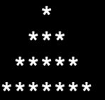
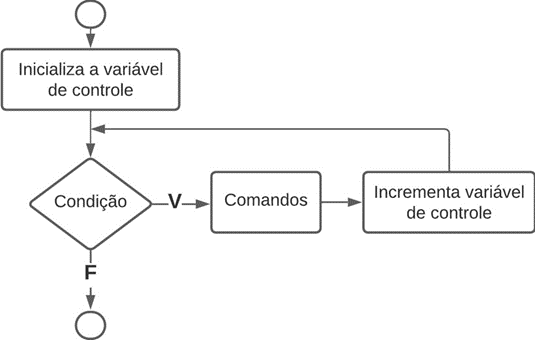

# Aula 3 — Estruturas Determinísticas

## Ponto de Partida

Olá! Até aqui você já estudou as estruturas de repetição `while` e `do-while`! Vamos continuar neste mesmo tema, porém, você será apresentado à estrutura de repetição **`for`**.

> Você é desenvolvedor de software em uma instituição de ensino e foi designado para criar um programa que possa ajudar os alunos a visualizar conceitos matemáticos de forma interativa. A instituição está empenhada em aprimorar o ensino de geometria e quer fornecer aos alunos uma ferramenta prática para entender a construção de formas geométricas simples, como triângulos, no contexto do aprendizado de programação. O objetivo é criar um programa em C que permita aos alunos **inserir o número de linhas desejado e exibir um triângulo na tela** do computador, fornecendo uma representação visual imediata dos conceitos discutidos em sala de aula. Isso não apenas tornará o processo de aprendizagem mais envolvente e prático, mas também ajudará os alunos a compreender melhor os fundamentos da geometria por meio da programação.
>
> O triângulo deve ser desenhado na tela da seguinte forma (nº de linhas = 4):
>
> 

Como você utilizará as estruturas condicionais e de laço de repetição para solucionar este desafio? Vamos ao estudo desta aula que com certeza tudo ficará mais claro!

---

## Vamos Começar!

### Estrutura de repetição determinística: laço `for`

Nesta aula vamos explorar a aplicação da estrutura de repetição `for` (para) em programação, compreendendo seus históricos e usos determinísticos, além de compará-la com estruturas de repetição `while` e `do-while`.

Iniciaremos abordando a repetição com variáveis de controle e como implementar o laço `for`. Este comando, que em português significa "para", é comumente utilizado para iterar uma instrução por um número pré-definido de vezes, ou seja, é possível determinar a quantidade de repetições (e por isso que é chamada de **determinística**!). A Tabela 1 ilustra a representação da estrutura de repetição utilizando o comando `for` juntamente com sua sintaxe na linguagem C.



```c
for (inicialização; condição; incremento)
{
    // comandos
}
```

*Tabela 1 | Instrução `for` — fluxograma (Inicializa a variável de controle → Condição → V: Comandos → Incrementa a variável de controle ↺ / F → sai) e sintaxe em C.*

Ao analisar a sintaxe do comando `for`, você pode observar três expressões distintas separadas por ponto e vírgula. A seguir estão os significados de cada uma delas:

| Expressão | Significado |
|---|---|
| **Inicialização** | instrução de atribuição realizada apenas uma vez, antes do início do loop. |
| **Condição** | condição final. Realiza um teste que determina se a condição é verdadeira ou falsa. Se a condição for verdadeira, o loop continua; se for falsa, o loop é encerrado. |
| **Incremento** | permite incrementar uma repetição com base em um contador específico (variável de controle inicializada no início do laço). Lembrando que o incremento é executado **após** os comandos. |

Agora vamos analisar um exemplo simples da estrutura de repetição `for`, no qual o algoritmo irá calcular a tabuada de um número. Veja o Quadro 1.

```c
#include <stdio.h>
int main(){
    int multiplicador, resultado, num;
    printf("Tabuada de qual numero: ");
    scanf("%d", &num);
    for(multiplicador=10; multiplicador<10; multiplicador++)
    {
        resultado = num * multiplicador;
        printf("%d", resultado);
    }
    return 0;
}
```

*Quadro 1 | Exemplo de código com `for`.*

Neste exemplo, a inicialização é realizada com o comando `multiplicador=10`. Em seguida, a condição final (`multiplicador<10`) é testada. Se for verdadeira, entramos no laço, realizamos os comandos, e o incremento (`multiplicador++`) é executado. Em seguida, a condição final é novamente testada, e o fluxo se repete até que ela seja **falsa**. A lógica do laço `for` muito se assemelha com um `while` com teste no início. E claro que podemos implementar o mesmo trecho de código com `while` e uma variável de controle. A diferença é que aqui controlamos o número de repetições de forma explícita, dentro da própria instrução `for`. Facilita a visualização e o controle.

> **Nota de revisão:** como está no material original, o laço do Quadro 1 **nunca executa**: começa em `multiplicador=10` e a condição `multiplicador<10` já é falsa no primeiro teste. Para gerar a tabuada de 0 a 10 (como no `while` da aula anterior), o correto seria `for(multiplicador=0; multiplicador<=10; multiplicador++)`. O texto original também dizia que o fluxo se repete "até que ela seja verdadeira" — o laço termina quando a condição se torna **falsa**.

---

## Siga em Frente...

### Laço `for` aninhado

A utilização do laço `for` é muito popular e ampla. E uma das formas mais comuns e importantes de utilizá-lo é por meio de **laços aninhados**. Para entendermos melhor, considere a seguinte situação em que queremos calcular e imprimir a tabuada de 1 até 5, uma por linha, da seguinte maneira:

```text
1 2 3 4 5 6 7 8 9 10
2 4 6 8 10 12 14 16 18 20
3 6 9 12 15 18 21 24 27 30
4 8 12 16 20 24 28 32 36 40
5 10 15 20 25 30 35 40 45 50
```

Já sabemos que pelo código do Quadro 1 podemos calcular qualquer uma destas linhas. Então a solução seria repetir todo o bloco do `for` por cinco vezes, mudando o valor da variável `num` antes de cada `for`? Poderia ser! Mas e se quiséssemos imprimir a tabuada de 1 a 10 agora? Precisaríamos repetir o `for` por mais cinco vezes (e sempre alterando estaticamente a variável `num`). Acredito que tenha dado para perceber que estamos repetindo código, e **repetir código não é uma boa prática**. Então vejamos: se estamos repetindo o laço `for` por cinco vezes, isto já caracteriza um laço determinístico com duração de cinco iterações, justamente a definição do laço `for` conforme estudamos! Então podemos colocar o laço `for` que calcula e imprime a tabuada dentro de outro laço que controla o número de vezes que a tabuada será calculada e impressa. Analise o Quadro 2 com o código completo.

```c
#include <stdio.h>
int main(){
    int multi, num;
    for(num = 1; num <= 5; num++){
        for(multi = 1; multi <= 10; multi++){
            printf("%d ", num*multi);
        }
        printf("\n");
    }
    return 0;
}
```

*Quadro 2 | Cálculo da tabuada de 1 a 5 com `for`.*

Veja que o `for` **externo** na linha 4 controla a variável `num`, que ao invés de ser definida pelo usuário, será incrementada dinamicamente de 1 até 5. E a cada iteração deste `for` externo, o `for` **interno** (linha 5) calcula a tabuada com base no valor de `num`. Perceba que ao término do `for` interno, realizamos um `printf` para pular a linha com `\n`, ainda dentro do `for` externo. Isso ocorre para que na próxima iteração, a próxima tabuada seja impressa na linha de baixo.

> Utilizar laços `for` aninhados possui várias aplicações, principalmente na manipulação de **matrizes**, que será o objeto de estudo mais à frente! Portanto, é importante que compreenda este conceito com plenitude para que possa avançar com mais facilidade.

### Exemplos de utilização de laços `for`

Agora vamos expandir nossos estudos sobre laços `for` com alguns exemplos de aplicações.

#### Duas variáveis de controle

Primeiro, vamos verificar que podemos realizar testes em mais de uma variável dentro do mesmo laço `for`, bem como a utilização de decremento ao invés de um incremento a cada iteração. Para isso, considere um programa que mostra uma sequência de números, em que `x` vai de 10 a 0 e `y` vai de 0 a 10. O código está presente no Quadro 3:

```c
#include <stdlib.h>
int main() {
    for(int x = 10, y = 0; x >= 0, y <= 10; x--, y++){
        printf("x = %d, y = %d\n", x,y);
    }
    return 0;
}
```

*Quadro 3 | Laço `for` com duas variáveis de controle.*

Agora vamos discutir o código. Primeiramente, veja que as variáveis `x` e `y` foram declaradas dentro da inicialização do `for`. Esta é uma prática muito comum que agiliza a codificação. Porém, fique atento ao detalhe de que estas variáveis **só existem enquanto este `for` estiver em execução**. Quando ele se encerra, estas variáveis são excluídas (desalocadas) pelo compilador. Na expressão de inicialização, `x` e `y` são inicializados com 10 e 0, respectivamente, e as instruções são separadas por vírgula. Na expressão de condição, temos condições diferentes para as duas variáveis, também separadas por vírgula. Isso quer dizer que o conteúdo do laço só será executado enquanto as duas condições forem verdadeiras ao mesmo tempo. Se uma for falsa, o laço se encerra. E por fim, no incremento, temos o `x` sendo subtraído de 1, e `y` sendo adicionado de 1. Na expressão de incremento podemos realizar qualquer tipo de operação aritmética envolvendo as variáveis de controle, não somente adição ou subtração.

> **Nota de revisão:** a explicação da condição está **incorreta** no material original. Na condição `x >= 0, y <= 10`, a vírgula é o *operador vírgula*: ele avalia `x >= 0`, **descarta** o resultado e usa apenas o valor de `y <= 10`. Neste exemplo as duas condições ficam falsas na mesma iteração, então a saída coincide — mas se `x` começasse em 5, o laço continuaria com `x` negativo. Para exigir que as duas sejam verdadeiras, use `x >= 0 && y <= 10`. Além disso, falta `#include <stdio.h>` nos Quadros 3 e 4.

#### Fatorial

Um outro exemplo interessante consiste no cálculo do **fatorial** de um número. Lembre-se que o fatorial de um número $n$ consiste na multiplicação sucessiva:

$$n! = n \cdot (n-1) \cdot (n-2) \cdot \ldots \cdot 1 \qquad \text{por exemplo,} \quad 5! = 5 \cdot 4 \cdot 3 \cdot 2 \cdot 1 = 120$$

Veja o código do Quadro 4.

```c
#include <stdlib.h>
int main() {
    int n;
    unsigned long long fatorial = 1; // Usamos "unsigned long long" para armazenar números grandes
    printf("Digite um número inteiro positivo: ");
    scanf("%d", &n);
    // Verificação para números negativos
    if (n < 0) {
        printf("O fatorial não está definido para números negativos.\n");
    } else {
        for (int i = 1; i <= n; i++) {
            fatorial *= i;
        }
        printf("O fatorial de %d é %llu\n", n, fatorial);
    }
    return 0;
}
```

*Quadro 4 | Cálculo do fatorial com `for`.*

Neste programa, o usuário insere um número inteiro positivo `n`, que utiliza um laço `for` para calcular o fatorial de `n`. O resultado é armazenado na variável `fatorial`, que é inicializada como 1 para tratar o caso de $0! = 1$. Por exemplo, se o usuário insere 0 (zero), o loop `for` não é executado, e a variável `fatorial` permanece valendo 1. Caso `n` seja maior ou igual a 1, o laço percorre todos os números de 1 a `n` e multiplica-os para calcular o fatorial. O resultado é impresso no final.

---

## Vamos Exercitar?

Prezado estudante, agora é o momento de abordar a resolução do problema requisitado pela instituição de ensino, para o qual você precisa criar um programa em C que permita aos alunos inserir o número de linhas desejado e exibir um triângulo na tela do computador.

A resolução está presente no Quadro 5.

```c
#include <stdio.h>

int main() {
    int linhas, espacos, asteriscos;
    printf("Digite o número de linhas do triângulo: ");
    scanf("%d", &linhas);

    for (int i = 1; i <= linhas; i++) {
        for (espacos = 1; espacos <= linhas - i; espacos++) {
            printf(" ");
        }
        for (asteriscos = 1; asteriscos <= 2 * i - 1; asteriscos++) {
            printf("*");
        }
        printf("\n");
    }

    return 0;
}
```

*Quadro 5 | Exemplo de solução.*

Este programa solicita ao usuário o número de linhas desejado para o triângulo e, em seguida, usa dois loops `for` internos para imprimir o triângulo na tela. O primeiro `for` interno gerencia a quantidade de **espaços em branco** que devem ser impressos, ao passo que o segundo imprime os **asteriscos**.

| Linha `i` | Espaços (`linhas - i`) | Asteriscos (`2*i - 1`) | Saída (4 linhas) |
|:---:|:---:|:---:|---|
| 1 | 3 | 1 | `   *` |
| 2 | 2 | 3 | `  ***` |
| 3 | 1 | 5 | ` *****` |
| 4 | 0 | 7 | `*******` |

---

## Saiba mais

Para entender melhor o conceito de estruturas de repetição na linguagem C, sugerimos a leitura do **Capítulo 4 - Laços**, do livro *Linguagem C*, disponível na Biblioteca Virtual.

> DAMAS, L. **Linguagem C**. 10. ed. Rio de Janeiro: LTC, 2023. cap. 4, p. 80-103.

Também sugerimos a leitura do **Capítulo 5 - Comandos de repetição**, do livro *Linguagem C: Completa e Descomplicada*, disponível na Biblioteca Virtual, para complementar os estudos sobre `while` e `do-while`.

> BACKES, A. **Linguagem C**: completa e descomplicada. 2. ed. Rio de Janeiro: LTC, 2023. cap. 5, p. 88-108.

Para auxiliar no desenvolvimento de programas na linguagem C, uma ótima prática é verificar a documentação da linguagem para entender em detalhes os principais tipos de funções e elementos utilizados. Para isso, sugerimos a consulta da seguinte documentação sempre que achar necessário. Nela você encontra todas as bibliotecas utilizadas na linguagem e como utilizar suas principais funções: **Referência da Linguagem C**.

---

## Referências

- BACKES, A. **Linguagem C**: completa e descomplicada. 2. ed. Rio de Janeiro: LTC, 2023. cap. 4, p. 67-87.
- DAMAS, L. **Linguagem C**. 10. ed. Rio de Janeiro: LTC, 2023. cap. 3, p. 51-79.
- PIVA JUNIOR, D. **Algoritmos e programação de computadores**. 2. ed. Rio de Janeiro: Elsevier, 2019.
