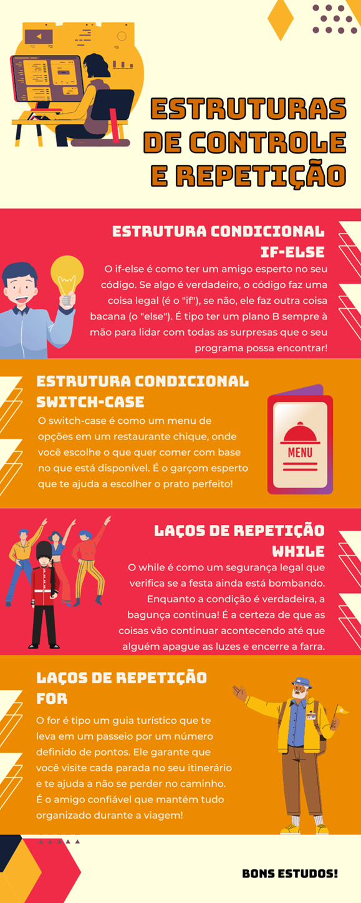

# Aula 5 — Encerramento da Unidade: Estruturas de Controle e Repetição

## Ponto de Chegada

Olá, estudante! Para desenvolver a competência desta Unidade, que é **"conhecer os elementos e componentes que efetuam o processo de desenvolvimento de algoritmos e programação estruturada"**, você deve explorar conceitos fundamentais em programação, concentrando seus estudos em estruturas condicionais e laços de repetição em linguagem C.

### Estruturas condicionais

Comece por compreender a importância das estruturas condicionais, como o `if-else` e o `switch-case`, para direcionar o fluxo do programa com base em condições lógicas. Por meio destas estruturas, você pode tomar decisões com base em diferentes cenários, facilitando o desenvolvimento de lógicas mais complexas em nossos programas.

### Laços de repetição

Além disso, é necessário estudar os laços de repetição para que possa executar blocos de código repetidamente. Explore o `while` e o `do-while`, compreendendo suas aplicações e diferenças no contexto de execução do código. Em particular, o `while` é valioso quando queremos repetir um bloco de código enquanto uma condição é verdadeira, enquanto o `do-while` é ideal para garantir que o bloco de código seja executado pelo menos uma vez, mesmo se a condição for inicialmente falsa.

Além disso, aprofunde sua compreensão do comando `for`. Você deve explorar como esse tipo de laço oferece uma estrutura mais concisa para repetições com um número fixo de iterações, permitindo-nos definir uma condição inicial, uma condição de continuação e uma atualização em um único local.

### Comandos de controle de laços

Por fim, algo importante consiste em aprender os comandos de controle de laços em C, incluindo `break`, `continue` e `goto`.

| Comando | Função |
|---|---|
| `break` | interrompe um laço de repetição prematuramente. |
| `continue` | pula para a próxima iteração do laço. |
| `goto` | desvia o fluxo do programa para uma determinada etiqueta (rótulo), embora seu uso deva ser feito com cautela devido à sua capacidade de complicar a legibilidade do código. |

Com a compreensão desses conceitos fundamentais, você estará "bem equipado" para desenvolver programas mais complexos e eficientes, capazes de lidar com uma variedade de problemas e cenários utilizando estruturas condicionais.

---

## É Hora de Praticar!

### Estudo de Caso: Crescimento populacional com Fibonacci

> Você está trabalhando em um projeto de análise de crescimento populacional e precisa calcular a **sequência de Fibonacci** para prever o número de indivíduos em uma população de coelhos ao longo do tempo. A sequência de Fibonacci é amplamente utilizada em modelagem matemática para representar o crescimento populacional e pode ser útil para prever a expansão de uma população de animais, como os coelhos.
>
> Você deve elaborar um programa em C que, a partir de uma entrada `n`, exiba os `n` primeiros termos da sequência de Fibonacci.
>
> Por exemplo:
>
> - `N = 5` → `0 1 1 2 3`
> - `N = 8` → `0 1 1 2 3 5 8 13`

### Reflita

- Por que o comando `for` é considerado uma estrutura de laço determinístico e como isso difere dos laços de repetição `while` e `do-while`?
- Quais são os possíveis impactos reais do uso indevido dos comandos `break`/`continue`/`goto` na legibilidade e manutenibilidade do código? Como você garantiria um uso apropriado desses comandos em seus programas?

---

## Resolução do Estudo de Caso

O código a seguir apresenta uma sugestão de resultado para o problema:

```c
#include <stdio.h>
int main() {
    int n;
    int primeiro = 0, segundo = 1, proximo;
    printf("Digite o número de termos da sequência de Fibonacci que você deseja calcular: ");
    scanf("%d", &n);
    printf("Sequência de Fibonacci até o termo %d:\n", n);
    for (int i = 0; i < n; i++) {
        if (i <= 1) {
            proximo = i;
        } else {
            proximo = primeiro + segundo;
            primeiro = segundo;
            segundo = proximo;
        }
        printf("%d ", proximo);
    }
    return 0;
}
```

Neste programa, calculamos e imprimimos os primeiros `n` termos da sequência de Fibonacci. Utilizamos um laço de repetição `for` para calcular cada termo com base nos dois termos anteriores e imprimir os valores resultantes. O usuário pode inserir o número de termos desejados, e o programa calculará a sequência correspondente.

| `i` | `primeiro` | `segundo` | `proximo` (impresso) |
|:---:|:---:|:---:|:---:|
| 0 | 0 | 1 | 0 |
| 1 | 0 | 1 | 1 |
| 2 | 1 | 1 | 1 |
| 3 | 1 | 2 | 2 |
| 4 | 2 | 3 | 3 |

*Teste de mesa para `n = 5` (valores de `primeiro` e `segundo` ao final de cada iteração).*

---

## Assimile

O infográfico a seguir ilustra e identifica as estruturas condicionais e de repetição estudadas nesta unidade.



---

## Referências

- BACKES, A. **Linguagem C**: completa e descomplicada. 2. ed. Rio de Janeiro: LTC, 2023.
- CORMEN, T. H. **Desmistificando algoritmos**. 1. ed. Rio de Janeiro: Elsevier, 2014.
- DAMAS, L. **Linguagem C**. 10. ed. Rio de Janeiro: LTC, 2023.
- MENÉNDEZ, A. **Simplificando algoritmos**. 1. ed. Rio de Janeiro: LTC, 2023.
- PIVA JUNIOR, D. **Algoritmos e programação de computadores**. 2. ed. Rio de Janeiro: Elsevier, 2019.
