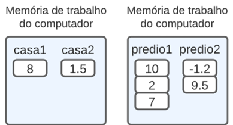
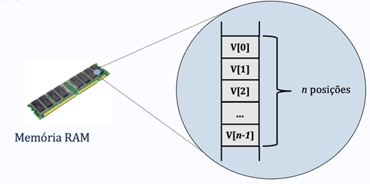

# Aula 1 — Vetores

## Ponto de Partida

Olá! Até aqui você já estudou os conceitos fundamentais de algoritmos e linguagem de programação, como os tipos de dados, as variáveis, as constantes, os operadores e as expressões, e as estruturas de controle. Agora vamos avançar um pouco mais em nossos estudos e introduzir uma estrutura de dado muito importante e amplamente utilizada: o **vetor**!

> A instituição de ensino que você trabalha está com um problema na digitação dos CPFs no momento do cadastro dos alunos. A questão é que, quando o usuário digita o CPF com pontos e traço, a indexação e a busca são dificultadas, ou seja, pode acontecer um erro de autenticidade. Para resolver esse impasse, você deverá desenvolver um programa para **padronizar o formato do CPF, eliminando os pontos e traços** digitados pelos usuários.

E agora, como resolver essa situação? Garanto que ao final desta aula você conseguirá encontrar a solução mais eficiente para esta questão! Agora vamos lá, preste muita atenção e tenha um excelente estudo!

---

## Vamos Começar!

### Motivação e definição

Conforme estudado anteriormente, as variáveis têm a função de reter dados na memória de execução e estes podem ser de diversos tipos (como números inteiros, decimais, caracteres ou booleanos), conhecidos como **tipos primitivos**. Você já sabe que podemos armazenar informações como a idade de uma pessoa em uma variável do tipo inteiro, a temperatura em uma variável de ponto flutuante e assim por diante. No entanto, surge uma questão: imagine que você precisa criar um sistema capaz de lidar com múltiplas medições de temperatura de um dispositivo, por exemplo. Seria viável criar quinze variáveis do tipo `float` para armazenar cada uma delas?

Com o conhecimento atual, isso exigiria a criação de quinze variáveis individuais, o que não apenas pode tornar o código mais extenso, mas também não é considerado uma prática de programação eficiente. A solução mais adequada para armazenar diversos valores dentro de um mesmo contexto é o uso de **variáveis compostas**, ou também chamadas de **estruturas de dados homogêneas**. Esse método possibilita armazenar vários valores em uma única estrutura.

Ao alocar uma variável primitiva, como um número inteiro (`int`), é reservado um espaço de 4 bytes na memória, ou seja, um bloco é reservado e seu endereço é utilizado para armazenar e recuperar os dados. Ao alocar uma variável composta, como um conjunto de números inteiros, um grupo de blocos de 4 bytes é reservado. O tamanho desse conjunto (se será 1, 2, 3, ... ou N blocos) é especificado pelo programador.

Para compreender as variáveis compostas, podemos estabelecer uma comparação entre **casas**, **prédios** e as próprias variáveis. Uma casa possui uma identificação única, composta por elementos como rua, número, bairro, cidade, estado e CEP. Podemos equiparar uma casa a uma variável primitiva, que armazena apenas um único valor em seu endereço específico. Por outro lado, um prédio possui um endereço que compartilha os mesmos parâmetros que uma casa, entretanto, nesse mesmo endereço estão instaladas múltiplas residências. Similarmente, as variáveis compostas são capazes de armazenar diversos valores em um mesmo endereço. Esses conceitos são exemplificados na Figura 1, onde à esquerda, a variável `casa1` armazena o valor 8 e a variável `casa2` armazena o valor -1.5; na representação à direita, a variável `predio1` contém três valores inteiros, enquanto a variável `predio2` armazena dois valores decimais.



*Figura 1 | Variáveis primitivas e variáveis compostas.*

Dentro do contexto das variáveis compostas, nos quais múltiplos valores são armazenados em um único endereço, surge a questão de como diferenciá-los uns dos outros. Assim como os apartamentos em um prédio são identificados por números, as variáveis compostas são identificadas por meio de **índices**. Dessa forma, ao contrário das variáveis primitivas, as variáveis compostas possuem um endereço na memória e índices que especificam seus subespaços.

As variáveis compostas derivam dos tipos primitivos e podem ser categorizadas como:

| Classificação | Significado |
|---|---|
| **Homogêneas** | armazenam valores do mesmo tipo primitivo. |
| **Heterogêneas** | armazenam valores de diferentes tipos. |
| **Unidimensionais** | uma única dimensão (uma coluna e N linhas, ou uma linha e N colunas). |
| **Multidimensionais** | duas ou mais dimensões (ex.: linhas e colunas). |

Os exemplos ilustrados na Figura 1, representados pelas variáveis compostas `predio1` e `predio2`, são considerados **homogêneos**, uma vez que a primeira armazena exclusivamente valores do tipo inteiro, enquanto a segunda contém exclusivamente valores decimais. Além disso, ambas são classificadas como **unidimensionais**, o que implica que elas seguem a estrutura de uma tabela com apenas uma coluna e N linhas (esse conceito seria o mesmo se considerássemos uma estrutura semelhante a uma tabela com uma linha e N colunas). Esse tipo de estrutura de dados é comumente conhecido como **vetor** ou **array**.

### Inicialização e utilização

A criação de um vetor assemelha-se à criação de uma variável primitiva, com a adição de um número entre colchetes que indica o tamanho desse vetor (ou a quantidade de blocos). Assim, a sintaxe é a seguinte:

```c
<tipo> <nome_do_vetor>[tamanho];
```

Vamos criar dois vetores em C para armazenar informações sobre a idade e a altura (em metros) de 3 indivíduos. Observando o código apresentado no Quadro 1, na linha 3, é definido o vetor `idade`, que é do tipo inteiro e tem capacidade para armazenar três valores. Na linha 4, o vetor `altura` é criado e inicializado com valores específicos. Ao declarar os valores no momento da criação do vetor, os elementos são listados entre chaves e separados por vírgula. Nas linhas de 5 a 7, os valores armazenados no vetor `altura` são impressos, acessando-os pelos seus respectivos índices.

```c
#include <stdio.h>
int main(){
    int idade[3];
    float altura[3] = {1, 1.5, 1.7};
    printf("\n Vetor altura[0] = %d",altura[0]);
    printf("\n Vetor altura[1] = %d",altura[1]);
    printf("\n Vetor altura[2] = %d",altura[2]);
    return 0;
}
```

*Quadro 1 | Exemplo de criação e inicialização de vetores.*

> **Nota de revisão:** o vetor `altura` é `float`, mas o código original imprime com `%d` (inteiro). Isso é comportamento indefinido e na prática exibe valores sem sentido. O especificador correto é `%f` (ou `%.2f`).

Cada elemento contido em um vetor é acessado por meio de seu índice, que, na maioria das linguagens de programação, **sempre se inicia em zero**. No código apresentado no Quadro 1, por exemplo, na linha 5, a expressão `altura[0]` é utilizada para imprimir o primeiro valor, `altura[1]` para imprimir o segundo e `altura[2]` para imprimir o terceiro. O índice é usado tanto para leitura quanto para escrita. Por exemplo, podemos atribuir valores ao vetor `idade` da seguinte maneira:

```c
idade[0] = 10;
idade[1] = 18;
idade[2] = 32;
```

Para facilitar a compreensão, observe a representação esquemática do vetor `idade` na memória, conforme ilustrado na Figura 2. O valor associado a um determinado índice é crucial para a posição do elemento no vetor. É importante destacar que **um vetor com N posições terá seus índices variando de 0 até N-1**. No caso do vetor `idade` com capacidade para 3 elementos, os índices variam de 0 até 2.



*Figura 2 | Vetor `idade`.*

Geralmente, os dados que serão utilizados são inseridos pelo usuário ou obtidos de alguma fonte de dados. Para armazenar um valor inserido pelo usuário em um vetor, é comum usar a função `scanf()`. No entanto, é crucial especificar em qual posição do vetor o valor deve ser armazenado. Por exemplo, se desejarmos guardar uma idade inserida pelo usuário no vetor, o processo seria como segue:

```c
printf("Digite uma idade: ");
scanf("%d", &idade[1]);
```

Neste caso, o valor seria armazenado no índice 1 do vetor, o que corresponde ao segundo bloco, considerando que o primeiro é o bloco zero.

> Vale ressaltar que um vetor é uma **estrutura de dados estática**, o que significa que seu tamanho deve ser definido no momento da criação pelo programador e não pode ser alterado durante a execução do programa. Além disso, ao criar um vetor com N posições, nem todas as posições precisam ser utilizadas. No entanto, é importante ter em mente que quanto maior o tamanho do vetor, mais espaço será reservado na memória de trabalho.

Outra questão importante relacionada com a criação de um vetor está relacionada com o fato do compilador apenas "reservar" o espaço de memória pedido, sem colocar nenhum valor nele. Isso significa que o vetor conterá inicialmente uma seleção "aleatória" de valores, que chamamos de **"lixo"** (provavelmente que sobraram da execução de algum programa que usou aquele espaço, exatamente como ocorria para as variáveis comuns).

---

## Siga em Frente...

### Vetores de caracteres: strings

Vamos começar com uma pergunta: como é constituída uma palavra? Por uma sequência de caracteres, correto? Já estabelecemos que o caractere é um tipo primitivo em linguagens de programação. Considerando que uma palavra é essencialmente uma cadeia de caracteres, podemos concluir que ela, na verdade, é um vetor de caracteres. Na terminologia da programação, um vetor de caracteres é comumente referido como **"string"**.

A declaração de uma string em C segue a seguinte estrutura:

```c
char <variavel>[tamanho];
```

Por exemplo:

```c
char nome[16];
char sobrenome[31];
char frase[101];
```

Ao criar uma string em C, é importante observar o tamanho da string, pois a última posição é reservada para o caractere **`'\0'`**, que indica o final da sequência. Portanto, a string `nome[16]` possui 15 espaços disponíveis para serem preenchidos (índices de 0 a 14).

A atribuição de valores a uma string pode ser feita no momento da declaração de três maneiras: (i) inserindo cada caractere entre chaves, separados por vírgula (similar aos outros tipos de vetores); (ii) atribuindo a palavra ou frase entre aspas; e (iii) atribuindo a palavra ou frase entre aspas e entre chaves. Por exemplo:

```c
char nome[16] = {'J','o','a','o'};
char sobrenome[31] = "Alberto Gomes";
char frase[101] = {"Disciplina de Algoritmos"};
```

Diversas funções são utilizadas para a leitura e impressão de strings em C. Estudaremos duas delas.

#### `scanf()` com `%s`

A primeira é a função já conhecida, `scanf()`, que agora é usada com o código de controle `%s` para indicar que uma string será armazenada. Portanto, para armazenar um nome digitado pelo usuário, utilizamos o seguinte formato:

```c
char nome[16];
printf("\n Digite um nome:");
scanf("%s", nome);
printf("\n Nome digitado: %s", nome);
```

É importante observar que, nesse caso, o operador `&` não é obrigatório na função `scanf()` — o nome do vetor já representa o endereço do seu primeiro elemento.

Essa forma de atribuição possui uma limitação: **somente é possível armazenar palavras simples, e não compostas**. Isso ocorre porque a função `scanf()` interrompe a atribuição ao encontrar um espaço em branco.

#### `fgets()`

Para contornar essa limitação, uma opção é utilizar a função `fgets()`, que também faz parte da biblioteca padrão `<stdio.h>`. Essa função é utilizada com a seguinte sintaxe:

```c
fgets(destino, tamanho, fluxo);
```

| Parâmetro | Significado |
|---|---|
| `destino` | nome da string que será utilizada para o armazenamento. |
| `tamanho` | deve ser o mesmo declarado para a string. |
| `fluxo` | origem da string; no caso em questão, sempre virá do teclado, e, portanto, utilizamos `stdin` (entrada padrão). |

Segue um exemplo prático:

```c
char frase[101];
printf("\n Digite uma frase:");
fflush(stdin);
fgets(frase, 101, stdin);
printf("\n Frase digitada: %s", frase);
```

Observa-se que antes de utilizar o `fgets()`, empregamos a função `fflush(stdin)`. Embora não seja obrigatório, essa prática assegura a limpeza da entrada padrão (`stdin`) antes do armazenamento.

> 💡 Diferente do `scanf("%s")`, o `fgets()` também guarda o `'\n'` do Enter no final da string (se couber) e nunca escreve além de `tamanho` posições — por isso é mais seguro.

---

## Vamos Exercitar?

Prezado estudante, é hora de aplicar todo o conhecimento adquirido até aqui! Para resolver a situação, será necessário implementar um programa em C que solicite ao usuário que insira o CPF no formato `NNN.NNN.NNN-NN` e, em seguida, elimine os pontos e os traços para criar um CPF sem formatação. Dessa forma, o sistema poderá processar e armazenar os CPFs de forma padronizada, facilitando a indexação e busca. Ainda, você poderá usar vetores com laços de repetições para eliminar os pontos e traço, além do comando `continue` dentro da estrutura de repetição. Veja no Quadro 2 uma das possíveis soluções:

```c
#include <stdio.h>
int main(){
    char cpf1[15]; // Vetor CPF formatado com pontos e traço
    char cpf2[11] = ""; // Vetor CPF sem formatação, inicializado como vazio
    int i = 0, n = 0;

    printf("Digite seu CPF na forma NNN.NNN.NNN-NN: \n");
    scanf("%s", cpf1);

    // Laço para percorrer todo o vetor cpf1
    // Remover pontos e traços e armazenar apenas os dígitos
    for (i = 0; i < 14; i++) {
        if (cpf1[i] == '.' || cpf1[i] == '-') {
            continue; // Ignora pontos e traços
        } else {
            // Armazena apenas os dígitos em cpf2
            cpf2[n] = cpf1[i];
            n++; // controla o tamanho do cpf2
        }
    }
    // Imprime o CPF formatado sem pontos e traços
    printf("\n\nCPF formatado = %s", cpf2);
    return 0;
}
```

*Quadro 2 | Código de resolução.*

> **Nota de revisão:** o CPF sem formatação tem 11 dígitos, então `cpf2` precisa de **12** posições (11 dígitos + `'\0'`). Com `char cpf2[11]`, os 11 dígitos ocupam o vetor inteiro, não sobra espaço para o terminador, e o `printf("%s", cpf2)` continua lendo memória além do fim do vetor. Declare `char cpf2[12] = "";`. Já `cpf1[15]` está correto (14 caracteres + `'\0'`).

> Lembrando que não há uma única resposta correta. Há vários caminhos para se chegar no mesmo resultado! Modifique e tente otimizar ao máximo os seus programas.

---

## Saiba mais

Para entender melhor o conceito de vetores em C, sugerimos a leitura do **Capítulo 6 - Vetores**, do livro *Linguagem C*, disponível na Biblioteca Virtual.

> DAMAS, L. **Linguagem C**. 10. ed. Rio de Janeiro: LTC, 2023. cap. 6, p. 129-151.

Também sugerimos a leitura do **Capítulo 7 - Arrays de caracteres - strings**, do livro *Linguagem C: Completa e Descomplicada*, disponível na Biblioteca Virtual, para complementar os estudos sobre strings em C.

> BACKES, A. **Linguagem C**: completa e descomplicada. 2. ed. Rio de Janeiro: LTC, 2023. cap. 7, p. 130-139.

Para auxiliar no desenvolvimento de programas na linguagem C, uma ótima prática é verificar a documentação da linguagem para entender em detalhes os principais tipos de funções e elementos utilizados. Para isso, sugerimos a consulta da seguinte documentação sempre que achar necessário. Nela você encontra todas as bibliotecas utilizadas na linguagem e como utilizar suas principais funções: **Referência da Linguagem C**.

---

## Referências

- BACKES, A. **Linguagem C**: completa e descomplicada. 2. ed. Rio de Janeiro: LTC, 2023. cap. 4, p. 67-87.
- DAMAS, L. **Linguagem C**. 10. ed. Rio de Janeiro: LTC, 2023. cap. 3, p. 51-79.
- PIVA JUNIOR, D. **Algoritmos e programação de computadores**. 2. ed. Rio de Janeiro: Elsevier, 2019.
