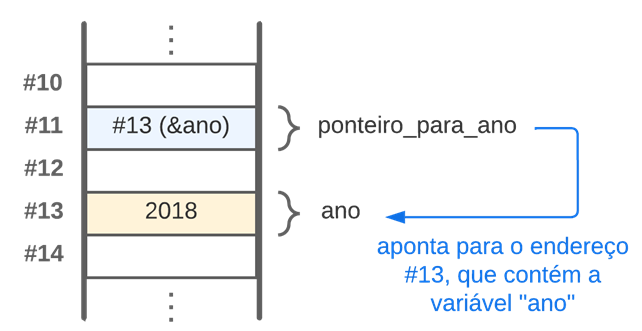
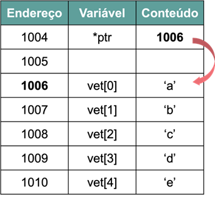
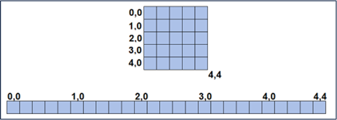

# Aula 4 — Ponteiros

## Ponto de Partida

Olá! Nesta aula você aprenderá a trabalhar com um recurso muito poderoso em linguagens de programação: os **ponteiros**!

> A instituição de ensino que você trabalha está promovendo um evento com uma série de desafios e minicursos aos estudantes de tecnologia. Um grupo de alunos participantes chegou até você com uma dúvida sobre um exercício envolvendo ponteiros em C: **escrever um programa que declare um vetor de inteiros e um ponteiro para inteiros. Em seguida, associar o ponteiro ao vetor e somar mais dez (+10) a cada posição do vetor usando o ponteiro com aritmética de ponteiros.** Como você pode ajudá-los a terminar o desafio e, principalmente, a compreender o funcionamento dos ponteiros?

Nesta aula vamos aprender o que é um ponteiro e como ele pode ser utilizado! Preste muita atenção e tenha um excelente estudo!

---

## Vamos Começar!

### Conceitos básicos de ponteiros

Além das variáveis primitivas e compostas, há um tipo de variável de extrema importância na linguagem C: os **ponteiros**. Por meio dos ponteiros, é possível manipular variáveis e outros recursos utilizando seus endereços de memória. Assim, existe uma relação intrínseca entre um ponteiro e os endereços de memória, o que justifica o uso frequente desse tipo de variável, especialmente para a manipulação de memória, proporcionando suporte às rotinas de alocação dinâmica.

Variáveis do tipo ponteiro são empregadas **exclusivamente para armazenar endereços de memória**. O acesso à memória é realizado utilizando dois operadores:

| Operador | Nome | Uso |
|:---:|---|---|
| `*` | asterisco | usado para **declarar** o ponteiro (e, fora da declaração, para acessar o conteúdo apontado). |
| `&` | operador de referência | usado para **obter o endereço** de memória de uma variável. |

A sintaxe padrão para declarar um ponteiro é:

```c
<tipo> *<nome_do_ponteiro>;
```

Por exemplo:

```c
int *idade;
```

Neste exemplo, um ponteiro do tipo inteiro é criado, o que implica que ele irá "apontar" para o endereço de uma variável desse tipo. A criação de um ponteiro só tem significado se estiver associada a algum endereço de memória. Para isso, utiliza-se a seguinte sintaxe:

```c
int ano = 2018;
int *ponteiro_para_ano = &ano;
```

Na primeira linha, declaramos uma variável inteira com o valor 2018, e na segunda linha associamos um ponteiro chamado `ponteiro_para_ano` ao endereço da variável `ano`. Agora, tudo o que for atribuído à variável `ano` será visível também pelo ponteiro (por meio de `*ponteiro_para_ano`). A Figura 1 ilustra de forma simplificada o esquema de uma variável com um ponteiro na memória. É importante observar que **o conteúdo do ponteiro é o endereço da variável para a qual ele aponta**, e que ele também ocupa espaço na memória.



*Figura 1 | Representação de um ponteiro na memória do computador (os endereços de variáveis são fictícios).*

Agora, vamos analisar como imprimir as informações de um ponteiro.

| O que imprimir | Código | Especificador |
|---|---|:---:|
| Conteúdo do ponteiro (endereço apontado) | `printf("Conteudo do ponteiro: %p", ponteiro_para_ano);` | `%p` |
| Conteúdo da variável apontada | `printf("Conteudo da variavel pelo ponteiro: %d", *ponteiro_para_ano);` | `%d` |
| Endereço do próprio ponteiro | `printf("Endereco do ponteiro: %p", &ponteiro_para_ano);` | `%p` |

O especificador de formato `%p` é usado para imprimir o endereço de memória armazenado em um ponteiro, em hexadecimal (também poderia ser utilizado `%x`). A diferença entre o primeiro e o segundo comando é o **asterisco** antes do nome do ponteiro, que acessa o conteúdo da variável apontada (operação chamada de *desreferência*).

> **Nota de revisão:** `%x` espera um `unsigned int` (4 bytes), enquanto um ponteiro em sistemas de 64 bits ocupa 8 bytes — imprimir um ponteiro com `%x` é comportamento indefinido e pode truncar o endereço. Use sempre `%p`.

### Operações com ponteiros

#### O valor `NULL`

Um ponto importante a ser destacado é que um ponteiro pode ter um valor especial chamado **`NULL`**, que é basicamente o "zero" para ponteiros. Este valor é usado para indicar explicitamente que o ponteiro não está apontando para nenhum endereço de memória válido.

A constante `NULL` é definida em muitas bibliotecas padrão de C e é frequentemente usada para inicializar ponteiros ou para verificar se um ponteiro está apontando para algo significativo antes de acessar seu conteúdo. Por exemplo:

```c
int *ponteiro = NULL;
if (ponteiro == NULL) {
    printf("O ponteiro está apontando para NULL\n");
}
```

Além disso, o valor `NULL` é amplamente utilizado na criação de estruturas de dados complexas, como **listas ligadas**. Nas listas ligadas, o valor `NULL` é frequentemente usado para indicar o fim da lista, indicando que não há mais nós a serem percorridos. Isso ajuda a controlar e gerenciar a estrutura da lista e a evitar erros de acesso à memória não alocada ou inválida. Ainda, o uso do valor especial `NULL` para ponteiros desempenha um papel crucial na segurança e na prevenção de erros em programas que lidam com alocação de memória dinâmica e estruturas de dados complexas.

#### Aritmética de ponteiros

É importante destacar que, em C, apenas duas operações aritméticas podem ser utilizadas com ponteiros: **adição** e **subtração**. Essas operações são especialmente úteis ao trabalhar com vetores e estruturas de dados que são representadas em memória de forma contígua (sequencial). Considere `p` uma variável do tipo ponteiro, e veja a seguir alguns exemplos de operações:

```c
p++;              // avança o ponteiro para o próximo elemento
p--;              // recua o ponteiro para o elemento anterior
(*p)++;           // incrementa o conteúdo da variável apontada pelo ponteiro p
*p = (*p) * 10;   // multiplica o conteúdo da variável apontada pelo ponteiro p por 10
```

> **Nota de revisão:** o material original comentava `p++` como "soma +1 no endereço armazenado no ponteiro". Na verdade, `p++` soma **`sizeof(*p)` bytes** ao endereço: se `p` é `int *` (4 bytes), o endereço avança 4. É justamente isso que faz `p++` chegar ao próximo elemento de um vetor, qualquer que seja o tipo.

A aritmética de ponteiros permite que você navegue por elementos de um vetor ou matriz de maneira eficiente. Por exemplo, suponha que você tenha um vetor de inteiros e um ponteiro para o primeiro elemento desse vetor. Você pode usar a aritmética de ponteiros para acessar elementos específicos do vetor. Aqui estão alguns exemplos:

```c
int numeros[5] = {10, 20, 30, 40, 50};
int *ponteiro = &numeros[0];

// Acessando o primeiro elemento
int primeiro_elemento = *ponteiro;

// Acessando o terceiro elemento
int terceiro_elemento = *(ponteiro + 2);

// Avançando para o próximo elemento
ponteiro++; // Agora aponta para o segundo elemento

// Voltando um elemento
ponteiro--; // Volta para o primeiro elemento
```

A aritmética de ponteiros é flexível e útil ao trabalhar com vetores, matrizes e estruturas de dados contíguas na memória. No entanto, é importante observar que **você só pode somar ou subtrair valores inteiros a partir de um ponteiro**. Isso é coerente com a ideia de que um ponteiro representa um endereço de memória, e a aritmética de ponteiros é usada para navegar de maneira precisa através desses endereços. O uso de outros tipos de dados na aritmética de ponteiros pode levar a comportamento indefinido e erros no programa. Portanto, é importante garantir que as operações de ponteiro estejam alinhadas com os tipos de dados apropriados.

#### Comparação de ponteiros

Além das operações de adição e subtração, os operadores relacionais de **igualdade** (`==`) e **desigualdade** (`!=`) podem ser utilizados para comparar se dois ponteiros apontam para o mesmo endereço de memória ou não. Isso é útil ao verificar se dois ponteiros estão apontando para o mesmo local de armazenamento ou para locais diferentes na memória. Por exemplo:

```c
int a = 5;
int *ptr1 = &a;
int *ptr2 = &a;
if (ptr1 == ptr2) {
    printf("Os ponteiros apontam para o mesmo endereço de memória.\n");
} else {
    printf("Os ponteiros apontam para endereços de memória diferentes.\n");
}
```

Quanto aos operadores de comparação (`>`), (`<`), (`>=`) e (`<=`), você pode comparar ponteiros para determinar qual deles aponta para um endereço de memória mais alto ou mais baixo. Essas comparações são úteis para estabelecer a ordem de elementos em uma sequência de memória. No entanto, tenha em mente que **essa comparação só faz sentido se os ponteiros apontarem para o mesmo bloco de memória** (por exemplo, elementos de um vetor) para que a comparação de endereços seja significativa. Por exemplo:

```c
int numeros[5] = {10, 20, 30, 40, 50};
int *ptr1 = &numeros[2];
int *ptr2 = &numeros[4];
if (ptr1 < ptr2) {
    printf("ptr1 aponta para um endereço mais baixo do que ptr2.\n");
}
```

---

## Siga em Frente...

### Ponteiros para estruturas de dados

Além de podermos criar ponteiros para variáveis comuns, podemos também criá-los para variáveis compostas, como os vetores, as matrizes e as estruturas.

#### Ponteiro para struct

Começando com as structs, ponteiros para estruturas são escritos de forma similar a uma variável comum. A principal diferença é o uso do **operador `->`** para acesso aos membros. Veja no Quadro 1 um exemplo de programa em C que trata esta questão.

```c
#include <stdio.h>

struct aluno{
    int mat;
    float nota;
};

int main(){
    struct aluno joao;
    struct aluno *ptr; // declaração do ponteiro para struct
    // Inicialização da struct declarada
    joao.mat = 1000;
    joao.nota = 8.5;
    //inicialização do ponteiro ptr
    ptr = &joao;

    printf("%d", ptr->mat);  //impressão do atributo mat através do ponteiro
    printf("%f", ptr->nota); //impressão do atributo nota através do ponteiro
    return 0;
}
```

*Quadro 1 | Exemplo de ponteiro para struct.*

> 💡 `ptr->mat` é apenas uma forma mais legível de escrever `(*ptr).mat`. Os parênteses são necessários porque o `.` tem precedência maior que o `*`.

#### Ponteiro para vetor

Sabemos que vetores são conjuntos de dados do mesmo tipo dispostos **contiguamente** (um depois do outro) na memória. No momento da declaração de um vetor, informamos ao computador para reservar uma certa quantidade de memória a fim de armazenar os elementos do vetor de forma sequencial. Desta maneira, o nome do vetor funciona como um ponteiro que aponta para o começo da sequência de elementos do vetor na memória. Portanto, podemos inicializar uma variável ponteiro com o endereço de início do vetor. O Quadro 2 apresenta um exemplo de ponteiro para vetor e a Figura 2 ilustra este procedimento na memória.

```c
#include <stdio.h>

int main(){
    char *ptr;
    int i;
    char vet[5] = {'a', 'b', 'c', 'd', 'e'};
    ptr = vet; // A variavel ponteiro ptr aponta para o primeiro elemento do vetor
    for (i=0; i < 5; i++){
        // conteudo do vetor acessado pela variavel
        printf("\n Vet[%d] = %c", i, vet[i]);
        // conteudo do vetor acessado pelo ponteiro
        printf("\n ptr = %c", *ptr);
        ptr++;
    }
    return 0;
}
```

*Quadro 2 | Exemplo de ponteiro para vetor.*

> **Nota de revisão:** no original, a legenda do Quadro 2 dizia "ponteiro para struct" e faltava fechar as aspas em `printf("\n Vet[%d] = %c, i, vet[i]);`; ambos foram corrigidos acima.



*Figura 2 | Representação de um ponteiro para vetor na memória do computador (os endereços de variáveis são fictícios).*

#### Ponteiro para matriz

Agora em relação às matrizes, apesar de terem mais de uma dimensão, elas são dispostas **linearmente** na memória e, por isso, podem ser manipuladas com ponteiros semelhantes aos vetores. Veja na Figura 3 como uma matriz 5x5 é disposta de forma linear na memória.



*Figura 3 | Matriz 5x5.*

> 💡 Em C as matrizes são armazenadas **linha por linha** (*row-major*): o elemento `m[i][j]` de uma matriz com `C` colunas está na posição `i * C + j` a partir do início.

---

## Vamos Exercitar?

Prezado estudante, é hora de aplicar todo o conhecimento adquirido até aqui! Lembre-se de que você precisa escrever um programa que declare um vetor de inteiros e um ponteiro para inteiros. Em seguida, associar o ponteiro ao vetor e somar mais dez (+10) a cada posição do vetor usando o ponteiro com aritmética de ponteiros. No Quadro 3, segue a solução do desafio.

```c
#include <stdio.h>

int main() {
    int vetor[5] = {1, 2, 3, 4, 5};
    int *ponteiro = vetor; // Associando o ponteiro ao vetor

    for (int i = 0; i < 5; i++) {
        *(ponteiro + i) += 10;
    }

    printf("Elementos do vetor após adicionar 10:\n");
    for (int i = 0; i < 5; i++) {
        printf("%d ", vetor[i]);
    }
    printf("\n");

    return 0;
}
```

*Quadro 3 | Exemplo de solução.*

**Saída:** `11 12 13 14 15`

> Lembrando que não há uma única resposta correta e você pode fazer de maneiras diferentes e ainda chegar ao mesmo resultado!! Bons estudos!

---

## Saiba mais

Para entender melhor o conceito de ponteiros em C, sugerimos a leitura do **Capítulo 8 - Ponteiros (Pointers)**, do livro *Linguagem C*, disponível na Biblioteca Virtual.

> DAMAS, L. **Linguagem C**. 10. ed. Rio de Janeiro: LTC, 2023. cap. 8, p. 174-202.

Também sugerimos a leitura do **Capítulo 10 - Ponteiros**, do livro *Linguagem C: Completa e Descomplicada*, disponível na Biblioteca Virtual, para complementar os estudos sobre ponteiros em C.

> BACKES, A. **Linguagem C**: completa e descomplicada. 2. ed. Rio de Janeiro: LTC, 2023. cap. 10, p. 194-212.

A fim de ampliar o conhecimento nesta temática, sugerimos a leitura do **Capítulo 11 - Alocação dinâmica**, do livro *Linguagem C: Completa e Descomplicada*, disponível na Biblioteca Virtual. Nele você estudará os conceitos de alocação dinâmica com ponteiros, uma forma de requisitar espaço de memória em tempo de execução.

> BACKES, A. **Linguagem C**: completa e descomplicada. 2. ed. Rio de Janeiro: LTC, 2023. cap. 11, p. 213-233.

---

## Referências

- BACKES, A. **Linguagem C**: completa e descomplicada. 2. ed. Rio de Janeiro: LTC, 2023. cap. 4, p. 67-87.
- DAMAS, L. **Linguagem C**. 10. ed. Rio de Janeiro: LTC, 2023. cap. 3, p. 51-79.
- PIVA JUNIOR, D. **Algoritmos e programação de computadores**. 2. ed. Rio de Janeiro: Elsevier, 2019.
