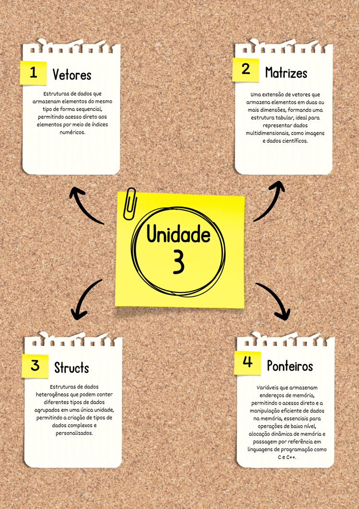

# Aula 5 — Encerramento da Unidade: Vetores, Matrizes, Structs e Ponteiros

## Ponto de Chegada

Olá, estudante! Para desenvolver a competência desta Unidade, que é **"compreender as técnicas para realizar a integração de vetores, matrizes, structs e ponteiros para desenvolvimento de software"**, você deve explorar conceitos fundamentais em programação, concentrando seus estudos nas estruturas de dados da linguagem C.

### Estruturas de dados homogêneas

Comece por compreender as estruturas de dados homogêneas, fundamentais no campo da programação, especialmente em linguagens de alto nível.

- Os **vetores**, por exemplo, representam conjuntos de elementos do mesmo tipo, organizados sequencialmente na memória. Eles permitem acesso rápido e eficiente aos elementos individuais, facilitando operações como ordenação, pesquisa e manipulação em massa.
- As **matrizes**, por sua vez, são uma extensão dos vetores, organizando os elementos em linhas e colunas, tornando-as essenciais para tarefas envolvendo dados multidimensionais, como representação de imagens, processamento de sinais e simulações científicas.

### Estruturas heterogêneas

Em seguida, você deve focar nos conceitos de criação de estruturas heterogêneas, como as **structs**, a fim de ampliar as possibilidades de representação de dados em linguagens de programação. As structs permitem que os programadores agrupem diferentes tipos de dados relacionados em uma única estrutura, o que facilita a organização e manipulação de informações complexas. Com as structs, é possível criar tipos de dados personalizados, contendo variáveis de tipos diversos, o que promove uma abordagem mais flexível e modular na resolução de problemas de programação.

### Ponteiros

Por fim, os **ponteiros** são elementos-chave na programação de baixo nível e desempenham um papel crucial na manipulação direta de memória em linguagens como C e C++. Eles são variáveis que armazenam endereços de memória, permitindo o acesso e a manipulação direta de dados armazenados em locais específicos da memória do computador. Os ponteiros são frequentemente usados para otimizar o desempenho, gerenciar estruturas de dados dinâmicas, acessar recursos de hardware e implementar passagem por referência, o que pode economizar espaço e tempo de execução. No entanto, seu uso incorreto pode levar a erros difíceis de depurar, como **vazamentos de memória** e **falhas de segmentação**. Portanto, compreender adequadamente o conceito de ponteiros e suas operações é fundamental para garantir a robustez e estabilidade de um programa.

| Estrutura | Tipo dos elementos | Acesso | Exemplo |
|---|---|---|---|
| **Vetor** | homogêneo | `v[i]` | `int notas[5];` |
| **Matriz** | homogêneo | `m[i][j]` | `float temp[5][2];` |
| **Struct** | heterogêneo | `s.campo` / `p->campo` | `struct Aluno a;` |
| **Ponteiro** | endereço de memória | `*p` | `int *p = &x;` |

Compreendendo esses conceitos essenciais, você estará preparado para criar programas mais sofisticados e otimizados, aptos a enfrentar uma diversidade de desafios e situações por meio do uso de vetores, matrizes, structs e ponteiros.

---

## É Hora de Praticar!

### Estudo de Caso: Gerenciamento de turmas e notas

> Imagine que você está desenvolvendo um sistema para uma escola que deseja automatizar o processo de gerenciamento de notas e informações de alunos. A escola possui várias turmas, e cada uma tem vários alunos e cada aluno precisa de informações como nome, número de matrícula e notas em várias disciplinas. O desafio é criar um programa em C que permita ao usuário realizar operações complexas, como adicionar alunos, lançar notas, calcular médias e gerar relatórios detalhados para cada turma. Para facilitar, realize de forma direta no código a inserção de alunos e a criação de turmas (mas sem adicionar alunos às turmas).
>
> O programa deve então realizar as seguintes funções:
>
> 1. Cadastrar aluno em uma turma.
> 2. Lançar notas de aluno.
> 3. Calcular a média de uma turma.
> 4. Gerar o relatório de turma, exibindo as informações de todos os alunos pertencentes à turma.

### Reflita

- Reflita sobre as vantagens e desvantagens das estruturas de dados homogêneas, como vetores e matrizes, em comparação com estruturas heterogêneas, como structs. Em quais situações cada tipo de estrutura é mais adequado?
- Como as structs proporcionam uma abordagem mais flexível e modular na resolução de problemas?
- Quais são os desafios e riscos associados ao uso incorreto de ponteiros, e como podem ser mitigados para garantir a robustez e estabilidade de um programa?

---

## Resolução do Estudo de Caso

O código a seguir apresenta uma sugestão de resultado para o problema:

```c
#include <stdio.h>
#include <string.h>

struct Aluno {
    char nome[50];
    int matricula;
    float notas[2]; // Considere 2 disciplinas para simplificar o código
};

struct Turma {
    int numeroTurma;
    struct Aluno alunos[30]; // Considere até 30 alunos por turma
    int totalAlunos;
};

int main(){

    struct Aluno alunos[5];
    struct Turma turmas[10]; // Suponha até 10 turmas na escola
    int op;
    // Cadastrar os alunos

    strcpy(alunos[0].nome, "João");
    alunos[0].matricula = 1001;
    alunos[0].notas[0] = 8.5;
    alunos[0].notas[1] = 7.0;

    strcpy(alunos[1].nome, "Maria");
    alunos[1].matricula = 1002;
    alunos[1].notas[0] = 7.5;
    alunos[1].notas[1] = 8.0;

    strcpy(alunos[2].nome, "Pedro");
    alunos[2].matricula = 1003;
    alunos[2].notas[0] = 9.0;
    alunos[2].notas[1] = 9.5;

    strcpy(alunos[3].nome, "Ana");
    alunos[3].matricula = 1004;
    alunos[3].notas[0] = 7.0;
    alunos[3].notas[1] = 7.5;

    strcpy(alunos[4].nome, "Carlos");
    alunos[4].matricula = 1005;
    alunos[4].notas[0] = 8.0;
    alunos[4].notas[1] = 8.5;

    // inicializa duas turmas

    turmas[0].totalAlunos = 0;
    turmas[0].numeroTurma = 5000;

    turmas[1].totalAlunos = 0;
    turmas[1].numeroTurma = 6000;

    int a, t;
    float mediaTurma = 0.0;

    do{
        printf(" \n 1 - cadastrar aluno na turma\n");
        printf(" 2 - lançar notas de aluno\n");
        printf(" 3 - media da turma\n");
        printf(" 4 - relatorio de turma\n");
        printf(" 5 - encerrar\n");
        printf(" Opcao: ");
        scanf("%d", &op);

        switch (op)
        {
        case 1:
            printf(" Escolha o aluno: ");
            scanf("%d", &a);
            printf(" Escolha a turma: ");
            scanf("%d", &t);
            if (turmas[t].totalAlunos < 30) {
                turmas[t].alunos[turmas[t].totalAlunos] = alunos[a];
                turmas[t].totalAlunos++;
            } else {
                printf(" A turma está cheia. Não é possível adicionar mais alunos.\n");
            }
            break;

        case 2:
            printf(" Escolha o aluno: ");
            scanf("%d", &a);
            for (int i = 0; i < 2; i++) {
                printf(" Nota %d: ", i+1);
                scanf("%f", &alunos[a].notas[i]);
            }
            break;

        case 3:
            printf(" Escolha a turma: ");
            scanf("%d", &t);
            mediaTurma = 0.0;
            for (int i = 0; i < turmas[t].totalAlunos; i++) {
                float somaNotas = 0.0;
                for (int j = 0; j < 5; j++) {
                    somaNotas += turmas[t].alunos[i].notas[j];
                }
                mediaTurma += somaNotas / 2;
            }
            printf("\n Media: %f", mediaTurma / turmas[t].totalAlunos);
            break;

        case 4:
            printf(" Escolha a turma: ");
            scanf("%d", &t);
            printf("\n Turma %d\n", turmas[t].numeroTurma);
            for (int i = 0; i < turmas[t].totalAlunos; i++) {
                printf(" Aluno: %s\n", turmas[t].alunos[i].nome);
                printf(" Matrícula: %d\n", turmas[t].alunos[i].matricula);
                printf(" Notas: ");
                for (int j = 0; j < 2; j++) {
                    printf("%.2f ", turmas[t].alunos[i].notas[j]);
                }
                printf("\n");
            }
            break;

        default:
            printf(" programa encerrado!\n\n");
            break;
        }
    }while(op != 5);

    return 0;
}
```

> **Nota de revisão:** o código está como no material original, mas tem problemas que vale reconhecer:
> - **`case 3`:** o laço interno usa `j < 5`, mas `notas` só tem 2 posições — lê 3 valores fora do vetor (acesso fora dos limites). O correto é `j < 2`.
> - **`case 1` × `case 2`:** `turmas[t].alunos[...] = alunos[a];` **copia** a struct inteira. Depois disso, lançar notas em `alunos[a]` (opção 2) não altera a cópia que está na turma — o relatório e a média continuam mostrando as notas antigas. Guardar ponteiros (`struct Aluno *alunos[30]`) ou o índice do aluno resolveria.
> - **`case 3`:** se a turma não tem alunos, `mediaTurma / turmas[t].totalAlunos` divide por zero (com `float`, resulta em `nan`).
> - os índices `a` e `t` digitados não são validados (só as turmas 0 e 1 foram inicializadas; `totalAlunos` das demais contém lixo).

A sugestão de solução dada simula um sistema de gerenciamento de turmas e alunos em uma escola.

- Duas estruturas são definidas: `struct Aluno` e `struct Turma`, que representam respectivamente os dados de um aluno e de uma turma. A `struct Turma` possui como membro um **vetor da estrutura `Aluno`**, representando os alunos que pertencem à turma.
- O usuário tem acesso a um menu de opções que inclui:
  - Adicionar um aluno a uma turma.
  - Lançar notas de um aluno.
  - Calcular a média da turma.
  - Gerar um relatório da turma.
  - Encerrar o programa.
- As funcionalidades do menu são implementadas utilizando um loop `do-while` e um `switch-case`. O programa imprime na tela as opções do menu e solicita a entrada do usuário para realizar as operações desejadas.
- A lógica de cada funcionalidade está associada a um `case`.

---

## Assimile

O mapa mental a seguir ilustra e identifica as estruturas estudadas nesta unidade.



---

## Referências

- BACKES, A. **Linguagem C**: completa e descomplicada. 2. ed. Rio de Janeiro: LTC, 2023.
- CORMEN, T. H. **Desmistificando algoritmos**. 1. ed. Rio de Janeiro: Elsevier, 2014.
- DAMAS, L. **Linguagem C**. 10. ed. Rio de Janeiro: LTC, 2023.
- MENÉNDEZ, A. **Simplificando algoritmos**. 1. ed. Rio de Janeiro: LTC, 2023.
- PIVA JUNIOR, D. **Algoritmos e programação de computadores**. 2. ed. Rio de Janeiro: Elsevier, 2019.
