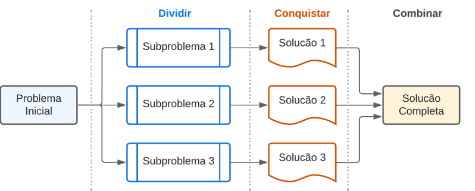
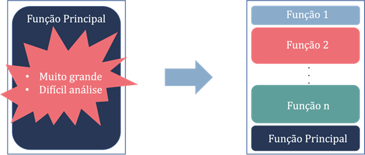
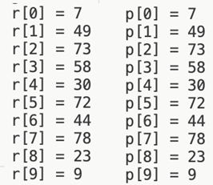

# Aula 1 — Funções

## Ponto de Partida

Olá! Até este ponto você já estudou praticamente todos os conceitos fundamentais de algoritmos e linguagem de programação, como os tipos de dados, variáveis, constantes, operadores e expressões, estruturas de controle, estruturas homogêneas e heterogêneas, além de ponteiros. Agora vamos prosseguir um pouco mais em nossos estudos e introduzir os conceitos de **procedimentos** e **funções**!

> Você foi recrutado por um laboratório de pesquisa que presta serviços terceirizados para colaborar com vários profissionais. Seu primeiro projeto será com o departamento de engenheiros civis. Eles receberam uma solicitação da construtora local para calcular e determinar qual guindaste deve ser utilizado em uma determinada construção para erguer as colunas de concreto armado. Eles têm à disposição três tipos de guindastes: **G1**, **G2** e **G3**. A seleção do guindaste a ser usado depende do peso da peça que será levantada pelo equipamento, o qual é calculado pela fórmula:
>
> $$P = V \cdot R$$
>
> em que $P$ representa o peso da coluna, $V$ é o volume e $R$ é a constante utilizada, que é igual a $25\ \text{kN/m}^3$. As diretrizes para a escolha do guindaste estão especificadas na Tabela 1.

| Regra | Guindaste |
|---|:---:|
| Peso ≤ 500 kg | G1 |
| 500 < Peso ≤ 1500 kg | G2 |
| Peso > 1500 kg | G3 |

*Tabela 1 | Regras para escolha do guindaste.*

> **Nota de revisão:** a constante $R = 25\ \text{kN/m}^3$ resulta em um peso em **kN**, mas a Tabela 1 usa **kg** — as unidades do enunciado original não batem. O código da resolução apenas compara o número calculado com 500 e 1500, sem conversão; para um cálculo fisicamente correto, seria preciso converter (1 kN ≈ 102 kg).

Para automatizar o processo com base nas medidas da coluna (base, largura e altura), como o programa determinará e informará aos engenheiros o guindaste que deve ser utilizado?

Para cumprir sua missão, você irá aprender sobre a distinção entre procedimentos e funções, bem como a criação e utilização desses conceitos. Agora vamos lá, preste muita atenção e tenha um excelente estudo!

---

## Vamos Começar!

### Conceitos e definição de funções

Até este ponto, você já desenvolveu vários algoritmos na linguagem C, correto? Nos programas que criou, mesmo sem ter um conhecimento formal sobre funções, você já as utilizou! Por exemplo, `printf()` e `scanf()` são funções incluídas nas bibliotecas da linguagem C que você utiliza desde o início. Mas antes mesmo destas funções você já empregou uma função muito importante! Observe o código apresentado no Quadro 1, que exibe uma mensagem na tela. Na linha 2 temos o comando `int main()`. Esse comando define uma função denominada `main` que retorna um valor inteiro, neste caso, zero. Parece complexo? Fique tranquilo! Vamos compreender adequadamente como construir e operar esse recurso fundamental.

```c
#include <stdio.h>
int main(){
    printf("Hello World!");
    return 0;
}
```

*Quadro 1 | Exemplo de programa em C.*

> **Nota de revisão:** no original, a linha 3 era `printf("Hello World!",altura[0]);` — `altura` não existe neste programa (resto copiado da Unidade 3) e o código não compila. O argumento extra foi removido.

A concepção de desenvolver programas com conjuntos de funcionalidades deriva de uma estratégia de design de algoritmos conhecida como **"dividir para conquistar"**. O conceito é direto: ao enfrentar um problema, é recomendado dividi-lo em problemas menores, facilitando assim sua resolução e organização. Essa técnica compreende três etapas (Figura 1):

| Etapa | Descrição |
|---|---|
| **Dividir** | fragmentar um problema em subproblemas menores. "Resolver problemas de menor escala, em vez de um problema único e grande, é, do ponto de vista computacional, teoricamente mais simples". |
| **Conquistar** | utilizar uma sequência de instruções separadas para resolver cada subproblema. |
| **Combinar** | integrar a solução de cada subproblema para obter a solução completa do problema original. |



*Figura 1 | Resumo da técnica dividir para conquistar.*

Em linguagem C, uma **função** é essencialmente um fragmento de código autônomo incorporado em um programa maior, designado para desempenhar uma tarefa específica com relativa independência do restante do código. Uma das vantagens fundamentais das funções é a capacidade de serem executadas repetidamente, o que proporciona a **reutilização** eficiente do código. Em vez de repetir várias vezes um conjunto de comandos para realizar uma determinada operação, é possível simplesmente chamar a função responsável por essa tarefa em múltiplas ocasiões. Essa prática, que também pode ser chamada de **modularização**, não só economiza espaço e torna o código mais conciso, mas também viabiliza ajustes ágeis no código associado a essa tarefa específica.

A organização do código em várias funções também desempenha um papel crucial na manutenção da clareza e limpeza do programa. Ao dividir o código em partes menores, cada uma focada em uma tarefa específica, a complexidade geral do programa é reduzida, tornando o código mais legível e compreensível. Esse método de divisão modular não apenas facilita a compreensão do funcionamento do programa, mas também simplifica o processo de identificação e correção de possíveis erros ou problemas no código.

A Figura 2 ilustra esta ideia de que as funções são blocos de construção que permitem a divisão dos programas em partes menores (segmentar uma tarefa grande de computação em várias tarefas menores).



*Figura 2 | Ilustração de um programa sendo dividido em funções.*

### Sintaxe de funções: parâmetros e retorno

Agora que sabemos a motivação por trás do conceito de função, como criá-la? Para isso, utilizamos a seguinte sintaxe:

```c
<tipo de retorno> <nome> (<parâmetros>)
{
    <Comandos da função>
    <Retorno> (não obrigatório)
}
```

Cada declaração de função possui uma série de elementos, alguns dos quais são fundamentais, enquanto outros são opcionais. Vamos examinar cada um deles:

| Elemento | Obrigatório? | Descrição |
|---|:---:|---|
| **Tipo de retorno** | Sim | indica o tipo de valor que a função retornará. Pode ser um valor inteiro (`int`), decimal (`float` ou `double`), caractere (`char`) ou outro tipo de dado. No caso de uma sub-rotina que executa um processo sem retornar um valor específico, utiliza-se `void`. Nesse contexto de função sem tipo de retorno (`void`), a função é denominada de **procedimento**. |
| **Nome** | Sim | especifica o identificador da função. Funciona de maneira similar ao nome de uma pessoa, em que é necessário chamá-la pelo nome para interagir. O nome não deve conter acentos, caracteres especiais ou espaços, seguindo as mesmas regras aplicadas a nomes de variáveis. |
| **Parênteses após o nome** | Sim | acompanham o nome da função ou procedimento. Por exemplo: `main()`, `printf()` e `somar()`. |
| **Parâmetros** | Não | contém valores que podem ser passados para a função, sobre os quais a função deve operar. Os parâmetros das funções atuam de maneira análoga às variáveis das funções matemáticas: na função $f(x) = x + 2$, ao calcular $f(3)$ substituímos $x$ por 3, resultando em $f(3) = 3 + 2 = 5$. O 3 é um parâmetro da função $f$, e a função o utiliza para realizar seu cálculo (processamento). Este campo será estudado em detalhes mais à frente. |
| **Comandos da função** | Sim | uma função só faz sentido se houver um conjunto de comandos que ela possa executar. |
| **Retorno** | Depende | quando o tipo de retorno é `void`, não precisa ser utilizado; quando não é `void`, torna-se obrigatório. O valor retornado deve ser compatível com o tipo de retorno. Pode ser qualquer expressão válida do lado direito de uma atribuição (`=`): o valor de uma variável, uma constante numérica ou caractere, ou uma expressão aritmética. **Somente um valor** pode ser retornado. A instrução `return` também **encerra a execução da função** (o programador deve usá-la somente quando não houver mais nada a fazer dentro da função). |

> **Nota de revisão:** o material original afirma que, em procedimentos, "o uso do `void` pode ser omitido". No C atual (C99 em diante) isso **não** é permitido — omitir o tipo de retorno é erro de compilação (no C89 antigo, o tipo virava `int` implicitamente, não `void`). Escreva sempre `void`. Além disso, uma função pode ter **vários comandos** `return` (ex.: um em cada ramo de um `if`); o que não é possível é devolver mais de um valor por vez.

Veja agora um exemplo de função em C no Quadro 2.

```c
#include <stdio.h>
int somar(){
    return 2 + 3;
}
int main(){
    int resultado = 0;
    resultado = somar();
    printf("O resultado da função é = %d", resultado);
    return 0;
}
```

*Quadro 2 | Exemplo de função em C.*

No exemplo apresentado no Quadro 2, a função principal, chamada `main()`, é um elemento essencial em muitas linguagens de programação, como C, Java e C#. Ela atua como o ponto de partida da execução do programa, definindo a rotina principal que deve ser executada. Antes do `main()`, temos a definição da função `somar()`. Em C, é comum criar as funções (também conhecidas como **sub-rotinas**) antes da função `main()` para facilitar o desenvolvimento e a leitura do código. A função `somar()` começa na linha 2 e termina na linha 4, delimitada por chaves. Vamos examinar os elementos nesse caso específico:

- **Tipo de retorno:** a função foi especificada para retornar um valor inteiro (`int`).
- **Nome:** o nome da função é `somar`.
- **Comandos da função:** nessa função, a soma de dois valores é retornada em um único comando: `return 2 + 3`. É importante notar que cada programador tem a liberdade de criar funções de acordo com suas preferências — os comandos poderiam ter sido escritos de outra forma, como no Quadro 3.

Vamos agora analisar o Quadro 3, que apresenta um exemplo de função **com parâmetros**.

```c
int somar(int x, int y){
    int s = 0;
    s = x + y;
    return s;
}
int main(){
    int resultado = somar(4, 5);
    printf("O resultado da função é = %d", resultado);
    return 0;
}
```

*Quadro 3 | Exemplo de função com parâmetros.*

A função do Quadro 3 realiza a soma de dois números inteiros passados como parâmetros, `x` e `y`, e estas duas variáveis são utilizadas dentro da função para realizar a soma, armazenar em `s`, e retornar seu valor. Quando a função é chamada no `main()` (linha 7), passamos os valores 4 e 5, que serão atribuídos aos parâmetros `x` e `y`, respectivamente. Portanto, o resultado retornado pela função será 9 ($x + y = 4 + 5$).

---

## Siga em Frente...

### O uso de funções na linguagem C

Você pode ter observado que uma função tem a capacidade de retornar valores de diferentes tipos primitivos, como inteiros, reais e caracteres. No entanto, surge a questão sobre a possibilidade de **retornar um vetor**. E a resposta é afirmativa! Para alcançar esse resultado devemos utilizar os **ponteiros**!

É importante destacar que não é possível criar funções com uma sintaxe direta como `int[10] calcular()`, onde `int[10]` indicaria que a função retorna um vetor com 10 posições. O único meio de retornar um vetor é através de um ponteiro. Como um ponteiro é um tipo especial de variável que armazena endereços de memória, podemos empregar essa abordagem para retornar o endereço de um vetor. Dessa forma, a função que invocou terá acesso ao vetor que foi calculado internamente.

Assim, a sintaxe apropriada para essa função é a seguinte:

```c
<tipo>* <nome_da_função>(){
    <tipo> vetor[tamanho];
    return vetor;
}
```

Observa-se que mesmo ao retornar o nome do vetor, ainda há a inclusão do tipo primitivo no retorno da função, que é acompanhado por um asterisco indicando o retorno de um ponteiro, ou seja, um endereço.

Para ilustrar o uso desse método, vamos implementar uma função que cria um vetor de dez posições, preenche-o com valores aleatórios, imprime esses valores e, em seguida, transmite o vetor para o chamador da função. A implementação dessa função é exibida no Quadro 4.

```c
#include <stdio.h>
#include <stdlib.h>
int* gerarRandomico(){
    static int r[10];
    int a;
    for(a = 0; a < 10; ++a) {
        r[a] = rand() % 100; // "% 100" é usado para limitar o rand a números entre 0 e 99
        printf("r[%d] = %d\n", a, r[a]);
    }
    return r;
}
int main(){
    int *p;
    int i;
    p = gerarRandomico();
    for (i = 0; i < 10; i++) {
        printf("\np[%d] = %d", i, *(p + i));
    }
    return 0;
}
```

*Quadro 4 | Função que retorna um vetor por meio de ponteiro.*

Na linha 13, um ponteiro do tipo inteiro é criado, indicando que ele apontará para um local que contém um número inteiro. Na linha 14, uma variável de controle de loop é criada. A função `gerarRandomico()` é invocada na linha 15, direcionando a execução para a linha 3, em que é especificado que a função retornará um endereço para valores inteiros (`int*`). Um vetor de números inteiros com dez posições é criado na linha 4 e é declarado **`static`**.

Um loop é estabelecido na linha 6 para percorrer as posições do vetor. Em cada posição, um valor aleatório é gerado usando a função `rand()` na linha 7, e esse valor é impresso na linha 8 para futuras comparações. O vetor agora preenchido é retornado pela função na linha 10, armazenando o endereço obtido no ponteiro `p` do programa principal. Outro loop é criado na linha 16 para percorrer o vetor acessado por seu endereço. Na linha 17, para acessar o conteúdo do vetor, o comando `*(p + i)` é utilizado. É importante lembrar que o ponteiro retorna o endereço da primeira posição do vetor, por isso é adicionado o valor de `i` para acessar as próximas posições.

O código apresentado no Quadro 4 resulta na impressão de valores idênticos nos dois laços — os valores vistos pelo `main` são os mesmos gerados dentro da função, graças ao uso do `static` na declaração do vetor. O resultado pode ser verificado na Figura 3.



*Figura 3 | Saída do programa do Quadro 4.*

> **Nota de revisão:** no original, as aspas de dois `printf` estavam corrompidas, a variável estava declarada como `I` maiúsculo, o texto falava em "cinco posições" (o código usa 10) e as legendas se referiam ao "Quadro 5"; tudo foi corrigido acima. O papel real do `static` também merece precisão: ele faz o vetor **continuar existindo depois que a função termina**. Sem `static`, `r` seria uma variável local destruída no `return`, e `p` apontaria para memória inválida (*dangling pointer*) — o compilador inclusive avisa: "function returns address of local variable".

---

## Vamos Exercitar?

Prezado estudante, é hora de aplicar todo o conhecimento adquirido até aqui! Para resolver a situação, é necessário ter a fórmula para calcular o peso anotada: $P = V \cdot R$. Além disso, será preciso criar condicionais para determinar qual guindaste deve ser utilizado. Agora, construa o programa seguindo as seguintes orientações, sendo que uma sugestão é apresentada no Quadro 5:

**Na função `calcularPeso()` (antes do `main()`):**

1. Crie uma função para calcular o peso antes da função `main()`.
2. Declare três variáveis para armazenar os valores da base, altura e comprimento.
3. Solicite ao usuário que insira os valores e armazene-os nas variáveis criadas.
4. Calcule o peso da coluna usando a fórmula fornecida pelos engenheiros.

**No `main()`:**

1. Declare uma variável para armazenar um valor real, já que o peso pode não ser um número inteiro.
2. Armazene o resultado da função na variável criada.
3. Compare o valor armazenado com a primeira condição para verificar se o guindaste a ser utilizado é o G1. Se for o caso, imprima uma mensagem para o usuário.
4. Crie uma estrutura condicional encadeada com a primeira, comparando o valor armazenado com a terceira condição, para determinar se o guindaste a ser utilizado é o G3. Em caso afirmativo, exiba uma mensagem para o usuário.
5. Adicione um bloco "senão" ao final, pois se o peso não corresponder a nenhuma das condições anteriores, o guindaste a ser utilizado será o G2. Nesse caso, também emita uma mensagem para o usuário.

```c
#include <stdio.h>
int calcularPeso() {
    float b, c, h = 0;
    printf("\n Digite o valor da base: ");
    scanf("%f", &b);
    printf("\n Digite o valor da altura: ");
    scanf("%f", &h);
    printf("\n Digite o valor do comprimento: ");
    scanf("%f", &c);
    return (int) (b * h * c * 25); // o (int) é chamado de "cast" e é usado para garantir que o valor resultante será inteiro (se não o for, ele o converte)
}
int main() {
    float peso;
    peso = calcularPeso();

    if (peso <= 500) {
        printf("\n O guindaste de modelo G1 deve ser usado");
    } else if (peso > 1500) {
        printf("\n O guindaste de modelo G3 deve ser usado");
    } else {
        printf("\n O guindaste de modelo G2 deve ser usado");
    }
    return 0;
}
```

*Quadro 5 | Código de resolução.*

> 💡 O *cast* `(int)` **trunca** a parte decimal (não arredonda): 500,9 vira 500 e seria classificado como G1. Como o `main` guarda o peso em `float`, faria mais sentido a função retornar `float` também.

> Lembrando que não há uma única resposta correta. Há vários caminhos para se chegar no mesmo resultado! Modifique e tente otimizar ao máximo os seus programas.

---

## Saiba mais

Para entender melhor o conceito de funções e procedimentos em C, sugerimos a leitura do **Capítulo 5 - Funções e Procedimentos**, do livro *Linguagem C*, disponível na Biblioteca Virtual.

> DAMAS, L. **Linguagem C**. 10. ed. Rio de Janeiro: LTC, 2023. cap. 5, p. 104-128.

Também sugerimos a leitura do **Capítulo 9 - Funções**, do livro *Linguagem C: Completa e Descomplicada*, disponível na Biblioteca Virtual, para complementar os estudos sobre funções em C.

> BACKES, A. **Linguagem C**: completa e descomplicada. 2. ed. Rio de Janeiro: LTC, 2023. cap. 9, p. 158-193.

Para auxiliar no desenvolvimento de programas na linguagem C, uma ótima prática é verificar a documentação da linguagem para entender em detalhes os principais tipos de funções e elementos utilizados. Para isso, sugerimos a constante consulta da seguinte documentação sempre que achar necessário. Nela você encontra todas as bibliotecas utilizadas na linguagem e como utilizar suas principais funções: **Referência da Linguagem C**.

---

## Referências

- BACKES, A. **Linguagem C**: completa e descomplicada. 2. ed. Rio de Janeiro: LTC, 2023. cap. 4, p. 67-87.
- DAMAS, L. **Linguagem C**. 10. ed. Rio de Janeiro: LTC, 2023. cap. 3, p. 51-79.
- PIVA JUNIOR, D. **Algoritmos e programação de computadores**. 2. ed. Rio de Janeiro: Elsevier, 2019.
