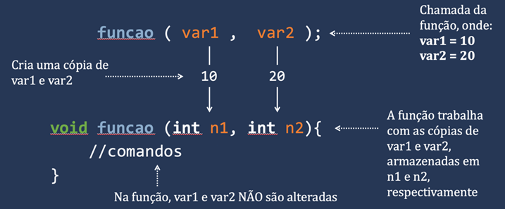
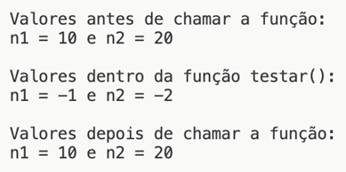

# Aula 2 — Passagem de Parâmetros por Valor

## Ponto de Partida

Olá! Vamos prosseguir nossos estudos sobre procedimentos e funções conhecendo um pouco mais sobre como trabalhar com os **parâmetros** de uma função!

> Continuando seu trabalho no laboratório de pesquisa multidisciplinar, agora é hora de colaborar com o núcleo de química. Em uma reação química, a relação entre os reagentes é crucial para determinar o resultado. Dados dois componentes químicos, A e B, sua mistura resultará em um terceiro composto C ($A + B \rightarrow C$). O núcleo de química solicitou uma otimização das condições em uma reação específica denominada "proteção". Para alcançar essa otimização, é necessário variar as condições do experimento, isto é, utilizando diferentes massas dos compostos.
>
> Um mol do composto A possui uma massa de **321,43 g**, enquanto um mol de B tem uma massa de **150,72 g**. É necessário criar uma função que facilite o cálculo dos produtos químicos. Dessa forma, a partir de diferentes combinações de massa, seu programa deverá calcular a massa final do composto. Além do cálculo, o programa deve exibir os resultados das combinações apresentadas na Tabela 1, uma vez que esses valores servem como referência para os químicos.

| Quantidade de mol de A | Quantidade de mol de B | Quantidade de mol de C |
|:---:|:---:|:---:|
| 1,2 | 1,0 | ? |
| 1,4 | 1,0 | ? |
| 1,0 | 1,6 | ? |

*Tabela 1 | Combinações de referência para a reação. (No original, a legenda dizia "Regras para escolha do guindaste", copiada da aula anterior.)*

Para cumprir sua missão, você aprenderá sobre o **escopo de variáveis** e a **passagem de parâmetros por valor**! Agora vamos lá, preste muita atenção e tenha um excelente estudo!

---

## Vamos Começar!

### Escopo de variáveis

Já sabemos que as variáveis servem para armazenar temporariamente dados na memória. Porém, o local em que elas são definidas no código de um programa determina o seu **alcance** e a sua **visibilidade**. O código apresentado no Quadro 1 ilustra esse conceito.

```c
#include <stdio.h>
int testar(){
    int x = 10;
    return x;
}
int main(){
    int x = 20;
    printf("\n Valor de x na funcao main() = %d", x);
    printf("\n Valor de x na funcao testar() = %d", testar());
    return 0;
}
```

*Quadro 1 | Exemplo de escopo de variáveis em C.*

Neste exemplo, existem duas variáveis chamadas `x`. Isso, no entanto, não causará nenhum problema, pois apesar de compartilharem o mesmo nome, elas são definidas em locais diferentes: uma está dentro da função `main()` e a outra dentro da função `testar()`. Assim, cada função possui seu próprio espaço de memória independente. Na memória, as variáveis são identificadas por seus endereços, o que implica que, mesmo com o mesmo nome, seus endereços são únicos.

Desta forma podemos definir o **escopo** de uma variável como a extensão do seu alcance no local no qual o recurso está definido, permitindo que ele seja acessível em várias partes do código do programa. O escopo é classificado em duas categorias:

| Escopo | Onde é declarada | Visibilidade | Tempo de vida |
|---|---|---|---|
| **Local** | dentro do corpo de uma função (ou bloco) | apenas dentro da função em que foi definida | criada na chamada, destruída ao final da função |
| **Global** | fora de qualquer função (por convenção, logo após os `#include`) | todas as funções do programa | todo o período de execução do programa |

No caso do Quadro 1, ambas as variáveis são locais. Para criar uma variável global, é necessário declará-la fora de qualquer função, tornando-a visível para todas as funções do programa.

No Quadro 2, é apresentado um exemplo de declaração de uma variável global na linha 2, logo após a inclusão da biblioteca padrão `<stdio.h>`. É importante observar que na função principal não há nenhuma variável definida com o nome `x`, no entanto, é possível imprimir o valor da variável global `x` na linha 7, uma vez que o valor é acessado globalmente. Na linha 8, é exibido o valor retornado pela função `dobrar()`, que calcula o dobro da variável global.

```c
#include <stdio.h>
int x = 10;
int dobrar(){
    return 2 * x;
}
int main(){
    printf("\n Valor de x global = %d", x);
    printf("\n Valor de x global alterado na função dobrar() = %d", dobrar());
    return 0;
}
```

*Quadro 2 | Exemplo de variável global em C.*

> **Nota de revisão:** apesar do texto do `printf`, a função `dobrar()` **não altera** `x` — ela apenas retorna `2 * x`. Depois da chamada, a global continua valendo 10. Para alterá-la, a função teria que fazer `x = 2 * x;`.

### Uso de variáveis globais

O uso de variáveis globais permite otimizar a alocação de memória, já que, em muitos casos, o desenvolvedor não necessita criar variáveis locais. No entanto, é fundamental ter cautela ao utilizar essa técnica, uma vez que as variáveis locais são criadas e destruídas ao final da função, enquanto as variáveis globais **permanecem na memória durante todo o período de execução do programa**.

Vamos considerar um exemplo prático que demonstra a utilização do escopo global de uma variável. No Quadro 3 temos um programa que calcula a média entre duas temperaturas distintas e que possui a declaração de duas variáveis globais na linha 2. É importante lembrar que o programa começa sempre pela função principal, cuja execução tem início na linha 6. Na linha 7, o usuário é solicitado a digitar duas temperaturas, que são armazenadas dentro das variáveis globais criadas. Na linha 9, a função `calcularMedia()` é chamada para realizar o cálculo da média usando os valores das variáveis globais. Neste exemplo, fica evidente a utilidade dessa abordagem de programação, já que as variáveis são usadas em diferentes funções, otimizando o uso da memória, uma vez que não é necessário criar mais variáveis locais em cada uma das funções.

```c
#include <stdio.h>
float t1, t2;
float calcularMedia(){
    return (t1 + t2) / 2;
}
int main(){
    printf("\n Digite as duas temperaturas: ");
    scanf("%f %f", &t1, &t2);
    printf("\n A temperatura média = %.2f", calcularMedia());
    return 0;
}
```

*Quadro 3 | Exemplo prático de variável global em C.*

> 💡 Na prática profissional, variáveis globais costumam ser evitadas: qualquer função pode alterá-las, o que dificulta rastrear erros. Passar os valores como parâmetros (próxima seção) deixa explícito de quais dados cada função depende.

#### Variável local e global com o mesmo nome

Nós já vimos que é viável criar variáveis com o mesmo nome em diferentes funções, visto que o escopo delas é local. Entretanto, e se houver uma variável global e uma local com o mesmo nome, como no exemplo a seguir?

```c
int x = 10;
int main(){
    int x = -1;
    printf("\n Valor de x = %d", x);
}
```

Qual valor será impresso na variável `x`? **A variável local sempre se sobrepõe à global**, e, nesse caso, o valor -1 será impresso na função principal.

Mas e se você precisar acessar o valor de uma variável global dentro de uma função que possui uma variável local com o mesmo nome? Neste caso, é necessário utilizar a instrução **`extern`**. No Quadro 4, é possível observar como usar variáveis globais e locais com o mesmo nome na linguagem C. Note que foi preciso criar uma variável chamada `b`, com um bloco de instruções (linhas 6 a 9), que atribui o valor "externo" de `x` à nova variável. A criação do bloco é necessária para separar o trecho de código do restante da função `main()`, indicando que ali, a variável `x` utilizada é a global (`extern int x`).

```c
#include <stdio.h>
int x = 10;
int main(){
    int x = -1;
    int b;
    {
        extern int x;
        b = x;
    }
    printf("\n Valor de x = %d", x);
    printf("\n Valor de b (x global) = %d", b);
    return 0;
}
```

*Quadro 4 | Exemplo de acesso a uma variável global com `extern` em C.*

---

## Siga em Frente...

### Passagem de parâmetros por valor

Vamos relembrar que, ao criar funções em linguagens de programação, usamos a seguinte estrutura básica:

```c
<tipo de retorno> <nome_da_função> (<parâmetros>)
{
    <Comandos da função>
    <Retorno> (opcional)
}
```

Todos os elementos dessa estrutura já foram apresentados detalhadamente até aqui, exceto os tipos de parâmetros que uma função pode receber. Portanto, neste momento, vamos nos concentrar em compreender esse recurso fundamental.

Ao definir uma função, podemos também especificar que ela receberá informações do **chamador** (ou seja, "de quem" a invocou). Por exemplo, ao criar uma função para calcular a média, é possível estabelecer que o chamador ("quem chama") deve fornecer os valores sobre os quais o cálculo será realizado.

Na sintaxe de criação de uma função que recebe parâmetros, é fundamental especificar o tipo de valor que será recebido. Uma função pode receber parâmetros na forma de **valor** ou **referência**. Ao passar parâmetros por valores, a função cria automaticamente variáveis locais para armazenar esses valores e, após a conclusão da função, essas variáveis são liberadas. A Figura 1 apresenta uma ilustração do processo de passagem de parâmetros por valor em uma função.



*Figura 1 | Processo de passagem de parâmetros por valor.*

No Quadro 5, é apresentado um exemplo de definição e chamada de função com passagem de valores. Na linha 2, a função `somar()` é definida para receber dois valores inteiros. Internamente, as variáveis locais `a` e `b` são criadas para armazenar esses valores até o término da função. Na linha 7, a função `somar` é invocada/chamada, passando os dois valores inteiros que a função espera receber, e o resultado do cálculo é armazenado na variável `res`.

```c
#include <stdio.h>
int somar(int a, int b){
    return a + b;
}
int main(){
    int res;
    res = somar(10, 15);
    printf("\n Resultado da soma = %d", res);
    return 0;
}
```

*Quadro 5 | Exemplo de passagem de parâmetros por valor.*

> **Nota de revisão:** no original, a variável era declarada como `int re;` mas usada como `res` — erro de compilação. Corrigido acima.

A técnica de passagem de parâmetros para uma função é amplamente utilizada em todas as linguagens de programação. Ao chamar uma função que espera receber parâmetros, a omissão de qualquer argumento esperado resultará em um erro de compilação.

Quando usamos variáveis como argumentos na passagem de parâmetros por valores, **as variáveis originais não são modificadas**, uma vez que uma **cópia** dos valores armazenados é fornecida à função. Para entender claramente essa definição, consideremos o código apresentado no Quadro 6. A execução do programa começa na linha 9, na função principal, em que são criadas duas variáveis, `n1` e `n2`. Na linha 13, o comando determina a impressão dos valores das variáveis. Em seguida, na linha 14, a função `testar()` é invocada, passando as duas variáveis como parâmetros. Nesse momento, uma cópia de cada variável é criada na memória para o uso da função. Dentro da função, o valor das cópias das variáveis é alterado e impresso, porém essa alteração é local, ou seja, é realizada apenas nas cópias dos valores e não afetará os valores iniciais das variáveis criadas na função principal. Na linha 16, os valores são impressos novamente após a chamada da função.

```c
#include <stdio.h>
int testar(int n1, int n2){
    n1 = -1;
    n2 = -2;
    printf("\n\n Valores dentro da função testar(): ");
    printf("\n n1 = %d e n2 = %d", n1, n2);
    return 0;
}

int main(){
    int n1 = 10;
    int n2 = 20;
    printf("\n\n Valores antes de chamar a função: ");
    printf("\n n1 = %d e n2 = %d", n1, n2);
    testar(n1, n2);
    printf("\n\n Valores depois de chamar a função: ");
    printf("\n n1 = %d e n2 = %d", n1, n2);
    return 0;
}
```

*Quadro 6 | Exemplo de passagem de parâmetros por valor.*

A seguir, a Figura 2 apresenta o resultado deste programa.



*Figura 2 | Resultado do programa do Quadro 6.*

| Momento | `n1` | `n2` |
|---|:---:|:---:|
| Antes de chamar `testar()` (no `main`) | 10 | 20 |
| Dentro de `testar()` (cópias) | -1 | -2 |
| Depois de chamar `testar()` (no `main`) | 10 | 20 |

---

## Vamos Exercitar?

Prezado estudante, é hora de aplicar todo o conhecimento adquirido até aqui! Para implementar a solução para a equipe de química, é possível criar uma função que tome como entrada a quantidade em mol dos componentes A e B e retorne a massa da reação.

O passo inicial consiste em criar a função de cálculo da massa. Ela pode ser definida da seguinte maneira:

```c
float calcularMassa(float quantidadeA, float quantidadeB)
```

Dentro dessa função, os valores de referência devem ser exibidos de acordo com a Tabela 1. A massa deve ser calculada e o resultado deve ser retornado:

$$m_C = n_A \cdot 321{,}43 + n_B \cdot 150{,}72$$

Em seguida, é necessário criar a função principal, na qual o usuário será solicitado a fornecer as quantidades dos elementos A e B. Uma vez que os valores forem obtidos, a função `calcularMassa()` deve ser chamada e os valores devem ser passados como argumentos.

O resultado da função deve ser armazenado em uma variável, da seguinte maneira:

```c
resultado = calcularMassa(quantidadeA, quantidadeB);
```

Por último, a massa da reação deve ser exibida.

O Quadro 7 apresenta uma sugestão de resolução da situação.

```c
#include <stdio.h>
float calcularMassa(float a, float b){
    const float mA = 321.43;
    const float mB = 150.72;
    printf("\n mol A : mol B ");
    printf("\n 1,2 : 1,0 \t= %f",1.2*mA + 1*mB);
    printf("\n 1,4 : 1,0 \t= %f",1.4*mA + 1*mB);
    printf("\n 1,6 : 1,0 \t= %f",1*mA + 1.6*mB);
    return (a * mA ) + (b * mB);
}
int main(){
    float a = 0, b = 0, resultado = 0;
    printf("\n Digite as massas dos elementos A e B: ");
    scanf("%f %f",&a,&b);
    resultado = calcularMassa(a,b);
    printf("\n\n Massa final do composto = %.2f g/mol",resultado);
    return 0;
}
```

*Quadro 7 | Código de resolução.*

> **Nota de revisão:** pequenas inconsistências no código original:
> - a terceira linha de referência é rotulada `1,6 : 1,0`, mas calcula `1*mA + 1.6*mB`, ou seja, a combinação **1,0 : 1,6** da Tabela 1 — o rótulo deveria ser `1,0 : 1,6`;
> - o `main` pede "as massas" dos elementos, mas o que se digita são as **quantidades em mol**;
> - o resultado é uma massa, então a unidade correta é **g**, não "g/mol".
>
> Para conferência, os valores de referência são: 1,2 : 1,0 → 536,44 g; 1,4 : 1,0 → 600,72 g; 1,0 : 1,6 → 562,58 g.

> Lembrando que não há uma única resposta correta. Há vários caminhos para se chegar no mesmo resultado! Modifique e tente otimizar ao máximo os seus programas.

---

## Saiba mais

Para entender melhor o conceito de funções e parâmetros em C, sugerimos a leitura do **Capítulo 5 - Funções e Procedimentos**, do livro *Linguagem C*, disponível na Biblioteca Virtual.

> DAMAS, L. **Linguagem C**. 10. ed. Rio de Janeiro: LTC, 2023. cap. 5, p. 104-128.

Também recomendamos a leitura do **Capítulo 9 - Passagem de Parâmetros**, do mesmo livro, *Linguagem C*, disponível na Biblioteca Virtual. Ele traz um estudo mais detalhado sobre passagem de parâmetros em C.

> DAMAS, L. **Linguagem C**. 10. ed. Rio de Janeiro: LTC, 2023. cap. 9, p. 203-227.

Sugerimos a leitura do **Capítulo 9 - Funções** do livro *Linguagem C: Completa e Descomplicada*, disponível na Biblioteca Virtual, para complementar os estudos sobre funções e parâmetros em C.

> BACKES, A. **Linguagem C**: completa e descomplicada. 2. ed. Rio de Janeiro: LTC, 2023. cap. 9, p. 158-193.

---

## Referências

- BACKES, A. **Linguagem C**: completa e descomplicada. 2. ed. Rio de Janeiro: LTC, 2023. cap. 4, p. 67-87.
- DAMAS, L. **Linguagem C**. 10. ed. Rio de Janeiro: LTC, 2023. cap. 3, p. 51-79.
- PIVA JUNIOR, D. **Algoritmos e programação de computadores**. 2. ed. Rio de Janeiro: Elsevier, 2019.
