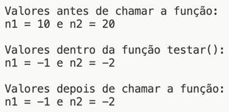
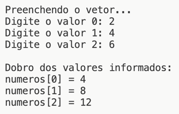

# Aula 3 — Passagem de Parâmetros por Referência

## Ponto de Partida

Olá! Vamos prosseguir nossos estudos sobre procedimentos e funções conhecendo um pouco mais sobre como trabalhar com **passagem de parâmetros por referência**!

> Vamos considerar que você tem um amigo que possui uma loja que vende diferentes tipos de produtos, e ele te pediu uma ajuda! Seu amigo precisa de um programa em C para **calcular o preço total de uma compra**, levando em consideração os preços unitários e as quantidades de cada item adquirido. O programa deve usar funções para calcular o preço total e passar parâmetros por referência para garantir a atualização correta das variáveis.

Para cumprir sua missão, você irá aprender sobre a passagem de parâmetros por referência! Agora vamos lá, preste muita atenção e tenha um excelente estudo!

---

## Vamos Começar!

### Passagem por referência com ponteiros

O uso de funções que passam parâmetros por referência está intimamente relacionado aos conceitos de **ponteiros** e **endereços de memória**. A abordagem dessa técnica é semelhante à passagem por valor, na qual a função é definida para receber determinados parâmetros, e o chamador deve fornecer esses argumentos. No entanto, o comportamento e o resultado diferem. Na passagem por referência, **não é criada uma cópia dos argumentos passados**; em vez disso, o endereço da variável é passado e a função manipula diretamente os valores armazenados lá.

Para utilizar essa abordagem, precisamos dos operadores `*` e `&`. Na definição da função, os parâmetros a serem recebidos devem ser declarados com `*`, por exemplo:

```c
int testar(int* parametro1, int* parametro2)
```

E ao chamar a função, os parâmetros devem ser passados com `&`, por exemplo:

```c
resultado = testar(&n1, &n2);
```

No exemplo apresentado no Quadro 1, temos uma função que passa variáveis por referência. Com a passagem por referência, os valores das variáveis são modificados. Nas linhas 3 e 4, o asterisco é usado para acessar o conteúdo armazenado dentro do endereço apontado, pois se usássemos apenas `n1` e `n2`, estaríamos acessando os endereços que eles armazenam.

```c
#include <stdio.h>
int testar(int* n1, int* n2) {
    *n1 = -1; // é necessário usar * para acessar o conteúdo
    *n2 = -2;
    printf("\n\n Valores dentro da função testar(): ");
    printf("\n n1 = %d e n2 = %d", *n1, *n2);
    return 0;
}
int main() {
    int n1 = 10;
    int n2 = 20;
    printf("\n\n Valores antes de chamar a função: ");
    printf("\n n1 = %d e n2 = %d", n1, n2);
    testar(&n1, &n2);
    printf("\n\n Valores depois de chamar a função: ");
    printf("\n n1 = %d e n2 = %d", n1, n2);
    return 0;
}
```

*Quadro 1 | Exemplo de passagem de parâmetros por referência.*

Neste exemplo, a função `testar()` recebe dois argumentos que são ponteiros para inteiros. Dentro da função, os valores apontados por esses ponteiros são alterados para -1 e -2, respectivamente. A seguir, a Figura 1 apresenta o resultado deste programa, ilustrando como os valores das variáveis mudam antes e depois da chamada da função `testar`.



*Figura 1 | Resultado do programa do Quadro 1.*

Compare com o Quadro 6 da aula anterior (mesmo programa, mas por valor):

| Momento | Por valor (Aula 2) | Por referência (Quadro 1) |
|---|:---:|:---:|
| Antes da chamada | `n1 = 10`, `n2 = 20` | `n1 = 10`, `n2 = 20` |
| Dentro de `testar()` | `n1 = -1`, `n2 = -2` | `n1 = -1`, `n2 = -2` |
| Depois da chamada | `n1 = 10`, `n2 = 20` | **`n1 = -1`, `n2 = -2`** |

A passagem de parâmetros por referência possui várias vantagens e desvantagens que afetam a eficiência e o desempenho de um programa:

| ✅ Vantagens | ❌ Desvantagens |
|---|---|
| Permite transmitir uma grande quantidade de dados para outras partes do programa: em vez de fazer cópias dos dados, é possível passar apenas um ponteiro para eles, o que economiza tempo, processamento e memória. | Pode comprometer a segurança, já que a função chamada pode corromper os dados do chamador. |
| Permite a alteração de uma variável ou um objeto externo a uma função, o que possibilita que uma função gere **vários valores de saída**. | É essencial ter cuidado para garantir que os dados não sejam modificados indevidamente por funções chamadas. |

### Passagem de vetores e matrizes

Agora, vamos compreender como passar um vetor para uma função, para que possamos preencher e imprimir o conteúdo armazenado em um vetor, evitando a repetição de trechos de código. Na linguagem C, **a passagem de um vetor é sempre realizada implicitamente por referência**. Isso implica que, mesmo sem o uso dos operadores `*` e `&`, quando uma função que recebe um vetor é invocada, o que é realmente passado é o endereço da primeira posição do vetor.

Na definição da função, os vetores a serem recebidos devem ser declarados com colchetes, sem especificar o tamanho, por exemplo:

```c
int testar1(int v1[], int v2[])
```

Ou ainda, você pode especificar os parâmetros da função como ponteiros:

```c
int testar2(int *v1, int *v2)
```

Ao chamar a função, independente da forma escolhida para definir os vetores nos parâmetros, estes devem ser passados como se fossem variáveis simples, por exemplo:

```c
resultado1 = testar1(n1, n2);
resultado2 = testar2(n1, n2);
```

Para ilustrar esse conceito, é apresentado um programa no Quadro 2, iniciando na linha 15. Na linha 18, a função `inserir()` é chamada, passando o vetor `numeros` como parâmetro. Deliberadamente, a função é definida na linha 2, recebendo um vetor chamado `a`, para demonstrar que o nome da variável na função não precisa ser o mesmo usado na chamada. Na função `inserir()`, é solicitado ao usuário digitar os valores que serão armazenados no vetor `numeros` por referência. Após a conclusão dessa função, a execução continua na linha 19, na qual a função `imprimir()` é invocada, passando o vetor `numeros` como argumento. Mais uma vez, é definida uma função na linha 9 com o nome de vetor diferente para enfatizar que não é necessário ser o mesmo nome. Nessa função, o vetor é percorrido e o dobro de cada valor é impresso. O resultado desse programa é ilustrado na Figura 2.

```c
#include <stdio.h>
void inserir(int a[]){
    int i=0;
    for(i=0; i<3; i++){
        printf("Digite o valor %d: ", i);
        scanf("%d", &a[i]);
    }
}
void imprimir(int b[]){
    int i=0;
    for(i=0; i<3; i++){
        printf("\n numeros[%d] = %d", i, 2 * b[i]);
    }
}

int main(){
    int numeros[3];
    printf("\n Preenchendo o vetor... \n");
    inserir(numeros);
    printf("\n Dobro dos valores informados:");
    imprimir(numeros);
    return 0;
}
```

*Quadro 2 | Exemplo de passagem de vetor para uma função.*



*Figura 2 | Resultado do programa do Quadro 2.*

> 💡 Como a função recebe só o endereço inicial, ela **não sabe o tamanho do vetor** (`sizeof(a)` dentro da função dá o tamanho de um ponteiro). Por isso o laço usa o 3 fixo — em código real, o tamanho costuma ser passado como parâmetro extra, como faz `numItens` no Quadro 4.

Podemos também passar **matrizes** como parâmetros para funções de forma semelhante à passagem de vetores, mas isso requer um detalhe específico na sintaxe devido à natureza multidimensional das matrizes. Devemos especificar suas dimensões na definição dos parâmetros da função, por exemplo:

```c
void testeMatriz(int mat[3][3])
```

E quando esta função for chamada, a matriz passada na função não precisa ir acompanhada de suas dimensões (já que elas já estão especificadas nos parâmetros da função):

```c
testeMatriz(m); //onde m é uma matriz
```

Alternativamente, uma matriz pode ser definida como parâmetro de uma função como `int mat[][3]`, onde `[3]` é o número de colunas e o número de linhas não é especificado. Isso permite a passagem de matrizes com diferentes quantidades de linhas como argumentos.

> 💡 Só a **primeira** dimensão pode ficar vazia: o compilador precisa saber quantas colunas há para calcular onde começa cada linha (`m[i][j]` = posição `i * colunas + j`, como visto na aula de ponteiros).

---

## Siga em Frente...

### Passagem de estruturas por referência

Em C, a passagem de estruturas (structs) por referência é feita usando ponteiros, da mesma forma que variáveis comuns. Ao passar uma estrutura como parâmetro para uma função, é passado o endereço de memória da estrutura, permitindo que a função manipule e altere os valores dos membros da estrutura original. Isso evita a cópia desnecessária da estrutura, o que pode ser útil para estruturas grandes ou complexas, economizando memória e tempo de processamento.

Para passar uma estrutura por referência em C, é necessário usar um ponteiro para a estrutura como parâmetro da função. Dentro da função, os membros da estrutura podem ser acessados e modificados usando a notação de seta `->`, por se tratar de um ponteiro.

O Quadro 3 mostra um exemplo de como passar uma struct por referência.

```c
#include <stdio.h>
#include <string.h>
struct Pessoa {
    char nome[50];
    int idade;
};
void modificarPessoa(struct Pessoa *p) {
    p->idade = 30;
}

int main() {
    struct Pessoa pessoa1;
    strcpy(pessoa1.nome, "João");
    pessoa1.idade = 25;

    modificarPessoa(&pessoa1);

    printf("Nome: %s\n", pessoa1.nome);
    printf("Idade: %d\n", pessoa1.idade);

    return 0;
}
```

*Quadro 3 | Exemplo de passagem de struct por referência.*

> **Nota de revisão:** o código original usava `strcpy` sem incluir `<string.h>`; a linha foi adicionada acima.

Neste exemplo, a função `modificarPessoa` recebe um ponteiro para uma estrutura `struct Pessoa` como parâmetro. Dentro da função, o valor do membro `idade` é modificado para 30. A estrutura é passada para a função usando o operador de referência `&` na chamada da função. A impressão dos valores da estrutura após a modificação mostra que a estrutura original foi de fato alterada dentro da função (**Idade: 30**).

| Tipo do argumento | Como é passado por padrão | Para alterar o original |
|---|---|---|
| Variável simples (`int`, `float`...) | por valor (cópia) | passar `&var` e receber `tipo *` |
| Vetor / matriz | por referência (endereço do 1º elemento) | já altera o original |
| Struct | por valor (cópia da struct inteira) | passar `&s` e receber `struct T *`, acessar com `->` |

---

## Vamos Exercitar?

Prezado estudante, é hora de aplicar todo o conhecimento adquirido até aqui! Para implementar a solução para a loja do seu amigo você precisará trabalhar com a passagem de parâmetros por referência! O Quadro 4 apresenta uma sugestão de resolução da situação.

```c
#include <stdio.h>
void calcularPrecoTotal(float precoUnitario[], int quantidade[], int numItens, float *precoTotal) {
    *precoTotal = 0;
    for (int i = 0; i < numItens; i++) {
        *precoTotal += precoUnitario[i] * quantidade[i];
    }
}
int main() {
    int numItens;
    printf(" Digite o número de itens comprados: ");
    scanf("%d", &numItens);
    float precoUnitario[numItens];
    int quantidade[numItens];
    float precoTotal;
    // Entrada dos preços unitários e quantidades de cada item
    for (int i = 0; i < numItens; i++) {
        printf("\n Digite o preço unitário do item %d: ", i + 1);
        scanf("%f", &precoUnitario[i]);
        printf(" Digite a quantidade do item %d: ", i + 1);
        scanf("%d", &quantidade[i]);
    }
    // Chamada da função para calcular o preço total
    calcularPrecoTotal(precoUnitario, quantidade, numItens, &precoTotal);
    // Exibindo o preço total da compra
    printf("\n Preço total da compra: R$ %.2f\n\n", precoTotal);

    return 0;
}
```

*Quadro 4 | Código de resolução.*

A seguir, seguem alguns detalhes da implementação do Quadro 4.

- A função `calcularPrecoTotal` é usada para calcular o preço total da compra, considerando os preços unitários e as quantidades de cada item.
- Os vetores `precoUnitario` e `quantidade` são passados por referência para a função (implicitamente, por serem vetores), e `precoTotal` é passado explicitamente por referência com `&`, para garantir a atualização correta da variável.
- O programa solicita ao usuário o número de itens comprados e depois solicita o preço unitário e a quantidade de cada item. Em seguida, ele chama a função `calcularPrecoTotal` para calcular o preço total da compra e, em seguida, exibe o preço total na saída.
- A passagem de parâmetros por referência neste caso torna o programa mais eficiente, pois permite que as variáveis sejam atualizadas diretamente na função chamadora sem a necessidade de retornar valores, além de possibilitar a passagem de vetores e matrizes.

> Lembrando que não há uma única resposta correta. Há vários caminhos para se chegar no mesmo resultado! Modifique e tente otimizar ao máximo os seus programas.

---

## Saiba mais

Para entender melhor o conceito de funções e parâmetros em C, sugerimos a leitura do **Capítulo 5 - Funções e Procedimentos**, do livro *Linguagem C*, disponível na Biblioteca Virtual.

> DAMAS, L. **Linguagem C**. 10. ed. Rio de Janeiro: LTC, 2023. cap. 5, p. 104-128.

Também recomendamos a leitura do **Capítulo 9 - Passagem de Parâmetros**, do mesmo livro, *Linguagem C*, disponível na Biblioteca Virtual. Ele traz um estudo mais detalhado sobre passagem de parâmetros em C.

> DAMAS, L. **Linguagem C**. 10. ed. Rio de Janeiro: LTC, 2023. cap. 9, p. 203-227.

Sugerimos a leitura do **Capítulo 9** do livro *Linguagem C: Completa e Descomplicada*, disponível na Biblioteca Virtual, para complementar os estudos sobre funções e parâmetros em C.

> BACKES, A. **Linguagem C**: completa e descomplicada. 2. ed. Rio de Janeiro: LTC, 2023. cap. 9, p. 158-193.

---

## Referências

- BACKES, A. **Linguagem C**: completa e descomplicada. 2. ed. Rio de Janeiro: LTC, 2023. cap. 4, p. 67-87.
- DAMAS, L. **Linguagem C**. 10. ed. Rio de Janeiro: LTC, 2023. cap. 3, p. 51-79.
- PIVA JUNIOR, D. **Algoritmos e programação de computadores**. 2. ed. Rio de Janeiro: Elsevier, 2019.
