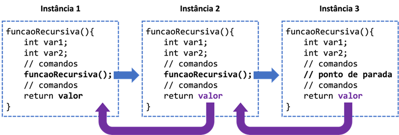
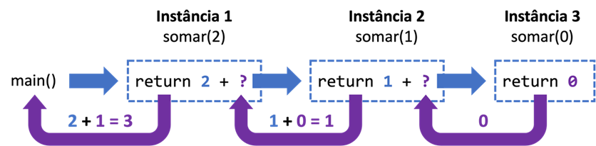
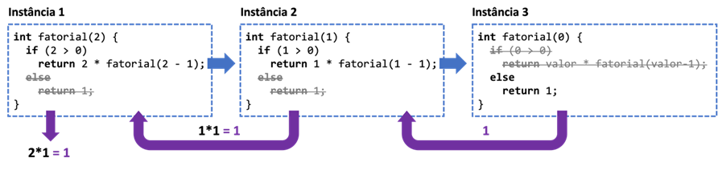

# Aula 4 — Recursividade

## Ponto de Partida

Olá! Vamos prosseguir nossos estudos sobre procedimentos e funções conhecendo um recurso poderoso, porém que exige muita cautela: a **recursividade**!

> Após colaborar com as equipes de engenheiros civis e químicos, você está enfrentando um novo desafio ao trabalhar com a equipe de matemáticos no laboratório. Agora, foi solicitado que você desenvolva um programa para **calcular a raiz quadrada de um número utilizando o método de aproximações sucessivas de Newton**. Os matemáticos contribuíram com a fórmula para essa tarefa:
>
> $$x_n = \frac{x_{n-1}^2 + n}{2\,x_{n-1}}$$
>
> onde $x_n$ é a raiz quadrada desejada, $x_{n-1}$ é a raiz anterior calculada pelo método, e $n$ é o número para o qual se deseja calcular a raiz.
>
> Seu gerente, que também é programador, especificou a utilização da técnica de recursividade na implementação, exigindo que o usuário informe o número para o qual deseja calcular a raiz quadrada. Quais valores precisam ser informados para que o programa seja executado de maneira correta? O que determinará o término do cálculo? Esse método exige algum tipo de valor específico?

Portanto, para realizar essa missão com sucesso, é fundamental entender o conceito de função recursiva, sua implementação adequada e a relação com as estruturas iterativas. Agora vamos lá, preste muita atenção e tenha um excelente estudo!

---

## Vamos Começar!

### O que é função recursiva?

Dentro do conjunto de funções, existe uma categoria especial conhecida como **funções recursivas**. Para adentrarmos nessa nova técnica de programação, é essencial compreender o conceito de recursão. O termo **recursão** (ou recursividade) está associado à ideia de repetição de uma situação específica. Ao aplicarmos esse conceito ao contexto da programação, nos deparamos com as funções recursivas. Nessa abordagem, uma função é considerada recursiva quando ela faz referência a si mesma, ou seja, **recursividade é a capacidade de uma função chamar a si mesma**.

A estrutura para implementação de uma função recursiva não difere significativamente das funções convencionais, pois requer um tipo de retorno, o nome da função, parênteses e parâmetros, quando necessário. A diferença está no conteúdo da função, pois ela é invocada dentro de si mesma. No trecho de código abaixo temos a construção da função, bem como o seu chamado, primeiro na função principal e, em seguida, dentro dela mesma.

```c
<tipo> funcaoRecursiva(){
    // comandos
    funcaoRecursiva(); // chamando a si própria
    // comandos
}

void main(){
    // comandos
    funcaoRecursiva();
    // comandos
}
```

Apesar da semelhança na estrutura entre funções recursivas e não recursivas, o comportamento entre elas difere significativamente, e o uso impróprio dessa técnica pode levar a problemas de consumo excessivo de memória, frequentemente resultando em falhas na aplicação e no sistema. Para uma compreensão mais completa do processo, é importante destacar alguns pontos-chave:

- A função recursiva chama a si mesma repetidamente até que um **ponto de parada** seja alcançado. Esse ponto pode ser definido por meio de uma estrutura condicional ou por um valor fornecido pelo usuário.
- Dentro do corpo de uma função, existem variáveis e comandos que são armazenados na memória de trabalho. No caso de uma função recursiva, os recursos (variáveis e comandos) são alocados em locais distintos da memória, resultando na **criação de novas instâncias a cada chamada** da função. Portanto, é crucial definir um ponto de parada adequado.
- As variáveis geradas em cada instância da função na memória são **independentes**. Assim, mesmo que as variáveis possuam os mesmos nomes, cada uma possui seu próprio endereço de memória, garantindo que a alteração de valores em uma não afete as outras.

Para facilitar a compreensão desse mecanismo, observe a Figura 1. A instância 1 representa a primeira chamada da função `funcaoRecursiva()`, que, por sua vez, contém um comando que invoca a si mesma. Nesse ponto, uma segunda instância da função é criada na memória de trabalho. Conforme a função continua a se chamar recursivamente, novos espaços de memória são alocados, cada um contendo suas próprias variáveis e comandos. No entanto, quando uma determinada condição de parada é atingida dentro da terceira instância, a função deixa de ser chamada e passa a retornar valores para as instâncias anteriores.



*Figura 1 | Mecanismo de uma função recursiva na memória.*

Quando a função recursiva atinge o ponto de parada, cada execução subsequente passa a devolver seus resultados à execução anterior. No exemplo da Figura 1, a execução três retorna à execução dois, que por sua vez retorna à execução um. É importante notar que, caso o ponto de parada não fosse especificado na última chamada, a função se instanciaria continuamente, resultando em um **estouro de memória** (*stack overflow*).

> **Caso base:** toda função recursiva necessita obrigatoriamente de uma instância que determine o encerramento das chamadas subsequentes, denominada **caso base**. Este representa o cenário mais simples que leva à interrupção do processo.

Refletindo sobre isso, é obrigatório para qualquer função recursiva ter um **critério de parada** bem definido. A instância que satisfaz esse critério é conhecida como caso base. Um programador que erroneamente implementa o critério de parada pode ocasionar um erro apenas na aplicação dessa função específica, ou tal erro pode impactar outras partes do sistema.

### Como funciona a recursividade

Para ilustrar como funciona uma função recursiva, considere a implementação de uma função recursiva que calcula a soma dos antecessores de um número inteiro positivo inserido pelo usuário. Por exemplo, se o usuário inserir 5, o programa deve calcular a soma $5 + 4 + 3 + 2 + 1 + 0$. Neste caso, o critério de parada é alcançado quando o parâmetro de soma atinge o valor zero, significando que todos os números anteriores já foram considerados para o cálculo. A implementação da função pode ser visualizada no Quadro 1, seguida pela explicação.

```c
#include <stdio.h>
int somar(int valor) {
    if (valor != 0) { // Critério de parada
        return valor + somar(valor - 1); // Chamada recursiva
    } else {
        return valor;
    }
}
int main() {
    int n, resultado;
    printf("\nDigite um numero inteiro positivo: ");
    scanf("%d", &n);
    resultado = somar(n); // Fazendo a primeira chamada da função
    printf("\nResultado da soma = %d", resultado);
    return 0;
}
```

*Quadro 1 | Exemplo de função recursiva.*

A execução do programa no Quadro 1 tem início na linha 9, pela função principal. Ao chegar na linha 13, a função `somar()` é chamada, recebendo como argumento um número inteiro inserido pelo usuário. Nesse ponto, a execução se desloca para a linha 2, onde a função é definida. Nota-se que a função é configurada para retornar e receber valores inteiros. Na linha 3, é utilizado um condicional como critério de parada. Se o valor for diferente (`!=`) de zero, a execução segue para a linha 4, na qual a função é chamada novamente, desta vez com o parâmetro sendo o valor reduzido em 1. Quando o valor atinge zero, as instâncias começam a retornar o valor para a instância que as chamou.

Para ilustrar, a Figura 2 demonstra o processo na memória de trabalho da função `somar()`. Neste exemplo, o usuário inseriu o valor 2, resultando na invocação da função `somar(2)` pela função `main()`. A primeira instância é criada com o parâmetro 2. Como o valor é diferente de zero nessa instância, o critério de parada não é satisfeito, e a função se chama a si mesma, criando a segunda instância com o parâmetro 1.



*Figura 2 | Exemplo da função `somar()` do Quadro 1.*

Observa-se que, na primeira instância, o valor a ser retornado é `2 + ?`, pois o resultado da função ainda não é conhecido. Na segunda instância, o valor também difere de zero, levando à chamada recursiva com o parâmetro zero (`valor - 1`). Nesse ponto, o retorno é `1 + ?`, pois o resultado da função ainda não é determinado. Na terceira instância, o critério de parada é alcançado, e a função retorna zero. Este valor é utilizado pela instância anterior, que, ao somar `1 + 0`, retorna seu resultado para a instância 1, que por sua vez soma `2 + 1` e retorna o valor à função principal, encerrando o ciclo de recursividade.

```text
somar(2) = 2 + somar(1)
               somar(1) = 1 + somar(0)
                              somar(0) = 0        ← caso base
               somar(1) = 1 + 0 = 1
somar(2) = 2 + 1 = 3                               → retorna 3 ao main
```

> **Nota de revisão:** o material original repetia o Quadro 1 inteiro logo após esta explicação (duplicação da extração), que foi removida. Observe também que o enunciado exige um inteiro **positivo** por um motivo: com `n` negativo, `valor` nunca chega a 0 (vai para -1, -2, ...) e a recursão só termina com estouro de pilha. Um critério mais robusto seria `if (valor > 0)`.

#### Fatorial recursivo

Vamos agora analisar o exemplo clássico da recursividade: o cálculo do **fatorial**! O fatorial de um número $N$ é obtido por meio de multiplicações sucessivas até que $N$ seja igual a 1:

$$N! = N \cdot (N-1) \cdot (N-2) \cdot \ldots \cdot 2 \cdot 1 \qquad \text{ex.: } 5! = 5 \cdot 4 \cdot 3 \cdot 2 \cdot 1 = 120$$

Recursivamente: $N! = N \cdot (N-1)!$, com caso base $0! = 1$. A seguir está o código, no Quadro 2, que implementa essa solução utilizando uma função recursiva, seguido pela explicação.

```c
#include <stdio.h>
int fatorial(int valor) {
    if (valor > 0) { // Critério de parada
        return valor * fatorial(valor - 1); // Chamada recursiva
    } else {
        return 1;
    }
}
int main() {
    int n, resultado;
    printf("\nDigite um numero inteiro positivo: ");
    scanf("%d", &n);
    resultado = fatorial(n);
    printf("\nResultado do fatorial = %d", resultado);
    return 0;
}
```

*Quadro 2 | Cálculo do fatorial com uma função recursiva.*

A execução do código no Quadro 2 inicia pela função `main()`, que solicita um número ao usuário e, na linha 13, invoca a função `fatorial()`, passando o valor digitado como parâmetro. Dentro da função `fatorial()`, enquanto o valor for maior que 0, a função chama a si mesma, criando novas instâncias na memória, passando, a cada vez, o valor decrementado de 1. Quando o valor chega a 0, a função retorna 1 e este valor é retornado à multiplicação dos valores encontrados em cada instância. Isso porque $0!$ é o caso mais básico, o qual nós sabemos que é igual a 1 sem fazer qualquer tipo de conta, ou seja, **o caso base**!

Para uma melhor compreensão, a Figura 3 ilustra as instâncias quando o usuário digita o número 2. Os resultados só são obtidos quando a função atinge o caso base e, então, inicia o processo de "devolução" do resultado para a instância anterior.



*Figura 3 | Exemplo da função `fatorial()` do Quadro 2.*

> 💡 Com `int` (32 bits), o maior fatorial representável é $12! = 479.001.600$; a partir de $13!$ o resultado transborda. O Quadro 4 da Aula 3 da Unidade 2 usava `unsigned long long` justamente por isso.

---

## Siga em Frente...

### Cuidados na implementação da recursividade

Agora, uma pergunta para você: daria para refazer o programa do Quadro 1 sem recursividade, apenas com um laço simples? Sim! Uma das principais dúvidas entre os programadores está justamente na escolha entre o uso de recursividade e as estruturas de repetição. No caso da função `somar()` apresentada no Quadro 1, seria possível substituí-la por uma estrutura de repetição, como exemplificado a seguir (para a entrada 2):

```c
for (i = 0; i <= 2; i++) {
    resultado = resultado + i;
}
```

De fato, a substituição é viável. A técnica de recursividade pode ser empregada para substituir estruturas de repetição, conferindo uma elegância ao código sob a perspectiva das boas práticas de programação. No entanto, como mencionado anteriormente, funções recursivas têm o potencial de **consumir mais memória** em comparação com abordagens iterativas.

| | Recursão | Iteração (laço) |
|---|---|---|
| **Controle** | caso base + chamada a si mesma | condição do laço |
| **Memória** | uma nova instância (variáveis) por chamada | variáveis reaproveitadas |
| **Risco** | estouro de pilha sem caso base | laço infinito sem condição de parada |
| **Ponto forte** | problemas que se dividem em versões menores de si mesmos | repetições simples e longas |

Para esclarecer o momento adequado para escolher a recursividade, podemos nos valer de algumas orientações: muitos problemas exibem a propriedade de possuir uma **estrutura recursiva**, na qual cada instância do problema contém uma versão menor do mesmo problema. Nesses casos, o método recomendado é:

1. Resolver diretamente a instância do problema se ela for pequena, utilizando força bruta se necessário.
2. Caso contrário, reduzir a instância para uma versão menor do mesmo problema, aplicar o método à instância menor e, em seguida, retornar à instância original.

A aplicação desse método resulta em um algoritmo recursivo, indicando a capacidade de um problema maior ser decomposto em instâncias menores. Contudo, é crucial considerar os recursos computacionais envolvidos em cada método ao optar pela recursividade.

---

## Vamos Exercitar?

Prezado estudante, é hora de aplicar todo o conhecimento adquirido até aqui! Para implementar a solução, é necessário desenvolver um programa que solicite ao usuário um número, especifique um **valor inicial** para a raiz e um **critério de parada**. Após pesquisa, constatou-se que o método iterativo de Newton envolve comparações entre os resultados obtidos em cada instância. A comparação entre o valor calculado da raiz e o obtido no passo anterior é realizada até que a diferença entre eles seja menor que o critério de parada. Para isso, as funções `fabs()` e `pow()`, pertencentes à biblioteca `math.h`, são utilizadas:

| Função (`math.h`) | Retorno |
|---|---|
| `fabs(x)` | valor absoluto de `x` |
| `pow(base, exp)` | `base` elevada a `exp` |

Adotando a **metade do valor informado** pelo usuário como valor inicial e **0.001** como critério de parada (quanto menor o valor do critério, mais preciso será o cálculo), os passos para a implementação são os seguintes:

1. Crie a função `calcularRaiz()`, que recebe dois parâmetros: o valor a ser calculado e a raiz anterior, inicialmente definida como o chute inicial.
2. Implemente a fórmula sugerida pelos matemáticos usando a função `pow()`.
3. Calcule a diferença entre o valor obtido no passo 2 e o valor da raiz anterior e verifique se é menor que o critério de parada:
   - Se for o caso, o valor é satisfatório e pode ser retornado (**caso base**).
   - Caso contrário, a função `calcularRaiz()` deve ser chamada novamente, passando como parâmetro o número e a raiz obtida no passo 2.

O Quadro 3 apresenta uma sugestão de resolução da situação.

```c
#include <stdio.h>
#include <math.h>
float calcularRaiz(float n, float raizAnt) {
    float raiz = (pow(raizAnt, 2) + n) / (2 * raizAnt);
    if (fabs(raiz - raizAnt) < 0.001)
        return raiz;
    return calcularRaiz(n, raiz);
}

void main() {
    float numero, raiz;
    printf("\nDigite um número para calcular a raiz: ");
    scanf("%f", &numero);
    raiz = calcularRaiz(numero, numero / 2);
    printf("\nRaiz quadrada: %f", raiz);
}
```

*Quadro 3 | Código de resolução.*

> **Nota de revisão:** respondendo às perguntas do enunciado — o método exige um número **positivo**: com `0`, o chute inicial é `0` e a fórmula divide por zero; com negativos não há raiz real e a recursão não converge. Além disso, `void main()` não é uma assinatura padrão em C; prefira `int main()` com `return 0;`. No GCC/Linux pode ser preciso compilar com `-lm` para usar `math.h`.

> Lembrando que não há uma única resposta correta. Há vários caminhos para se chegar no mesmo resultado! Tente sempre otimizar ao máximo os seus programas.

---

## Saiba mais

Para entender melhor o conceito de recursividade em C, sugerimos a leitura do **Capítulo 9 - Passagem de Parâmetros**, a partir da página 219 (tópico: Recursividade), do livro *Linguagem C*, disponível na Biblioteca Virtual.

> DAMAS, L. **Linguagem C**. 10. ed. Rio de Janeiro: LTC, 2023. cap. 9, p. 203-227.

Sugerimos a leitura do **Capítulo 9 - Funções**, do livro *Linguagem C: Completa e Descomplicada*, disponível na Biblioteca Virtual, para complementar os estudos sobre recursividade em C.

> BACKES, A. **Linguagem C**: completa e descomplicada. 2. ed. Rio de Janeiro: LTC, 2023. cap. 9, p. 158-193.

Recomendamos o acesso e estudo do conteúdo web do portal **Khan Academy**, que possui várias lições, explicações e vários desafios acerca de recursividade. Vale a pena conferir! *(O link do material original não foi preservado na extração.)*

---

## Referências

- BACKES, A. **Linguagem C**: completa e descomplicada. 2. ed. Rio de Janeiro: LTC, 2023. cap. 4, p. 67-87.
- DAMAS, L. **Linguagem C**. 10. ed. Rio de Janeiro: LTC, 2023. cap. 3, p. 51-79.
- PIVA JUNIOR, D. **Algoritmos e programação de computadores**. 2. ed. Rio de Janeiro: Elsevier, 2019.
