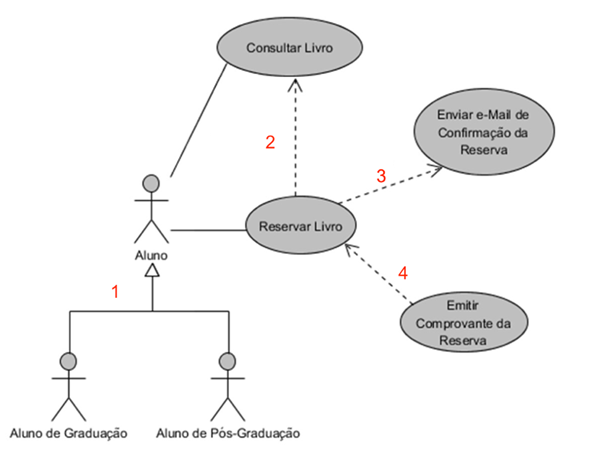

# Exercícios de Revisão — Unidade 4

> **Tema:** UML e Orientação a Objetos

## Questão 1 ✅

Com a introdução do Paradigma Orientado a Objeto, surgiu a necessidade de métodos específicos voltados para análise e projetos orientados a objetos. A Linguagem de Modelagem Unificada (UML — Unified Modeling Language) foi criada a partir da fusão de três métodos, dos autores Booch, Rumbaugh (OMT — Object Modeling Technique) e Jacobson (OOSE — Object-Oriented Software Engineering). A concretização da UML aconteceu em 1997.

Sobre a modelagem Orientada a Objetos, julgue as sentenças a seguir:

- **I.** Na década de 90, os pesquisadores James Rumbaugh, Ivar Jacobson e Grady Booch uniram as melhores características destacadas em suas técnicas de modelagem e construíram um padrão de referência para modelagem orientada a objetos, surgindo a UML.
- **II.** A notação utilizada pela metodologia UML não é padronizada pela OMG e facilita a compreensão de cada parte do sistema que está sendo modelado, por qualquer pessoa que tenha conhecimento sobre a linguagem.
- **III.** A UML apresenta um conjunto de técnicas de modelagem gráficas, integrando vários elementos (objetos, classes, atributos etc.) do paradigma orientado a objetos.
- **IV.** Os diagramas da UML são recursos gráficos para a visualização de um sistema sob diferentes perspectivas e geralmente por itens e relacionamentos.

**Pergunta:** Estão corretas as alternativas:

- A) I e II, apenas.
- B) II e III, apenas.
- C) III e IV, apenas.
- **D) I, III e IV, apenas.** ✅
- E) I, II, III e IV.

**Resposta correta:** D ✅

**Comentário:**

- **I. Correta.** A UML nasceu da união dos métodos de Booch, Rumbaugh e Jacobson.
- **II. Incorreta.** A notação **é** padronizada pela **OMG** (Object Management Group).
- **III. Correta.** Integra técnicas gráficas e elementos do paradigma OO.
- **IV. Correta.** Os diagramas mostram o sistema por diferentes perspectivas.

## Questão 2 ✅

O Diagrama de caso de uso é uma forma de comunicação entre o analista de sistemas e os programadores, pois os diagramas detalham o que precisará ser implementado (codificado). Faça a correspondência correta entre os componentes do Diagrama de casos de uso com suas respectivas características.

| Coluna A | Coluna B |
|---|---|
| **I.** Include | **1.** Representam a herança entre componentes (atores ou casos de uso). |
| **II.** Generalização | **2.** Esse relacionamento mostra que o tipo de relacionamento entre dois casos de uso implica na obrigatoriedade da execução do caso de uso que está sendo incluído. |
| **III.** Extend | **3.** É o relacionamento (a ligação) entre os atores e outros casos de uso. |
| **IV.** Associação | **4.** Compartilhar pedaços de pequenas funcionalidades. |

**Pergunta:** Assinale a alternativa com a associação correta das colunas em:

- A) I-1; II-2; III-3; IV-4.
- B) I-2; II-3; III-1; IV-4.
- C) I-4; II-3; III-2; IV-1.
- D) I-1; II-4; III-2; IV-3.
- **E) I-2; II-1; III-4; IV-3.** ✅

**Resposta correta:** E ✅

**Comentário:**

| Componente | Correspondência | Por quê |
|---|:---:|---|
| **Include** | 2 | Execução **obrigatória** do caso de uso incluído |
| **Generalização** | 1 | Representa **herança** entre atores ou casos de uso |
| **Extend** | 4 | Compartilha pedaços de pequenas funcionalidades (comportamento **opcional**) |
| **Associação** | 3 | Ligação entre **atores** e casos de uso |

## Questão 3 ✅

Conforme a classificação das técnicas de modelagem da Unified Modeling Language (UML), o Diagrama de Casos de Uso é uma técnica de modelagem comportamental.

Considerando as características do Diagrama de casos de uso, indique "V" para os itens verdadeiros e "F" para os itens falsos.

- **(  )** Apresenta uma linguagem simples e de fácil compreensão para que os usuários possam ter uma ideia geral de como o sistema irá se comportar. É um diagrama adotado para representar os requisitos funcionais.
- **(  )** É um diagrama abstrato e flexível com poucos elementos de notação, que representa a interação entre os elementos ator e casos de uso.
- **(  )** Os casos de uso são utilizados para capturar os requisitos não-funcionais do sistema, sendo usados para definir a arquitetura e o desempenho pretendidos para cada caso de uso.
- **(  )** Demonstra o comportamento de um objeto através de um conjunto de estados e suas transições em um determinado instante de tempo de execução do sistema.

**Pergunta:** Assinale a alternativa correta:

- A) F; F; V; V.
- **B) V; V; F; F.** ✅
- C) V; V; V; V.
- D) F; F; F; F.
- E) V; F; V; F.

**Resposta correta:** B ✅

**Comentário:**

- **1ª. Verdadeira.** Linguagem simples; representa **requisitos funcionais**.
- **2ª. Verdadeira.** Poucos elementos de notação: atores e casos de uso.
- **3ª. Falsa.** Casos de uso capturam requisitos **funcionais**, não os não funcionais.
- **4ª. Falsa.** Estados e transições de um objeto são do **diagrama de estados** (máquina de estados), não de casos de uso.

## Questão 4 ✅

No sistema da biblioteca da universidade XP, o aluno ao reservar um livro deve receber um e-mail confirmando a reserva. Outras funcionalidades, como emitir comprovante de reserva e consultar o livro, não são obrigatórias. No caso de uso a seguir, está representada a descrição anterior.

> Fonte: elaborada pela autora.

**Pergunta:** Após a análise do diagrama, assinale a alternativa que apresenta os elementos destacados, na ordem numérica expressa:

- A) 1- Generalização/especialização; 2- include; 3- extend; 4- extend;
- B) 1- Generalização/especialização; 2- extend; 3- extend; 4- extend;
- **C) 1- Generalização/especialização; 2- extend; 3- include; 4- extend;** ✅
- D) 1- extend; 2- extend; 3- extend; 4- extend;
- E) 1- include; 2- extend; 3- include; 4- extend;

**Resposta correta:** C ✅

**Comentário:**

- A confirmação por e-mail é **obrigatória** → relacionamento **include**.
- Emitir comprovante e consultar o livro são **opcionais** → relacionamento **extend**.
- O elemento 1 liga elementos de mesma natureza por herança → **generalização/especialização**.

## Questão 5 ✅

O paradigma de orientação a objetos visualiza um software como uma coleção de agentes interconectados chamados de objetos, sendo que cada objeto é responsável por realizar sua tarefa e que de forma colaborativa resultam às funcionalidades de um sistema computacional.

Nesse sentido, para um entendimento de conceitos de análise orientada a objetos, é importante entender que:

> uma _________________ é uma abstração que define um tipo de __________________ e que esse mesmo tipo possui seus _________________, que pelos _________________, são definidas as ações que esse tipo será capaz de realizar.

**Pergunta:** Assinale a alternativa correta que preenche as lacunas acima:

- **A) Classe; objeto; atributos; métodos.** ✅
- B) Classe; atributo; métodos; eventos.
- C) Classe; objeto; eventos; identificadores.
- D) Operação; atributo; métodos; eventos.
- E) Operação; objeto; eventos; identificadores.

**Resposta correta:** A ✅

**Comentário:**

- Uma **classe** é a abstração que define um tipo de **objeto**.
- Esse tipo possui **atributos** (dados) e **métodos** (ações que o objeto é capaz de realizar).

---

## Gabarito geral

| Questão | Alternativa | Resposta |
|:---:|:---:|---|
| 1 | **D** | I, III e IV, apenas. |
| 2 | **E** | I-2; II-1; III-4; IV-3. |
| 3 | **B** | V – V – F – F. |
| 4 | **C** | Generalização; Extend; Include; Extend. |
| 5 | **A** | Classe; objeto; atributos; métodos. |
