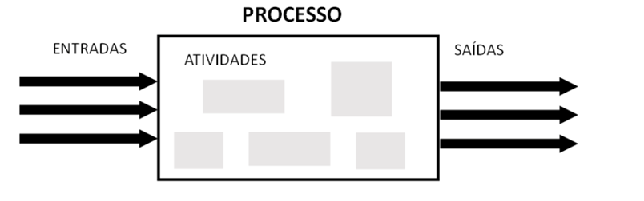
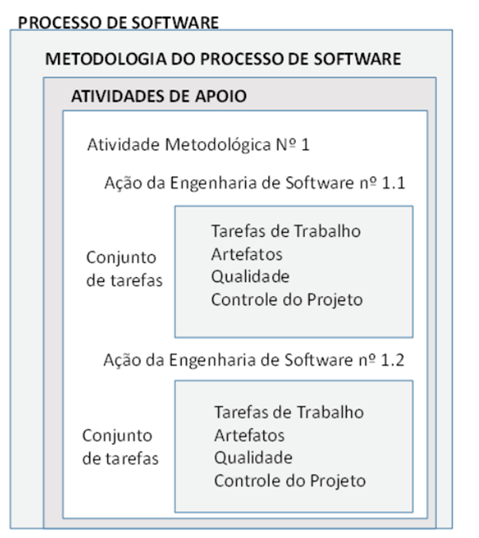

# Aula 2 — Processos de Software

## Ponto de Partida

Na aula de hoje, vamos explorar os **Processos de Software**, um tema essencial para profissionais de tecnologia da informação, como desenvolvedores e analistas. Esses processos são mais do que apenas escrever código; eles envolvem uma série de atividades planejadas e executadas que são cruciais para desenvolver um software eficaz e confiável. Vamos cobrir desde os fundamentos da criação de software até a entrega ao cliente, enfatizando a importância de cada etapa do processo. Essa discussão incluirá as práticas comuns na indústria e como elas se aplicam a diferentes tipos de projetos de software, proporcionando uma visão clara da importância dos Processos de software no desenvolvimento tecnológico.

Em seguida, abordaremos as **Tarefas** e a **Modelagem** das atividades do processo de software. Essas tarefas são componentes cruciais no processo de desenvolvimento, e entender como elas se interligam é fundamental. A modelagem de atividades ajuda a visualizar o processo de desenvolvimento, identificar desafios e encontrar soluções eficazes. Um aspecto crucial que exploraremos é a **Qualidade do software**. A qualidade é um objetivo constante, integrado em cada fase do desenvolvimento, e não apenas uma etapa final. Vamos discutir estratégias para assegurar que o software atenda às necessidades do cliente e seja ao mesmo tempo robusto, seguro e eficiente. Esta aula é para aqueles que querem aprimorar seus conhecimentos e habilidades em engenharia de software, com foco na qualidade como um elemento fundamental dos seus projetos.

> Pensando nesses conceitos, imagine que você é um Analista de sistemas em uma *software house*, você realiza diversas tarefas, atendendo diferentes clientes. Alguns clientes têm relatado um incômodo, quanto ao tempo de entrega do produto final, o software. Para ajudar a empresa, você possui a missão de investigar o Processo de software da empresa e propor melhorias. Para isso, deverá se concentrar em responder os seguintes questionamentos:
>
> 1. Quais as atividades principais de um Processo de software?
> 2. Como você poderia melhorar o Processo de construção de um software?

---

## Vamos Começar!

### Processo de software

De acordo com Sommerville (2018), um **processo de software** é um conjunto de atividades inter-relacionadas e resultados que conduzem à criação de um software. Pressman (2021) salienta que, na Engenharia de software, um processo não implica um método rígido de desenvolvimento, mas sim oferece uma abordagem **flexível** que permite à equipe de desenvolvimento selecionar processos alinhados com a filosofia da empresa, visando a qualidade do produto, cumprimento de prazos e redução de custos.

Sommerville (2018) também menciona que a metodologia organizada adotada pela Engenharia de software para a produção de software é conhecida como processo de software. Esse processo geralmente engloba várias atividades, incluindo **especificação, design, implementação, validação, manutenção e evolução**. Destaca-se os seguintes pontos sobre o processo de software:

- Estabelece um padrão para a criação de serviços e produtos.
- Facilita a repetição e reutilização de serviços e produtos, aproveitando componentes já desenvolvidos e padronizados.
- Preserva o conhecimento dentro da empresa, permitindo que novos membros continuem os processos estabelecidos.
- Define e orienta as atividades de um Projeto de Software.
- Especifica todo o processo ou partes do processo de desenvolvimento de software.
- Determina as tarefas a serem realizadas pela equipe e individualmente.
- Minimiza riscos e torna os resultados mais previsíveis.
- Fornece uma base comum de entendimento para a equipe de desenvolvimento, melhorando a comunicação.
- Pode ser usado como um modelo para outros projetos, aumentando a eficiência em novos projetos de software.

Conforme explicado por Engholm Jr. (2010), ao estabelecer processos de software, diversos parâmetros são determinados:

1. O evento que marca o início do processo.
2. A matriz de responsabilidades atribuídas.
3. As atividades a serem realizadas, juntamente com a ordem em que devem ser executadas.
4. As entradas e saídas associadas a cada atividade.
5. As regras e políticas que devem ser seguidas durante a execução das atividades.
6. A infraestrutura necessária para a realização do processo.
7. Os resultados produzidos ao final de cada processo.

Além disso, a Figura 1 ilustra que, dentro de cada Processo de Software, várias atividades podem ocorrer, seja de forma sequencial ou em paralelo.

> **Figura 1** — Representação de um processo de software. *Fonte: adaptada de Engholm Jr. (2010, p. 43).*

Como apresentado na Figura 1, um processo de software é caracterizado por várias entradas e saídas. Ele se compõe de uma sequência de atividades padronizadas, que são organizadas em diferentes fases. Nessas fases, ocorrem mudanças nas atividades realizadas. Em cada uma dessas fases, são estabelecidos elementos-chave, como as **responsabilidades** (definindo quem fará o quê), os **prazos de entrega**, e as **estratégias** para alcançar os objetivos propostos. A Figura 2 apresenta um diagrama do processo de software, onde se nota que cada atividade metodológica é formada por uma série de **ações** no campo da engenharia de software. Estas ações são detalhadas por um conjunto de **tarefas** específicas, as quais determinam as tarefas de trabalho a serem concluídas, os artefatos de software a serem produzidos, os critérios de garantia de qualidade a serem seguidos e os marcos indicativos de progresso.

> **Figura 2** — Exemplo de metodologia de processo de software. *Fonte: adaptada de Pressman (2021).*

O processo de software adotado em uma empresa pode ser completamente diferente de outra empresa, cada qual procura encontrar e estabelecer atividades que visam aumentar a qualidade e baixar o custo de produção do software produzido. Independente do modelo de Processos de Software adotado pela empresa de desenvolvimento, todos utilizam uma **Estrutura de Processo Genérico de Software**, com atividades pré-estabelecidas.

---

## Siga em Frente...

### Tarefas e modelagem das atividades do processo de software

As etapas envolvidas em qualquer processo de software são cruciais para a criação de um produto de software finalizado e entregue ao cliente. Dentro de um Processo Genérico de Software, como descrito por Sommerville (2018), embora os processos possam variar entre diferentes projetos, existem **quatro atividades fundamentais** comuns a todos os projetos de desenvolvimento de software:

| Atividade | Descrição |
|---|---|
| **Especificação de software** | Define o escopo do projeto, incluindo suas funcionalidades e limitações. |
| **Projeto e implementação de software** | Abrange o desenho e a codificação (programação) do software, garantindo que ele atenda às especificações definidas. |
| **Validação de software** | Verificação para assegurar que o software desenvolvido atende às necessidades e requisitos do cliente. |
| **Evolução de software** | Adaptar e atualizar o software para atender às demandas em mudança e às solicitações de melhorias feitas pelo cliente. |

Dentro do Processo genérico de software, cada atividade é uma parte integrante da Engenharia de software. Segundo Pressman (2021), uma metodologia genérica em Engenharia de software engloba **cinco atividades essenciais**:

| Atividade | Descrição |
|---|---|
| **Comunicação** | Essencial para compreender os objetivos do projeto; a comunicação entre os participantes é crucial para definir os requisitos e funcionalidades do software a ser desenvolvido. |
| **Planejamento** | Elaboração de um "mapa" ou plano de projeto, detalhando as tarefas técnicas, riscos, recursos, produtos a serem gerados e um cronograma de trabalho para acompanhar o progresso do desenvolvimento. |
| **Modelagem** | Criação de modelos (como diagramas) para uma melhor compreensão das necessidades do software. Esses modelos são fundamentais tanto para a fase de codificação quanto para a validação do projeto pelos *stakeholders*. |
| **Construção** | Codificação do software (baseada nos modelos desenvolvidos anteriormente). Além disso, são realizados testes para validar os códigos de programação criados. |
| **Entrega** | O software é entregue, seja parcial ou completamente, ao cliente, que realiza testes e fornece *feedback*. Durante esta fase, adaptações e correções são realizadas no software por um período previamente acordado entre as partes envolvidas. |

O desenvolvimento de software exige extenso planejamento, e cada projeto de software é único em sua natureza. Por exemplo, mesmo quando duas universidades solicitam softwares para controle acadêmico, é improvável que os dois softwares resultantes sejam idênticos. Como destaca Pressman (2021), diferentes projetos de software requerem diferentes conjuntos de tarefas e abordagens na modelagem das atividades do processo de software. Os analistas de sistemas selecionam essas tarefas com base nas necessidades específicas e nas características do projeto em questão.

Um **conjunto de tarefas** define as ações necessárias para atingir os objetivos específicos dentro do processo de desenvolvimento de software. Um exemplo clássico seria o desenvolvimento das interfaces de um sistema. O programador trabalha com base em um conjunto de requisitos para as telas do sistema. Após a conclusão da programação, a qualidade do trabalho do programador é avaliada com base nas especificações fornecidas para o desenvolvimento dessas interfaces. No Quadro 1, está apresentado um possível conjunto de tarefas na fase de Planejamento de um Software e os resultados esperados relativos a estas atividades.

#### Quadro 1 — Atividades de planejamento de um software

| Fase | Atividades | Resultados |
|---|---|---|
| **Planejamento** | Levantamento de requisitos | Documentação do levantamento de requisitos |
| | Especificação dos requisitos | Documentação da especificação de requisitos |
| | Estimativas de prazos | Plano de ação para determinar os prazos |
| | Estimativa de recursos | Alocação de recursos para criação do software |

> *Fonte: adaptada de Werlich (2020, p. 31).*

### Qualidade do software

A presença de um processo de software em si **não assegura automaticamente** a qualidade do produto final, nem garante sua entrega dentro do prazo estipulado ou a conformidade total com as funcionalidades solicitadas pelo cliente. A qualidade do software está intrinsecamente ligada aos padrões de qualidade aplicados ao longo dos Processos de Software. Portanto, é crucial estabelecer procedimentos e padrões rigorosos para assegurar a qualidade em cada etapa do processo. Um dos benefícios da modelagem de processos é a oportunidade de revisão e busca por melhorias contínuas antes da conclusão e entrega do software.

É essencial avaliar o processo de software para verificar se ele atende a um conjunto de critérios fundamentais. O processo de software pode ser submetido a uma gama de critérios previamente estabelecidos, que contribuem para assegurar a integração e validação eficazes entre as atividades do processo. Pressman (2021) destaca várias metodologias para a avaliação e melhoria dos processos de software:

| Abordagem | Resumo |
|---|---|
| **SCAMPI** | *Standard CMMI Appraisal Method for Process Improvement*. Alinha-se ao CMMI (*Capability Maturity Model Integration*) e oferece um modelo de avaliação em cinco etapas: início, diagnóstico, estabelecimento, atualização e aprendizado. |
| **SPICE (ISO/IEC 15504)** | Padrão internacional que estabelece critérios para avaliação de processos de software, auxiliando as organizações em avaliações objetivas da eficácia desses processos. |
| **ISO 9001:2000** | Padrão genérico, aplicável a qualquer organização que busque manter um padrão global de qualidade em produtos, sistemas ou serviços. |

#### SCAMPI

A abordagem SCAMPI estabelece regras para garantir a objetividade nas avaliações, entre outros aspectos:

1. Auxilia na coleta e compilação de evidências através de apresentações, documentação e entrevistas.
2. Registra todas as evidências observadas em forma de anotações.
3. Transforma as anotações em avaliações de conformidade ou não conformidade, em relação às práticas do CMMI.
4. Transforma estas avaliações em observações preliminares.
5. Confirma a validade das observações preliminares e as converte em observações finais.

#### SPICE

A abordagem **SPICE (ISO/IEC 15504)** é um padrão internacional que estabelece critérios para a avaliação de processos de software. Seu objetivo é auxiliar as organizações na realização de avaliações objetivas da eficácia dos processos de software. Este método oferece uma estrutura para a avaliação de Processos de Software, que pode ser aplicada em organizações envolvidas na produção de software.

#### ISO 9001:2000

Por outro lado, a abordagem **ISO 9001:2000** para software, segundo Pressman (2021), é um padrão genérico que pode ser aplicado a qualquer organização que busque manter um padrão global de qualidade em seus produtos, sistemas ou serviços. Existem diversos modelos de referência que auxiliam na garantia da qualidade do software:

- **ISO/IEC 9126:** detalha as características que definem um software de qualidade.
- **ISO 9000:** família de normas de gestão da qualidade.
- **ISO 9001:** foca na garantia de qualidade em design, desenvolvimento e assistência técnica de projetos. É especificamente aplicável ao desenvolvimento, fornecimento e manutenção de software, conforme detalhado na norma ISO 9000-3.
- **ISO/IEC 12207:** modelo de referência para o ciclo de vida do software.

Os erros que surgem durante o processo de software podem ser gerenciados por meio de uma abordagem metodológica cuidadosa. É essencial que os Analistas de Sistemas se mantenham atualizados sobre as novas metodologias, avaliando-as e adotando-as no Processo de Software quando apropriado. O objetivo é desenvolver um software de alta qualidade, com o mínimo possível de erros e que atenda às expectativas do cliente.

---

## Vamos Exercitar?

Chegou o momento de resolver o desafio que lhe foi proposto no início da aula. O desenvolvimento de um software requer a mobilização de diversos profissionais, cada um contribuindo com sua função. Você, como Analista de sistemas em uma *software house*, recebeu como missão rever o processo de software da empresa e propor melhorias. Podemos começar essa investigação, fazendo um levantamento das principais atividades de um Processo de software.

### 1. Principais atividades de um Processo de software

Geralmente as atividades de um processo de software estão divididas em: **Especificação (Análise), Projeto, Implementação, Validação, Manutenção e Evolução**.

| Atividade | O que acontece |
|---|---|
| **Especificação** | São realizados o estudo de Viabilidade, a Elicitação de requisitos, a Especificação de requisitos e a Validação dos requisitos. |
| **Projeto** | São definidas as estruturas modulares do software, as interfaces gráficas e as estruturas de dados (do banco de dados). |
| **Implementação** | Tudo o que foi decidido nas atividades de Especificação e Projeto é passado para uma linguagem de programação e o banco de dados é criado. |
| **Validação** | São realizados testes para validar tanto os códigos dos programas quanto a verificação dos requisitos (se o software atendeu aos requisitos impostos pelo cliente). |
| **Manutenção e evolução** | São atividades contínuas a fim de melhoramento do software e inclusão de novos recursos. |

> **Atividades em paralelo:** é comum as atividades de Especificação (busca de informação sobre o software a ser construído) funcionarem em paralelo às de Projeto (assim que as funcionalidades forem levantadas, já é realizado o Projeto), e as atividades de Implementação (codificação) caminham em paralelo às de Projeto, desde que aprovadas.

### 2. Como melhorar o processo de construção de um software?

Pensando na qualidade final dos Processos de Software, é necessário estabelecer uma série de **critérios de validação** das atividades do Processo de Software, implantando um (ou mais) métodos de abordagem de avaliação e melhoria dos processos, podendo ser: **SCAMPI**, **SPICE** e **ISO 9001:2000**.

Entretanto, você deverá fazer algumas pesquisas para ajudar a sua empresa. Pesquise na Internet:

1. Normas específicas da ISO 9001:2000. Faça um relatório indicando quais itens dessa norma podem ser adotados no processo de software.
2. Novas metodologias ágeis que podem acelerar o desenvolvimento.

---

## Saiba mais

1. **MPS.BR**: existe um modelo de referência de qualidade de software brasileiro, chamado MPS.BR. Conheça mais sobre este modelo:
   > SOFTEX. **Modelos de referência**. [s. d.]

2. **Modelos de processo e definição de atividade**: leia o Capítulo 2, seções 2.1 e 2.2, do livro *Engenharia de software*, disponível na Biblioteca Virtual:
   > PRESSMAN, R. S.; MAXIM, B. R. **Engenharia de software**. Grupo A, 2021.

3. **Engenharia de Software — Projetos e Processos**: os Capítulos 1, 2 e 3 aprofundam bastante o tema estudado nesta aula.
   > FILHO, W. de P. P. **Engenharia de Software — Projetos e Processos — Vol. 2**. Grupo GEN, 2019.

## Referências

- ENGHOLM JR., H. Engenharia de Software na Prática. São Paulo: Novatec, 2010.
- PRESSMAN, R. S. Engenharia de software: uma abordagem profissional. 9. ed. Porto Alegre: AMGH, 2021.
- SOMMERVILLE, I. Engenharia de software. 10. ed. São Paulo: Pearson, 2018.
- WERLICH, C. Análise e modelagem de sistemas. Londrina: Editora e Distribuidora Educacional S.A., 2020.
