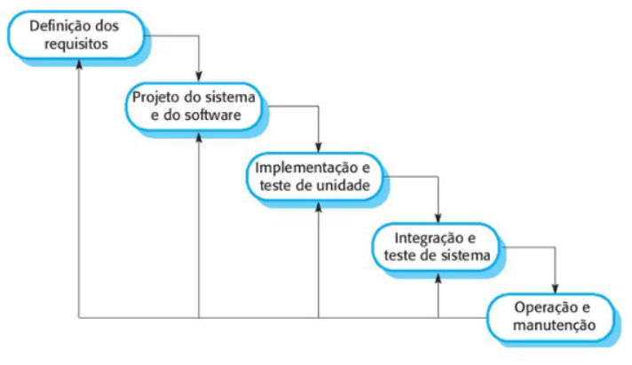
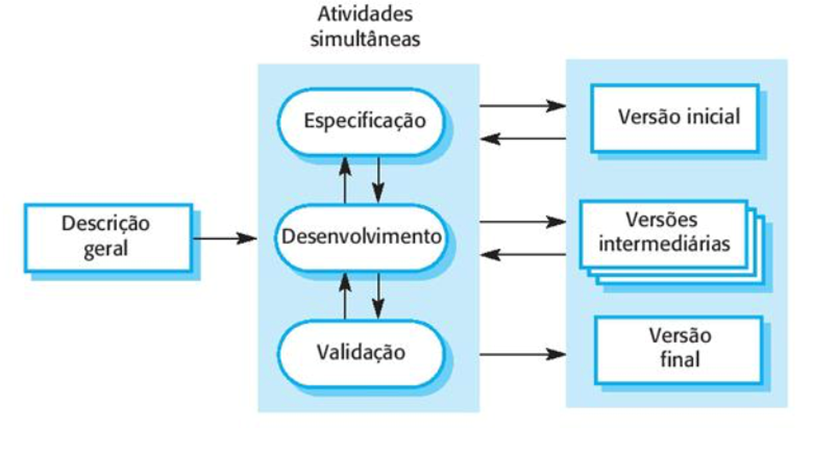
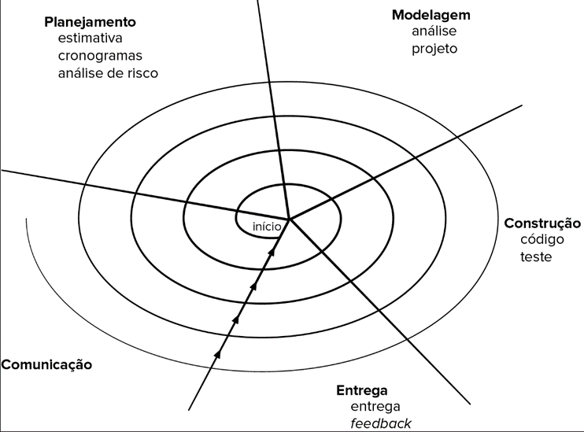

# Aula 3 — Modelos de Processos de Software

## Ponto de Partida

O uso de smartphones vem revolucionando a maneira das pessoas utilizarem softwares. Existem APPs para pagar contas, controlar gastos, localizar lugares e pessoas, e uma infinidade de outras utilidades. Nesse universo, dois grandes sistemas operacionais se destacam, o **Android** e o **iOS**. Você sabia que para desenvolver um software (APP) nativo para esses dois sistemas é preciso utilizar diferentes linguagens de programação? Ou seja, para um mesmo APP nativo, são necessários dois projetos de desenvolvimento e duas equipes. Com tanto trabalho, como isso pode ser feito de maneira organizada, controlada e eficiente? Só há uma maneira! Usando um **modelo de processo de software** que seja adequado ao projeto, à equipe e às expectativas do cliente.

Nesta aula, exploraremos diversos modelos de processos de software disponíveis no mercado. Alguns desses modelos são antigos, mas ainda são amplamente utilizados em vários projetos. A escolha do modelo adequado depende do tipo de software a ser desenvolvido e das expectativas do cliente. O objetivo de todos esses modelos é evitar o caos no desenvolvimento e estabelecer um fluxo de trabalho eficaz.

> Imaginemos que você é um analista de sistemas trabalhando em uma *software house* e acaba de receber um novo cliente. Este cliente deseja desenvolver um software para sua loja de brinquedos online, que permita aos usuários comprar produtos. Além do site, é necessário criar um aplicativo para compras e aluguel de brinquedos, sendo que a opção de aluguel estará disponível apenas no app.
>
> Agora, você enfrenta a decisão crucial: **qual modelo de processo de software é o mais adequado para este novo projeto?**

---

## Vamos Começar!

Os **Modelos de Processos de Software** são utilizados para gerenciar as atividades envolvidas no desenvolvimento de software. O objetivo de um modelo de processo de software é fornecer um *framework* estável, controlado e organizado para essas atividades. Geralmente representado de forma gráfica, um modelo de processo de software detalha os objetos e atividades que fazem parte do processo de desenvolvimento. Pfleeger (2004) aponta que há uma variedade de técnicas e ferramentas disponíveis para a Modelagem de Processos e que **não existe um modelo universalmente aceito como o melhor**. Cada empresa adota e adapta um modelo de processo de software de acordo com suas necessidades específicas e os requisitos de cada projeto de software.

Pressman (2021) enfatiza que um modelo de processo de software serve como um roteiro para as atividades de Engenharia de software, delineando o fluxo de atividades, ações e tarefas, bem como o grau de interação entre elas, os artefatos a serem produzidos e a organização do trabalho a ser realizado. Há vários modelos de processos de software, cada um com suas próprias características distintas. Alguns dos mais notáveis incluem:

| Categoria | Exemplos |
|---|---|
| **Modelos de processos prescritivos** | Cascata, Incremental, Evolucionários (prototipação e espiral), Concorrentes |
| **Modelos de processos especializados** | Baseado em componentes, Métodos formais, Orientado a aspectos, Processo Unificado (RUP), Pessoal e de equipe |
| **Modelos de desenvolvimento ágil** | XP (*Extreme Programming*), Scrum, DSDM, Modelagem Ágil, Processo Unificado Ágil |

### Modelos de processos prescritivos

O modelo de processo prescritivo, também conhecido como **modelo de processos tradicionais**, é definido por um conjunto de elementos do processo, que incluem ações de engenharia de software, produtos resultantes do trabalho e mecanismos de garantia de qualidade e controle de mudanças em projetos de desenvolvimento de sistemas de software, conforme descrito por Pressman (2021). Este modelo estabelece as relações entre os elementos do processo com o objetivo de organizar e estruturar o desenvolvimento de um software de maneira ordenada.

Neste modelo, as tarefas são realizadas de forma sequencial e com diretrizes claras. Elas delineiam um conjunto de atividades metodológicas, ações, tarefas, artefatos, medidas de garantia de qualidade e mecanismos de controle de mudanças para cada projeto. Cada Modelo de processo prescritivo também define um **fluxo de processo** (ou fluxo de trabalho), descrevendo como os elementos do processo estão interconectados.

Dentre os modelos de processos prescritivos mais conhecidos estão o **modelo cascata**, o **modelo incremental**, os **modelos evolucionários** (que incluem prototipação e espiral) e os **modelos concorrentes**.

#### Modelo cascata

O modelo cascata, também conhecido como **ciclo de vida clássico** de um sistema ou abordagem *Top-down*, caracteriza-se por sua abordagem sistemática e sequencial para os processos de desenvolvimento de software. Neste modelo, **cada fase do projeto começa somente após a conclusão da fase anterior**, enfatizando uma progressão linear e estruturada. A Figura 1 ilustra este modelo, mostrando como ele flui de uma etapa para a próxima de maneira ordenada e previsível.

> **Figura 1** — Modelo cascata. *Fonte: Sommerville (2018, p. 33).*

A Figura 1 destaca os estágios do modelo cascata com as cinco atividades fundamentais deste modelo. Vejamos a definição dessas cinco etapas segundo Sommerville (2018):

| Etapa | Descrição |
|---|---|
| **1. Definição de requisitos** | As funcionalidades do sistema são definidas através de consultas aos usuários. A especificação do sistema é documentada, envolvendo a participação e a aprovação do cliente para garantir que as necessidades sejam atendidas. |
| **2. Projeto do sistema de software** | Planejamento da estrutura do sistema, designando recursos para o desenvolvimento do software. São definidas a estrutura de dados, a arquitetura do software, interfaces gráficas, entre outros aspectos técnicos. |
| **3. Implementação e teste de unidade** | O software é codificado na linguagem de programação escolhida. Paralelamente, testes unitários são realizados em cada módulo ou parte do código para identificar e corrigir falhas de programação. |
| **4. Integração e teste de sistemas** | Após a codificação, todos os módulos do software são integrados e submetidos a testes conjuntos, preparando o software para entrega ao cliente. |
| **5. Operação e manutenção** | Com o software em uso, surgem correções e possíveis melhorias solicitadas pelos usuários. São implementadas as correções e novos requisitos identificados como necessários pelo cliente, assegurando a funcionalidade contínua e aprimoramento do software. |

O modelo em cascata é o mais tradicional e simples dentre os modelos de processos de software, oferecendo uma estrutura clara para as atividades e servindo de base para outros modelos que surgiram posteriormente. Sua simplicidade e clareza tornam o gerenciamento mais fácil. No entanto, este modelo pode prolongar o tempo de desenvolvimento de um software, especialmente em projetos complexos, devido à sua natureza sequencial, onde atrasos em uma fase afetam as subsequentes. Como resultado, os clientes podem enfrentar longos períodos de espera antes de receberem o produto final, o que pode levar à insatisfação. Além disso, o modelo em cascata normalmente conta com uma única fase de especificação de requisitos. Uma alternativa para mitigar essas limitações é o uso do modelo incremental.

| Cascata | |
|---|---|
| ✅ **Vantagens** | Simples, estrutura clara, gerenciamento mais fácil |
| ⚠️ **Desvantagens** | Sequencial: atrasos se propagam, cliente espera muito pelo produto final, requisitos especificados uma única vez |

#### Modelo incremental

O modelo incremental é **iterativo** e constrói o software em etapas. A partir dos requisitos iniciais, pequenas versões do software são desenvolvidas e entregues ao cliente, expandindo-se progressivamente até a construção completa do sistema ideal. Neste modelo, cada versão representa um **incremento**, incluindo parte das funcionalidades requisitadas. Diferentemente do modelo em cascata, no modelo incremental o cliente recebe o software em **várias entregas parciais** ao longo do desenvolvimento. Essas entregas consistem em módulos que adicionam ou aprimoram as funcionalidades do sistema. Cada incremento é lançado como uma nova versão do software, culminando na versão final. A Figura 2 ilustra o modelo incremental, mostrando que as atividades de especificação, desenvolvimento e validação ocorrem de forma intercalada, não separadamente. Segundo Sommerville (2018), é essencial manter um *feedback* rápido entre as atividades simultâneas. Em cada incremento, o ciclo completo de desenvolvimento de software é realizado, do planejamento aos testes, resultando em um sistema funcional, mesmo que ainda incompleto em termos de requisitos.

> **Figura 2** — Modelo de processo prescritivo: modelo incremental. *Fonte: Sommerville (2018, p. 35).*

#### Modelo espiral

O modelo espiral, apresentado na Figura 3, é uma variante do modelo evolutivo e combina a natureza iterativa da prototipação com os elementos sistemáticos e controlados do modelo cascata, conforme descrito por Pressman (2016). Este modelo visa o desenvolvimento acelerado de versões do software, onde cada ciclo iterativo resulta em uma versão mais avançada e completa do produto.

> **Figura 3** — Modelo de processo prescritivo: modelo evolucionário-espiral. *Fonte: Pressman (2021).*

---

## Siga em Frente...

### Modelo de processo especializado

Os modelos de processos especializados combinam elementos de um ou mais Modelos de Processos Prescritivos e são aplicados em situações que demandam uma abordagem de Engenharia de Software mais específica e detalhada. Pressman (2021) lista diversos exemplos desses modelos especializados:

| Modelo | Descrição |
|---|---|
| **Baseado em componentes** | Frequentemente utilizado em projetos de software comercial, onde componentes de software pré-fabricados são empregados. Tais componentes, vendidos individualmente ou em conjunto, são projetados para reutilização em diversos projetos. Cada componente é uma unidade independente do software e pode ser substituído ou modificado conforme necessário. |
| **Métodos formais** | Envolve a criação de especificações matemáticas formais do software. Ajuda a identificar e eliminar problemas como ambiguidade, incompletude e inconsistência, fornecendo uma base sólida para a verificação de código e a detecção de erros que poderiam passar despercebidos. |
| **Orientado a aspectos** | Abordagem metodológica que define, especifica, projeta e constrói aspectos do software. O código é organizado de acordo com sua importância, com as classes orientadas a objetos sendo um exemplo. Os requisitos são modelados de maneira a abranger várias funcionalidades do sistema. |
| **Processo unificado (RUP)** | *Rational Unified Process*. Combina características dos modelos prescritivos tradicionais com alguns princípios da metodologia Ágil. É considerado um modelo iterativo e incremental. |
| **Pessoal e de equipe** | Focam no desenvolvimento de software como um esforço coletivo da equipe. No **processo pessoal**, a ênfase é na medição individual do trabalho produzido e na qualidade resultante. Já o **processo de equipe** visa criar uma equipe auto-organizada e autodirigida, com o objetivo de produzir software de alta qualidade. |

### Modelo de desenvolvimento ágil

Com a evolução constante das tecnologias, os processos de negócios têm exigido um desenvolvimento de software mais ágil e rápido. Diante disso, surgiu a **Metodologia Ágil**, uma abordagem que introduz maior flexibilidade e dinamismo no desenvolvimento de software.

A Metodologia Ágil foi desenvolvida para abordar certos desafios da Engenharia de software, oferecendo vantagens significativas. Para Sbrocco (2012), essa metodologia responde à necessidade de um desenvolvimento de software mais rápido, em resposta à demanda dos clientes por resultados rápidos e à natureza evolutiva dos aplicativos, que frequentemente incorporam novas funcionalidades. O Desenvolvimento Ágil enfatiza a flexibilidade e a rapidez na atenção às necessidades dos clientes. Outro ponto relevante deste método são as entregas frequentes, com ênfase na comunicação ativa e contínua entre as partes envolvidas, buscando satisfazer o cliente através de entregas incrementais. Os princípios fundamentais do Desenvolvimento Ágil:

| Princípio | Descrição |
|---|---|
| **Envolvimento ativo do cliente** | É crucial que o cliente participe ativamente no desenvolvimento do software, fornecendo requisitos e avaliando os incrementos desenvolvidos. |
| **Desenvolvimento incremental** | O software é desenvolvido em etapas, permitindo que o cliente forneça novos requisitos que serão incorporados em cada incremento subsequente. |
| **Foco nas pessoas, não nos processos** | A equipe tem autonomia no desenvolvimento, maximizando o potencial dos desenvolvedores, sem a rigidez dos processos prescritivos. |
| **Flexibilidade para mudanças** | O projeto é estruturado de forma a acomodar mudanças nos requisitos, adaptando-se às novas necessidades que possam surgir. |
| **Simplicidade como chave** | A equipe deve evitar complexidades desnecessárias, adotando uma abordagem simples e eficiente em seu trabalho. |

O processo de Desenvolvimento Ágil tem como objetivo principal diminuir significativamente a necessidade de documentação extensa. Isso torna o processo de desenvolvimento mais flexível e diminui a burocracia, comum em outros Modelos de Processos de Software. Nesse contexto, destacam-se dois Métodos Ágeis: **XP (Extreme Programming)** e **Scrum**.

#### XP — Extreme Programming

No Método XP, a retroalimentação constante, o desenvolvimento incremental e a comunicação eficaz entre os envolvidos são aspectos centrais. Pressman (2021) salienta a necessidade de seguir quatro atividades metodológicas principais: **Planejamento, Projeto, Codificação e Testes**. O desenvolvimento do software segue um padrão, com **trabalho em pares** e a participação ativa de um **representante do cliente** no processo, esclarecendo dúvidas e integrando-se à equipe de desenvolvimento.

#### Scrum

Por outro lado, a metodologia Scrum aplica um processo de desenvolvimento iterativo e incremental, sendo também aplicável à gestão de projetos. Este método estabelece um conjunto de práticas e regras de gestão visando o sucesso do projeto, como o trabalho em equipe e a comunicação eficaz. Pressman (2021) menciona que o Scrum compreende atividades metodológicas como Requisitos, Análise, Projeto, Evolução e Entrega, e em cada atividade ocorrem as seguintes tarefas principais:

| Elemento | Descrição |
|---|---|
| **Product Backlog** | Lista dinâmica de requisitos e funcionalidades do projeto, com prioridades que podem ser ajustadas a qualquer momento. O gerente do produto é responsável por adicionar, remover e atualizar as prioridades nessa lista. |
| **Sprints** | Unidades de trabalho designadas para atingir objetivos específicos estabelecidos no Product Backlog. Cada Sprint é delimitado por um período fixo, conhecido como *Time Box*, que define os prazos de entrega. |
| **Reunião de planejamento de sprint** | O *Product Owner* define as prioridades dos itens do Product Backlog, e a equipe seleciona as tarefas que consegue implementar no próximo Sprint. |
| **Daily Scrum** | Reuniões diárias e breves, normalmente com duração de 15 minutos, realizadas no início de cada dia de trabalho. Cada membro da equipe responde a três perguntas-chave (veja abaixo). |

**As três perguntas do Daily Scrum:**

1. O que foi realizado desde a última reunião?
2. Quais obstáculos foram encontrados?
3. O que está planejado até a próxima reunião?

No início de um projeto, são estabelecidas as ideias e funcionalidades básicas do produto, conhecidas como **Histórias**. Essas Histórias, juntas, compõem o Product Backlog. No método Scrum, as reuniões são frequentemente lideradas pelo **Scrum Master**, que é responsável por orientar o processo e monitorar o progresso da equipe. O Scrum Master avalia as respostas de cada membro para identificar problemas precocemente, como atrasos ou dificuldades em compreender determinados requisitos. Ao final de cada Sprint, os requisitos definidos são concluídos e sua funcionalidade é avaliada, o que contribui para aperfeiçoar o processo para o próximo Sprint. Cada Sprint finaliza com um avanço no produto ou no Product Backlog.

Além do Scrum, existem outros métodos de Desenvolvimento Ágil. Pressman (2021) menciona métodos como o **Desenvolvimento de Sistemas Dinâmicos (DSDM)**, a **Modelagem Ágil** e o **Processo Unificado Ágil**. Esses métodos ágeis compartilham uma ênfase na colaboração humana e na auto-organização como componentes fundamentais.

---

## Vamos Exercitar?

Chegou o momento de resolver o desafio que lhe foi proposto no início da aula! Você é um analista de sistemas e recebeu a missão de determinar qual modelo de processo de software será mais indicado para o mais novo projeto de software. A *software house*, onde você trabalha, possui um novo cliente que deseja um software para sua loja de brinquedos online. O software deverá permitir que os clientes da loja comprem os produtos disponíveis no site. Além do site, o cliente deseja um aplicativo, caso o usuário queira acessar a loja para comprar ou alugar brinquedos (o aluguel somente estará disponível na versão em aplicativo).

Para responder qual modelo de processo de software será mais indicado para o mais novo projeto de software, antes devemos observar dois detalhes sobre o software a ser desenvolvido: primeiro, o cliente deseja um site (um *e-commerce*) e, segundo, um aplicativo.

Precisaremos de uma equipe qualificada para realizar o desenvolvimento. A equipe deverá ser subdividida em duas partes: uma para o site e outra para o aplicativo. Há um porém: não foi mencionada qual plataforma deverá ser desenvolvida o aplicativo. Caso consideremos os sistemas operacionais Android e iOS, deveremos ter uma equipe para cada sistema operacional.

Antes de propor um modelo de processo de software é preciso compreender a complexidade do problema e alinhar os prazos e valores com o cliente. Algumas perguntas que devem ser feitas antes da escolha, são:

1. O cliente tem pressa?
2. A equipe de desenvolvimento é grande o suficiente para trabalhar neste projeto?
3. A equipe domina toda a tecnologia envolvida para o desenvolvimento do site e do aplicativo?

Esse projeto é gigante, visto que o cliente deseja um site e um aplicativo; nesse caso, existe uma grande probabilidade de um modelo baseado nos processos **Ágeis** ser o mais recomendável, entretanto, a participação do cliente é essencial para o sucesso desta metodologia. Um dos princípios da metodologia Ágil é dividir o software para entregá-lo em partes menores. O cliente não precisa esperar o site e os aplicativos ficarem totalmente prontos para ver o resultado final, mas pode participar ativamente de todo o processo de desenvolvimento.

> **Conclusão:** uma possível abordagem para esse projeto é adotar a metodologia **Scrum**. Nessa metodologia, entregas devem ser feitas a cada Sprint; dessa forma o cliente saberá o que vai receber e quando receberá. Os requisitos mais importantes podem ser entregues primeiro possibilitando que tanto o site quanto o aplicativo comecem a operar.

Outro ponto importante é a construção do quadro que ajudará a organizar o cronograma e as equipes de trabalho. Veja no Quadro 1 um possível quadro que pode ser usado no projeto. Esse quadro apresenta algumas tarefas pertinentes ao desenvolvimento do site. Como podemos observar no Backlog, estão previstas as tarefas *Gerar Interfaces do Site* (conhecidas como **Wireframes**), *Definir a Paleta de Cores do Site* e *Definir a Estrutura do Banco de Dados*.

#### Quadro 1 — Exemplo de quadro Scrum para o projeto

| Itens do Backlog | A fazer | Em andamento | Pronto |
|---|:---:|:---:|:---:|
| Gerar interfaces do site (wireframes) | | | |
| Definir paleta de cores | | | |
| Definir estrutura do banco de dados | | | |
| ... | | | |

> *Fonte: adaptada de Werlich (2020, p. 50).*

---

## Saiba mais

1. **Modelos de processos de software**: leia o Capítulo 2 — *Processos de software*:
   > SOMMERVILLE, I. **Engenharia de software**. 10. ed. São Paulo, SP: Pearson, 2018.

2. **Metodologias Ágeis**: o livro aborda esse assunto e apresenta outras metodologias. Acesse os capítulos de acordo com os temas estudados na aula.
   > SBROCCO, J. H. T. de C.; MACEDO, P. C. de. **Metodologias Ágeis — Engenharia de Software sob Medida**. Editora Saraiva, 2012.

3. **Trello**: uma boa ferramenta para organizar as tarefas do método ágil Scrum. Pode ser empregada para criar quadros que representam Sprints, onde listas categorizam as tarefas em *To Do*, *In Progress* e *Done*. Cada cartão pode representar uma história de usuário ou uma tarefa, e a equipe pode movê-los pelas listas conforme avançam no Sprint.

## Referências

- PRESSMAN, R. S. Engenharia de software: uma abordagem profissional. 9. ed. Porto Alegre: AMGH, 2021.
- PFLEEGER, S. L. Engenharia de software: teoria e prática. 2. ed. São Paulo: Prentice Hall, 2004.
- SBROCCO, J. H. T. de C. Metodologias ágeis: engenharia de software sob medida. 1. ed. São Paulo: Érica, 2012.
- SOMMERVILLE, I. Engenharia de software. 10. ed. São Paulo: Pearson, 2018.
- WERLICH, C. Análise e modelagem de sistemas. Londrina: Editora e Distribuidora Educacional S.A., 2020.
