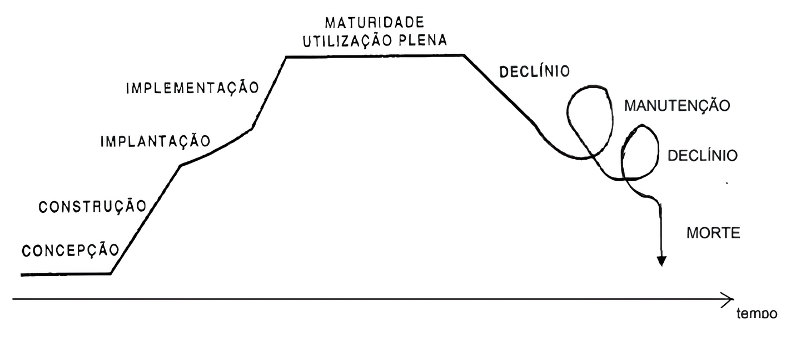
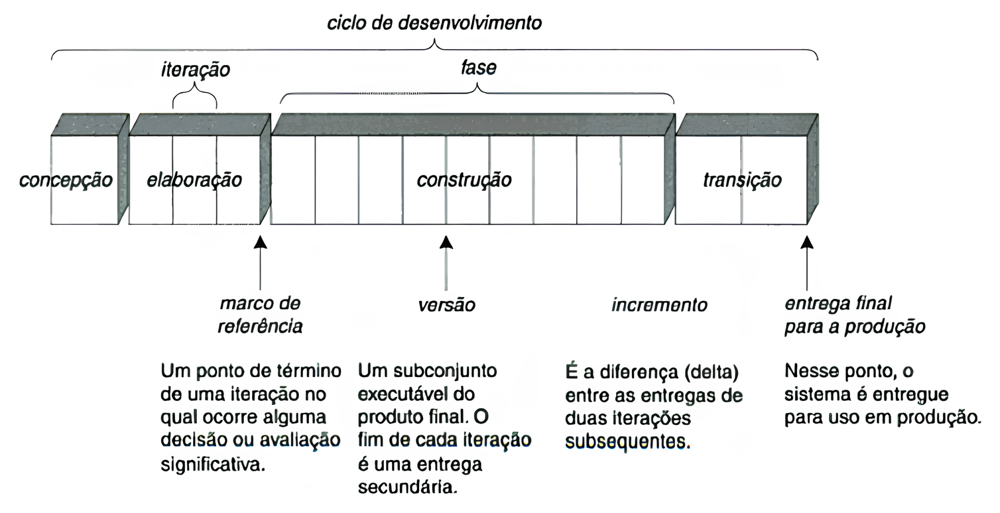
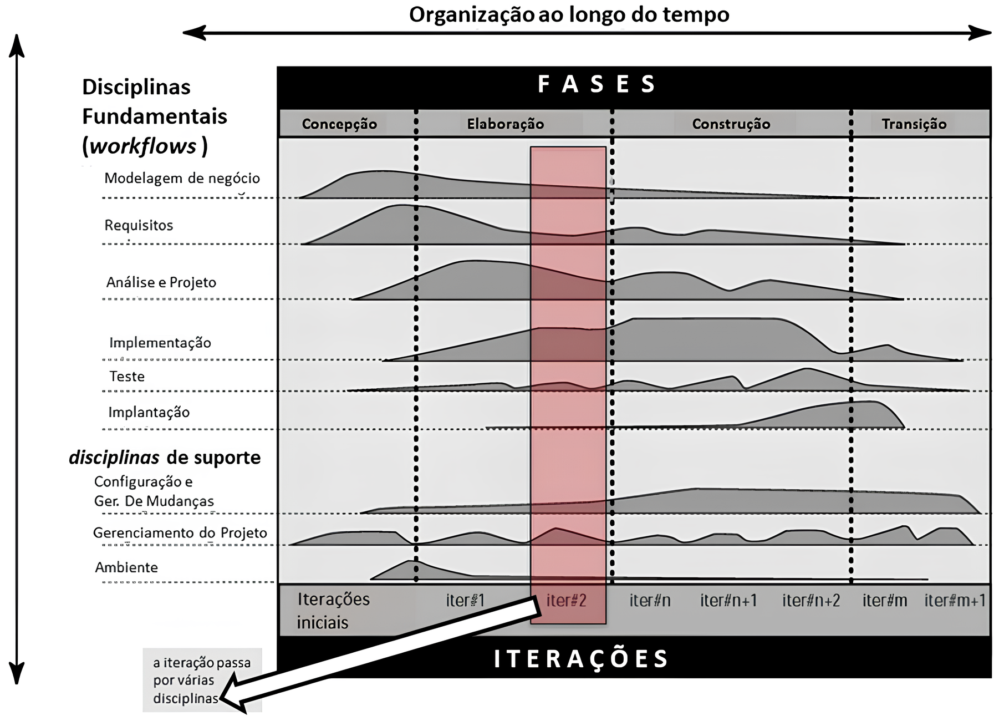

# Aula 4 — Processo Unificado

## Ponto de Partida

Nesta aula, focaremos no **Processo Unificado**, uma abordagem de desenvolvimento de software que se destaca por ser **iterativa, incremental e centrada em arquitetura e casos de uso**. O processo unificado é estruturado em quatro fases principais: **Concepção, Elaboração, Construção e Transição**. Cada fase tem objetivos específicos e contribui para o avanço progressivo do projeto de software. Ao longo da aula, exploraremos detalhadamente essas fases, enfatizando as atividades-chave e os artefatos gerados em cada uma delas. Além disso, discutiremos a importância dos casos de uso como um mecanismo fundamental para capturar requisitos e guiar o desenvolvimento. A abordagem iterativa e incremental permite avaliações e ajustes frequentes, facilitando o gerenciamento de riscos e melhorando a adaptabilidade do projeto às mudanças de requisitos.

A compreensão do processo unificado é crucial para os profissionais de tecnologia, especialmente aqueles envolvidos na gestão de projetos de software. Esta metodologia oferece um *framework* estruturado que ajuda as equipes a lidar com a complexidade do desenvolvimento de software, ao mesmo tempo em que fornece flexibilidade para se adaptar a mudanças e novos requisitos. O processo unificado apoia uma abordagem de desenvolvimento orientada a resultados, permitindo que as equipes identifiquem e resolvam problemas de maneira eficiente, minimizando riscos e garantindo a entrega de software de alta qualidade.

> Imagine que você é um gerente de projeto em uma empresa de desenvolvimento de software. Seu novo projeto é criar um **aplicativo de gerenciamento de tarefas pessoais**. Utilizando os conceitos do processo unificado, elabore um plano inicial para o desenvolvimento deste software.
>
> No seu planejamento, inclua uma descrição breve de cada uma das quatro fases do processo unificado (Concepção, Elaboração, Construção e Transição) aplicadas ao seu projeto. Especifique quais atividades seriam realizadas em cada fase e que tipo de artefatos (documentos, diagramas, código etc.) você espera produzir. Seu plano deve demonstrar uma compreensão clara do processo unificado e como ele pode ser aplicado para gerenciar efetivamente o ciclo de vida do desenvolvimento de software.

---

## Vamos Começar!

### Características do processo unificado

O processo de software refere-se ao conjunto de métodos, técnicas e padrões empregados na produção de software. Dentro da ampla gama de abordagens existentes, o **Processo Unificado (PU)** se destaca como uma síntese de várias metodologias correlatas. Esta abordagem foi concebida e nomeada como Processo Unificado pelos renomados especialistas em software **Jacobson, Booch e Rumbaugh** em 2000, que combinaram suas experiências e conhecimentos para criar um modelo de desenvolvimento de software coeso e eficiente.

No processo unificado, um processo define **quem** está fazendo **o quê**, **quando** e **como** alcançar um determinado objetivo. No PU, os elementos do processo destacados referem-se a:

| Pergunta | Elemento |
|---|---|
| **Quem** | Papel |
| **O quê** | Artefato |
| **Como** | Atividade |
| **Quando** | Disciplina |

Um planejamento eficaz, fundamentado nos princípios da engenharia de software, é essencial para desenvolver um produto de software de alta qualidade, minimizando os riscos associados ao projeto, incluindo atrasos e custos excessivos. Assim como outros produtos, o software passa por um ciclo de vida que inclui várias fases, desde o início (concepção) até a maturidade e uso completo, e eventualmente chegando ao fim de sua utilidade, como demonstrado em um ciclo de vida típico ilustrado na Figura 1.

> **Figura 1** — Representação gráfica do ciclo de vida do software. *Fonte: adaptada de Rezende (2002, p. 49).*

> **Atenção:** não confunda **ciclo de vida do produto** com **modelo do ciclo de vida de desenvolvimento**.

| Conceito | O que é |
|---|---|
| **Ciclo de vida do produto** | Engloba quatro fases principais: introdução (ou concepção), crescimento (que inclui o desenvolvimento e a implantação), maturidade e declínio. |
| **Modelo do ciclo de vida de desenvolvimento** | Estrutura adotada para gerenciar o processo de criação de um software (cascata, espiral, prototipação, incremental, iterativo, entre outros). |

Estes modelos ajudam a organizar as várias etapas do desenvolvimento de software, desde a concepção até a entrega final. Um resumo dos principais:

| Modelo | Característica |
|---|---|
| **Cascata** | Um dos mais antigos. Cinco etapas: (i) análise e levantamento de requisitos, (ii) projeto, (iii) desenvolvimento, (iv) teste e (v) implantação. |
| **Incremental** | O software é entregue ao cliente em módulos, cada um passando por todas as fases do modelo em cascata. |
| **Iterativo (evolutivo)** | Envolve a participação ativa do cliente na fase de análise, mesmo quando todos os requisitos e funcionalidades ainda não estão completamente definidos. Inicialmente, realiza-se uma análise básica, seguida da implementação; com o tempo, a análise é aprimorada, levando à entrega de versões subsequentes e melhoradas. |

Neste amplo leque de opções, destaca-se o **Processo Unificado (PU)**, o tema central desta discussão. O PU é um modelo adaptativo que se inspira no modelo incremental, focando na construção iterativa do software. Este modelo aprimora os processos tradicionais incrementais e iterativos, abordando e mitigando algumas de suas limitações:

- **No modelo iterativo:** há o risco de o software nunca ser concluído devido a constantes solicitações de alterações por parte do cliente, e se a documentação não for bem gerida, o resultado pode ser um software desorganizado.
- **No modelo incremental:** a necessidade de completar cada parte integralmente antes de avançar pode ser um entrave.

O Processo Unificado, proposto por Jacobson, Booch e Rumbaugh, em 2000, combina os aspectos dos modelos iterativo e incremental, permitindo que o software se desenvolva de forma robusta e coesa, evoluindo gradualmente para a maturidade do processo.

#### UML, PU e RUP

No Processo Unificado (PU), a **Linguagem de Modelagem Unificada (UML)** é uma ferramenta indispensável, fornecendo um meio eficiente e padronizado para a modelagem de sistemas de software. Como um conjunto de notações gráficas padronizadas, a UML é utilizada para a criação de representações visuais abrangentes dos sistemas, facilitando a visualização, especificação, construção e documentação dos componentes de software. Sua aplicação no PU, um *framework* adaptativo para o desenvolvimento de software, é fundamental para a comunicação eficaz entre desenvolvedores e demais *stakeholders*, assegurando que todos os elementos do sistema sejam entendidos e validados antes de sua implementação. Além disso, a UML desempenha um papel chave na organização do processo de desenvolvimento dentro do PU, permitindo a definição clara de requisitos, arquiteturas e componentes do software, bem como o acompanhamento do progresso do projeto através das fases iterativas e incrementais do PU.

O PU foi desenvolvido **após** a criação da UML, que surgiu da combinação de três metodologias orientadas a objeto: **Booch, OMT e OOSE**, como destacado por Jacobson no prefácio do livro *"El Proceso Unificado de Desarrollo de Software"* (JACOBSON; BOOCH; RUMBAUGH, 2000). A UML rapidamente se tornou um padrão na indústria de desenvolvimento de software, mas por si só, não constituía um processo completo para o ciclo de desenvolvimento. Para preencher essa lacuna, a mesma equipe que desenvolveu a UML criou o **Processo Unificado Racional (RUP)**, uma versão mais refinada e detalhada do PU.

| | PU | RUP |
|---|---|---|
| **Natureza** | Domínio público | Processo proprietário (Rational Software, mais tarde adquirida pela IBM) |
| **Escopo** | Abrange o ciclo de desenvolvimento de software de forma mais ampla | Mais detalhado, inclui disciplinas adicionais |

### Os três aspectos fundamentais do PU

Conforme descrito por Jacobson, Booch e Rumbaugh em 2000, o PU é caracterizado por três aspectos fundamentais:

1. **Orientação por casos de uso**
2. **Foco na arquitetura**
3. **Natureza iterativa e incremental**

#### 1. Orientado por casos de uso

Os casos de uso são elementos centrais, como explicado por Jacobson, Booch e Rumbaugh (2000). Eles são essenciais para entender as necessidades e desejos dos futuros usuários do sistema. É importante que os casos de uso se concentrem nas necessidades específicas de cada usuário, em vez de se limitarem apenas às funções do sistema. Assim, o modelo de casos de uso orienta as fases de projeto (*design*), implementação e testes do software, seguindo uma sequência lógica de fluxos de trabalho.

#### 2. Foco na arquitetura

Assim como na construção de um carro, onde se considera o design, a mecânica, o sistema elétrico e a aerodinâmica, a arquitetura do software proporciona uma **visão geral do sistema**. Essa visão abrangente deve incluir tanto as necessidades dos usuários quanto os objetivos estratégicos da empresa, fornecendo ao desenvolvedor um entendimento completo do sistema.

#### 3. Iterativo e incremental

Envolve dividir o projeto em subprojetos menores, ou **iterações**, onde cada uma resulta em um **incremento** do produto. Jacobson, Booch e Rumbaugh (2000) destacam que *"as iterações se referem aos passos no fluxo de trabalho, e os incrementos, ao desenvolvimento do produto"*. O método iterativo no PU é bem controlado, o que diminui os riscos associados a custos crescentes e prazos estendidos, e acelera o desenvolvimento ao reconhecer que, especialmente em sistemas complexos, é improvável definir completamente os requisitos e necessidades dos usuários no início do projeto.

### Ciclo de vida do processo unificado

O ciclo de vida do PU é uma série de repetições ao longo da vida do sistema, sendo que cada ciclo completo resulta em uma versão do software. Cada ciclo é composto por **4 fases**:

| Fase | Objetivo |
|---|---|
| **1. Concepção** | Estabelece a visão geral do projeto, definindo o escopo e os requisitos iniciais. É o momento de determinar os objetivos principais e delinear o que o projeto pretende alcançar. |
| **2. Elaboração** | Os requisitos e a arquitetura do sistema são detalhados e refinados. Envolve também uma análise aprofundada dos riscos e a elaboração de estimativas mais precisas para o desenvolvimento do projeto. |
| **3. Construção** | Desenvolvimento ativo do sistema: a construção começa com os elementos mais simples e avança para os mais complexos. Também se inicia a preparação para a implantação do sistema. |
| **4. Transição** | Última fase do ciclo, dedicada à implantação do sistema, momento em que o software é entregue. Envolve a finalização dos detalhes para garantir que o sistema esteja pronto para ser usado no ambiente de destino. |

Observe, na Figura 2, que o ciclo de desenvolvimento (concepção + elaboração + construção + transição) termina com a entrega de uma versão do sistema, pronta para ser implementada em produção. Todo esse ciclo é composto de muitas iterações, segundo Larman (2007).

> **Figura 2** — Ciclo de vida do PU. *Fonte: Larman (2007, p. 62).*

O PU estrutura-se em torno de **quatro elementos fundamentais** que definem o processo:

| Elemento | Pergunta | Descrição |
|---|:---:|---|
| **Papel** (trabalhador) | Quem | Define as responsabilidades de cada pessoa envolvida no projeto, especificando as funções e tarefas de cada trabalhador em determinado momento. Um indivíduo pode assumir diferentes papéis e realizar diversas atividades ao longo do projeto. |
| **Artefato** | O quê | Representa qualquer produto gerado durante o processo de trabalho, que pode incluir código-fonte, esquemas de banco de dados, diagramas, modelos, entre outros. São os resultados tangíveis produzidos pelos trabalhadores. |
| **Atividade** | Como | Refere-se às tarefas executadas pelos trabalhadores com o objetivo de criar ou modificar um artefato. Cada atividade é um passo necessário na produção ou alteração de um artefato. |
| **Disciplina** (fluxo de trabalho) | Quando | Envolve a organização das atividades em uma sequência lógica que leva a um resultado significativo. Os fluxos de trabalho são abordados sob três perspectivas: a **dinâmica** (relacionada ao tempo), a **estática** (focada nas atividades específicas) e as **boas práticas**. Dentro de cada perspectiva, existem várias disciplinas que orientam a execução do projeto. |

---

## Siga em Frente...

### Fluxo de trabalho do processo unificado

As disciplinas fundamentais do PU, também conhecidas como **fluxos de trabalho**, incluem: (i) modelagem de negócios, (ii) requisitos, (iii) análise e projeto, (iv) implementação, e (v) teste e implantação. Estas disciplinas constituem o núcleo principal do nosso estudo. Além delas, existem **disciplinas de suporte**, como gerenciamento de projeto, gerenciamento de configurações e mudanças, e o ambiente. A Figura 3 ilustra como essas disciplinas são aplicadas durante as fases do ciclo de vida do desenvolvimento e em suas várias iterações. Cada iteração, que representa um minissistema, termina com a entrega de um incremento, momento em que se avalia o cumprimento dos objetivos e se fazem os ajustes necessários. Embora todas as disciplinas possam estar envolvidas em cada iteração, a quantidade de tempo dedicado a cada uma varia. Por exemplo, a Figura 3 mostra que nas primeiras iterações há um foco maior nas fases de concepção e elaboração, enquanto nas iterações finais, outras disciplinas recebem mais atenção, o que reflete a progressão natural no desenvolvimento de um sistema.

> **Figura 3** — Fluxo das iterações ao longo do tempo e das disciplinas. *Fonte: IBM (2005).*

Vamos agora analisar o que cada uma destas disciplinas contempla:

| Disciplina | O que contempla |
|---|---|
| **Modelagem de negócio** | Documentar e analisar os objetivos de negócio envolvidos no projeto, com o intuito de compreender como o negócio deve suportar os processos associados. Embora muitos projetos possam optar por não realizar uma modelagem de negócios detalhada, esta etapa é fundamental para alinhar o projeto do sistema com as necessidades do negócio. Casos de uso de negócios são frequentemente empregados nesta fase. |
| **Requisitos** | Definir claramente **o que** o sistema deve fazer. Baseia-se principalmente em casos de uso para identificar os requisitos do sistema. Um aspecto importante é a identificação dos **atores**, que representam os usuários e quaisquer outros sistemas que interajam com o sistema em desenvolvimento (IBM, 2005, p. 4, tradução nossa). O foco está nas funcionalidades do sistema, e é essencial que desenvolvedores e clientes concordem com a descrição dos requisitos. |
| **Análise e Projeto** | Criação dos modelos do sistema, que servirão de base para futuras implementações (detalhado abaixo). |
| **Implementação** | Efetiva construção do software, ou seja, a programação propriamente dita. O código é desenvolvido, configurando a parte prática do projeto, onde os desenvolvedores colocam a "mão na massa". Inclui também a preparação para os primeiros testes, conhecidos como **testes beta**. |
| **Testes** | Definir os procedimentos de teste a serem seguidos. Segundo o documento *"RUP: boas práticas para o desenvolvimento de software"* (IBM, 2005), os principais objetivos são verificar a interação entre objetos e componentes, assegurar que todos os requisitos foram implementados corretamente e identificar e resolver quaisquer defeitos antes da implantação do software. |
| **Implantação** | Garantir a entrega bem-sucedida do produto aos usuários. Inclui a aceitação formal do software pelo cliente. As atividades abrangem a distribuição, instalação e migração de dados, bem como a integração com softwares já existentes. Assegura que o software esteja pronto para uso no ambiente destinado. |

#### Análise e Projeto em detalhe

Estas fases aprimoram a compreensão dos **requisitos funcionais**, estabelecidos nos casos de uso. Requisitos funcionais são declarações dos serviços que o sistema deve fornecer, de como ele deve reagir a entradas específicas e de como deve se comportar em determinadas situações.

| | Análise | Projeto |
|---|---|---|
| **Foco** | Investigação do problema e dos requisitos, não da solução. Como o sistema será usado e quais funções deve desempenhar ("o que fazer"). | Concepção da solução: criação de modelos que atendam aos requisitos estabelecidos ("como fazer"). |
| **Público** | Usuários e desenvolvedores | Desenvolvedores, não os usuários finais |

> Larman (2005) destaca que a análise se concentra mais na investigação do problema e dos requisitos do que na solução propriamente dita, enquanto a implementação lida com o "como fazer".

O projeto envolve a definição clara de **subsistemas**, com a organização de classes em pacotes, delineando os componentes que serão implementados. Um aspecto crucial é seu foco na **arquitetura do sistema**, que implica em representar diversas visões ou abstrações das características mais significativas do sistema. Essa abordagem orientada para a arquitetura facilita a realização de mudanças futuras, especialmente quando os requisitos funcionais passam por alterações, garantindo maior flexibilidade e adaptabilidade ao longo do desenvolvimento do software.

#### Disciplinas de suporte

As disciplinas adicionais, focadas em suporte, foram integradas no **RUP** para complementar as áreas não cobertas pelo PU. Estas incluem o gerenciamento de mudanças e configurações, o gerenciamento de projeto e o gerenciamento do ambiente de desenvolvimento. Essas disciplinas são essenciais para alcançar a maturidade do projeto, oferecendo estruturas e processos necessários para gerenciar eficientemente a evolução do projeto, assegurar a qualidade e facilitar a coordenação e execução das tarefas de desenvolvimento.

---

## Vamos Exercitar?

Chegou o momento de resolver o desafio que lhe foi proposto no início da aula! O plano ilustra a aplicação prática do Processo Unificado no desenvolvimento de um aplicativo de gerenciamento de tarefas pessoais. Cada fase é abordada com atividades e artefatos específicos, demonstrando a abordagem iterativa e incremental do Processo Unificado. Esse planejamento enfatiza a importância da preparação cuidadosa e da resposta flexível às mudanças, elementos-chave para o sucesso no desenvolvimento de software.

### 1. Fase de Concepção

- **Escopo do projeto:** definir o objetivo do aplicativo de gerenciamento de tarefas, identificando as necessidades dos usuários e os benefícios esperados.
- **Requisitos iniciais:** levantar requisitos básicos, como a capacidade de criar, editar e organizar tarefas, definir lembretes e categorizar tarefas.
- **Casos de uso principais:** desenvolver casos de uso para funções críticas, como adicionar uma nova tarefa, definir prioridades e receber notificações.
- **Artefatos:** documento de visão, lista inicial de requisitos, casos de uso iniciais.

### 2. Fase de Elaboração

- **Arquitetura do sistema:** detalhar a arquitetura do software, escolhendo tecnologias apropriadas e definindo a estrutura de módulos e interfaces.
- **Plano de mitigação de riscos:** identificar riscos potenciais, como dependências tecnológicas e desafios de integração, propondo estratégias para mitigá-los.
- **Artefatos:** especificação de arquitetura, modelos de análise e projeto, plano de mitigação de riscos.

### 3. Fase de Construção

- **Desenvolvimento e teste:** organizar o desenvolvimento em iterações, com foco na implementação de funcionalidades conforme definido nos casos de uso. Realizar testes contínuos para garantir a qualidade do software.
- **Artefatos:** código-fonte, testes automatizados, relatórios de teste.

### 4. Fase de Transição

- **Entrega e implantação:** preparar o software para lançamento, realizando testes beta com usuários finais e corrigindo quaisquer problemas identificados.
- **Treinamento e suporte:** desenvolver materiais de treinamento para usuários e estabelecer um plano de suporte pós-lançamento.
- **Planejamento de lançamento:** definir uma estratégia de lançamento, incluindo comunicação de marketing e cronograma de lançamento.
- **Artefatos:** versão final do software, manuais de usuário, plano de lançamento.

---

## Saiba mais

1. **Processo Unificado**: leia o Capítulo 2, seção 2.5, do livro *Engenharia de Software*, disponível na Biblioteca Virtual.
   > PRESSMAN, R. S.; MAXIM, B. R. **Engenharia de software**. Grupo A, 2021.

2. **UML**: o Processo Unificado se baseia na Linguagem de Modelagem Unificada. Para entender mais sobre essa linguagem, acesse o Capítulo 2 do livro *UML Essencial*, disponível na Biblioteca Virtual.
   > FOWLER, M. **UML essencial**. Grupo A, 2011.

3. **Podcast**: ouça o Podcast do Senai Play — Episódio 8 — Processo Unificado.

## Referências

- IBM. Rational Unified Process: Best practices for software development teams. From the developerWorks archives. IBM Staff, jul. 2005.
- JACOBSON, I.; BOOCH, G.; RUMBAUGH, J. El Proceso Unificado de Desarrollo de Software. 1. ed. rev. Madrid: Pearson Educación S.A., 2000.
- LARMAN, C. Utilizando UML e padrões. 3. ed. São Paulo: Bookman, 2007.
- REZENDE, D. A. Engenharia de Software e sistemas de informações. 2. ed. Rio de Janeiro: Brasport, 2002.
