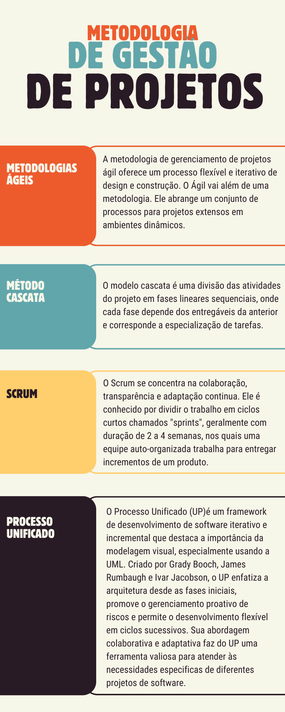

# Aula 5 — Videoaula de Encerramento

## Ponto de Chegada

Olá, estudante! Para desenvolver a competência desta Unidade, que é **compreender os fundamentos da análise de sistemas e as características dos diversos tipos de processos de software**, você deverá primeiramente conhecer os princípios da análise de sistemas.

### Análise de sistemas

A análise de sistemas é um processo que envolve estudos detalhados para identificar a solução ideal para o desenvolvimento de um sistema, baseando-se em métodos e técnicas de pesquisa e especificação. Este processo é dividido em várias fases, incluindo **análise, projeto, implementação, testes, documentação e manutenção**. Cada fase tem um papel específico, desde a avaliação de viabilidade e especificação de funcionalidades até a codificação, teste e documentação do software. Além disso, é importante incluir um processo de **homologação** para a aprovação oficial do cliente. Sommerville (2018) e Pressman (2021) ressaltam a importância da clareza e compartilhamento de informações, definição progressiva de funcionalidades, ilustração do comportamento do software, estruturação de diagramas em camadas para decompor problemas complexos, e detalhamento dos aspectos de implementação conforme o projeto avança.

### O papel do analista de sistemas

É um profissional responsável por liderar a análise de sistemas, incluindo atividades como pesquisa, planejamento, coordenação de equipes de desenvolvimento e recomendação de soluções de software adequadas às necessidades empresariais. Este papel abrange desde a concepção até a implementação e implantação de software, começando pela definição das funcionalidades do sistema e compreensão das necessidades dos usuários para organização, especificação e documentação adequadas. Este profissional deve ter conhecimentos abrangentes sobre várias áreas de negócios e estar disposto a se informar sobre campos específicos quando necessário. As habilidades importantes incluem estar atualizado com as tecnologias, possuir organização, visão gerencial e excelentes habilidades interpessoais.

O analista de sistemas age como um **intermediário** entre os desenvolvedores e os usuários finais, coletando e interpretando informações dos usuários para comunicá-las aos desenvolvedores de forma técnica, garantindo que o software atenda às expectativas de clientes e usuários. As responsabilidades durante o desenvolvimento incluem:

- interagir com clientes e usuários;
- avaliar a viabilidade do projeto;
- coletar informações e identificar requisitos;
- desenvolver a modelagem do software e orientar desenvolvedores;
- realizar testes e gerenciar a documentação;
- administrar mudanças no projeto e estabelecer padrões de desenvolvimento;
- garantir a qualidade do software, com monitoramento e auditorias;
- organizar treinamentos para usuários e supervisionar a implantação;
- oferecer consultoria técnica.

O analista também deve se manter informado sobre novas tecnologias e buscar constante aperfeiçoamento profissional.

### Processo de software

Um **Processo de software** é um conjunto de atividades e resultados inter-relacionados que levam à criação de um software. Segundo Sommerville (2018) e Pressman (2021), na Engenharia de software, esse processo não é uma metodologia rígida, mas sim uma abordagem **flexível** que permite à equipe de desenvolvimento escolher processos que se alinhem com a filosofia da empresa, buscando qualidade, cumprimento de prazos e redução de custos. O Processo de software geralmente inclui **especificação, design, implementação, validação, manutenção e evolução**. Esse processo estabelece padrões para a criação de serviços e produtos, facilita a repetição e reutilização de componentes, preserva conhecimento dentro da empresa, define atividades de projetos de software, especifica processos de desenvolvimento, determina tarefas, minimiza riscos, melhora a comunicação na equipe e pode ser usado como modelo para novos projetos.

Engholm Jr. (2010) explica que, ao estabelecer Processos de software, são determinados vários parâmetros, incluindo o evento que inicia o processo, a matriz de responsabilidades, as atividades a serem executadas em ordem, as entradas e saídas de cada atividade, as regras e políticas, a infraestrutura necessária e os resultados de cada processo. Em um Processo de Software, diversas atividades podem ocorrer de forma sequencial ou em paralelo, envolvendo mudanças nas atividades realizadas em cada fase e estabelecendo responsabilidades, prazos e estratégias para alcançar os objetivos. Mesmo variando entre empresas, todos os Processos de software utilizam uma **estrutura genérica** com atividades pré-estabelecidas.

#### Atividades fundamentais

| Autor | Atividades |
|---|---|
| **Sommerville (2018)** — 4 atividades | **Especificação** (escopo e funcionalidades) · **Projeto e Implementação** (desenho e programação) · **Validação** (verifica se atende aos requisitos do cliente) · **Evolução** (atualizações e melhorias) |
| **Pressman (2021)** — 5 atividades | **Comunicação** (compreender os objetivos) · **Planejamento** (tarefas técnicas e cronograma) · **Modelagem** (criar modelos para entender as necessidades) · **Construção** (codificação e teste) · **Entrega** (software entregue e testado pelo cliente, com adaptações e correções) |

Cada projeto de software é único e requer diferentes conjuntos de tarefas e abordagens. Os analistas de sistemas determinam essas tarefas com base nas características e necessidades específicas do projeto. Por exemplo, na criação de interfaces de um sistema, o programador desenvolve as telas com base em requisitos específicos, e a qualidade do trabalho é avaliada conforme essas especificações.

> **Qualidade:** a implementação de um Processo de software **não garante automaticamente** a qualidade do produto final, nem assegura que o software será entregue dentro do prazo ou que atenderá integralmente aos requisitos do cliente. A qualidade depende diretamente dos padrões de qualidade aplicados durante o processo. A modelagem de processos permite revisões e melhorias contínuas antes da finalização do software.

### Modelos de processos de software

#### Modelos prescritivos

O modelo de processo prescritivo, também conhecido como **modelo de processos tradicionais**, inclui um conjunto de elementos que englobam ações de engenharia de software, produtos de trabalho e mecanismos para garantir a qualidade e controlar mudanças em projetos de desenvolvimento de software. Este modelo orienta o desenvolvimento de forma estruturada e ordenada, com tarefas realizadas sequencialmente e diretrizes claras (SOMMERVILLE, 2018).

| Modelo | Resumo |
|---|---|
| **Cascata** | Abordagem sistemática e sequencial, com cada fase iniciando após a conclusão da anterior. Etapas: definição de requisitos, projeto do sistema, implementação e teste de unidade, integração e teste de sistemas, e operação e manutenção. Simples e claro, facilita o gerenciamento, mas pode prolongar o tempo de desenvolvimento devido à sua natureza sequencial. |
| **Incremental** | Iterativo; desenvolve o software em etapas. Com base em requisitos iniciais, são criadas versões menores do software, entregues ao cliente de forma progressiva até a conclusão do sistema. Cada versão adiciona ou melhora funcionalidades, com entregas parciais durante o desenvolvimento. |
| **Espiral** | Combina a abordagem iterativa da prototipação com a estrutura sistemática do cascata. Cada ciclo resulta em uma versão mais completa do software, visando um desenvolvimento rápido e eficiente. |

#### Modelos especializados

Representam uma fusão de elementos de diferentes modelos prescritivos, adaptados para situações que exigem abordagens mais específicas e detalhadas.

| Modelo | Resumo |
|---|---|
| **Baseado em componentes** | Amplamente usado em projetos comerciais, com componentes de software pré-fabricados para reutilização. |
| **Métodos formais** | Cria especificações matemáticas formais para o software, facilitando a eliminação de ambiguidades e inconsistências e fortalecendo a verificação do código. |
| **Orientado a aspectos** | Organiza o código por importância, abordando diversos aspectos do sistema, como classes orientadas a objetos. |
| **Processo unificado (RUP)** | Integra características dos modelos prescritivos com a metodologia Ágil, sendo iterativo e incremental. |
| **Pessoal e de equipe** | Enfatiza o desenvolvimento como atividade coletiva: no modelo **pessoal**, foco na medição individual do trabalho; no modelo de **equipe**, criação de equipes auto-organizadas e autodirigidas, visando software de alta qualidade. |

#### Metodologia Ágil

A evolução constante das tecnologias e dos processos de negócios tem impulsionado a necessidade de um desenvolvimento de software mais ágil e rápido, levando ao surgimento da **Metodologia Ágil**. Esta abordagem traz maior flexibilidade e dinamismo ao processo, focando na rapidez e flexibilidade para atender às necessidades dos clientes. É caracterizada por:

- envolver ativamente o cliente no desenvolvimento;
- adotar uma abordagem de desenvolvimento incremental;
- dar autonomia à equipe;
- ser flexível às mudanças;
- buscar simplicidade no trabalho.

A Metodologia Ágil visa reduzir a necessidade de documentação extensiva, tornando o processo mais flexível e menos burocrático. Dois métodos ágeis se destacam:

| Método | Resumo |
|---|---|
| **XP (Extreme Programming)** | Enfatiza a retroalimentação constante, desenvolvimento incremental e comunicação eficaz, seguindo atividades como planejamento, projeto, codificação e testes, com a participação ativa de um representante do cliente (PRESSMAN, 2021). |
| **Scrum** | Processo de desenvolvimento iterativo e incremental, aplicável também à gestão de projetos, que incorpora práticas e regras de gestão para o sucesso do projeto. Inclui *Product Backlog*, *sprints* para atingir objetivos específicos, reuniões de planejamento e reuniões diárias (*Daily Scrum*) para monitorar o progresso. |

Além destes, existem outros métodos de Desenvolvimento Ágil, como o **DSDM** (Desenvolvimento de Sistemas Dinâmicos), a **Modelagem Ágil** e o **Processo Unificado Ágil**, todos compartilhando uma ênfase na colaboração humana e na auto-organização.

### Processo Unificado (PU)

O PU representa uma abordagem adaptável no desenvolvimento de software, caracterizado por sua natureza **iterativa e incremental**. A intenção do PU é alinhar o processo de desenvolvimento com os objetivos específicos de cada projeto, mantendo ao mesmo tempo a flexibilidade e a eficiência. Uma das características distintas do PU é sua divisão do projeto em mini fases ou **iterações**, onde cada uma resulta em um incremento do software. Isso permite fazer ajustes contínuos com base no *feedback* e nas mudanças de necessidades do projeto (ENGHOLM, 2010). O PU é fortemente **centrado em casos de uso** para definir os requisitos funcionais, guiando o desenvolvimento pelas necessidades dos usuários finais para assegurar a relevância e utilidade do software. Além disso, a abordagem dá grande ênfase à **arquitetura** do software, garantindo que o sistema seja robusto, escalável e fácil de manter.

No que diz respeito às fases, o PU se divide em quatro etapas principais:

| Fase | O que acontece |
|---|---|
| **Concepção** | Estabelece a visão e o escopo do projeto, focando em identificar requisitos básicos, riscos potenciais e a viabilidade do projeto. |
| **Elaboração** | Detalha os requisitos e define a arquitetura base do sistema, além de avaliar os riscos principais; crucial para o planejamento detalhado do projeto. |
| **Construção** | O software é desenvolvido e testado, seguindo o design e a arquitetura previamente definidos, resultando em um produto quase final ou versão beta. |
| **Transição** | O produto é entregue aos usuários finais, envolvendo a resolução de quaisquer problemas identificados, ajustes finais e, em alguns casos, treinamentos para os usuários e a manutenção do sistema. |

Dentre as metodologias derivadas do PU, destaca-se o **Rational Unified Process (RUP)**, desenvolvido pela Rational Software e mais tarde adquirido pela IBM. O RUP personaliza o PU para fornecer um processo mais estruturado e detalhado, adaptando-se a uma variedade de projetos de software (IBM, 2005).

O PU é especialmente benéfico em projetos grandes e complexos, onde os requisitos podem mudar com o tempo. A natureza iterativa e incremental do PU facilita a gestão de riscos, a adaptação a mudanças e promove uma colaboração eficaz entre equipes de desenvolvimento e partes interessadas.

---

## É Hora de Praticar!

### Estudo de Caso: Scrum + Processo Unificado

Scrum e Processo Unificado representam duas abordagens distintas, porém complementares, no vasto cenário do desenvolvimento de software. O Scrum, uma metodologia ágil, destaca-se por sua flexibilidade e capacidade de se adaptar a mudanças rápidas, dividindo o trabalho em iterações mensuráveis chamadas *sprints*. Por outro lado, o Processo Unificado oferece uma estrutura mais estruturada, dividindo o desenvolvimento em fases definidas, como concepção, elaboração, construção e transição. Embora essas abordagens possam parecer contrastantes à primeira vista, a combinação equilibrada de elementos do Scrum e do Processo Unificado pode resultar em uma metodologia híbrida que aproveita o dinamismo ágil e a solidez estruturada, oferecendo uma abordagem eficaz para projetos complexos. Nesse contexto, exploraremos como essas metodologias podem ser integradas para otimizar o desenvolvimento de software, equilibrando agilidade e estrutura para alcançar resultados sólidos e adaptáveis.

> Sabendo disso, vamos imaginar que você é um **consultor** encarregado de liderar uma equipe de desenvolvimento em um projeto altamente complexo que exige inovação e adaptabilidade. Proponha uma estratégia que combine elementos das metodologias ágeis, como o Scrum, com o processo unificado, enfatizando como essa abordagem híbrida pode gerenciar eficientemente mudanças constantes nos requisitos, garantindo ao mesmo tempo uma arquitetura sólida e escalabilidade para o sistema. Apresente um plano de implementação detalhado, considerando possíveis desafios e soluções, destacando como essa sinergia entre ágil e processo unificado pode ser uma vantagem competitiva no desenvolvimento de projetos de alta complexidade.

### Reflita

1. Como o papel do analista de sistemas evolui diante das rápidas transformações tecnológicas e das demandas crescentes por inovação nas organizações?
2. Qual é a importância de considerar as características específicas de um projeto de software ao escolher o processo de desenvolvimento, e como as necessidades e requisitos únicos podem influenciar a decisão entre metodologias tradicionais, como a cascata, e abordagens ágeis, como o Scrum?
3. Como a abordagem do processo unificado na modelagem de software, ao desafiar a segmentação tradicional de fases, contribui para uma visão mais fluida e interconectada, influenciando positivamente na criação de sistemas mais adaptáveis e robustos?

### Dê o Play!

Clique aqui para acessar os slides do *Dê o play!* (disponível na plataforma da instituição).

### Resolução do Estudo de Caso

Para implementar essa abordagem híbrida de Scrum com o processo unificado, o consultor poderia iniciar adotando **sprints do Scrum** para iterativamente desenvolver funcionalidades, enquanto, simultaneamente, a **fase de Elaboração** do processo unificado é utilizada para realizar análises detalhadas de requisitos e arquitetura. Durante os sprints, a equipe aplicaria princípios ágeis de flexibilidade e entrega contínua, enquanto a fase de Elaboração garantiria a estabilidade arquitetural e a integração consistente de novas funcionalidades.

| Aspecto | Resolução |
|---|---|
| **Scrum contribui com** | Sprints, flexibilidade, entrega contínua |
| **Processo Unificado contribui com** | Elaboração: análise detalhada de requisitos e arquitetura estável |
| **Desafio potencial** | Sincronização eficiente entre as práticas ágeis e tradicionais |
| **Solução** | Comunicação clara e colaborativa entre as equipes envolvidas |

A sinergia resultante entre Scrum e o processo unificado cria um ambiente propício para desenvolver projetos complexos de forma ágil e estruturada.

### Assimile

Este infográfico oferece uma visão concisa e informativa sobre quatro abordagens fundamentais no desenvolvimento de software: **Métodos Ágeis, Método Cascata, Scrum e o Processo Unificado (PU)**. Ao explorar essas metodologias, o infográfico destaca as principais características e benefícios de cada uma. Descubra as práticas ágeis que promovem a flexibilidade e resposta rápida às mudanças, as iterações estruturadas do Scrum para gerenciamento de projetos, e a abordagem iterativa e focada em arquitetura do Processo Unificado.

> **Figura** — Infográfico: abordagens fundamentais no desenvolvimento de software. *Fonte: elaborada pela autora.*

---

## Referências

- ENGHOLM JR., H. Engenharia de Software na Prática. São Paulo: Novatec, 2010.
- IBM. Rational Unified Process: Best practices for software development teams. From the developerWorks archives. IBM Staff, jul. 2005.
- PRESSMAN, R. S. Engenharia de software: uma abordagem profissional. 9. ed. Porto Alegre: AMGH, 2021.
- SOMMERVILLE, I. Engenharia de software. 10. ed. São Paulo: Pearson, 2018.
- WERLICH, C. Análise e modelagem de sistemas. Londrina: Editora e Distribuidora Educacional S.A., 2020.
