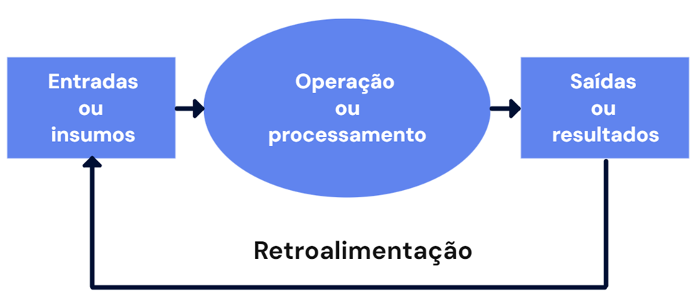
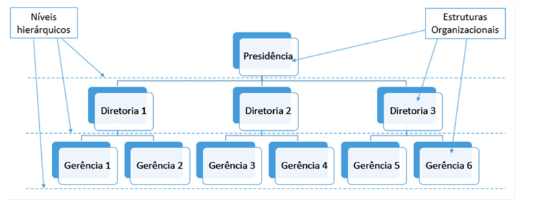
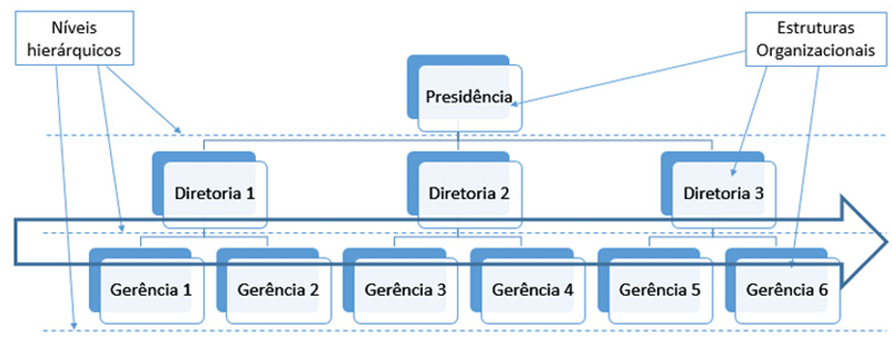

# Aula 1 — Fundamentos de Processos de Negócios

## Ponto de Partida

O processo de negócio para análise de sistemas é uma atividade que surge da **observação**, parte para o **estabelecimento de um plano de melhoria** e por último realiza o **monitoramento**. Muitas vezes essa atividade é desenvolvida no nosso dia a dia de forma intuitiva, e um exemplo disso é quando mudamos um móvel ou até um componente da cozinha de lugar: visamos ganhar espaço, melhorar a utilização do que temos, deixar um item muito utilizado mais à mão, e por aí vai. A ideia de avaliar os processos de negócio tem o mesmo objetivo, e para fixarmos o aprendizado vamos ao primeiro desafio.

> Uma empresa do ramo de **indústria alimentícia** precisa melhorar seus processos para a implementação de um novo software de gestão, e para isso você deverá auxiliar a gestora da empresa a construir os processos de negócios em uma visão funcional e de processos ponta a ponta. Dessa forma, será necessário compreender as áreas de negócios da empresa, e você deverá determinar sua classificação para que possa ter processos de negócios bem desenhados e que atendam, posteriormente, às demandas da área de TI.
>
> Para atingir os objetivos do seu desafio, você foi informado que atualmente a organização conta com **38 colaboradores**, cada área com um gestor:
>
> | Área | Colaboradores | Composição |
> |---|:---:|---|
> | Administrativa | 7 | contas a pagar, contas a receber, faturamento, estoquista, compras, RH, gestor |
> | Comercial | 8 | gestor e consultores de vendas |
> | Marketing | 3 | gestor e analistas |
> | Produção | 10 | gestor e operadores de produção |
> | Logística | 7 | gestor, 3 motoristas e 3 ajudantes |
> | TI | 3 | gestor e analistas |
>
> O objetivo da empresa é ter todos os processos mapeados e documentados de forma adequada para que a área de TI consiga ter entregas satisfatórias no menor tempo possível. A empresa conta com sua expertise para validar todos os processos junto aos responsáveis da área e estruturar o melhor cenário possível. Você deverá utilizar os conceitos desta seção para atender o solicitado e pensar sobre o funcionamento da organização, bem como as relações existentes dentro dela.

O entendimento sobre o segmento de atuação da organização é importante para definir os processos de negócio. Sempre que falamos de processos de negócio devemos levar em conta a relação com o cliente e pensarmos nos processos que contribuem para que esse seja atendido de forma satisfatória ao longo de sua cadeia. A relação do cliente se inicia no ambiente externo, avança para o interno e novamente volta ao externo.

Como produto da execução das atividades propostas, você entregará à indústria alimentícia um relatório com todos os aspectos levantados por meio do estudo dos conceitos e das respostas geradas a partir das indagações realizadas por você e sua equipe para resolver essa etapa da jornada.

Não se esqueça que o desafio será vencido com maior facilidade a partir do seu empenho para adquirir os conhecimentos que serão tratados nesta seção. Conceitos esses que estão direcionados para o entendimento dos processos de negócio, como são estruturados e no que diferem de processos, bem como sua classificação e visão de negócio.

---

## Vamos Começar!

### Conceito de processo de negócios

Você já refletiu sobre a diversidade de áreas que uma empresa abrange? É evidente que cada empresa possui uma estrutura única, atividades específicas e, por conseguinte, diversas áreas. Portanto, é crucial analisar cada organização com cuidado para compreender e identificar suas distintas áreas e como elas se inter-relacionam.

A integração da área de Tecnologia da Informação (TI) com as demais áreas de negócio desempenha um papel significativo. Essa integração é crucial para evitar falhas no desenvolvimento de software, garantindo que este esteja alinhado com os objetivos da empresa. A área de TI desempenha um papel estratégico nas organizações, contribuindo para o design e a gestão de processos que possibilitam a entrega de soluções mais eficazes aos clientes.

Um exemplo concreto é a experiência da área de TI no desenho de processos de negócio. A tecnologia desempenha um papel crucial na determinação de modelos de processos de negócio, otimizando e reduzindo custos. Isso permite que a empresa se posicione de maneira diferenciada e gere vantagens competitivas, atendendo às demandas dos clientes. Por exemplo, ao otimizar o processo de vendas, é possível aumentar a agilidade no atendimento, na entrega e na satisfação do cliente. Esse mesmo princípio pode ser aplicado a vários outros processos, como os financeiros e produtivos.

As **áreas de negócio** são aquelas cujo propósito é dar continuidade à missão organizacional, produzindo bens ou serviços que atendam às demandas do cliente externo. Estas atividades são consideradas essenciais, pois estão diretamente vinculadas à atividade central (*core business*) da organização.

Quando nos referimos às áreas de negócio, é imprescindível não negligenciar o processo de negócio, mas é necessário primeiro recordar o conceito de processo. Segundo Chiavenato (2014), um **processo** é uma sequência lógica e estruturada de tarefas que envolvem uma entrada (*input*) de vários elementos, os quais são processados para gerar saídas (*outputs*), conforme ilustrado na Figura 1.

> **Figura 1** — Processo. *Fonte: adaptada de Chiavenato (2014).*

A estruturação do processo de negócio deve ser abordada a partir da perspectiva de processos, englobando inputs e outputs. Os **inputs**, que são as entradas do processo, incluem, essencialmente:

| Input | Exemplos |
|---|---|
| **Recursos humanos** | Disponibilidade de pessoas |
| **Máquinas e equipamentos** | Desde computadores até maquinários produtivos |
| **Materiais** | Insumos de produção ou outros |
| **Recursos financeiros** | — |
| **Informações** | Provenientes do cliente, mercado, estoque |
| **Procedimentos** | Definem como a execução deve ocorrer |

Por outro lado, os **outputs** representam os resultados gerados a partir do processamento de todos esses recursos de entrada, com o objetivo de criar um produto ou serviço (Paim, 2009).

### Classificação de processos de negócio

Os processos podem ser categorizados como **simples** ou **complexos**, como no exemplo de ligar uma televisão ou fabricar uma televisão. A complexidade do processo tem impacto direto em sua dificuldade de modelagem e gerenciamento, exigindo uma documentação adequada que detalhe como as tarefas e atividades devem ser executadas, especificando quem é responsável pela execução das tarefas para alcançar o resultado desejado. É importante ressaltar que mesmo processos simples devem ser documentados, pois isso favorece a padronização e evita interferências em outros processos.

#### Decomposição: macroprocesso, processo e subprocesso

Quanto ao processo de decomposição, é possível categorizá-lo como **macroprocesso**, **processo** e **subprocesso**. A Figura 2 ilustra um exemplo de decomposição, em que os macroprocessos abordam as operações mais amplas da organização, sendo subdivididos em processos, os quais, por sua vez, são fragmentados em subprocessos.

> **Exemplo:** uma montadora de automóveis pode ter a **fabricação de veículos** como macroprocesso, o qual contém vários processos, incluindo a **produção**, que, por sua vez, é desmembrada em subprocessos como **pintura** e **montagem**, entre outros.

> **Figura 2** — Decomposição de macroprocesso, processo e subprocesso. *Fonte: adaptada de Werlich (2020, p. 58).*

#### Processos primários, de suporte e de gerenciamento

Conforme destacado por Brocke e Rosemann (2013), o processo de negócio é a consolidação de atividades e tarefas com o objetivo de alcançar um resultado que represente **valor agregado ao cliente**. Ele organiza sequencialmente essas atividades e tarefas de maneira lógica, delineando como o trabalho deve ser executado por meio de um bem ou serviço. Os mesmos autores enfatizam que os processos de negócios podem ser classificados, com base em suas características, como **processos primários**, **processos de suporte** e **processos de gerenciamento**. É importante ressaltar que existe interação entre esses tipos de processos.

| Tipo | Agrega valor a… | Exemplos |
|---|---|---|
| **Primário** | O **cliente final** (ligado ao *core business*) | Produção de produtos, entrega ao cliente, marketing |
| **Suporte** | Os processos primários e de gerenciamento (não ao cliente diretamente) | RH, TI, contabilidade, contas a pagar |
| **Gerenciamento** | Os processos primários e de suporte (não ao cliente diretamente) | Gerenciamento estratégico, gerenciamento de desempenho |

**Processos primários.** Estão intrinsecamente ligados ao *core business* (negócio principal) da organização, ou seja, estão diretamente associados às atividades essenciais. São aqueles que agregam valor ao cliente final, e, como resultado, seus desempenhos refletem o nível de satisfação do cliente. Desempenham um papel crucial na tradução da missão da organização, englobando atividades como a produção de produtos, a entrega ao cliente, o marketing, entre outras iniciativas voltadas para a geração de valor ao cliente (BROCKE; ROSEMANN, 2013).

> Os processos primários são capazes de **iniciar e encerrar fora da organização**, uma vez que estão diretamente conectados aos clientes, estabelecendo uma relação com a entrega final (a promessa feita ao cliente).

**Processos de suporte.** Sustentam as operações dos processos primários e de gerenciamento, ou seja, oferecem apoio aos dois outros grupos de processos. Eles auxiliam os processos primários na realização das entregas que agregam valor ao cliente, embora não forneçam valor diretamente ao cliente final. Em outras palavras, esses processos acrescentam valor ao próprio processo, não ao cliente. Uma execução eficiente dos processos de suporte contribui para que os processos primários sejam executados da melhor forma possível, gerando um impacto positivo no cliente. Essa eficácia, por sua vez, demanda um alinhamento organizacional inicial, assegurando que todos os colaboradores estejam alinhados na mesma direção. Posteriormente, é essencial ter uma clara delineação dos processos primários, de suporte e de gerenciamento (BROCKE; ROSEMANN, 2013).

Setores como recursos humanos, tecnologia da informação, contabilidade e contas a pagar são exemplos de áreas de apoio aos processos primários, mas não mantêm uma conexão direta com o cliente final.

> **Contexto importa:** a avaliação dos processos de suporte deve ser contextualizada de acordo com cada organização. Por exemplo, em um escritório de contabilidade, onde o "produto" entregue é a contabilidade em si, os processos de suporte podem ser considerados como processos primários nesse contexto específico.

**Processos de gerenciamento.** Compartilham características semelhantes com o processo de suporte, uma vez que operam como processo secundário. Têm a capacidade de agregar valor tanto aos processos primários quanto aos de suporte, porém não proporcionam, diretamente, valor ao cliente final. De acordo com Brocke e Rosemann (2013), o processo de gerenciamento está vinculado à **supervisão e controle** das atividades organizacionais. Esses processos são essenciais para monitorar os resultados, avaliar sua satisfatoriedade e, consequentemente, identificar melhorias que indiretamente resultarão em valor agregado ao cliente, mas por meio da otimização dos processos e não pela entrega direta de valor ao cliente. Seu objetivo é assegurar o alcance dos objetivos organizacionais. O monitoramento e controle são realizados por meio de práticas como o gerenciamento estratégico e o gerenciamento de desempenho, que servem para acompanhar, medir ou controlar o desenvolvimento dos processos primários e de suporte.

Quando mencionamos controle, estamos nos referindo aos **indicadores de desempenho** estabelecidos por cada organização, adaptados às suas atividades e tarefas específicas. É crucial ter em mente que cada organização terá indicadores distintos, abrangendo diferentes fatores a serem monitorados e controlados.

> **Por que classificar?** A classificação serve, basicamente, para direcionar os esforços das empresas: quando há problemas em um processo **primário** o cliente "sente" de forma imediata; já quando o problema é em um processo de **suporte** ou de **gerenciamento**, o impacto no cliente, de maneira geral, é menor ou imperceptível.

---

## Siga em Frente...

### Visão funcional e visão de processos ponta a ponta

Gerenciar processos se mostra como um pensamento de grande relevância para organização, pois acarreta benefícios que gerarão impactos diretos no cliente. Alguns dos benefícios gerados pelo gerenciamento de processos estão ligados a (VALLE; OLIVEIRA; BRACONI, 2013):

- Alinhamento dos processos com a estratégia organizacional.
- Melhoria da qualidade dos processos e dos produtos.
- Redução de custos por se desenvolver um olhar mais crítico.
- Muitos processos têm redução de sua complexidade e tornam-se mais simples, facilitando a interação entre as áreas.
- A melhor gestão sobre os processos permite readequação e redução de tempo em muitos casos.
- Processos não essenciais podem ser automatizados.
- Aumento do envolvimento e comprometimento dos *stakeholders* (partes interessadas).
- Melhor delegação de responsabilidades.

#### Visão funcional

A abordagem funcional da organização está associada à sua estrutura hierárquica, caracterizando-se por um modelo de visualização **vertical**. Nesse contexto, os processos são analisados por departamento, e cada departamento gerencia recursos específicos de sua área (DE SORDI, 2018).

Essa perspectiva não enfatiza a interconectividade entre as áreas de negócios, resultando em uma percepção isolada de cada área, como se não houvesse integração entre elas, assemelhando-se à situação em que as engrenagens de um relógio não se entrelaçam. A abordagem funcional apresenta características de **silos**, onde cada atividade é conduzida de maneira isolada, com coordenação deficiente e falta de conhecimento dos processos interdependentes.

Principais características:

- Baixa orientação para o mercado: incapaz de identificar as tendências e necessidades dos clientes.
- Objetivos tratados de maneira isolada: cada departamento se concentra exclusivamente em suas metas individuais, sem priorizar os objetivos globais.
- Avaliações de desempenho departamentais.
- Foco no desenvolvimento de competências funcionais, priorizando uma visão restrita em vez de abrangente.
- Reconhecimento individualizado e limitado, sem considerar se a atividade contribuiu para agregar valor ao cliente ou ao processo que sustenta.
- Orçamentos locais, que não se comunicam com os demais orçamentos da empresa e não são influenciados pelos resultados globais.
- Consequência: falta de preocupação com os processos como um todo.

A Figura 3 ilustra a configuração de uma estrutura funcional. Também fica evidente que o fluxo de informação segue um padrão hierárquico, ou seja, de cima para baixo, resultando em uma comunicação vertical, sem estabelecer processos de comunicação horizontais. As diretorias e gerências operam de maneira individualizada, o que torna mais desafiador atender às necessidades do cliente, dado que a visão é estruturada de forma hierárquica.

> **Figura 3** — Visão funcional. *Fonte: Werlich (2020, p. 61).*

#### Visão de processos ponta a ponta

Já a Figura 4 mostra a integração **horizontal** existente entre as diretorias e gerências e, portanto, com maior possibilidade de atender às necessidades dos clientes de forma satisfatória. Lembre-se: para a modelagem de sistema acontecer de forma adequada é necessária a integração entre as áreas (WERLICH, 2020).

> **Figura 4** — Visão de processos. *Fonte: Werlich (2020, p. 62).*

A abordagem de processos ponta a ponta proporciona uma perspectiva abrangente ao percorrer e visualizar as conexões entre todos os departamentos, ou seja, em uma perspectiva horizontal. Ela engloba aspectos como **tempo, custos, capacidade e qualidade**, possibilitando uma compreensão da contribuição de cada parte para atender às necessidades do cliente. Essa abordagem viabiliza uma visualização em diversos níveis e representa uma maneira de agregar valor ao cliente.

Um processo ponta a ponta pode ser:

- **Interfuncional:** ultrapassa as fronteiras das funções departamentais, conectando todos os departamentos relacionados a um determinado processo.
- **Interorganizacional:** estabelece conexões não apenas entre departamentos, mas também com elementos externos à organização.

| | Visão funcional | Visão de processos ponta a ponta |
|---|---|---|
| **Direção** | Vertical (hierárquica) | Horizontal (entre áreas) |
| **Foco** | Departamento e suas metas individuais | Cliente e objetivos globais |
| **Comunicação** | De cima para baixo | Integrada entre as áreas |
| **Avaliação** | Por departamento | Do processo como um todo |
| **Orçamento** | Local | Considera resultados globais |

A visão de processo ponta a ponta possibilita ampliar a perspectiva organizacional para melhor atender às necessidades do cliente, pois esse é o objetivo final do processo.

> **Valor** é a percepção do cliente com relação a um benefício recebido ao consumir um determinado produto ou serviço, portanto, trata-se de um elemento de extrema subjetividade, pois a percepção entre as pessoas é moldada de forma bastante diferente.

Dessa forma, de tempos em tempos as organizações devem rever suas estratégias para melhor atender às necessidades de seus clientes. É fato que a personalização é fundamental para um melhor atendimento ao cliente. Reflita sobre as mudanças que a indústria automobilística passou. Henry Ford dizia que o cliente podia ter o carro da cor que quisesse, desde que fosse preto. Atualmente os automóveis não têm apenas cores diferentes, mas motorização, recursos como direção elétrica, computadores de bordo, entre tantos outros recursos. Tal cenário demonstra que as necessidades dos consumidores se modificaram e as organizações tiveram que redesenhar suas atividades, mudar seus processos para melhor atender tais necessidades. Avalie as mudanças que ocorreram em outros mercados.

Na perspectiva por processos, a estrutura organizacional passa por uma reconfiguração para priorizar os processos como um eixo gerencial mais significativo do que o eixo funcional. Todas as decisões, assim como os sistemas de informação, avaliação de desempenho, alocação de recursos financeiros, requisitos dos clientes e outros fatores são avaliados de maneira integrada, ou seja, de forma global (WERLICH, 2020).

> **Atenção!** O desenho de processos adequado determinará o sucesso do desenvolvimento de sua atividade e, portanto, é necessário que foque uma coleta de dados adequada para que possa atender aos requisitos do cliente de forma satisfatória. Muitas vezes o processo é passado de forma superficial, portanto, busque aprofundamento na informação e o suporte de documentação.

---

## Vamos Exercitar?

A situação-problema desta aula traz o cenário da indústria de alimentos que possui 38 colaboradores, e você deverá ajudar a gestão da empresa bem como toda a sua equipe a desenvolver a visão de processos de negócio dentro da organização, além de determinar a classificação dos processos e sua visão funcional e de processos. Os 38 colaboradores estão distribuídos em 6 áreas organizacionais que se subdividem, portanto, aloque-os nas funções específicas de cada área de atuação, lembrando que a organização possui macroprocesso, processo e subprocesso.

Para ajudar a gestora você deverá, ainda, apropriar-se dos demais conceitos expostos nesta seção e construir o cenário organizacional, determinando de forma detalhada todos os processos que existem neste negócio. Não se limite ao conteúdo; busque informações sobre o segmento que podem complementar seus estudos e decisões, bem como estabelecer a classificação de cada um deles.

Como todo projeto, inicialmente vale realizar uma reunião com toda equipe para que ocorra um processo de conscientização sobre o seu papel e, ainda, sobre a importância do trabalho. Fora isso, você deverá navegar pela compreensão da relação entre os departamentos, portanto, levantará questionamentos como:

### 1. Quais são as áreas do negócio?

- **Administrativa:** contas a pagar, contas a receber, faturamento, estoquista, compras, RH e gestor.
- **Comercial:** gestor e consultores de vendas.
- **Marketing:** gestor e analistas.
- **Produção:** gestor e operadores de produção.
- **Logística:** gestor, 3 motoristas e 3 ajudantes.
- **TI:** gestor e analistas.

### 2. Qual a estrutura hierárquica dessa organização?

- Realizar a criação do **organograma funcional** da empresa, colocando no topo a gestora da empresa.

### 3. Quais os processos existentes na organização?

- Cada área de negócio possui processos específicos, portanto, relatar a importância do mapeamento de cada um deles.
- Determinar em que ponto cada processo inicia e termina.
- Estabelecer o processo ponta a ponta de cada um deles, ou seja, descrever por quais áreas o processo passa.

### 4. Quais são os recursos necessários para que cada processo aconteça?

- Quais máquinas e equipamentos são necessários.
- Quais pessoas são necessárias.
- Quais recursos financeiros são necessários.
- Qual a infraestrutura necessária.

### 5. Como cada um desses processos é classificado?

- Para cada processo será necessário determinar se é um processo **primário**, de **suporte** ou de **gerenciamento**.
- Lembre-se de que a determinação da classificação dos processos tem relação com agregação de valor para o cliente ou para outro processo.

Para facilitar seu trabalho, você pode construir uma tabela que contenha cada um dos processos, relacionando-os com as colunas abaixo. Dessa maneira conseguirá tabular de forma bastante organizada as informações desta empresa.

| Processo | Área de início | Área(s) intermediária(s) | Área final | Agrega valor ao cliente? | Classificação |
|---|---|---|---|---|---|
| | | | | | |

> **Entrega:** apresentar um organograma funcional da empresa, um descritivo detalhado de cada processo e uma tabela que contenha as informações indicadas anteriormente. Assim sendo, terá superado o desafio dos fundamentos de processos de negócio, estabelecendo compreensão sobre as áreas de negócios, seus processos e a importância de estudá-las para o desenvolvimento da atividade de TI, e estará pronto para seguir em frente para mais um desafio!

---

## Saiba mais

1. **Análise e modelagem de processos de negócio**: acesse o livro, disponível na Biblioteca Virtual.
   > VALLE, R.; OLIVEIRA, S. B. de. **Análise e modelagem de processos de negócio: foco na notação BPMN** (*Business Process Modeling Notation*). Grupo GEN, 2013.

2. **Gestão por Processos**: leia o artigo *Como funciona a Gestão por Processos? Entenda.*
   > SYDLE. **Como funciona a Gestão por Processos? Entenda.** 2023.

3. **Gerenciamento de processos de negócios**: acesse o Guia BPM CBOK — Capítulo 2, disponível na Biblioteca do Portal do Escritório de Processos do Instituto Federal de São Paulo.
   > BPM CBOK. **Guia para o Gerenciamento de Processos de Negócio**. Corpo Comum de Conhecimento. ABPMP BPM CBOK V3.0. 1. ed. 2013.

## Referências

- BROCKE, J. V.; ROSEMANN, M. Manual de BPM: gestão de processos de negócio. Porto Alegre: Bookman, 2013.
- CHIAVENATO, I. Administração: teoria, processo e prática. 5. ed. Barueri: Manole, 2014.
- DE SORDI, J. O. Gestão de Processos: uma abordagem da moderna administração. 5. ed. São Paulo: Saraiva, 2018.
- VALLE, R.; OLIVEIRA, S. B. de. Análise e modelagem de processos de negócio: foco na notação BPMN. São Paulo: Atlas, 2013.
- WERLICH, C. Análise e modelagem de sistemas. Londrina: Editora e Distribuidora Educacional S.A., 2020.
