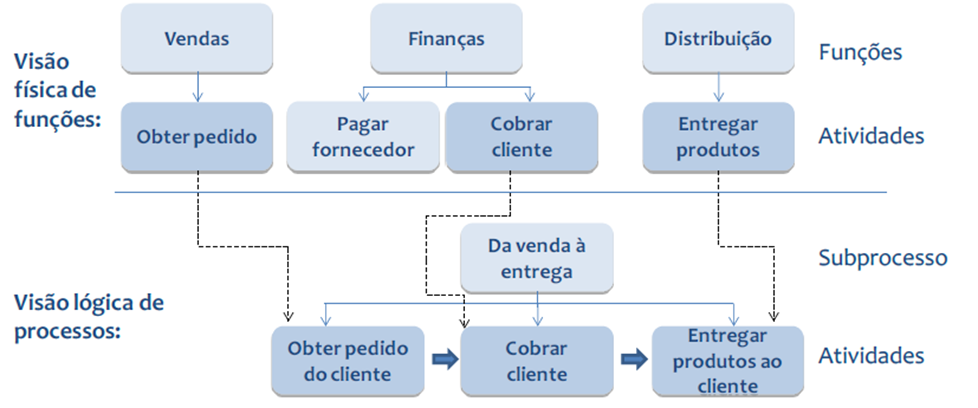
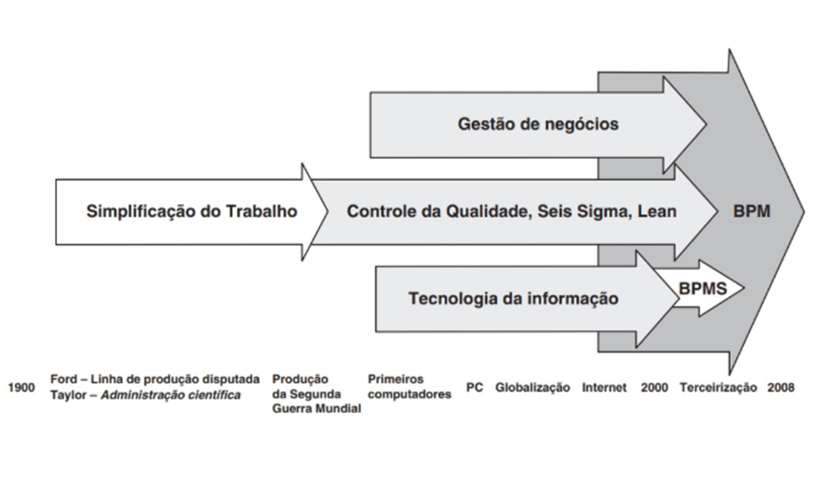
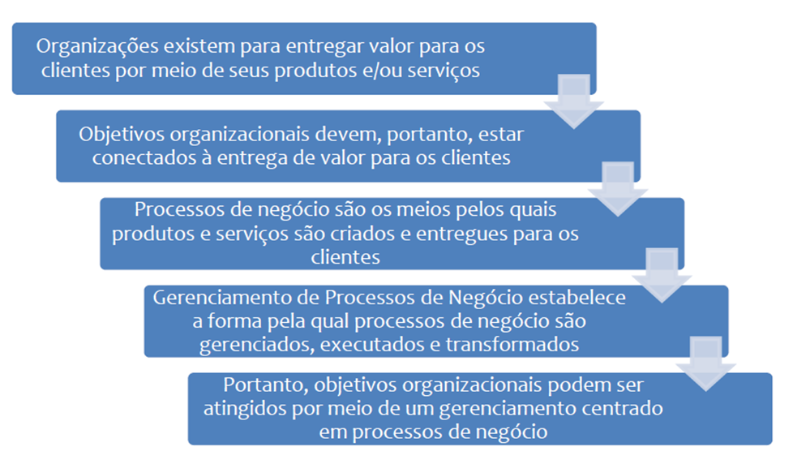

# Aula 2 — Gerenciamento de Processos de Negócios

## Ponto de Partida

Caro estudante, nesta aula, você entenderá como **monitorar e controlar** processos de negócio dentro das organizações e quais ferramentas (softwares) você poderá utilizar para realizar esse processo.

Será de grande relevância relacionar os conhecimentos sobre a classificação de processos de negócios, o entendimento de processo ponta a ponta, o desenho do fluxo de trabalho, a criação de diagramas, mapas ou modelos e a documentação do processo de negócio, que permitirão um bom entendimento e uma boa execução das atividades.

> Sobre esses assuntos, vamos imaginar uma **empresa de logística**, que atua na gestão logística de transporte de cargas. Com o crescimento do volume de negócios, a empresa enfrenta desafios na eficiência operacional e na integração de sistemas legados. Para superar esses obstáculos, a empresa decide implementar uma abordagem baseada em **Arquitetura Orientada a Serviços (SOA)** e **Gerenciamento de Processos de Negócio (BPM)**.
>
> **Desafios:**
>
> - **Desconexão de sistemas:** a empresa possui sistemas legados que operam de forma isolada, dificultando a troca de informações entre departamentos.
> - **Ineficiências operacionais:** os processos de gerenciamento de carga e rastreamento são complexos e enfrentam atrasos devido à falta de automação e padronização.
> - **Falta de visibilidade:** a alta administração carece de visibilidade em tempo real sobre o desempenho operacional e os principais indicadores de desempenho (KPIs).
>
> Encontre possíveis soluções para o desafio que a empresa enfrenta.

---

## Vamos Começar!

### Introdução ao Gerenciamento de Processos de Negócio (BPM)

O gerenciamento representa uma atividade fundamental para todas as organizações e em todas as suas áreas, uma vez que possibilita a identificação de lacunas nos resultados e, a partir disso, a elaboração de planos de aprimoramento. Chiavenato (2014) destaca quatro funções administrativas essenciais:

1. **Planejamento**
2. **Organização**
3. **Direção**
4. **Controle**

Segundo o autor, a última função está intrinsecamente ligada à gestão, e ele argumenta que não há uma organização com desempenho satisfatório sem a presença efetiva dessas quatro funções. Chiavenato (2014) sublinha que controlar, monitorar ou gerenciar são termos intercambiáveis que desempenham uma função crucial, permitindo à organização entender precisamente o que está sendo realizado, como está sendo feito e quais são as dificuldades enfrentadas. Portanto, trata-se de uma atividade de extrema relevância para o funcionamento eficiente e eficaz da organização.

No **BPM** (*Business Process Management* — Gerenciamento de Processos de Negócio), a abordagem aos processos organizacionais é distinta, pois a perspectiva é expandida. Existe uma compreensão abrangente de toda a cadeia envolvida na entrega de um produto ou serviço, diferenciando-se de uma visão verticalizada.

A perspectiva verticalizada limita a percepção da organização a uma visão de cima para baixo, onde as interações entre as áreas não são facilmente identificadas. O gerenciamento de processos de negócio assume relevância ao promover a integração entre as áreas, facilitando a comunicação, a troca de informações e o fortalecimento de uma visão **horizontal**.

De acordo com a ABPMP (2013), o BPM torna-se essencial para analisar o processo em um nível mais elevado do que a simples execução de tarefas. Somente ao enxergar integralmente o processo torna-se possível compreender as relações entre as áreas e subdividi-lo em subprocessos, os quais serão executados por diversas atividades (fluxos de trabalho) nas áreas funcionais. A Figura 1 ilustra a diferença entre a compreensão física das funções, representadas pelas atividades, e a visão lógica, representada pelos processos.

> **Figura 1** — Analogia entre visão física e lógica dos processos. *Fonte: ABPMP (2013, p. 34).*

| Visão | O que mostra |
|---|---|
| **Física** | As áreas operando de maneira desintegrada, cada uma realizando suas atividades como se fossem isoladas, sem interdependência aparente. |
| **Lógica** | O foco está no **processo**, evidenciando a interconexão entre as atividades, uma vez que o resultado é influenciado por todas elas. |

Nesse contexto, compreende-se o BPM como a construção de processos ponta a ponta, viabilizando a integração das estratégias e objetivos das empresas. Para que essa abordagem funcione de maneira eficaz, é crucial compreender elementos como cultura organizacional, clima, estruturas, tecnologia e políticas. A **governança dos processos**, em que todas as ações seguem regras e diretrizes com o objetivo de alcançar os objetivos organizacionais, é essencial. A governança deve incorporar os conceitos de controle e prestação de contas, o que se mostra apropriado e extremamente necessário para a gestão de processos (ARAÚJO; GARCIA; MARTINES, 2017).

Os processos de negócio estão embasados em algumas metodologias de mudanças, conforme apresentado na Figura 2.

> **Figura 2** — Abordagens de mudanças dos processos de negócio. *Fonte: Brocke e Rosemann (2013, p. 38).*

A evolução da melhoria de processos, ilustrada na Figura 2, tem seu início com uma abordagem de **simplificação do trabalho**, progredindo para os **controles de qualidade**, metodologias como **Seis Sigma** e **Lean**, chegando até a **gestão de negócios** e **tecnologia da informação**. A convergência de todos esses elementos resulta no **BPM**, e associado a ele está o **BPMS**, atuando como suporte tecnológico.

### BPMS (*Business Process Management Suite or System*)

O BPMS, traduzido como sistema de gerenciamento de processos de negócio, é uma ferramenta que desempenha a função de **mapear, executar e monitorar** os processos funcionais, buscando proporcionar uma visão abrangente de ponta a ponta. Em outras palavras, contribui para a automatização das ações e do fluxo de informações dentro dos processos. Conforme destacado por Araújo, Garcia e Martines (2017), o BPMS é considerado uma **evolução em relação ao workflow**, uma vez que tem a capacidade de integrar diversos fluxos de trabalho. Essa característica confere ao BPMS uma perspectiva mais ampla e a habilidade de se integrar a **sistemas legados**, ou seja, sistemas mais antigos que ainda estão em operação.

Segundo Valle e Oliveira (2013), é crucial que os processos de negócio estejam em sintonia com os objetivos e estratégias da organização. A Figura 3 ilustra a maneira pela qual esse alinhamento deve ser estabelecido na perspectiva do BPM.

> **Figura 3** — BPM e a conexão com os objetivos estratégicos. *Fonte: ABPMP (2013, p. 46).*

Na Figura 3, o desdobramento se inicia com a **entrega de valor ao cliente**, onde esse valor deve ser percebido por ele através de produtos/serviços. Esses produtos/serviços, por sua vez, necessitam estar alinhados aos **objetivos globais** da organização, ou seja, toda a empresa deve colaborar em direção a esses objetivos. Esses objetivos, por sua vez, são detalhados nos **processos e em seu gerenciamento**, orientados para a otimização da forma como as necessidades do cliente são atendidas, refletindo assim nos objetivos gerais da organização.

---

## Siga em Frente...

### Visão geral sobre as áreas de negócio

A visão de gestão de negócios está intrinsecamente relacionada à função administrativa, como indicado por Chiavenato (2014). Este autor destaca a importância de estabelecer padrões de desempenho mensuráveis, passíveis de comparação com os resultados reais por meio de monitoramento. Esse acompanhamento permite a tomada de medidas corretivas, se necessário, para alcançar os objetivos propostos. Chiavenato também enfatiza que o controle deve abranger todos os níveis organizacionais:

| Controle | Alcance | Prazo |
|---|---|---|
| **Estratégico** | Visão abrangente da organização como um todo | Longo prazo |
| **Tático** | Mais detalhado, com foco em perspectivas departamentais | Médio prazo |
| **Operacional** | Analítico, direcionado a tarefas e atividades específicas | Curto prazo |

Relacionando essa perspectiva com o conceito de BPM, percebe-se que o processo de controle também deve ocorrer em todos os níveis, mas, no contexto do BPM, o foco reside nas **atividades e tarefas** que compõem cada processo de negócio.

### Maturidade em processos: CMM e CMMI

O planejamento do gerenciamento de processos de negócios está intrinsecamente ligado à compreensão do **nível de maturidade** em processos da organização. Isso porque a capacidade da empresa de compreender e gerenciar seus processos determinará a abordagem adotada no gerenciamento. A maturidade engloba não apenas a habilidade da empresa em compreender seus processos, mas também como ela interage com eles. O objetivo é implementar uma série de atividades que auxiliem a organização a alcançar metas predefinidas, contribuindo para a melhoria dos resultados na área de TI. Portanto, o **CMMI** (*Capability Maturity Model Integration*, ou Modelo Integrado de Capacidade de Maturidade) desempenha um papel crucial no contexto do BPM, pois colabora para um gerenciamento mais eficiente das atividades, resultando em produtos finais padronizados, com menor margem de erro e, consequentemente, gerando satisfação do cliente.

#### Linha do tempo

| Ano | Marco |
|---|---|
| **1986** | Início do desenvolvimento do modelo de maturidade de processos |
| **1991** | Primeira versão do CMM |
| **1993** | Versão 1.1 do CMM, com alguns ajustes |
| **1999–2002** | Transição de CMM para CMMI |
| **2000** | Versão 1.0 do CMMI |
| **2002** | Versão 1.1 do CMMI |
| **2006** | Início da versão 1.2 do CMMI |
| **2010** | Versão 1.3 do CMMI |

O **SEI** (*Software Engineering Institute*) é o responsável pela criação do **CMM**, que é a descrição dos elementos-chave de um processo de software eficaz. O CMM é baseado em **cinco níveis de maturidade**, com o intuito das empresas de software evoluírem seu processo. Conforme indicado pelo SEI (2010), com o propósito de consolidar todos os modelos de capacitação existentes, o conceito evoluiu para **CMMI**, que representa o Modelo de Maturidade da Capacitação Integrado.

Segundo Couto (2007), a versão inicial, denominada 0.2 do CMMI, tinha como objetivo aprimorar os processos e produtos, reduzindo problemas de redundância ou falhas decorrentes da utilização de vários modelos distintos. As subsequentes versões do CMMI foram desenvolvidas para aperfeiçoar o modelo ao longo do tempo.

A versão 1.2 do CMMI é composta por até **vinte e cinco áreas de processos**, bem como seus objetivos e práticas, divididas em quatro grupos:

1. Gerenciamento de processos.
2. Gerenciamento de projetos.
3. Engenharia.
4. Apoio.

Na versão 1.3 do CMMI a estrutura geral do modelo foi mantida. Apenas algumas diferenças são encontradas: simplificação das práticas genéricas, revisão de glossário, métodos mais ágeis, foco na satisfação do cliente, visando mais atributos de qualidade.

> Conforme demonstra a Figura 4, **quanto maior o nível de maturidade, melhor será a capacidade de gerenciamento do processo.**

---

## Vamos Exercitar?

A situação-problema proposta nesta aula traz o cenário da empresa de logística que decide adotar uma abordagem integrada de SOA e BPM para superar os desafios identificados. Vamos à solução!

| Solução | Descrição |
|---|---|
| **Desenvolvimento de serviços** | Identificação e design de serviços para interligar os sistemas legados. Inclui serviços para rastreamento de carga, gerenciamento de estoque e comunicação entre diferentes áreas. |
| **Automação de processos** | Utilização de ferramentas BPM para modelar, otimizar e automatizar os processos de negócios. Abrange desde a solicitação de transporte até a entrega final, incorporando etapas de aprovação, verificação e escalonamento. |
| **Implementação de APIs** | Desenvolvimento de APIs para facilitar a comunicação entre os diversos sistemas internos e externos, promovendo a interoperabilidade. |
| **Dashboard de KPIs** | Criação de painéis de controle baseados em BPM, proporcionando uma visão unificada dos principais indicadores de desempenho, como tempo de entrega, eficiência operacional e satisfação do cliente. |

**Resultados esperados:**

- **Melhoria na eficiência operacional:** redução de atrasos e erros nos processos logísticos, resultando em uma operação mais eficiente.
- **Integração de sistemas:** facilitação da troca de dados entre sistemas legados, eliminando silos de informação.
- **Visibilidade em tempo real:** a alta administração terá acesso a dashboards em tempo real, permitindo uma tomada de decisão mais informada.
- **Adaptabilidade a mudanças:** a arquitetura SOA permite que a empresa se adapte mais facilmente a futuras mudanças, adicionando ou modificando serviços conforme necessário.

> **Avaliação:** ao final da implementação, a empresa avaliará os resultados com base na eficiência operacional, na satisfação do cliente e na capacidade de adaptação a novas demandas de mercado. O estudo de caso servirá como base para compreender o impacto positivo da integração de SOA e BPM no ambiente empresarial da empresa.

---

## Saiba mais

1. **Arquitetura Orientada a Serviços**: acesse o site indicado e conheça mais sobre este tema.
   > AWS. **O que é SOA (arquitetura orientada a serviços)?** [s. d.]

2. **BPMS**: leia o artigo *O que significa BPMS? Quais são seus componentes?*
   > DINIZ, B. **O que significa BPMS? Quais são seus componentes?** 2023.

## Referências

- ABPMP. Association of Business Process Management Professionals International. BPM CBOK: guia para o gerenciamento de processos de negócio — corpo comum de conhecimento v. 3.0. Brasília: ABPMP Brasil, 2013.
- ARAÚJO, L. C. G.; GARCIA, A. A.; MARTINES, S. Gestão de Processos: melhores resultados e excelência organizacional. 2. ed. São Paulo: Atlas, 2017.
- BOWDITCH, J. L.; BUONO, A. F. Elementos do Comportamento Organizacional. São Paulo: Cengage Learning, 2017.
- BROCKE, J. V.; ROSEMANN, M. Manual de BPM: gestão de processos de negócio. Porto Alegre: Bookman, 2013.
- CHIAVENATO, I. Administração: teoria, processo e prática. 5. ed. Barueri: Manole, 2014.
- COUTO, A. B. CMMI: integração dos modelos de capacitação e maturidade de sistemas. 1. ed. Ciência Moderna, 2007.
- DE SORDI, J. O. Gestão de Processos: uma abordagem da moderna administração. 5. ed. São Paulo: Saraiva, 2018.
- VALLE, R.; OLIVEIRA, S. B. de. Análise e modelagem de processos de negócio: foco na notação BPMN. São Paulo: Atlas, 2013.
