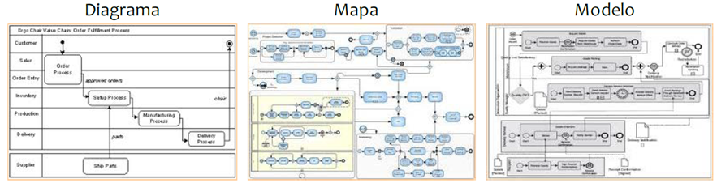

# Aula 3 — Modelagem de Processos de Negócios

## Ponto de Partida

Engaje-se na emocionante jornada da modelagem de processos! Desenvolver esse conjunto de habilidades e técnicas não apenas permite compreender, mas também **comunicar e gerenciar** os elementos essenciais dos processos de negócio. Para organizações que reconhecem o valor significativo de seus processos, a modelagem torna-se uma peça central no quebra-cabeça do gerenciamento organizacional!

Durante esta aula, iremos explorar uma variedade de tópicos fundamentais relacionados à gestão eficiente de processos de negócios:

1. **Introdução à Modelagem de Processos de Negócios:** uma compreensão sólida dos conceitos-chave e das práticas essenciais nesse campo.
2. **Arquitetura de Processos e Arquitetura de Negócios:** como essas estruturas desempenham papéis cruciais na otimização e alinhamento dos processos organizacionais.
3. **Notações de Modelagem de Negócios:** os tipos de linguagens visuais para representar e comunicar eficientemente os processos de negócios.

Este conjunto abrangente de temas busca fornecer uma base sólida para a compreensão e aplicação prática da gestão de processos, capacitando os participantes a navegar com sucesso no complexo ambiente empresarial.

> Existem diversas linguagens de modelagem de processo, e a escolha dessas linguagens faz diferença. Por isso, como exercício prático, **faça uma lista de algumas linguagens de modelagem e coloque as vantagens e desvantagens de cada linguagem.**

---

## Vamos Começar!

### Introdução à modelagem de processos de negócios

A atividade de modelagem de processos requer um conjunto essencial de habilidades e técnicas, possibilitando compreender, comunicar e gerenciar os componentes dos processos de negócio. Para organizações conscientes do valor significativo de seus processos de negócio, a modelagem torna-se uma atividade central no gerenciamento organizacional.

A **modelagem de processos de negócio** abrange o conjunto de atividades destinadas a criar representações de processos existentes ou propostos. Essas representações podem oferecer uma visão abrangente do processo ou focalizar em partes específicas, como processos primários, de suporte ou de gerenciamento.

O objetivo da modelagem é desenvolver uma representação completa e precisa do processo, destacando seu funcionamento. O nível de detalhamento e o tipo de modelo adotados dependem das expectativas da iniciativa de modelagem. Em alguns casos, um diagrama simples pode ser suficiente, enquanto em outros, pode ser necessário um modelo mais abrangente e detalhado (ABPMP, 2013).

Um **modelo** é uma representação simplificada de um objeto, conceito ou atividade, podendo adotar formas matemáticas, gráficas, físicas, narrativas ou combinações desses tipos. Os modelos têm uma ampla variedade de aplicações nos contextos de negócios, desempenhando funções como (VALLE; OLIVEIRA, 2013):

| Função | Significado |
|---|---|
| **Organização** | estruturação |
| **Descoberta** | aprendizagem |
| **Previsão** | estimativas |
| **Medição** | quantificação |
| **Explicação** | ensino, demonstração |
| **Verificação** | validação |
| **Controle** | estabelecimento de restrições e objetivos |

Os processos de negócio podem ser expressos por meio de modelagem em diferentes níveis de detalhe, desde uma visão abstrata contextual até uma visão minuciosa. Um modelo de processos de negócio completo geralmente abrangerá diversas perspectivas, atendendo a diferentes propósitos.

#### Elementos de um modelo de processo

O conteúdo de um modelo de processo compreende diversos elementos que visam representar de maneira abrangente e detalhada todas as facetas de um determinado processo de negócio. Esses elementos são essenciais para proporcionar uma compreensão completa e eficaz do funcionamento do processo. Algumas das principais componentes presentes no conteúdo de um modelo de processo incluem (BROCKE, 2013):

| Elemento | Descrição |
|---|---|
| **Atividades** | Descrição das tarefas específicas ou operações realizadas no decorrer do processo. Destacam as etapas cruciais para atingir os objetivos do processo. |
| **Fluxo de trabalho** | Representação visual das sequências e interconexões entre as atividades. Mostra a ordem lógica das etapas e como a informação ou trabalho flui de uma atividade para outra. |
| **Recursos** | Identificação dos elementos necessários para a execução das atividades, como pessoas, sistemas, dados ou equipamentos. |
| **Decisões** | Pontos de decisão ou ramificações no processo, indicando escolhas que influenciam o curso do fluxo de trabalho. Ajuda a modelar as condições para determinadas ações. |
| **Eventos** | Eventos ou gatilhos que podem iniciar, interromper ou modificar o processo. Destacam momentos-chave que impactam o comportamento do processo. |
| **Tempo** | Aspectos temporais, como prazos, tempos de ciclo e quaisquer restrições temporais relevantes para as atividades. |
| **Responsabilidades** | Atribuição de responsabilidades específicas, indicando quem é responsável por executar cada tarefa no processo. |
| **Objetivos** | Clarificação dos objetivos gerais do processo, garantindo que todas as atividades estejam alinhadas com as metas organizacionais. |

Ao integrar esses elementos, um modelo de processo robusto fornece uma representação abrangente que facilita a compreensão, análise, otimização e gestão eficaz dos processos de negócio dentro de uma organização. Vale ressaltar que nem todos os elementos citados anteriormente podem ser integrados a qualquer modelo, isso dependerá se faz parte dos elementos determinados pelo modelo.

#### Diagrama × mapa × modelo

Os conceitos de diagrama de processo, mapa de processo e modelo de processos frequentemente são empregados de maneira intercambiável ou como termos sinônimos. No entanto, diagramas, mapas e modelos possuem distintos propósitos e aplicações. Na prática, diagrama, mapa e modelo representam diferentes estágios de desenvolvimento, cada um incorporando maior quantidade de informações e utilidade para o entendimento, análise e delineamento de processos. A Figura 1 apresenta essa diferença de modo visual.

> **Figura 1** — Diagrama versus mapa versus modelo. *Fonte: ABPMP (2013, p. 73).*

| Conceito | O que é |
|---|---|
| **Diagrama** | Apresenta os elementos principais de um fluxo de processo, simplificando detalhes menores para facilitar a compreensão dos fluxos de trabalho. Pode ser comparado a um mapa básico que ajuda a localizar um armazém, fornecendo uma visão simplificada ou exagerada de marcos geográficos e distâncias. Auxilia na rápida identificação das atividades principais. |
| **Mapa** | Oferece uma visão abrangente dos principais componentes do processo, acrescentando mais precisão do que um diagrama. Tende a incorporar maior detalhe sobre o processo e alguns relacionamentos cruciais com outros elementos, como atores, eventos e resultados. |
| **Modelo** | Implica a representação de um estado específico do negócio (atual ou futuro) e dos recursos correspondentes, como pessoas, informações, instalações, automação, finanças e insumos. Por buscar uma representação mais precisa do funcionamento do que está sendo modelado, exige mais dados sobre o processo e os fatores que afetam seu comportamento. |

> **Ferramentas:** frequentemente, a modelagem é realizada por meio de ferramentas que oferecem capacidades de simulação e geração de relatórios úteis para analisar e compreender o processo.

---

## Siga em Frente...

### Arquitetura de processos e Arquitetura de negócios

A distinção entre arquitetura de processos e arquitetura de negócio é frequentemente objeto de dúvida para aqueles envolvidos em modelagem.

| | Arquitetura de **negócio** | Arquitetura de **processos** |
|---|---|---|
| **Pergunta que responde** | **O QUÊ** no negócio | **COMO** do negócio |
| **Nível** | Alto nível de abstração; modelos conceituais | Define como um entregável, produto ou serviço é construído e entregue |
| **Trata de** | Capacidades de negócio (a habilidade de realizar ou entregar algo) | Atividades físicas e sua gestão; decompostos em detalhe, definem as atividades que uma empresa deve ser capaz de realizar |
| **Foco** | **Eficácia** | **Eficiência** |

Arquitetos de negócio concentram-se em criar modelos de negócio, que operam em um nível elevado de abstração e tratam das capacidades de negócio (ABPMP, 2013). Por outro lado, modelos de arquitetura de processos abordam o "COMO" do negócio. Quando decompostos em maior detalhe, esses modelos definem as atividades que uma empresa deve ser capaz de realizar. Cada atividade está transitivamente relacionada a uma determinada capacidade.

Quando combinados, esses modelos permitem ir além do desenho de atividades para garantir que nenhum trabalho seja executado se não estiver relacionado à entrega de uma capacidade de negócio específica, assegurando **efetividade**.

A confusão entre esses dois tipos de modelo muitas vezes ocorre devido ao fato de que, em muitas organizações, arquitetos de negócio constroem modelos de arquitetura de processos. Embora ambas as disciplinas visem melhorar o negócio, elas têm propósitos diferentes. Essas disciplinas são **complementares**, não iguais nem concorrentes, e ambas são essenciais em qualquer nível de mudança, seja no âmbito de processos ou corporativo. No entanto, em algumas organizações, essa distinção não é clara, e os papéis e ferramentas associadas a cada grupo podem ser confundidos (ABPMP, 2013).

### Notações de modelagem de negócios

**Notação** é um conjunto padronizado de símbolos e regras que determinam o significado desses símbolos.

Por exemplo, assim como a notação musical emprega símbolos universalmente reconhecidos para notas e claves, a notação de modelagem de processos de negócio incorpora ícones (figuras) e conectores que facilitam a representação dos relacionamentos entre diversos componentes dos processos de negócio (ABPMP, 2013). Existem vários padrões de notação de modelagem, e escolher a abordagem mais adequada dentre as opções disponíveis pode ser desafiador. Contudo, optar por uma metodologia que siga normas e convenções bem estabelecidas oferece diversas vantagens:

- utilização de um conjunto comum de símbolos, linguagem e técnicas que facilitam a comunicação entre as pessoas;
- consistência no formato e significado dos modelos resultantes;
- capacidade de importar, exportar e gerar aplicações a partir desses modelos de processos.

A seguir, breves descrições de algumas das notações de modelagem mais comumente encontradas.

#### BPMN

O **BPMN** (*Business Process Model and Notation*) é uma notação gráfica padronizada internacionalmente, desenvolvida para representar visualmente os processos de negócio em organizações. Essa notação fornece um conjunto de símbolos e regras que permitem aos analistas e profissionais de BPM descrever, analisar e otimizar processos de forma clara e compreensível. O BPMN utiliza uma abordagem intuitiva e visual, representando as etapas do processo, as decisões, os eventos e as interações entre diferentes participantes. Essa notação facilita a comunicação entre as partes interessadas, promovendo uma compreensão consistente dos processos em toda a organização. O BPMN é amplamente adotado como uma ferramenta eficaz para modelagem de processos de negócio, contribuindo para a melhoria da eficiência operacional e para o alinhamento estratégico das atividades organizacionais (VALLE; OLIVEIRA, 2013).

#### Fluxograma

O **fluxograma** é uma representação visual que utiliza símbolos gráficos para descrever a sequência de atividades em um processo. Essa ferramenta é amplamente empregada na modelagem e documentação de processos, proporcionando uma visão clara e sistemática das etapas envolvidas. Os símbolos utilizados no fluxograma representam diferentes elementos, como operações, decisões, pontos de início e fim, facilitando a compreensão tanto para profissionais especializados quanto para aqueles que não têm conhecimento técnico aprofundado. O fluxograma é uma valiosa ferramenta na identificação de gargalos, ineficiências e oportunidades de melhoria em processos, contribuindo para uma gestão mais eficaz e uma comunicação eficiente entre os membros da equipe e partes interessadas.

#### EPC

O **Event-driven Process Chain (EPC)** é uma notação de modelagem de processos que oferece uma representação gráfica para descrever e analisar os processos de negócio em uma organização. Desenvolvido por **August-Wilhelm Scheer**, o EPC se destaca por sua abordagem **centrada em eventos**, onde os eventos desempenham um papel fundamental na definição das atividades e conexões no processo. Os eventos representam o início ou o término de uma atividade, sendo conectados por funções, processos e controles. Essa notação é eficaz na visualização das relações causais entre os eventos e nas condições sob as quais as atividades são executadas. Comumente utilizada em conjunto com metodologias de gestão de processos, o EPC é uma ferramenta valiosa para mapear, analisar e otimizar os processos organizacionais, proporcionando uma compreensão clara das interações e fluxos de trabalho.

#### UML

A **Unified Modeling Language (UML)** é uma linguagem padronizada de modelagem visual amplamente utilizada na engenharia de software para representar sistemas complexos. Desenvolvida no final da década de 1990, a UML fornece uma notação gráfica abrangente que permite aos desenvolvedores, analistas e outros *stakeholders* visualizar, entender e comunicar eficientemente as diferentes partes de um sistema. A UML utiliza diversos diagramas, como diagramas de classes, diagramas de sequência, diagramas de casos de uso, entre outros, para representar aspectos específicos do sistema. Essa linguagem ajuda a capturar os requisitos, projetar a arquitetura, modelar a interação entre componentes e documentar o software ao longo do ciclo de vida do desenvolvimento. A UML tornou-se uma ferramenta essencial na engenharia de software, facilitando a comunicação entre equipes e promovendo uma compreensão mais clara e abrangente dos sistemas complexos.

---

## Vamos Exercitar?

Vamos à apresentação da lista das linguagens de modelagem de processos existentes, cada uma com suas características específicas, juntamente com suas vantagens e desvantagens:

| Linguagem | Vantagens | Desvantagens |
|---|---|---|
| **BPMN** (*Business Process Model and Notation*) | Padrão amplamente adotado, notação visual fácil de entender, suporte para diferentes níveis de detalhe, permite a modelagem de processos de ponta a ponta. | Pode se tornar complexo para processos muito detalhados, limitado em representar certos aspectos organizacionais. |
| **UML** (*Unified Modeling Language*) — Diagramas de Atividades | Amplamente conhecido na engenharia de software, integração com outros diagramas UML, suporte a diversas notações. | Menos específico para processos de negócios do que BPMN, pode ser mais técnico. |
| **EPC** (*Event-driven Process Chain*) | Foco em eventos que acionam processos, representação clara de controle e dados, integração com sistemas de informação. | Menos adotado globalmente do que BPMN, pode não ser tão intuitivo para não especialistas. |
| **IDEF** (*Integrated DEFinition*) | Pode ser aplicado em diversas disciplinas, incluindo processos de negócios, modelagem clara de dados e atividades. | Menos difundido do que BPMN ou UML, curva de aprendizado pode ser íngreme. |
| **CMMN** (*Case Management Model and Notation*) | Especializado em modelagem de casos, gestão adaptativa de processos, suporte a situações não estruturadas. | Menos utilizado em comparação com BPMN, pode ser mais complexo para cenários simples. |
| **Fluxograma** (*Flowchart*) | Simplicidade, amplamente compreendido, adequado para processos simples. | Menos poderoso para processos complexos, falta de padronização em comparação com BPMN. |

> Cada linguagem tem seu lugar dependendo das necessidades específicas do projeto e do público-alvo. A escolha deve considerar a **clareza da representação**, a **familiaridade da equipe** e a **adequação ao contexto organizacional**.

---

## Saiba mais

1. **BPMN**: para conhecer mais sobre o mundo do BPMN, acesse o livro, disponível na Biblioteca Virtual.
   > VALLE, R.; OLIVEIRA, S. B. de. **Análise e modelagem de processos de negócio: foco na notação BPMN** (*Business Process Modeling Notation*). Grupo GEN, 2013.

2. **Ferramentas online**: existem ferramentas online para fazer a modelagem de negócios; o Visual Paradigm Online é uma dessas ferramentas.
   > VISUAL PARADIGM ONLINE. **Ferramenta de Diagrama BPMN**. [s. d.]

## Referências

- ABPMP. Association of Business Process Management Professionals International. BPM CBOK: guia para o gerenciamento de processos de negócio — corpo comum de conhecimento v. 3.0. Brasília: ABPMP Brasil, 2013.
- BROCKE, J. V.; ROSEMANN, M. Manual de BPM: gestão de processos de negócio. Porto Alegre: Bookman, 2013.
- VALLE, R.; OLIVEIRA, S. B. de. Análise e modelagem de processos de negócio: foco na notação BPMN. São Paulo: Atlas, 2013.
