# Aula 4 — Business Process Model and Notation (BPMN)

## Ponto de Partida

Para esta aula, é fundamental compreender os conceitos relacionados à modelagem de processos de negócios, à notação **BPMN** (*Business Process Modeling Notation*) e aos seus elementos utilizados na construção de desenhos de processos de negócio, cadeias de valores, fluxos de trabalho e na documentação de processos de negócios.

É importante destacar que os elementos do BPMN representam uma **evolução do fluxograma**, proporcionando um desenho mais refinado do processo e gerando informações de maior qualidade para o acompanhamento das atividades cotidianas. O modelo de processo baseado na notação BPMN vai além de simplesmente indicar o "caminho" de uma atividade, incorporando informações e recursos detalhados ao processo, o que possibilita uma visão mais abrangente e minuciosa.

> Para você treinar essa modelagem de processos, você deve criar um modelo de negócio para a especificação a seguir:
>
> 1. O **comercial** recebe o pedido do cliente, verifica se o pedido está com preenchimento correto e encaminha para o departamento de contas a receber (via sistema).
> 2. O **contas a receber** recebe o pedido, verifica se o cliente está adimplente e se o pedido não estoura o limite de crédito do cliente. Caso o pedido seja liberado, é enviado para expedição e, caso não seja, a informação é enviada ao comercial para que faça contato com o cliente.
> 3. A **expedição** inicia o processo de separação de produtos identificando se há em estoque os itens e as quantidades solicitadas pelo cliente e, caso faltem itens, é enviado um comunicado ao departamento comercial para que informe o cliente. O pedido é enviado para o faturamento.
> 4. O **faturamento** recebe o pedido, realiza os ajustes retirando os itens faltantes e transforma o pedido em nota fiscal. Realiza a emissão do boleto e encaminha os documentos para a logística.
> 5. A **logística** recebe as informações e efetua o carregamento do caminhão para que seja realizada a entrega aos clientes.

---

## Vamos Começar!

### Introdução ao BPMN

A modelagem de processos requer a ampliação dos conceitos previamente apresentados. Esse campo envolve habilidades e técnicas essenciais para compreender e administrar os processos de negócios de maneira eficaz. Vamos começar examinando os termos individualmente.

| Termo | Definição |
|---|---|
| **Modelagem** | O ato ou resultado de modelar, sendo aplicada na informática à criação de modelos. |
| **Modelo** | Representação em escala reduzida, ou seja, simplificação de algo real. Por exemplo, um esquema de produto apresentado em um manual nos permite visualizar efetivamente o produto. |
| **Processo de negócio** | Sequência de atividades executadas para alcançar um objetivo (resultado) que agregue valor ao cliente. |

A modelagem pode se manifestar em uma representação simples, caracterizada por uma quantidade reduzida de elementos e áreas de negócio, ou em uma forma complexa, incorporando uma grande variedade de elementos e envolvendo várias áreas. Os modelos podem adotar formas matemáticas, gráficas, descritivas ou uma combinação de algumas ou todas essas abordagens. São empregados para fins de organização, aprendizado, previsão, medição, explicação, verificação e controle (ABPMP, 2013).

O aprimoramento de processos implica na avaliação e reconfiguração, visando um desempenho mais eficiente e atendimento otimizado às demandas de clientes internos e externos. A eliminação ou automação de processos busca a criação de procedimentos ágeis e eficazes, resultando em custos reduzidos. Além disso, a documentação de processos é essencial para assegurar que a organização possua informações consistentes, permitindo que todos os membros compreendam e executem as tarefas ou atividades necessárias.

**Business Process Model and Notation (BPMN)** é um padrão desenvolvido pela *Business Process Management Initiative* (BPMI) e adotado pelo *Object Management Group* (OMG), um consórcio que estabelece padrões para sistemas de informação. A aceitação do BPMN tem experimentado um aumento significativo, especialmente com sua integração nas principais ferramentas de modelagem. Essa notação oferece um conjunto abrangente de símbolos para representar diversos aspectos de processos de negócio. Como em muitas notações, esses símbolos delineiam relacionamentos claramente definidos, abrangendo desde o fluxo de atividades até a ordem de precedência (ABPMP, 2013).

Dentro da BPMN, as **raias** dividem o modelo em diversas linhas paralelas, onde cada raia representa um papel desempenhado por um ator na execução do trabalho. O fluxo do trabalho ocorre de uma atividade para outra, seguindo o trajeto estabelecido de raia a raia. A construção dos modelos em BPMN deve ser orientada por padrões corporativos, especialmente se a perspectiva de longo prazo for criar um modelo integrado de negócios para a organização. Esses padrões fornecem diretrizes sobre quando e como as raias são definidas (representando papéis), a decomposição das atividades, a coleta de dados durante a modelagem, entre outros aspectos.

A BPMN possui ícones organizados em conjuntos descritivos e analíticos para atender a diversas necessidades de utilização. Sua notação permite indicar eventos de início, intermediários e fim, fluxo de atividades e mensagens, comunicação intranegócio e colaboração internegócio. Essa notação é útil para apresentar modelos de processos a diferentes públicos, simular processos de negócio com um motor de processo e gerar aplicações em BPMS a partir dos modelos de processos.

| ✅ Vantagens | ⚠️ Desvantagens |
|---|---|
| Amplo uso e entendimento em muitas organizações | Necessidade de treinamento e experiência para usar o conjunto completo de símbolos |
| Versatilidade para modelar diversas situações de processo | Dificuldade na visualização do relacionamento entre diferentes níveis de um processo |
| Suporte por ferramentas BPMS | Possibilidade de diferentes ferramentas serem necessárias para apoiar subconjuntos específicos da notação |
| | A origem na tecnologia da informação pode inibir seu uso por pessoal de negócios |

> *Fonte: ABPMP (2013).*

### Elementos do BPMN

O BPMN é representado por linhas paralelas, onde cada linha indica um papel distinto a ser desempenhado na execução do trabalho. Este formato é composto por elementos básicos e específicos, que incluem **atividade, evento, gateway e conector**. Cada um desses elementos é identificado por um ícone específico, conforme mostrado na Figura 1.

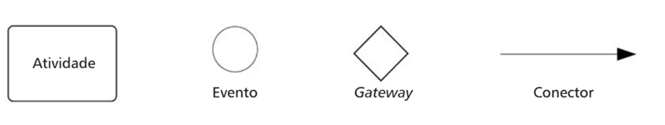

> **Figura 1** — Elementos básicos do BPMN. *Fonte: Valle e Oliveira (2013, p. 81).*

| Elemento | O que representa |
|---|---|
| **Atividade** | O trabalho a ser realizado, desdobrando-se em tarefa, subprocesso (colapsado ou expandido) e processo. Exemplo de tarefa: "emitir o pedido". |
| **Evento** | Ocorrências no processo que podem influenciar outros elementos e eventos na cadeia de processos, marcando o início e o término dos processos em relação à linha do tempo dos acontecimentos. |
| **Gateway** | Controla o fluxo de sequência e toma decisões, bifurcações e uniões de caminhos. Exemplo: verificar o saldo do cliente ao usar o cartão de débito. |
| **Conector** | Elementos de conexão que ligam atividades, eventos e gateways, proporcionando a demonstração de um caminho. |

#### Atividades

A tarefa pode ter três marcadores: **Loop**, **Instâncias Múltiplas** e **Compensação**. Esses símbolos estão apresentados na Figura 2.

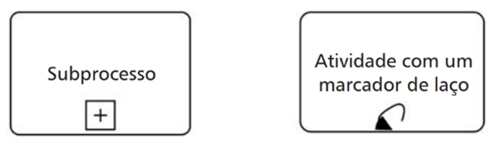

> **Figura 2** — Tipos de atividades. *Fonte: Valle e Oliveira (2013, p. 82).*

O **subprocesso colapsado** é adicionado do símbolo "+" que indica outro nível de detalhes. Também podem ser utilizados marcadores:

| Marcador | Função |
|---|---|
| **Loop** | Executa a atividade até que a condição seja satisfeita |
| **Instâncias Múltiplas** | Executa diversas atividades até que todas sejam satisfeitas |
| **Compensação** | Compensa atividade já executada do processo, isto é, desfaz a atividade |
| **Transacional** | Subprocesso com diversas atividades que devem ser completadas ou canceladas |

Já o **subprocesso expandido** contém um processo de negócio. O **processo** é um conjunto de objetos gráficos compostos por tarefas e subprocessos, isto é, ele não é representado por um único elemento, mas um grupo deles. Esses símbolos estão apresentados na Figura 3.

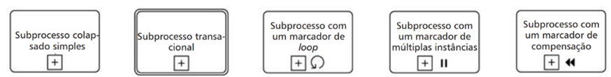

> **Figura 3** — Subprocessos. *Fonte: Valle e Oliveira (2013, p. 83).*

#### Eventos

A ABPMP (2013) enfatiza que o evento trata algo que ocorre durante o processo de negócio e afeta o fluxo do processo. Há três tipos de eventos, apresentados na Figura 4:

| Tipo | Símbolo |
|---|---|
| **Início** | Círculo com contorno claro |
| **Intermediário** | Círculo duplo (pode ser utilizado para enviar uma informação) |
| **Encerramento** | Círculo com contorno escuro |

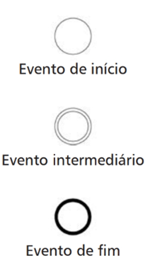

> **Figura 4** — Tipos de eventos. *Fonte: Valle e Oliveira (2013, p. 84).*

Cada evento exibe uma representação gráfica no centro do elemento. Nos eventos de início e intermediários, essas representações indicam os **disparadores**, enquanto nos eventos de fim representam os **resultados**. A Figura 5 ilustra os eventos de início nas duas primeiras colunas, eventos intermediários nas duas colunas seguintes e eventos de fim nas duas últimas colunas.

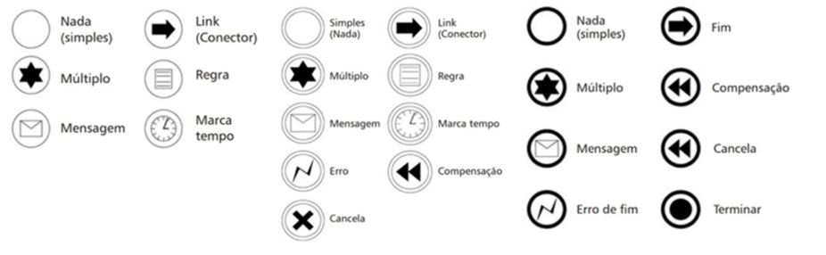

> **Figura 5** — Eventos de início, intermediário e de fim. *Fonte: adaptada de Valle e Oliveira (2013, p. 84 e 85).*

#### Gateways

Os gateways são **filtros de decisão**: eles separam e juntam os fluxos. Caso o fluxo não precise ser controlado, não há necessidade deste elemento. Os tipos de gateway estão apresentados na Figura 6.

> **Figura 6** — Tipos de gateways. *Fonte: Valle e Oliveira (2013, p. 87).*

| Gateway | Como funciona | Exemplo |
|---|---|---|
| **Exclusivo baseado em dados** | Caminhos possíveis "sim ou não" em resposta a uma pergunta: decisão com escolha de apenas uma alternativa. Algo **interno** à organização. | "Tenho o produto que o cliente solicitou em estoque?" A resposta é imediata. |
| **Exclusivo baseado em evento** | Depende de uma resposta **externa** ao processo para determinar o ponto de desvio. | Uma cotação é enviada a um cliente que pode responder (mensagem) com "sim" ou "não"; com base nesta resposta é determinado o caminho. |
| **Inclusivo** | Depende de **mais de uma condição** para dar sequência na atividade: não trabalha com "sim" e "não", mas com a satisfação de duas ou mais condições. | — |

#### Conectores

Os conectores têm a função de orientar o fluxo e são classificados em três categorias:

| Conector | Função |
|---|---|
| **Sequência de fluxo** | Delineia a rota a ser seguida para a conclusão do processo, indicando passo a passo as tarefas a serem realizadas. |
| **Fluxo de mensagem** | Aparência distinta para evidenciar que se trata de transferência de informação, não envolvendo tarefas. |
| **Associação de elementos** | Conecta artefatos ao diagrama, proporcionando uma ligação entre os elementos. |

Na Figura 7, estão apresentados esses conectores.

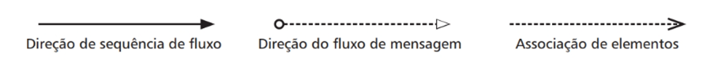

> **Figura 7** — Tipos de conectores. *Fonte: Valle e Oliveira (2013, p. 88).*

#### Swimlanes: pool e lane

O BPMN usa ainda o conceito de *swimlanes*, que serve para ajudar a dividir e organizar as atividades e é dividido em **pool** (piscina) e **lane** (raia).

Para Brocke e Rosemann (2013), os **pools** devem ser utilizados quando se envolvem duas ou mais entidades de negócios ou atores, determinando quem faz "o quê". Já a **lane** é a separação das atividades associadas para um papel específico, isto é, são utilizadas para representar um ator do processo. A Figura 8 apresenta esses elementos.

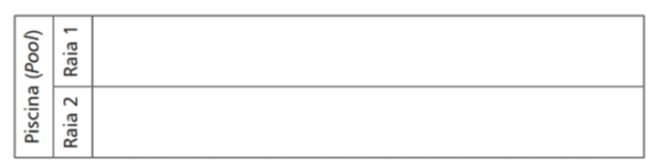

> **Figura 8** — Representação de Pool e Lane. *Fonte: Valle e Oliveira (2013, p. 89).*

#### Artefatos

Ainda é possível contar com os artefatos, que são elementos que contribuem para que sejam mostradas informações além da estrutura básica do diagrama. A Figura 9 apresenta os tipos de artefatos.

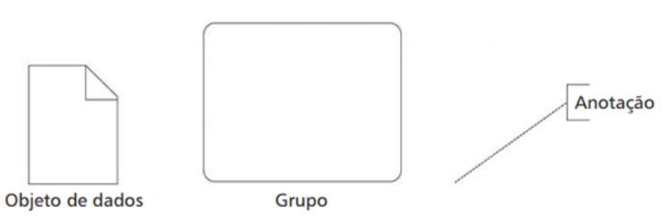

> **Figura 9** — Artefatos. *Fonte: Valle e Oliveira (2013, p. 90).*

| Artefato | Função | Exemplo (atividade "emitir pedido") |
|---|---|---|
| **Objeto de dados** | Agrega informação ao processo: conjunto de informações referentes a uma atividade específica. | O pedido é um documento que possui uma série de detalhes. |
| **Grupo** | Dá destaque a um grupo de atividades. | — |
| **Anotação** | Traz comentários do processo que ajudam a entender a tarefa. | "Verificar impressora" para que o pedido seja impresso. |

A utilização de notação (representação gráfica) no processo de modelagem ajuda na comunicação, na conscientização dos processos decorrentes, permite a importação de processos entre diferentes ferramentas e gera aplicações a partir dos modelos.

---

## Siga em Frente...

### Exemplos de BPMN

O modelo de processo é composto por ícones que representam atividades, tarefas, decisões e podem conter informações. Esse modelo de processo pode ser representado por um **diagrama**, **mapa** ou **modelo**.

| Nível | O que é |
|---|---|
| **Diagrama** | Representa exclusivamente os elementos principais do fluxo, deixando de exibir detalhes menores relacionados ao fluxo de trabalho. Contudo, é útil para compreender as atividades fundamentais do processo. |
| **Mapa** | Além do conteúdo do diagrama, agrega mais detalhes acerca do processo, mostra os principais componentes e apresenta maior precisão, com mais detalhes acerca dos atores, eventos e resultados. |
| **Modelo** | O mais completo, segundo a ABPMP (2013): cria uma representação do negócio (atual ou futuro), de todos os envolvidos (pessoas, informação, instalações, automação, finanças e insumos) e dos fatores que afetam o comportamento do processo. |

Um exemplo de diagrama está representado na Figura 10.

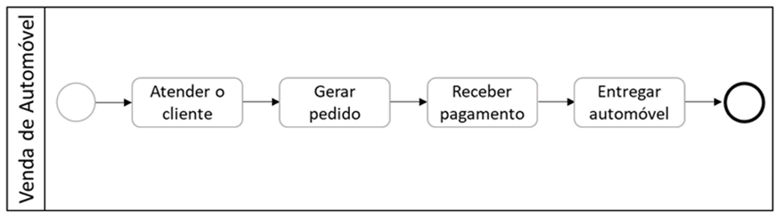

> **Figura 10** — Diagrama. *Fonte: Werlich (2020, p. 77).*

A Figura 11 apresenta um mapa.

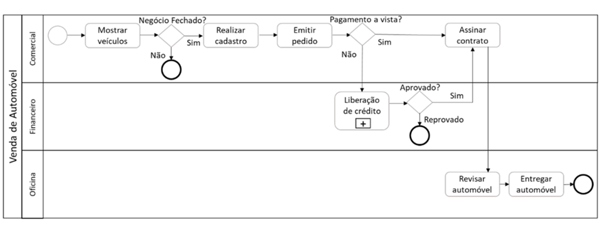

> **Figura 11** — Mapa. *Fonte: Werlich (2020, p. 78).*

E a Figura 12 expõe a representação de um modelo.

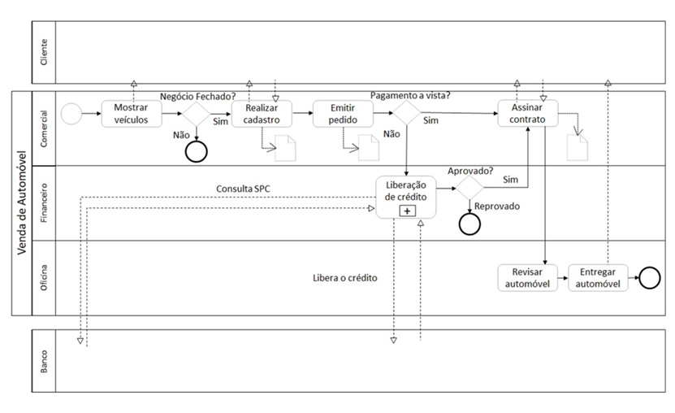

> **Figura 12** — Modelo. *Fonte: Werlich (2020, p. 79).*

Segundo Valle e Oliveira (2013), o BPMN define e utiliza um **único modelo de diagrama**, trata-se do **Business Process Diagram (BPD)**, ou o Diagrama de Processo de Negócio (DPN). Ele representa a saída gráfica de um modelo de processos no BPMN e é capaz de retratar diversos tipos de modelagem, nos quais serão apresentados os diversos elementos que formam o modelo.

> A partir de todos os elementos que foram apresentados até aqui é possível realizar a modelagem de um processo de negócios. Não se esqueça que o BPMN nada mais é que uma **notação evoluída de um fluxograma** e que serão utilizados apenas os elementos que se fizerem necessários ao longo do processo de modelagem.

---

## Vamos Exercitar?

A modelagem utilizando a BPMN é uma abordagem essencial para representar visualmente os processos de negócios de uma organização. A notação oferece um conjunto de símbolos padronizados que permite a criação de diagramas compreensíveis e consistentes, facilitando a comunicação entre diferentes *stakeholders*. Através da BPMN, é possível descrever não apenas o fluxo sequencial de atividades, mas também capturar informações detalhadas sobre eventos, decisões, responsabilidades e interações entre processos. Essa metodologia vai além do simples desenho de um caminho linear, proporcionando uma visão abrangente e detalhada do funcionamento interno da empresa. Ao utilizar a BPMN na modelagem de processos, as organizações podem aprimorar a compreensão, análise e otimização de suas operações, promovendo uma gestão mais eficiente e alinhada com os objetivos estratégicos.

Um modelo de negócios possível para o problema proposto no início da aula está apresentado a seguir:

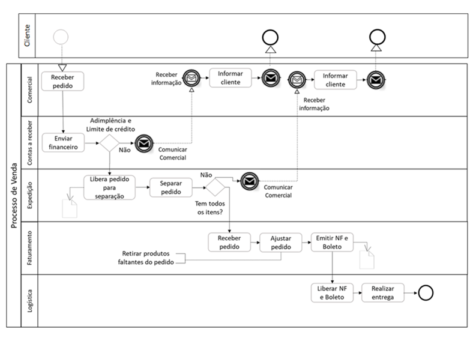

> **Figura 13** — Modelo de Negócios. *Fonte: Werlich (2020, p. 87).*

---

## Saiba mais

- **Bizagi**: poderosa ferramenta de automação de processos de negócios que oferece uma abordagem intuitiva e visual para modelagem, execução e otimização de fluxos de trabalho empresariais.
  > BIZAGI. **Bizagi Modeler**. [s. d.]

## Referências

- ABPMP. Association of Business Process Management Professionals International. BPM CBOK: guia para o gerenciamento de processos de negócio — corpo comum de conhecimento v. 3.0. Brasília: ABPMP Brasil, 2013.
- BROCKE, J. V.; ROSEMANN, M. Manual de BPM: gestão de processos de negócio. Porto Alegre: Bookman, 2013.
- VALLE, R.; OLIVEIRA, S. B. de. Análise e modelagem de processos de negócio: foco na notação BPMN. São Paulo: Atlas, 2013.
- WERLICH, C. Análise e modelagem de sistemas. Londrina: Editora e Distribuidora Educacional S.A., 2020.
