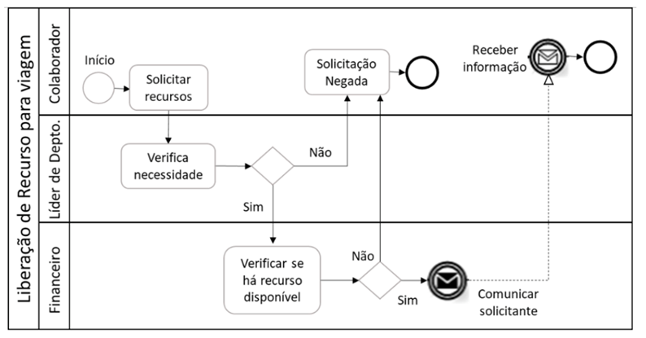
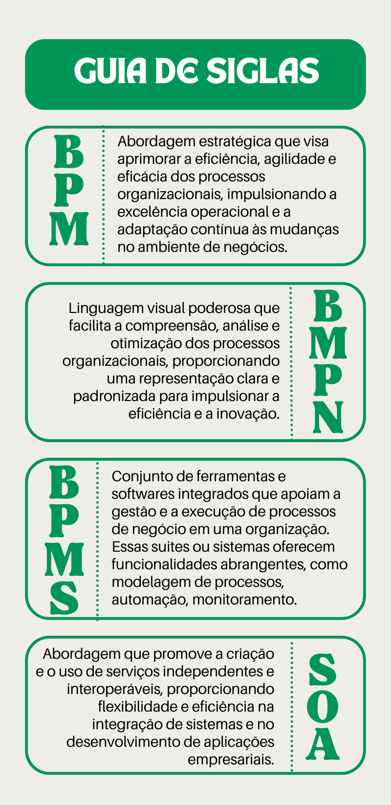

# Aula 5 — Videoaula de Encerramento

## Ponto de Chegada

Olá, estudante! Para desenvolver a competência desta Unidade, que é **aplicar os conhecimentos de processos de negócios e desenvolver diagramas utilizando o BPMN**, devemos conhecer os principais conceitos dos processos de negócios.

### Processos de negócio e sua classificação

O **processo de negócio** é uma sequência de atividades inter-relacionadas e coordenadas que visam alcançar um objetivo específico dentro de uma organização. Ele representa a maneira pela qual as tarefas, recursos, informações e decisões são organizados e executados para produzir um resultado desejado. Os processos de negócio são fundamentais para o funcionamento eficiente de uma empresa, pois proporcionam uma abordagem estruturada para a execução de atividades, promovendo a eficiência operacional.

Além de conhecer os conceitos, é importante compreender as classificações de processos de negócio, com interações entre eles:

| Tipo | Resumo |
|---|---|
| **Primários** | Essenciais ao *core business*; agregam valor ao cliente final, refletindo em sua satisfação. Iniciam e encerram fora da organização, estabelecendo uma relação direta com o cliente. |
| **Suporte** | Oferecem apoio aos primários (ex.: recursos humanos e tecnologia da informação), contribuindo para a eficiência global e exigindo alinhamento organizacional. Devem ser avaliados conforme a natureza da organização: em um escritório de contabilidade, por exemplo, podem ser considerados primários. |
| **Gerenciamento** | Supervisionam e controlam as atividades organizacionais, otimizando os processos e indiretamente agregando valor ao cliente. Compartilham características com os de suporte. O monitoramento e controle são feitos por meio de gerenciamento estratégico e de desempenho, utilizando indicadores específicos de cada organização. |

> A classificação dos processos é crucial para direcionar os esforços das empresas, pois problemas nos processos **primários** impactam imediatamente o cliente, enquanto problemas nos processos de **suporte** ou **gerenciamento** têm um impacto geralmente menor ou imperceptível.

### Visão funcional × visão de processos ponta a ponta

Gerenciar processos é fundamental para uma organização, trazendo benefícios que impactam diretamente os clientes (VALLE; OLIVEIRA; BRACONI, 2013). Esses benefícios incluem o alinhamento dos processos com a estratégia organizacional, melhoria da qualidade, redução de custos, simplificação e automação de processos, além do aumento do envolvimento das partes interessadas e uma melhor delegação de responsabilidades.

| | Abordagem funcional | Integração horizontal (ponta a ponta) |
|---|---|---|
| **Estrutura** | Hierárquica; analisa os processos por departamento | Prioriza os processos como eixo gerencial principal |
| **Visão** | Isolada, sem interconectividade entre as áreas; cria **silos** | Abrangente e interfuncional, reconhecendo as interconexões |
| **Consequências** | Gestão deficiente, orientação limitada ao mercado, objetivos departamentais isolados, coordenação prejudicada | Atende às necessidades do cliente de maneira mais eficaz |

A perspectiva por processos implica uma reavaliação contínua para atender às necessidades em constante evolução dos clientes. A indústria automobilística serve como exemplo, passando de uma abordagem de produção em massa para uma oferta personalizada, evidenciando a necessidade de adaptação dos processos às mudanças no mercado. A coleta detalhada de dados e uma análise aprofundada são cruciais para o sucesso na gestão de processos, garantindo que as atividades estejam alinhadas com os requisitos do cliente de maneira satisfatória.

### BPM — Gerenciamento de Processos de Negócio

A gestão é uma atividade crucial para todas as organizações, abrangendo **planejamento, organização, direção e controle**, conforme destacado por Chiavenato (2014). A função de controle, especificamente, está intrinsecamente ligada à gestão e é fundamental para assegurar o desempenho satisfatório da organização. No contexto do BPM, a abordagem expande a visão organizacional, promovendo uma compreensão holística da cadeia de entrega de produtos ou serviços e superando limitações da perspectiva verticalizada.

O BPM, conforme definido pela ABPMP (2013), é essencial para analisar os processos em um nível mais elevado, permitindo a compreensão das relações entre as áreas e a subdivisão em subprocessos. A **visão física** destaca a operação desintegrada das áreas, enquanto a **visão lógica** enfoca o processo, evidenciando a interconexão entre as atividades e a influência coletiva no resultado. O BPM é percebido como a construção de processos ponta a ponta, integrando estratégias e objetivos empresariais.

A eficácia dessa abordagem depende da compreensão de elementos como cultura organizacional, clima, estruturas, tecnologia e políticas. A **governança dos processos**, incorporando controle e prestação de contas, é essencial para alcançar os objetivos organizacionais (ARAÚJO; GARCIA; MARTINES, 2017).

A evolução da melhoria de processos abrange desde a simplificação do trabalho até metodologias avançadas como **Seis Sigma** e **Lean**, culminando no BPM. Associado a isso está o **BPMS**, um sistema tecnológico de suporte que possibilita o mapeamento, execução e monitoramento dos processos organizacionais (BROCKE; ROSEMANN, 2013).

### BPMS

O BPMS desempenha um papel fundamental ao mapear, executar e monitorar os processos funcionais, proporcionando uma visão completa e automatizando ações e fluxos de informações. De acordo com Araújo, Garcia e Martines (2017), o BPMS é uma **evolução em relação ao workflow**, integrando diversos fluxos de trabalho e adaptando-se a sistemas legados. A integração eficiente dos processos é crucial, como destacado por Valle e Oliveira (2013), para garantir que estejam alinhados aos objetivos e estratégias organizacionais.

### Controle, maturidade e CMMI

A gestão de negócios, segundo Chiavenato (2014), está intimamente ligada à administração e destaca a importância do estabelecimento de padrões de desempenho mensuráveis. O controle, abrangendo níveis **estratégicos, táticos e operacionais**, é crucial para alcançar metas, e no contexto do BPM, foca nas atividades de cada processo de negócio. O planejamento do gerenciamento de processos está relacionado ao **nível de maturidade** da organização, e o **CMMI** desempenha um papel crucial nesse contexto, promovendo a eficiência do gerenciamento das atividades.

O CMMI, desenvolvido pelo SEI, baseia-se em **cinco níveis de maturidade**, indicando que quanto maior o nível, melhor a capacidade de gerenciamento do processo.

### Gestor de processos e gestão de mudanças

O gestor de processos, ou ***process owner***, desempenha um papel crucial, sendo responsável por garantir recursos, avaliar resultados, facilitar o treinamento e implementar mudanças necessárias. A cultura participativa e a gestão de mudanças são fundamentais para o progresso eficaz do processo.

A conexão entre mudança e BPM é destacada, enfatizando a necessidade de uma disposição significativa para mudanças. No entanto, a resistência é comum devido a fatores como medo do desconhecido e preferência pela zona de conforto. Abordagens para mudança cultural incluem persuasão e contratação alinhada à cultura existente. A gestão de mudanças é vital, mas muitas vezes os métodos BPM não a incorporam efetivamente.

Os gestores de processos devem possuir:

- habilidades técnicas;
- relacionamento eficaz;
- proficiência em TI;
- capacidade de gerenciar equipes multifuncionais;
- compreensão abrangente do processo de negócio.

A tecnologia desempenha um papel crucial, com softwares BPM e BPMS sendo essenciais para modelagem, automação e controle de processos. A definição de metas, seguindo o método **SMART**, é vital, pois proporciona sentido ao gerenciamento de processos, vinculando indicadores de desempenho aos objetivos organizacionais.

### Modelagem de processos

Um ponto importante para alcançarmos a competência é saber aplicar a modelagem nos processos de negócios. Logo, compreender o que é modelar e os tipos de modelagem de processos.

A modelagem de processos é uma atividade essencial no gerenciamento organizacional, exigindo habilidades e técnicas para compreender, comunicar e gerenciar componentes dos processos de negócio. Ela envolve a criação de representações, oferecendo visões abrangentes ou focadas em partes específicas dos processos. O objetivo é desenvolver uma representação completa e precisa do processo, com o nível de detalhamento dependendo das expectativas da iniciativa de modelagem.

Os modelos, representações simplificadas de objetos ou atividades, têm diversas aplicações nos negócios, desempenhando funções como **organização, descoberta, previsão, medição, explicação, verificação e controle**. Os processos podem ser expressos em diferentes níveis de detalhe, de uma visão abstrata contextual a uma visão minuciosa, abrangendo diversas perspectivas.

O conteúdo de um modelo de processo inclui elementos como **atividades, fluxo de trabalho, recursos, decisões, eventos, tempo, responsabilidades e objetivos**. Esses elementos proporcionam uma compreensão completa do funcionamento do processo, facilitando a análise, otimização e gestão eficaz.

Os termos diagrama, mapa e modelo são frequentemente usados de maneira intercambiável, mas representam estágios distintos de desenvolvimento, cada um com maior quantidade de informações e utilidade:

| Conceito | Resumo |
|---|---|
| **Diagrama** | Simplifica detalhes para facilitar a compreensão dos fluxos de trabalho, semelhante a um mapa básico que fornece uma visão simplificada. |
| **Mapa** | Oferece uma visão mais precisa e detalhada do processo, incorporando informações sobre relacionamentos cruciais. |
| **Modelo** | Representa um estado específico do negócio, exigindo mais dados sobre o processo e os fatores que afetam seu comportamento. |

Ferramentas de modelagem oferecem capacidades de simulação e geração de relatórios para análise aprofundada do processo.

### Arquitetura de processos × arquitetura de negócio

A distinção entre arquitetura de processos e arquitetura de negócio é muitas vezes fonte de confusão na modelagem.

| | Arquitetura de negócio | Arquitetura de processos |
|---|---|---|
| **Pergunta** | **O QUE** no negócio | **COMO** do negócio |
| **Natureza** | Modelos conceituais, nível elevado de abstração; tratam das capacidades de negócio | Detalham como produtos, serviços ou entregáveis são construídos e entregues, relacionados a atividades específicas |
| **Foco** | **Eficácia** | **Eficiência** |

A clareza na distinção entre esses modelos é crucial para garantir que atividades estejam alinhadas à entrega de capacidades de negócio específicas, promovendo efetividade organizacional.

### Notação e BPMN

**Notação**, em modelagem de processos de negócio, refere-se a um conjunto padronizado de símbolos e regras que define o significado desses símbolos. A escolha de uma metodologia com normas estabelecidas, como o BPMN (*Business Process Model and Notation*), proporciona vantagens como comunicação eficiente, consistência nos modelos e facilidade de importação/exportação.

Outras notações desempenham papéis específicos na modelagem:

| Notação | Contribuição |
|---|---|
| **BPMN** | Abordagem visual para representar processos de forma compreensível; amplamente adotado para aprimorar a eficiência operacional e alinhar atividades estratégicas. |
| **Fluxograma** | Visualização clara das etapas do processo. |
| **EPC** (*Event-driven Process Chain*) | Análise centrada em eventos. |
| **UML** | Representação abrangente de sistemas complexos na engenharia de software. |

Para a modelagem de processos de negócios, essa disciplina opta pela notação **BPMN**. O BPMN é um padrão desenvolvido pela *Business Process Management Initiative* (BPMI) e amplamente aceito pelo *Object Management Group* (OMG), destacando-se pela sua integração nas principais ferramentas de modelagem. Essa notação oferece uma gama abrangente de símbolos que representam vários aspectos dos processos de negócio, incluindo fluxo de atividades e ordem de precedência. Dentro do BPMN, as **raias** organizam o modelo em linhas paralelas, representando diferentes papéis desempenhados por atores na execução do trabalho, seguindo um trajeto estabelecido. É crucial orientar a construção dos modelos por padrões corporativos para criar uma perspectiva de longo prazo de modelos integrados de negócios.

A notação BPMN utiliza ícones descritivos e analíticos para atender diversas necessidades, permitindo indicar eventos, fluxo de atividades, comunicação intra e interorganizacional.

| ✅ Vantagens | ⚠️ Desvantagens |
|---|---|
| Ampla aceitação e versatilidade para modelar diversas situações de processo | Necessidade de treinamento para usar todos os símbolos |
| Suporte por ferramentas BPMS | Dificuldade na visualização de relacionamentos em diferentes níveis de um processo |
| | Possível necessidade de diferentes ferramentas para suportar subconjuntos específicos da notação |
| | A origem na tecnologia da informação pode ser um obstáculo para o uso por profissionais de negócios |

#### Elementos do BPMN

A notação BPMN é composta por diversos elementos que desempenham papéis cruciais na representação gráfica de processos de negócio:

| Elemento | Papel |
|---|---|
| **Eventos** | Abrangem desde pontos de início até eventos intermediários e de fim. |
| **Atividades** | Representadas por tarefas e subprocessos; essenciais para descrever unidades de trabalho. |
| **Gateways** | Indicam decisões exclusivas ou paralelismo nas sequências de atividades. |
| **Conectores** | Fluxos de sequência e associações: delineiam a ordem das atividades e conectam informações adicionais aos elementos do diagrama. |
| **Raias** (*pools* e *lanes*) | Fornecem uma estrutura organizacional, representando diferentes participantes ou departamentos envolvidos no processo. |
| **Artefatos** | Objetos de dados e anotações: adicionam camadas de informação contextual ao diagrama. |
| **Fluxos de mensagem** | Indicam a troca de mensagens entre diferentes participantes ou *pools*, facilitando a compreensão das interações. |

Essa diversidade de elementos na notação BPMN oferece flexibilidade para modelar uma ampla gama de processos de negócio, proporcionando uma representação visual clara e abrangente que promove a compreensão e a comunicação eficaz entre profissionais de negócios e de TI.

> **Em resumo:** o Gerenciamento de Processos de Negócio e a notação associada, BPMN, destacam-se como ferramentas para organizações contemporâneas que buscam aprimorar operações e alinhar estratégias. Ao incorporar essas práticas, as empresas não só enxergam, analisam e aprimoram seus processos, mas também aprimoram a comunicação entre as partes interessadas. A modelagem de processos com a notação BPMN fornece uma representação visual eficaz, capacitando profissionais a entender complexidades, identificar oportunidades de melhoria e impulsionar a eficiência operacional.

---

## É Hora de Praticar!

### Estudo de Caso: Solicitação de recursos de viagem

A atividade proposta neste encerramento consiste na elaboração de um modelo BPMN voltado para a **"Solicitação de recursos de viagem"**, integrando os departamentos **Financeiro**, **Líder de departamento** e **Colaboradores**. Essa iniciativa visa estabelecer uma representação visual clara e abrangente do processo, desde a requisição inicial até a aprovação final e o subsequente tratamento financeiro. A modelagem incorporará elementos essenciais, como pontos de decisão, atribuições de responsabilidade e eventos críticos, visando melhorar não apenas a eficiência operacional, mas também a comunicação entre os diversos participantes envolvidos. O modelo resultante será submetido à validação dos *stakeholders* pertinentes, sendo refinado conforme necessário para garantir uma implementação eficaz, acompanhada da devida documentação e treinamento para a correta execução do novo processo de solicitação de recursos para viagem.

> **Atividade proposta:** desenvolver um modelo BPMN para a Solicitação de Recursos de Viagem, envolvendo os setores Financeiro, Líder de Departamento e Colaboradores.
>
> 1. Inclua os elementos necessários para representar claramente o fluxo do processo, desde a solicitação até a aprovação e processamento financeiro.
> 2. Destaque pontos de decisão, responsabilidades específicas de cada participante e eventos que possam influenciar o andamento do processo.
> 3. Ao final, valide o modelo com *stakeholders* relevantes, ajuste conforme necessário e esteja pronto para a implementação, documentação e treinamento associados ao novo processo.
>
> O objetivo é criar uma representação visual que melhore a eficiência operacional e a comunicação entre os envolvidos nesse processo específico de solicitação de recursos para viagem.

### Reflita

1. Como o Gerenciamento de Processos de Negócio (BPM) contribui para a eficiência e inovação nas organizações, promovendo a adaptação contínua e a maximização do valor entregue aos clientes e partes interessadas?
2. Como a Modelagem de Gerenciamento de Processos de Negócio influencia a compreensão, análise e aprimoramento contínuo dos processos organizacionais, contribuindo para uma gestão mais eficiente e alinhada aos objetivos estratégicos?
3. Como a escolha da melhor linguagem de Modelagem de Gerenciamento de Processos de Negócio pode influenciar a clareza, eficácia na comunicação e na capacidade de análise das operações organizacionais, considerando a diversidade de opções disponíveis e as particularidades de cada contexto empresarial?

### Dê o Play!

Clique aqui para acessar os slides do *Dê o play!* (disponível na plataforma da instituição).

### Resolução do Estudo de Caso

A **documentação** tem diversas utilidades, mas a principal é subsidiar a precisão das análises e embasamento dos resultados identificados. A documentação atenderá, sempre, a demanda de cada projeto, porém pode informar o motivo pelo qual o processo existe, para elucidar as interações existentes entre os subprocessos, para mostrar o fluxo de trabalho, identificar *gaps* de desempenho, motivo dos *gaps*, registro de coleta de dados e onde são coletados, entre muitos outros aspectos. Sabendo disso, uma possível solução para a atividade proposta é:

> **Figura 1** — Modelo de negócios. *Fonte: elaborada pela autora.*

> Lembre-se: dependendo da interpretação, pode haver variações entre os modelos.

### Assimile

Desvende as siglas importantes da modelagem de negócios com o infográfico. Entenda sem rodeios o que **BPM**, **BPMN** e **BPMS** representam, e ganhe clareza na linguagem da gestão empresarial.

> **Figura** — Guia de siglas. *Fonte: elaborada pela autora.*

---

## Referências

- ABPMP. Association of Business Process Management Professionals International. BPM CBOK: guia para o gerenciamento de processos de negócio — corpo comum de conhecimento v. 3.0. Brasília: ABPMP Brasil, 2013.
- ARAÚJO, L. C. G.; GARCIA, A. A.; MARTINES, S. Gestão de Processos: melhores resultados e excelência organizacional. 2. ed. São Paulo: Atlas, 2017.
- CHIAVENATO, I. Administração: teoria, processo e prática. 5. ed. Barueri: Manole, 2014.
- VALLE, R.; OLIVEIRA, S. B. de. Análise e modelagem de processos de negócio: foco na notação BPMN. São Paulo: Atlas, 2013.
