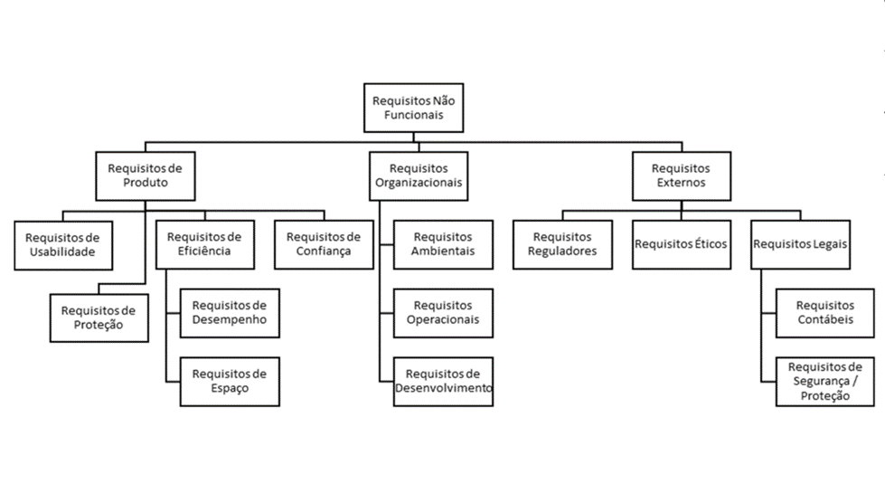
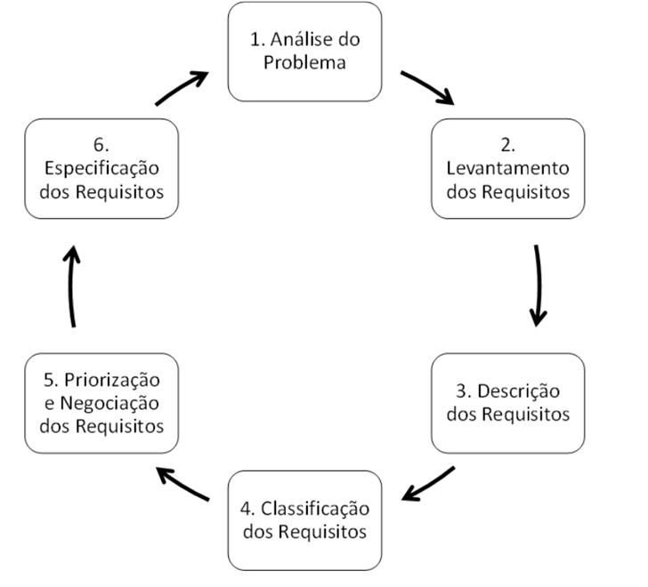

# Aula 1 — Introdução à Engenharia de Requisitos

## Ponto de Partida

Um aspecto crucial na elaboração de um projeto de software é a **engenharia de requisitos**, em que qualquer erro ou omissão pode afetar significativamente o resultado do produto desenvolvido. Esta fase é de extrema importância, pois o sucesso do software depende dela.

O sucesso de um profissional de Tecnologia da Informação (TI) está intimamente ligado à capacidade de compreender as necessidades do cliente (nosso usuário final) e, ainda mais importante, identificar aquilo que o cliente nem mesmo tem consciência de que precisa. Embora possa parecer complexo, existem técnicas que auxiliam na execução dessa etapa fundamental do desenvolvimento de software, capacitando o profissional a compreender e aplicar métodos para especificação, validação e modelagem de requisitos.

O desafio desta aula é aplicar e identificar os processos de engenharia de requisitos, assim como suas técnicas e análises, para atender à demanda de um cliente, que diz respeito ao desenvolvimento de um software para uma empresa que vende produtos e plantas ornamentais. Porém, para realizar essa tarefa, você necessita conhecer os conceitos e as técnicas que serão apresentados.

> Vamos imaginar que você trabalha em uma empresa de desenvolvimento de softwares e, por ser bem detalhista, você ficou encarregado do **levantamento de requisitos** para a produção de um software para um grande cliente que cultiva e comercializa **plantas ornamentais**. A fim de conhecer bem as rotinas da empresa, serão necessárias várias visitas, pois, dessa forma, além de conhecer o fluxo de trabalho da companhia, você poderá investigar como funcionam as rotinas de trabalho que, muitas vezes, não são contadas pelos usuários do sistema.
>
> O cliente necessita de um software para atender à crescente demanda por plantas ornamentais, pois todo o processo, com exceção ao realizado pela máquina de cartão de crédito, é feito manualmente e resulta em anotações em muitos cadernos. A empresa possui como meta expandir os negócios através de franquias, mas, para isso, será necessário informatizar todo o processo de compra de plantas ornamentais e realizar um controle das encomendas realizadas por arquitetos e paisagistas. A empresa atende ao público em geral, de modo que consumidores podem comprar (e/ou encomendar) diversos tipos de plantas.
>
> Você, como analista de sistemas, precisa auxiliar o cliente no progresso dessa informatização. Para resolver o problema de falta de conhecimento sobre as rotinas de trabalho da empresa, você foi designado a elaborar uma apresentação com os seguintes questionamentos:
>
> 1. O que precisará ser feito?
> 2. Quais requisitos funcionais podem ser apontados nesta primeira etapa?
> 3. Determine também requisitos não funcionais que contribuem para atender às expectativas do cliente, classificando-os em "requisitos funcionais" e "não funcionais".

O primeiro passo para responder as questões acima é estudar esta aula, que contém conhecimentos acerca de procedimentos da engenharia de requisitos, de seus conceitos e tipos.

---

## Vamos Começar!

### Conceitos e fundamentos sobre requisitos

Uma das principais dificuldades no desenvolvimento de software é estimar o tempo necessário para sua conclusão. Além disso, garantir que o produto final atenda exatamente às necessidades do cliente é outro desafio crucial. No entanto, esses obstáculos podem ser superados por meio da prática da engenharia de requisitos.

De acordo com Pressman (2021), a **engenharia de requisitos** engloba um conjunto de atividades que visam produzir e manter um documento, conhecido como **documento de requisitos**, cujo principal objetivo é especificar o que deve ser implementado antes do início do desenvolvimento do software ou sistema. No entanto, é comum que as empresas comecem a desenvolver partes do software antes mesmo de concluir o levantamento de requisitos.

Sommerville (2018) define a engenharia de requisitos como o processo de descrever todas as funcionalidades que um sistema deve possuir, além de detalhar os serviços e as restrições de funcionamento, refletindo as necessidades dos clientes (usuários do software) e contribuindo para o desenvolvimento de um produto de qualidade. O objetivo principal é garantir que todas as partes envolvidas no desenvolvimento do sistema tenham uma **compreensão compartilhada por escrito do problema**. Para isso, são utilizados diversos artefatos que asseguram a qualidade das especificações fornecidas.

#### Mas, o que é o requisito de um sistema?

Requisito de sistema era definido como uma função que o software deveria ter ou uma qualidade que ele deveria apresentar. Atualmente, além da função e da qualidade, os requisitos de um sistema abrangem especificações dos serviços que ele deve fornecer, restrições que deve possuir, características gerais e restrições que devem ser atendidas no seu processo de desenvolvimento (Pfleeger, 2004).

Dando sequência a nossa tratativa sobre a engenharia de requisitos, suponha que você precise criar um **jogo on-line de perguntas e respostas** para treinar seus conhecimentos para um concurso. Nessa situação, podemos elencar alguns exemplos de requisitos:

- O jogador deverá realizar um cadastro antes de jogar, criando um apelido, senha, e-mail e escolher um avatar.
- O jogo deverá ter várias fases, apresentando graus de dificuldade.
- O jogador deverá escolher uma ou mais áreas de conhecimento.
- As questões deverão ser classificadas em vários níveis de dificuldade.

Note que os requisitos são redigidos de forma que tanto o cliente quanto os desenvolvedores possam compreender claramente o que o software deve realizar. É importante evitar enunciados muito extensos ou subjetivos; eles devem ser concisos e consistentes, garantindo que todas as partes envolvidas entendam claramente o que será entregue. O Quadro 1 lista as qualificações que os requisitos devem atender.

#### Quadro 1 — Qualificação dos requisitos

| Qualificação | Descrição |
|---|---|
| **Exatidão** | Todo requisito precisa ser um requisito do produto a ser desenvolvido. |
| **Precisão** | Todo requisito possui apenas uma única interpretação, aceita tanto pelos desenvolvedores quanto pelos clientes (usuários). |
| **Completude** | Todo requisito reflete as decisões de especificação que foram acordadas entre as partes envolvidas. |
| **Consistência** | Não pode haver conflitos entre os requisitos e qualquer um dos seus subconjuntos. |
| **Priorização** | Todo requisito é rotulado de acordo com a sua importância, estabilidade e complexidade. |
| **Verificabilidade** | Demonstra a conformidade do produto final com cada requisito elencado. |
| **Modificabilidade** | O requisito deve ter estrutura e estilo que permitam mudança de maneira fácil, completa e consistente. |
| **Rastreabilidade** | Permite a determinação dos antecedentes e das implicações de todos os requisitos. |

> *Fonte: adaptado de Paula Filho (2019, [s. p.]).*

#### Prioridade dos requisitos

Destacar um fator no levantamento de um requisito é determinar a sua **prioridade**, a qual possuirá denominações diferenciadas de acordo com a literatura consultada, podendo cada empresa adotar a sua terminologia. Os requisitos são classificados como **essencial**, **importante** ou **desejável**, conforme afirma Pfleeger (2004).

| Prioridade | Característica | Exemplo |
|---|---|---|
| **Essencial** | De suma importância para o funcionamento do software, vital para sua completude. Sem ele, o programa ficaria incompleto, impossibilitando sua implantação ou conclusão. | Um aluno só pode acessar uma disciplina se estiver devidamente matriculado nela. |
| **Importante** | Não é crucial para a implantação do software, podendo ser realizado em segundo plano. Embora desejável, não é indispensável. | A criptografia das senhas dos usuários em um sistema acadêmico: se não for implementada inicialmente, o sistema ainda pode ser implantado e atualizado depois. |
| **Desejável** | Não é essencial para a conclusão do software; é opcional e pode até ser descartado durante o desenvolvimento. | A contagem de tempo de acesso dos alunos, usada para determinar a duração do uso do sistema por cada usuário durante o semestre. Pode ser deixada de lado em caso de atrasos. |

> As prioridades de cada requisito devem ser determinadas durante a definição do escopo do projeto, entretanto vale ressaltar que essas prioridades **podem mudar** com a evolução do sistema.

---

## Siga em Frente...

### Tipos de requisitos

Na engenharia de requisitos é importante fazer uma distinção dos diferentes tipos de descrições dos requisitos, conforme afirma Sommerville (2018). Eles podem ser classificados como:

| Tipo | Descrição |
|---|---|
| **Requisitos do usuário** | Delineiam tanto os requisitos funcionais quanto os não funcionais do sistema, utilizando uma **linguagem compreensível** para os usuários finais (clientes). Destacam as funcionalidades e as restrições que o sistema deve apresentar. O resultado é um documento que não se aprofunda em detalhes técnicos, mas facilita a comunicação entre os desenvolvedores e os clientes. |
| **Requisitos do sistema** | Especificam os **detalhes do sistema**, baseados nos requisitos do usuário, resultando em um documento que pode servir como parte do contrato entre todas as partes envolvidas no desenvolvimento do sistema. Este estágio marca o início do projeto. |

Determinar o tipo de requisito em um sistema pode ser uma tarefa extenuante, e um requisito pode ser classificado inicialmente como de um tipo e, no decorrer do projeto, pode sofrer alterações e receber outra classificação, podendo gerar, ainda, uma série de novos requisitos.

De acordo com Sommerville (2018) e Pressman (2021), os requisitos de um sistema podem ser agrupados em **três categorias principais**:

| Categoria | Descrição |
|---|---|
| **Requisitos funcionais** | Especificam de forma clara e precisa as funcionalidades específicas que o sistema deve executar ou não. Descrevem as ações que o sistema deve realizar em resposta a entradas específicas do usuário ou de outros sistemas. |
| **Requisitos não funcionais** | Impõem restrições sobre as funcionalidades do sistema, definindo padrões específicos de desenvolvimento, plataforma, tempos de resposta e restrições de acesso. Relacionam-se às qualidades que o sistema deve apresentar, como desempenho, segurança, usabilidade e escalabilidade. |
| **Requisitos de domínio** | Determinam as características do domínio do sistema, refletindo as particularidades do ambiente em que será utilizado. Podem impor restrições aos requisitos funcionais ou fornecer cálculos específicos com base no contexto do domínio. |

#### Requisitos funcionais (RF)

Os requisitos funcionais delineiam os objetivos específicos do sistema, ou seja, as características que ele deve possuir ao término de seu desenvolvimento. Esses requisitos devem englobar todas as funcionalidades e informações fornecidas pelo cliente antes da implementação do software. Para identificá-los, utilizamos a sigla **RF** seguida de uma numeração (Sommerville, 2018). Abaixo estão exemplos de requisitos funcionais para um **sistema de controle acadêmico** fictício:

- **[RF0001]** — O sistema deve manter os dados pessoais e acadêmicos dos alunos.
- **[RF0002]** — O sistema deve permitir que o aluno faça a matrícula por disciplina.
- **[RF0003]** — O sistema deverá manter os dados (pessoais e profissionais) dos professores, especialmente dos seguintes atributos: CPF, RG, nome, endereço (completo), data de nascimento, telefones para contato, e-mail (pessoal e corporativo), nacionalidade, data de admissão, data de demissão, valor da hora-aula, carga horária.
- **[RF0004]** — O sistema deve permitir a visualização das notas cadastradas.
- **[RF0005]** — O professor poderá cadastrar as notas no sistema de acordo com o calendário acadêmico (previamente cadastrado na plataforma).

O nível de detalhamento de um requisito desempenha um papel crucial na comunicação com o cliente, ajudando a esclarecer o que precisa ser realizado no sistema. Além disso, facilita a programação da funcionalidade correspondente, pois fornece uma orientação clara ao programador. Portanto, um detalhamento minucioso é essencial para eliminar ambiguidades e garantir que todos compreendam claramente o que está sendo solicitado.

> É importante notar que o requisito funcional **[RF0003]** possui um nível de detalhamento mais elevado em comparação com **[RF0001]**. Embora o detalhamento seja fundamental nessa fase, **cada requisito deve ser específico**. Por exemplo, se estamos discutindo informações dos alunos em um requisito, não devemos incluir dados dos professores no mesmo requisito.

#### Requisitos não funcionais (RNF)

Os requisitos não funcionais são identificados pela sigla **RNF** e estabelecem critérios para qualificar os requisitos funcionais. Esses requisitos abordam aspectos relacionados à qualidade, desempenho, confiabilidade, usabilidade, implementação, entre outros. É importante ressaltar que um único requisito não funcional pode resultar em vários requisitos funcionais. A seguir, alguns exemplos de requisitos não funcionais para o sistema acadêmico fictício:

- **[RNF0001]** — O tempo de espera do aluno para visualizar as notas não poderá exceder os sete segundos.
- **[RNF0002]** — O sistema deverá ser implementado utilizando a linguagem de programação JAVA.
- **[RNF0003]** — As notas só poderão ser lançadas por profissionais da empresa com o perfil de professor.
- **[RNF0004]** — Todas as cores do sistema deverão obedecer ao padrão de cores da instituição: laranja (RGB: 255,140,0), cinza (RGB: 211,211,211) e branco (RGB: 248,248,255).
- **[RNF0005]** — Todos os relatórios devem ser gerados com as cores do sistema, logomarca da instituição, com data e hora da geração; devem ser gerados no formato PDF.

> **Dica:** uma recomendação importante para saber se a especificação do requisito é um requisito não funcional é observar se o assunto tratado pode ser **mensurado** (velocidade, tempo, linguagens, versões); caso seja, possivelmente será um requisito não funcional, conforme Paula Filho (2019).

Observe o Quadro 2 com métricas que auxiliam na identificação e especificação de requisitos não funcionais.

#### Quadro 2 — Métricas de requisitos não funcionais

| Propriedade | Métrica |
|---|---|
| **Velocidade** | Quantidade de transações realizadas por segundo. Tempo de resposta ou atualização do sistema. |
| **Tamanho** | Megabytes ou gigabytes ocupados. Quantidade de RAM. Quantidade de espaço em disco ou nuvem. |
| **Usabilidade** | Tempo de treinamento (horas necessárias). Quantidade de telas de ajuda. |
| **Confiabilidade** | Tempo médio para falhar. Probabilidade de indisponibilidade. Taxa de ocorrência de falhas. Disponibilidade. |
| **Robustez** | Percentual de eventos que causam falhas e o tempo necessário para o sistema se reestabelecer. Determinar as possibilidades de que os dados sejam corrompidos. |
| **Portabilidade** | Quantidade de adaptações para o sistema funcionar em diferentes plataformas (Sistema Operacional). |

> *Fonte: adaptado de Sommerville (2018, p. 94).*

Os requisitos não funcionais são categorizados com base em três grandes áreas:

| Área | Descrição |
|---|---|
| **Requisitos do produto** | Especificam ou restringem o comportamento do sistema e podem incluir determinações sobre a linguagem de programação a ser utilizada. |
| **Requisitos organizacionais** | Derivados das políticas e procedimentos da empresa, do cliente e do desenvolvedor. |
| **Requisitos externos** | Englobam todos os fatores externos ao sistema que podem influenciar no seu desenvolvimento, desde que estejam em conformidade com a legislação vigente. |

A classificação completa dos requisitos não funcionais pode ser visualizada na Figura 1.

> **Figura 1** — Classificação dos requisitos não funcionais. *Fonte: adaptada de Sommerville (2018, p. 92).*

#### Requisitos de domínio

Os requisitos de domínio descrevem características específicas e estabelecem condições adicionais aos requisitos funcionais, indicando, por exemplo, critérios obrigatórios para a validação de um requisito. Eles podem consistir em novos requisitos funcionais ou em complementos que impõem restrições adicionais aos requisitos existentes.

> **Exemplo:** um aluno será considerado aprovado se alcançar, no mínimo, **3000 pontos** nas avaliações semestrais **e** **4000 pontos** nas atividades complementares de cada disciplina. Este requisito estabelece duas condições, e ambas devem ser cumpridas para que o aluno seja considerado aprovado no sistema.

### Papel da engenharia de requisitos no ciclo de vida do projeto

As atividades do processo da engenharia de requisitos envolvem a coleta de informações sobre o software (sistema) a ser realizado, a análise do problema e, em seguida, a descrição dos requisitos, classificação e priorização, sendo que logo após isso é gerada a especificação desses requisitos (Pressman, 2021). Tais processos podem ser melhor visualizados na Figura 2.

> **Figura 2** — Atividades dos processos de engenharia de requisitos. *Fonte: adaptada de Pfleeger (2004) e Sommerville (2018).*

Todas as atividades relacionadas à engenharia de requisitos têm como objetivo principal a elaboração de um **documento de requisitos**, como destacado por Sommerville (2018) e Pressman (2021). Estas atividades abrangem as seguintes etapas:

| Etapa | O que acontece |
|---|---|
| **Concepção** | Define-se o escopo geral do sistema e identificam-se todos os *stakeholders* envolvidos. |
| **Elicitação** | Coleta de requisitos funcionais e não funcionais, utilizando técnicas como entrevistas, observação e pesquisa. |
| **Elaboração** | Detalha-se cada requisito inicialmente expresso em linguagem natural, transformando-os em modelos conceituais, muitas vezes utilizando a UML, com o objetivo de eliminar erros, omissões, duplicações e inconsistências. |
| **Negociação** | Identificam-se e tratam-se requisitos conflitantes, realizando-se negociações entre as partes envolvidas para ajustar e/ou eliminar tais requisitos. |
| **Especificação** | Transformam-se os requisitos em uma visão mais detalhada do sistema, considerando o desenvolvimento da solução. |
| **Validação** | Os requisitos são validados pelos usuários relevantes, verificando se todas as necessidades foram atendidas, sob a perspectiva do cliente. |
| **Gerenciamento** | Verificação contínua, ao longo do processo, da conformidade dos requisitos com o escopo do projeto, bem como a garantia da rastreabilidade, que envolve o controle de possíveis alterações que os requisitos possam sofrer. |

Essa etapa de gerenciamento permeia todo o ciclo de vida do produto. Várias atividades envolvem o processo de engenharia de requisitos. A partir de uma análise inicial do problema do cliente, na qual é realizada a compreensão do domínio do problema, realiza-se a fase do **levantamento dos requisitos**, atividade que dará suporte a todas as etapas da engenharia de requisitos. Após isso, realiza-se a classificação, a priorização e a documentação dos requisitos. A participação do cliente e dos usuários finais do sistema é fundamental para a validação dos requisitos levantados. Deve-se também inserir atividades de controle de qualidade em todas as etapas para validar os requisitos e garantir a qualidade do que está sendo projetado. E, como tudo é dinâmico em um projeto de software, os requisitos podem sofrer alterações, sendo necessário um processo de gerenciamento para validar as evoluções dos requisitos funcionais e não funcionais a fim de manter o controle dessa evolução.

> **Resumindo:** os requisitos **funcionais** delineiam as funcionalidades, os comportamentos e as características de entrada e saída de um sistema, enquanto os requisitos **não funcionais** se referem aos atributos e qualidades do sistema.

Os requisitos são o cerne de qualquer software. Antes de iniciar o desenvolvimento de um sistema, é crucial criar uma lista de funcionalidades e características que ele deve possuir — esses são os requisitos iniciais. No entanto, o processo não termina aí. Convido você a explorar ainda mais a engenharia de requisitos.

---

## Vamos Exercitar?

Retomando a situação-problema do início da aula, você foi escolhido para fazer parte da equipe de analistas cuja meta é elencar os requisitos de um software para um cliente, dono de uma empresa de plantas ornamentais que possui como objetivo expandir os negócios através de franquias. Para isso, será necessário informatizar todo o processo de compra de plantas ornamentais dos fornecedores, controlar as encomendas realizadas por arquitetos e paisagistas e, como a empresa também fornece o serviço de decoração paisagista (doméstico e empresarial), é necessário também um controle desses processos. A empresa atende ao público em geral, de modo que consumidores podem comprar (e/ou encomendar) diversos tipos de plantas. Assim sendo, alguns questionamentos foram realizados e precisam ser respondidos.

### 1. Para resolver o problema de falta de conhecimento sobre as rotinas de trabalho da empresa, o que você precisará fazer?

Para solucionar este problema, o primeiro passo é **visitar o cliente** e conversar com os usuários que utilizarão o software. Desta forma, poderemos conhecer a rotina da empresa, conversando com as pessoas, ficando atentos às atividades que elas realizam, sendo curiosos e perguntando sempre que houver dúvidas.

> **Dica:** anotar tudo e, se possível, recolher cópias de documentos que são utilizados.

Durante as visitas, foram realizadas várias entrevistas e foram coletados vários documentos, como listas de anotações de pedidos aos fornecedores, encomendas de clientes e a lista de plantas disponíveis para a venda.

### 2. Quais requisitos funcionais podem ser apontados nesta primeira etapa?

Aqui é preciso determinar requisitos não funcionais que contribuem para atender às expectativas do cliente, classificando-os em requisitos funcionais e não funcionais. Após as visitas realizadas, pode-se listar alguns **requisitos funcionais**:

- **[RF0001]** — O sistema deverá manter (incluir, consultar, alterar e excluir) os dados dos clientes: nome, endereço, CPF ou CNPJ, e-mail, telefones.
- **[RF0002]** — O sistema deve gerar um relatório das plantas disponíveis para venda.
- **[RF0003]** — O sistema deve permitir que sejam cadastrados os pedidos de encomenda de plantas e produtos da empresa.
- **[RF0004]** — O sistema deve autorizar a inclusão de pedidos de jardinagem, permitindo a escolha das plantas e demais produtos.
- **[RF0005]** — O sistema deverá manter o cadastro de todos os produtos da empresa.
- **[RF0006]** — O sistema deverá manter as informações botânicas das plantas.
- **[RF0007]** — O sistema deverá emitir relatórios sobre as encomendas, situação do estoque, trabalhos paisagísticos em andamento e finalizados.
- **[RF0008]** — O sistema deverá manter o cadastro de todos os fornecedores.
- **[RF0009]** — O sistema deverá emitir um relatório das plantas que podem ser plantadas, sendo estas classificadas por época do ano, tipos de terrenos e tipos de construção.
- **[RF0010]** — O sistema deverá manter um cadastro dos usuários do sistema, classificando-os como: vendedor, administrador e supervisor.

Pode-se elencar os seguintes **requisitos não funcionais**:

- **[RNF0001]** — O sistema deverá ser realizado na linguagem de programação JAVA.
- **[RNF0002]** — O tempo de espera dos relatórios não poderá ultrapassar os seis segundos.
- **[RNF0003]** — As telas do sistema devem ter cores claras (tom pastel) e ícones grandes.
- **[RNF0004]** — O sistema deverá utilizar o banco de dados MySQL.
- **[RNF0005]** — Apenas usuários classificados como supervisor e administrador poderão gerar os relatórios sobre as encomendas.

> Observe que os requisitos funcionais sempre aparecem em **maior quantidade** do que os requisitos não funcionais. Isso é natural, até porque qualquer software deverá ter muitas funcionalidades e todas devem ser descritas de forma individualizada. Foram listados alguns requisitos, mas será que você não consegue identificar mais alguns?

---

## Saiba mais

1. **Engenharia de Requisitos**: o livro de Pressman oferece *insights* valiosos. Acesse o Capítulo 7.1 e leia mais sobre o tema:
   > PRESSMAN, R. S.; MAXIM, B. R. **Engenharia de software**. Grupo A, 2021.

2. **Requisitos funcionais e não funcionais**: leia o Capítulo 4.1 do livro:
   > SOMMERVILLE, I. **Engenharia de software**. 10. ed. São Paulo, SP: Pearson, 2018.

3. **Artigo**: *Requisitos de Software: Um Guia Abrangente para o Desenvolvimento de Sistemas de Sucesso* — a importância de requisitos, os tipos, processos e melhores práticas.
   > ALMEIDA, B. **Requisitos de Software: Um Guia Abrangente para o Desenvolvimento de Sistemas de Sucesso**. Data Perspective. 2023.

## Referências

- PAULA FILHO, W. P. Engenharia de software: produtos. 4. ed. Rio de Janeiro: LTC, 2019.
- PFLEEGER, S. L. Engenharia de Software: teoria e prática. 2. ed. São Paulo: Prentice Hall, 2004.
- PRESSMAN, R. S. Engenharia de software: uma abordagem profissional. 9. ed. Porto Alegre: AMGH, 2021.
- SOMMERVILLE, I. Engenharia de software. 10. ed. São Paulo: Pearson, 2018.
