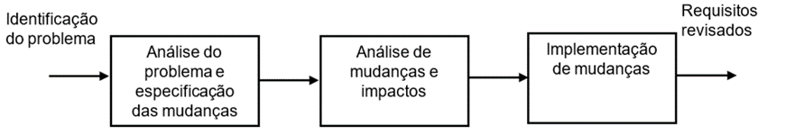

# Aula 2 — Elicitação e Análise de Requisitos

## Ponto de Partida

O processo de desenvolvimento de um software é muito dinâmico, tudo pode mudar rapidamente. Um cliente pode mudar de ideia e esperar que o software a ser desenvolvido tenha características diferentes do início do desenvolvimento. Precisamos deixar o cliente satisfeito, porém, nós, como desenvolvedores, precisamos garantir que os requisitos sejam executados conforme o contratado.

> Você, sendo detalhista em requisitos de software, ficou encarregado do levantamento dos requisitos para o desenvolvimento de um software para um cliente que cultiva e comercializa **plantas ornamentais**. Foram realizadas diversas visitas ao cliente e foram identificados vários requisitos funcionais e não funcionais:
>
> **Requisitos funcionais:**
>
> - **[RF0001]** — O sistema deverá manter (incluir, consultar, alterar e excluir) os dados dos clientes: nome, endereço, CPF ou CNPJ, e-mail, telefones.
> - **[RF0002]** — O sistema deve gerar um relatório das plantas disponíveis para venda.
> - **[RF0003]** — O sistema deve permitir que sejam cadastrados os pedidos de encomenda de plantas e produtos da empresa.
> - **[RF0004]** — O sistema deve permitir a inclusão de pedidos de jardinagem, permitindo a escolha das plantas e demais produtos.
> - **[RF0005]** — O sistema deverá manter o cadastro de todos os produtos da empresa.
> - **[RF0006]** — O sistema deverá manter as informações botânicas das plantas.
> - **[RF0007]** — O sistema deverá emitir relatórios sobre as encomendas, situação do estoque, trabalhos paisagísticos em andamento e finalizados.
> - **[RF0008]** — O sistema deverá manter o cadastro de todos os fornecedores.
> - **[RF0009]** — O sistema deverá emitir um relatório das plantas que podem ser plantadas classificadas por época do ano, tipos de terrenos e tipos de construção.
> - **[RF0010]** — O sistema deverá manter um cadastro dos usuários do sistema, classificando-os como: Vendedor, Administrador e Supervisor.
>
> **Requisitos não funcionais:**
>
> - **[RNF0001]** — O sistema deverá ser realizado na linguagem de programação JAVA.
> - **[RNF0002]** — O tempo de espera dos relatórios não poderá ultrapassar os 6 segundos.
> - **[RNF0003]** — As telas do sistema devem apresentar cores claras (tom pastel) e ícones grandes.
> - **[RNF0004]** — O sistema deverá utilizar o banco de dados MySQL.
> - **[RNF0005]** — Apenas usuários classificados como Supervisor e Administrador poderão gerar os relatórios sobre as encomendas.
>
> Seu desafio é determinar como será feita a coleta de dados para obter o máximo de informações sobre o software a ser desenvolvido para o controle de venda de plantas ornamentais. Quais os passos para realizar a elicitação dos requisitos? De que forma os requisitos elencados (os citados e os novos que você inseriu) podem ser especificados?
>
> Elabore uma tabela com os requisitos encontrados (e supralistados) e adicione novos requisitos funcionais e não funcionais.

---

## Vamos Começar!

### Técnicas e abordagens para identificar, coletar e compreender os requisitos junto aos stakeholders

Na engenharia de requisitos, a **elicitação de requisitos** consiste em obter o máximo de informações, seja por meio de extrair dados de fontes ou de interações com indivíduos relevantes, a fim de estabelecer os requisitos de um sistema específico. Essa etapa é fundamental e uma das primeiras na disciplina de Engenharia de Requisitos, conforme delineado por Pressman (2021).

O processo de elicitação de requisitos não é realizado isoladamente pelo analista de sistemas; ele envolve a colaboração de várias pessoas, conhecidas como ***stakeholders***, que incluem todos os interessados no projeto. Segundo Pressman (2021), a elicitação de requisitos envolve a combinação de elementos para resolver problemas, requerendo uma abordagem colaborativa dos stakeholders. Sommerville (2018) ressalta que os stakeholders são as partes interessadas no projeto, que podem incluir analistas de sistemas, gerentes de projetos, programadores, clientes (contratantes) e usuários finais do sistema.

No processo de elicitação, é crucial ter perspectivas diversas sobre as funcionalidades do sistema, e os stakeholders devem participar para garantir a **ausência de requisitos contraditórios**. Estes, se não forem resolvidos antes do desenvolvimento, podem acarretar problemas durante a entrega do produto final. A partir das questões e necessidades dos stakeholders, a elicitação de requisitos visa realizar as seguintes tarefas (PRESSMAN, 2021):

1. Especificar o escopo do problema do sistema.
2. Avaliar as oportunidades de reutilização de soluções existentes.
3. Identificar os stakeholders diretamente envolvidos com o sistema.
4. Elicitar e qualificar os requisitos do sistema.
5. Analisar os requisitos elicitados.
6. Validar os requisitos elicitados.

A engenharia de requisitos abrange todas as etapas que colaboram para a elaboração de um documento de requisitos e sua subsequente manutenção ao longo do ciclo de vida do projeto. Os procedimentos fundamentais de levantamento e análise de requisitos de um sistema incluem as seguintes atividades (SOMMERVILLE, 2018):

| Atividade | Descrição |
|---|---|
| **1. Concepção ou entendimento do domínio** | Estabelecer uma compreensão básica do problema a ser abordado. É essencial que todos os stakeholders tenham uma compreensão clara do que será realizado, incluindo os limites do que será e do que não será realizado. |
| **2. Coleta e classificação (elicitação)** | Todas as atividades destinadas a identificar o máximo de requisitos dos stakeholders. Os requisitos são então classificados em funcionais e não funcionais. |
| **3. Negociação** | Após a lista de requisitos ter sido compilada, é crucial determinar se há conflitos entre eles (ver abaixo). |
| **4. Validação** | Verificação abrangente dos requisitos, resultando em um **"termo de aceitação"** no qual todas as partes envolvidas (stakeholders do sistema projetado) concordam e validam os requisitos. |
| **5. Documentação** | Resultado da Engenharia de Requisitos: um documento contendo todas as especificações dos requisitos funcionais e não funcionais. Serve como o principal meio de comunicação entre o analista de sistemas ou engenheiro de software e o cliente. |

#### Negociação de requisitos: resolvendo conflitos

Exemplo de conflito:

- **RF0025** — O cliente deve ter uma senha para acessar o sistema.
- **RF0078** — Não é necessário que um cliente tenha uma senha para acessar o sistema.

Observe que o requisito RF0078 contradiz completamente o requisito RF0025. Como lidar com essa situação? Provavelmente, durante a coleta de requisitos, um stakeholder solicitou acesso com senha para os clientes, enquanto outra pessoa envolvida no projeto indicou que o uso de senha era desnecessário. O procedimento para resolver esse impasse envolve **convocar as partes envolvidas** para resolver o conflito, realizando as seguintes análises:

- **Verificação de requisitos:** todos os requisitos são analisados para garantir que estejam alinhados com as necessidades dos stakeholders.
- **Definição de prioridades:** é feita a determinação dos requisitos mais importantes, que requerem total atenção para o sucesso do projeto.

A Figura 1 ilustra o processo de levantamento e análise de requisitos. É evidente que a partir da compreensão do domínio do que será efetivamente realizado no sistema, ocorre a coleta e classificação de requisitos, com o propósito de determinar o que será implementado, facilitando sua organização para melhor controle. A negociação entra em cena para estabelecer os ajustes necessários e auxiliar na definição das prioridades durante o desenvolvimento. A especificação marca o início da documentação dos requisitos, enquanto a validação consiste em uma verificação geral de todos os requisitos, com o objetivo final de documentar os requisitos de forma precisa.

> **Figura 1** — Levantamento e análise de requisitos. *Fonte: Werlich (2020, p. 133).*

O levantamento e a análise de requisitos, proposto por Sommerville (2018), é um processo de **validação continuada**. A Figura 1 demonstra essa sequência dos processos, entretanto, basta alguma alteração em um requisito para que o ciclo deva ser repetido, de forma iterativa e contínua, até a finalização do projeto.

### Elicitação de requisitos

O processo de elicitação de requisitos pode variar entre as empresas, pois cada uma possui seus próprios métodos e procedimentos. De acordo com Sommerville (2018), as atividades do processo de elicitação incluem:

1. **Descoberta de requisitos:** atividade interativa com a participação ativa dos stakeholders, onde os usuários finais do sistema contribuem com sua experiência para auxiliar na coleta dos requisitos.
2. **Classificação e organização de requisitos:** agrupar os requisitos para identificar se há repetições ou se eles pertencem a subsistemas específicos.
3. **Priorização e negociação de requisitos:** em colaboração com os stakeholders, estabelece-se a prioridade de cada requisito (essencial, importante ou desejável), ajudando a definir as etapas mais críticas do desenvolvimento.
4. **Especificação de requisitos:** os requisitos são documentados, podendo ser em formatos formais ou informais.

A elicitação tem por objetivo conseguir o máximo de requisitos do sistema a ser desenvolvido, destacando as seguintes **técnicas**:

| Técnica | Descrição |
|---|---|
| **Pesquisa** | Observação de como funciona a rotina dos processos do sistema e de outros softwares utilizados, visando procurar requisitos que não foram explicitamente solicitados. Envolve também a pesquisa pela tecnologia solicitada. |
| **Entrevista** | Tipicamente conduzida com um questionário para identificar as necessidades que o sistema deve atender. Nesta fase, é crucial praticar a **escuta ativa** e registrar o máximo de informações obtidas. |
| **Reuniões** | Utilizando técnicas como o *brainstorming* para identificar requisitos que ainda não foram determinados e resolver conflitos de requisitos surgidos durante as entrevistas. |
| **Documentos** | Coleta de documentos que possam esclarecer as funcionalidades do sistema, tais como relatórios, planilhas, registros em papel, cadernos de anotações, entre outros. |
| **Etnografia** | Observação e análise do verdadeiro modo de trabalho dos usuários finais (em contraste com o que eles possam expressar), resultando na identificação de requisitos significativos para o sistema. |

#### Especificação de requisitos

A especificação de requisitos consiste na formalização e abstração das funcionalidades que o software deve executar, utilizando descrições claras e objetivas. Esse processo de sistematização busca caracterizar o problema a ser resolvido, resultando na elaboração de um **documento de especificação de requisitos**. De acordo com Pfleeger (2004), a melhor abordagem para iniciar a especificação é adotar uma **estrutura hierárquica**, começando pelos atributos gerais do sistema e, em seguida, detalhando progressivamente em subníveis até alcançar os atributos mais específicos.

A especificação de requisitos serve como o canal de comunicação entre o analista de sistemas e os programadores responsáveis pelo desenvolvimento do software. É crucial que os requisitos sejam especificados de maneira que não haja margem para interpretações divergentes, uma vez que o programador utilizará essa especificação como base para implementar exatamente o que está descrito. Abrange todas as funcionalidades e suas respectivas restrições, tanto funcionais quanto não funcionais, geralmente apresentadas em tabelas ou documentos específicos, podendo também incluir diagramas de casos de uso para facilitar a compreensão ou a utilização de prototipagem.

#### Casos de uso

Os casos de uso são diagramas que compõem a Linguagem Unificada de Modelagem (**UML** — *Unified Modeling Language*) e são uma técnica fundamental na engenharia de requisitos, usada para capturar os **requisitos funcionais** de um sistema de forma clara e compreensível. Eles descrevem interações entre **atores** (usuários ou sistemas externos) e o sistema em questão, apresentando cenários detalhados de como o sistema será utilizado para alcançar determinados objetivos. Ajudam a definir o escopo do sistema, identificar requisitos específicos e fornecer uma visão geral das principais funcionalidades esperadas. Além disso, são uma ferramenta valiosa para comunicação entre stakeholders, permitindo que todos compreendam e validem os requisitos do sistema de forma eficaz.

#### Prototipagem

De acordo com Paula Filho (2019), a prototipagem consiste na criação de uma versão simplificada do sistema a ser desenvolvido, baseada no princípio da verificação do custo-benefício, em que a experiência do usuário desempenha um papel crucial. O mesmo autor destaca várias vantagens associadas à técnica:

1. Possibilita a identificação precoce de problemas.
2. Permite verificar se os requisitos do software atendem às necessidades dos clientes.
3. Aprimora a comunicação com o cliente, apresentando o progresso do software.
4. Facilita a realização de testes para avaliar a aceitação do software pelo cliente, juntamente com o *feedback* fornecido.

Na técnica da prototipagem, é possível antecipar vários problemas, permitindo uma melhor estimativa do tempo necessário para resolvê-los. Pfleeger (2004) categoriza a prototipagem em três abordagens distintas:

| Abordagem | Descrição |
|---|---|
| **Protótipo descartável** | Desenvolvido com o propósito de explorar o problema a ser solucionado e avaliar a viabilidade da solução. Não é utilizado posteriormente, sendo descartado após a fase exploratória. |
| **Protótipo evolutivo** | Criado quando os clientes têm dúvidas sobre alguma parte do software, geralmente relacionada à interface gráfica. É integrado ao software final. |
| **Prototipagem rápida** | Construção de partes do software para avaliar a viabilidade dos requisitos. O objetivo é determinar se a implementação do projeto é viável. |

#### Negociação

A negociação de requisitos tem como finalidade, conforme destacam Pressman (2021), desenvolver um plano de projeto que atenda às demandas dos envolvidos (stakeholders) e, ao mesmo tempo, analisa as restrições no que diz respeito ao **orçamento, pessoal, tecnologia e/ou tempo**, impostas à equipe de desenvolvimento do software.

---

## Siga em Frente...

### Monitoramento e validação de requisitos

O **monitoramento de requisitos** é um processo essencial para assegurar que o escopo do software desenvolvido seja alcançado. A cada modificação em um ou mais requisitos, é fundamental garantir a rastreabilidade das alterações, utilizando ferramentas de controle adequadas. Por exemplo, é necessário determinar o **status** de cada requisito (proposto, em progresso, em revisão, adiado, excluído, aprovado, etc.) e criar uma **matriz de rastreabilidade** para facilitar o gerenciamento dos requisitos. Essa matriz deve incluir todos os requisitos, suas dependências, o status atual, os responsáveis pela modificação e aprovação dos requisitos, e, especialmente, as datas relevantes de cada evento ocorrido.

Toda mudança, por mínima que seja, em um requisito deve ser cuidadosamente gerenciada para evitar duplicações. Na Figura 2, é possível visualizar o processo de gestão de mudanças de requisitos, que visa garantir a rastreabilidade das alterações durante o desenvolvimento do software. Este processo inclui a **análise de impacto** das mudanças propostas para determinar sua viabilidade técnica e financeira (SOMMERVILLE, 2018). Muitas vezes, a pressa em alterar uma funcionalidade no sistema em desenvolvimento pode comprometer a gestão de mudanças de requisitos, pois a modificação é realizada sem que a documentação dos requisitos seja devidamente atualizada, resultando em inconsistências e tornando a documentação desatualizada.

> **Figura 2** — Gerenciamento de mudança de requisitos. *Fonte: adaptada de Sommerville (2018, p. 116).*

O **processo de validação** dos requisitos determina que a especificação é consistente com a definição dos requisitos, assegurando que os requisitos propostos atenderão às necessidades impostas pelo cliente, de acordo com Pfleeger (2004). Durante a validação podem existir diferentes tipos de verificação (SOMMERVILLE, 2018):

| Verificação | O que checa |
|---|---|
| **Validade** | Se os requisitos contemplam os objetivos do projeto. |
| **Consistência** | Que um requisito não entre em conflito com outro requisito. |
| **Completude** | Deve haver requisitos que garantam as funcionalidades esperadas pelos usuários do sistema. |
| **Realismo** | Que a tecnologia utilizada atenda as demandas do sistema projetado. |
| **Ambiguidade** | O requisito não pode ter mais de uma interpretação. |
| **Verificável** | O requisito deve ser passível de verificação através de testes. |
| **Rastreabilidade** | Cada requisito deve ter origem clara e bem definida. |

O propósito da validação de requisitos é identificar falhas nos requisitos documentados. Pressman (2018) ressalta que erros comuns nos sistemas incluem **inconsistências, contradições, duplicações, ambiguidades, omissões e imprecisões**. Para validar os requisitos, algumas perguntas fundamentais podem ser feitas:

1. Os requisitos estão de acordo com objetivos globais do sistema?
2. O requisito foi bem especificado, fornecendo detalhes apropriados de forma clara e concisa?
3. O requisito é realmente necessário? Está com a sua classificação correta?
4. O requisito não está em conflito com outro requisito?
5. O modelo de requisito reflete adequadamente a informação, comportamento e funcionalidade do sistema?

O nível de detalhamento das perguntas pode ser ampliado e aprofundado de acordo com a complexidade do sistema a ser desenvolvido. Em muitos casos, será necessário realizar uma investigação mais aprofundada e formular mais perguntas para determinar a precisão dos requisitos. É importante ressaltar que o principal objetivo da validação de requisitos é a **detecção e eliminação de erros** que possam resultar em atrasos e aumento de custos, tanto durante a produção do software quanto para o cliente.

Um recurso que pode contribuir para garantir a qualidade da validação é o ***checklist***, uma lista de perguntas elaborada para analisar cada requisito do sistema. Essa técnica tem como objetivos:

- identificar erros em diversos níveis, como função, lógica e implementação;
- verificar se o sistema atende aos requisitos especificados;
- assegurar que o software desenvolvido foi implementado conforme os padrões previamente estabelecidos.

---

## Vamos Exercitar?

O desafio desta aula é determinar como será feita a coleta de dados para obter o máximo de informação sobre o software a ser desenvolvido para o controle de venda de plantas ornamentais. Quais os passos para realizar a elicitação dos requisitos? De que forma os requisitos elencados (os citados e os novos que você inseriu) podem ser especificados?

### 1. Como será feita a coleta de dados para conseguir realizar a elicitação dos requisitos?

Para responder essa pergunta, primeiro teremos que analisar os requisitos elencados após as visitas realizadas no cliente e responder:

- **Serão somente esses requisitos?** Provavelmente não, pode haver uma lista maior de requisitos. Observe que não foi informado nada a respeito dos trabalhos paisagísticos realizados pela empresa. Será necessário guardar informações sobre esse assunto?
- **As informações dos requisitos são suficientes?** Provavelmente, a resposta também será não. Observe que foram mencionados nos requisitos anteriores: fornecedores, funcionários, plantas, encomendas, porém não há informação que complete o requisito. Procure por mais informações sobre os usuários que utilizarão o software.

A coleta deverá envolver:

1. **Pesquisa:** examinando com os usuários envolvidos para obter mais informações sobre o que falta em cada requisito.
2. **Observação:** mesmo que algo não seja solicitado explicitamente, você deverá observar para que não haja contradições entre o que é feito e o que é dito.
3. **Entrevistas:** converse informalmente com os futuros usuários procurando saber o que realmente é importante ter no sistema a ser desenvolvido e, caso necessário, providencie entrevistas estruturadas (já com as perguntas pré-realizadas).

### 2. Como especificar os novos requisitos funcionais e não funcionais elencados?

Você precisará adotar técnicas para especificar os requisitos. Analise as seguintes dicas:

- Estimule a participação dos stakeholders.
- Escreva os requisitos de forma simples e objetiva.
- Evite o excesso de detalhamento nos requisitos, pois isso dificulta a leitura e a compreensão.
- Tenha como foco resolver o problema do cliente.

**Exemplo de uma boa especificação:**

> **[RF0001]** — O sistema deverá manter (incluir, consultar, alterar e excluir) os dados dos clientes: nome, endereço, CPF ou CNPJ, e-mail, telefones.

**Mais um exemplo:**

> **[RF0001]** — O sistema deverá manter (incluir, consultar, alterar e excluir) os dados dos clientes: nome, endereço, CEP, CPF ou CNPJ, Inscrição Estadual, e-mail, telefone residencial, telefone comercial, celular, cidade, data de nascimento.

É uma boa prática criar **tabelas separadas** com os tipos de requisitos: uma para os requisitos funcionais e outra para os requisitos não funcionais. Para os requisitos não funcionais é importante estabelecer a **classificação** do requisito. Observe uma sugestão de tabela para os requisitos não funcionais:

#### Quadro 1 — Requisitos não funcionais

| Identificador | Descrição | Classificação |
|---|---|---|
| **RNF0001** | O sistema deverá ser realizado na linguagem de programação JAVA. | Implementação |
| **RNF0002** | O tempo de espera dos relatórios não poderá ultrapassar os 6 segundos. | Desempenho |
| **RNF0003** | As telas do sistema devem apresentar cores claras (tom pastel) e ícones grandes. | Usabilidade |
| **RNF0004** | O sistema deverá utilizar o banco de dados MySQL. | Implementação |
| **RNF0005** | Apenas usuários classificados como Supervisor e Administrador poderão gerar os relatórios sobre as encomendas. | Segurança |

> *Fonte: Werlich (2020, p. 143).*

---

## Saiba mais

1. **Levantamento de Requisitos**: o livro de Pressman oferece *insights* valiosos. Acesse o Capítulo 7.3:
   > PRESSMAN, R. S.; MAXIM, B. R. **Engenharia de software**. 9. ed. Grupo A, 2021.

2. **Elicitação de Requisitos**: leia o Capítulo 4.3 de *Engenharia de Software*:
   > SOMMERVILLE, I. **Engenharia de software**. 10. ed. São Paulo, SP: Pearson, 2018.

3. **Técnicas de Elicitação de Requisitos**: leia o artigo:
   > ACERT. **Técnicas de Elicitação de Requisitos**. 2023.

## Referências

- PAULA FILHO, W. P. Engenharia de software: produtos. 4. ed. Rio de Janeiro: LTC, 2019.
- PFLEEGER, S. L. Engenharia de Software: teoria e prática. 2. ed. São Paulo: Prentice Hall, 2004.
- PRESSMAN, R. S. Engenharia de software: uma abordagem profissional. 9. ed. Porto Alegre: AMGH, 2021.
- SOMMERVILLE, I. Engenharia de software. 10. ed. São Paulo: Pearson, 2018.
- WERLICH, C. Análise e modelagem de sistemas. Londrina: Editora e Distribuidora Educacional S.A., 2020.
