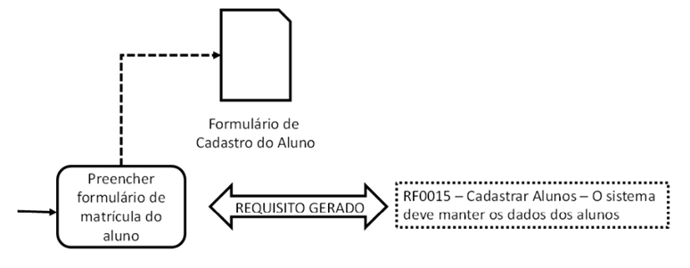
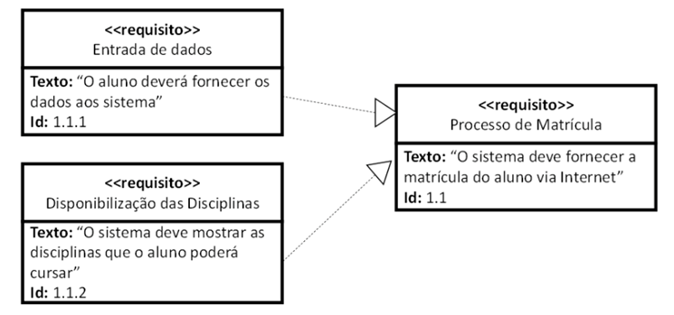
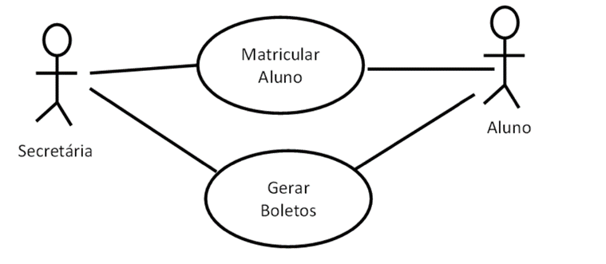

# Aula 3 — Modelagem de Requisitos

## Ponto de Partida

Você já reparou que estamos cada vez mais atolados com muitas informações? A cada dia aparecem mais informações que devemos administrar. Como esse excesso de informação deve ser administrado em uma empresa de desenvolvimento de software? É necessário um gerenciamento eficaz das informações recolhidas para o desenvolvimento de um software. Em um desenvolvimento de software, **tudo precisa ser documentado, organizado e validado com o cliente**, para que ambas as partes concordem com o que será desenvolvido.

Pensando nessa documentação, vamos apresentar métodos de documentar os requisitos, seja por meio de linguagem natural ou através de modelos especificados e próprios para essa atividade.

> Para que você exercite esse seu lado de modelagem de requisitos, vamos imaginar que você está trabalhando como analista de sistemas e faz parte de uma equipe responsável pela engenharia de requisitos do software. Você documentará os seguintes requisitos:
>
> - **[RF0008]** — O sistema deverá manter o cadastro de todos os fornecedores.
> - **[RF0009]** — O sistema deverá emitir um relatório das plantas que podem ser plantadas classificadas por época do ano, tipos de terrenos e tipos de construção.
> - **[RF0010]** — O sistema deverá manter (incluir, consultar, alterar e excluir) os dados dos clientes: nome, endereço, CPF ou CNPJ, e-mail, telefones.
> - **[RF0011]** — O sistema deve gerar um relatório das plantas disponíveis para venda.
>
> Agora, o desafio final é criar uma **Documentação da especificação de requisitos**. Será possível usar uma padronização para documentar os requisitos? Existe alguma vantagem ao utilizar essa técnica? Você consideraria importante documentar a especificação e a elicitação dos requisitos?

---

## Vamos Começar!

### Especificação de requisitos funcionais e não funcionais

A modelagem de requisitos tem como principal objetivo concentrar-se no **"o que será feito"** e não no **"como será feito"**. Conforme afirmado por Pressman (2021), o modelo de requisitos deve alcançar três objetivos fundamentais:

1. Descrever o que o cliente solicitou.
2. Estabelecer uma base para a criação do Projeto de Software.
3. Produzir um conjunto de requisitos que possa ser validado assim que o software estiver concluído.

Para compreender completamente os requisitos, é essencial notar que não apenas descrevem o fluxo de informações que entram e saem do sistema, bem como a transformação dos dados dentro do sistema, mas também delineiam todas as restrições relacionadas ao seu comportamento e desempenho, como afirmado por Pfleeger (2004). Os requisitos permitem:

- explicar, na perspectiva dos desenvolvedores, como os clientes desejam que o sistema funcione;
- definir as funcionalidades e atributos que o sistema deve possuir;
- informar à equipe de testes o que deve ser validado junto ao cliente.

O Quadro 1 traz uma série de perguntas que devem ser feitas sobre cada requisito, visando promover o entendimento tanto do cliente quanto dos desenvolvedores, garantindo a qualidade dos requisitos levantados.

#### Quadro 1 — Características dos requisitos

| Pergunta | Descrição |
|---|---|
| **Os requisitos estão corretos?** | Todos os envolvidos devem verificar se os requisitos estão corretos. |
| **Os requisitos estão consistentes?** | Procurar inconsistência de informação (um requisito para uma determinada ação e outro requisito desfaz essa necessidade). |
| **Os requisitos estão completos?** | Verificar a existência de lacunas nos requisitos, com o máximo de informação sobre o que será realizado, como será realizado e as alternativas que podem haver. |
| **Os requisitos são realistas?** | Verificar se o que está sendo solicitado é realmente possível de ser realizado. |
| **O requisito descreve algo necessário para o cliente?** | O requisito deverá focar no que o sistema deverá realizar, evitando funções desnecessárias (e consequentemente perda de tempo no desenvolvimento). |

> *Fonte: adaptado de Pfleeger (2004, [s. p.]).*

Existem diversas técnicas de modelagem de requisitos. A primeira, conforme Sommerville (2018), é fazer uma **separação entre os requisitos funcionais e não funcionais**, determinando um equilíbrio entre ambos (lembre-se que os Requisitos Funcionais dependem dos Requisitos Não Funcionais). O ideal é agrupar os requisitos conforme os seus objetivos, suas prioridades e seus tipos. Após o agrupamento dos requisitos funcionais e não funcionais, devemos agrupar todos os requisitos funcionais com prioridade **Essencial** (sem esse tipo de requisito, o software não estará apto a funcionar).

A especificação de requisitos envolve a documentação dos requisitos do usuário e do sistema em um documento formal. Em teoria, esses requisitos devem ser claros, inequívocos, facilmente compreensíveis, completos e consistentes, embora seja praticamente impossível alcançar essas condições idealmente. Os stakeholders tendem a interpretar os requisitos de maneiras diversas, frequentemente resultando em conflitos e incoerências. Os requisitos de usuário são geralmente redigidos em linguagem natural e podem ser complementados por diagramas e tabelas apropriados no documento de requisitos. Por outro lado, os requisitos do sistema também podem ser expressos em linguagem natural, mas outras notações, como formulários, gráficos ou modelos matemáticos, podem ser utilizadas. O Quadro 2 resume as diferentes notações possíveis para escrever requisitos de sistema.

#### Quadro 2 — Notações para escrever requisitos do sistema

| Notação | Descrição |
|---|---|
| **Sentenças em linguagem natural** | Os requisitos são escritos usando frases numeradas em linguagem natural. Cada frase deve expressar um requisito. |
| **Linguagem natural estruturada** | Os requisitos são escritos em linguagem natural em um formulário ou *template*. Cada campo fornece informações sobre um aspecto do requisito. |
| **Notações gráficas** | Modelos gráficos, suplementados por anotações em texto, são utilizados para definir os requisitos funcionais do sistema. São utilizados com frequência os diagramas de casos de uso e de sequência da UML. |
| **Especificações matemáticas** | Baseiam-se em conceitos matemáticos como as máquinas de estados finitos ou conjuntos. Embora essas especificações inequívocas possam reduzir a ambiguidade em um documento de requisitos, a maioria dos clientes não compreende uma especificação formal. |

> *Fonte: adaptado de Sommerville (2018, p. 104).*

### Uso de linguagem natural

Desde os anos 1950, a linguagem natural tem sido empregada na redação de requisitos de software. É uma forma expressiva, intuitiva e universal de comunicação. No entanto, também é intrinsecamente **vaga e ambígua**, sua interpretação variando conforme a experiência do leitor. Apesar das diversas propostas de alternativas para escrever requisitos, nenhuma delas foi amplamente adotada, e a linguagem natural continuará sendo o meio predominante de especificar requisitos de sistema e software.

Para mitigar possíveis mal-entendidos ao redigir requisitos em linguagem natural, é recomendável seguir estas diretrizes simples (SOMMERVILLE, 2018):

1. **Estabelecer um formato padrão** e garantir sua adoção em todas as definições de requisitos. Padronizar o formato reduz a probabilidade de omissões e facilita a verificação dos requisitos. Sempre que viável, expressar o requisito em uma ou duas frases em linguagem natural.
2. **Distinguir obrigatório de desejável** de maneira consistente. Os requisitos obrigatórios são aqueles que o sistema deve obrigatoriamente suportar e geralmente são expressos com o termo **"deve"**. Já os requisitos desejáveis não são essenciais e são indicados pelo termo **"pode"**.
3. **Destacar partes importantes** do requisito usando realces de texto, como negrito, itálico ou cor.
4. **Evitar presumir conhecimento técnico** em engenharia de software. Termos como "arquitetura" e "módulo" podem ser facilmente mal interpretados. Sempre que possível, evitar o uso de jargões, abreviações e acrônimos.
5. **Associar um racional** a cada requisito de usuário sempre que possível. O racional deve explicar por que o requisito foi incluído e quem o propôs (a origem do requisito), facilitando a identificação de quem contatar caso o requisito precise ser alterado. É particularmente útil em momentos de mudança, ajudando a discernir quais alterações seriam indesejáveis.

#### Linguagem natural estruturada

A linguagem natural estruturada é uma forma de redigir os requisitos do sistema de maneira padronizada, em oposição ao texto livre. Essa abordagem mantém a expressividade e a clareza da linguagem natural, porém impõe uma certa uniformidade à especificação. As notações que adotam a linguagem estruturada utilizam modelos para descrever os requisitos do sistema. Essa descrição pode fazer uso de construções da linguagem de programação para apresentar alternativas e iterações, possibilitando destacar elementos-chave por meio de sombreamento ou diferentes fontes.

Para adotar uma abordagem estruturada na especificação de requisitos de sistema, é necessário estabelecer um ou mais modelos para os requisitos e representá-los como formulários estruturados. A especificação pode ser organizada em torno dos **objetos** manipulados pelo sistema, das **funções** executadas por ele ou dos **eventos** processados (SOMMERVILLE, 2018).

A adoção de especificações estruturadas remove algumas das dificuldades encontradas na redação de requisitos em linguagem natural. A variabilidade na especificação é minimizada e os requisitos são organizados de maneira mais eficiente. No entanto, em certas situações, pode ser desafiador expressar os requisitos de forma clara e inequívoca (SOMMERVILLE, 2018).

---

## Siga em Frente...

### Uso de modelos e diagramas

#### Técnica REMO

Uma técnica de modelagem de requisitos empregada na fase de elicitação é a técnica **REMO** (*Requirements Elicitation oriented by business process MOdeling*). Esta técnica possibilita a integração da modelagem de processos de negócios, utilizando a notação BPMN, com a elicitação de requisitos, conforme mencionado por Vieira (2012).

A técnica REMO possibilita a extração de requisitos a partir dos diagramas de processos de negócios, apoiada por um conjunto de heurísticas. Vieira (2012) descreve que o método compreende **duas fases**:

| Fase | Foco |
|---|---|
| **1ª — Entendimento do contexto** | Explorar o domínio do problema do software. O Analista de Sistemas elabora um documento com informações cruciais para compreender o domínio: problemas e necessidades identificados, papéis envolvidos nos processos, recursos necessários e disponíveis, e diagramas de processos de negócios. |
| **2ª — Requisitos** | Extração e descrição dos requisitos do sistema. |

Observe na Figura 1 como um requisito funcional pode ser gerado a partir da Modelagem de Processos de Negócios. Primeiramente, foi identificada uma atividade (*Preencher formulário de matrícula do aluno*) e, então, é realizado o seguinte questionamento: **"Essa atividade pode ser um requisito?"** Caso afirmativo, temos um requisito encontrado a partir da Modelagem de Processos de Negócios. No exemplo da Figura 1, o requisito gerado foi o **RF0015 — Cadastrar Alunos**: *o sistema deve manter os dados dos alunos*.

> A palavra **"manter"** no requisito significa: **cadastrar, consultar, alterar e excluir** (evitando, assim, a escrita do mesmo requisito mudando os verbos, que representam o objetivo do requisito).

> **Figura 1** — Requisito gerado a partir da modelagem de processos de negócio. *Fonte: Werlich (2020, p. 150).*

#### SysML

Existem outras técnicas de modelagem de requisitos, como a linguagem de modelagem **SysML** (*Systems Modeling Language*), que é *open source* (código aberto), derivada da linguagem UML e especificada pelo Object Management Group. O SysML suporta as seguintes atividades: especificação, análise, design, verificação e validação de sistemas. Nesta modelagem podemos reutilizar vários diagramas da UML, e foi criado o **Diagrama de Requisitos**, que possui como principal vantagem a demonstração dos requisitos e suas relações. O diagrama de requisitos do SysML é baseado em textos e nos relacionamentos entre os requisitos.

Na Figura 2 são ilustrados três requisitos (nos retângulos). O requisito "Processo de Matrícula" possui duas dependências: os requisitos "Entrada de dados" e "Disponibilização das Disciplinas" precisam ser elaborados após a abertura do requisito "Processo de Matrícula". Importa destacar que o diagrama pode ficar muito grande, dependendo da quantidade de requisitos. Nesse sentido, ainda é usual a utilização de tabelas para descrever os requisitos.

> **Figura 2** — Diagrama de requisitos. *Fonte: Werlich (2020, p. 151).*

#### UML e casos de uso

A UML é amplamente empregada na modelagem de requisitos. A Linguagem UML (Linguagem de Modelagem Unificada) oferece uma variedade de diagramas que podem ser utilizados de forma isolada, representando aspectos específicos, ou combinados para compor modelos mais abrangentes. Por exemplo, o **caso de uso** é um dos diagramas mais utilizados para modelar requisitos, juntamente com o **diagrama de sequência** e o **diagrama de atividades**. Cada empresa pode adotar uma ou várias técnicas de modelagem de requisitos para produzir a documentação necessária ao final do processo de modelagem.

O processo de modelagem de requisitos na análise de sistemas pode ser considerado uma **conexão** entre as fases de elicitação e especificação de requisitos e a fase de modelagem de projetos do sistema. Uma alternativa adicional para especificar requisitos é através de diagramas de caso de uso. Pressman (2021) destaca que um cenário de uso, ou **especificação do caso de uso**, detalha o caso de uso, auxiliando na modelagem do requisito específico. Este detalhamento serve como principal meio de comunicação entre a equipe de desenvolvimento, ou seja, entre o analista de sistemas responsável pela modelagem e o programador encarregado de implementar o requisito modelado.

O diagrama de caso de uso desempenha um papel fundamental na construção de software orientado a objetos utilizando a UML. Estes diagramas acompanham o software desde sua concepção até sua conclusão. Além disso, servem como um meio de comunicação eficaz entre o analista de sistemas e os programadores, pois detalham precisamente o que precisa ser implementado e codificado.

Na Figura 3 é demonstrado um modelo de diagrama de Casos de Uso com dois processos (cada processo, ou elipse, é chamado de **Caso de Uso**): (i) *Matricular o Aluno* e (ii) *Gerar Boletos*, e envolve dois **atores** que "alimentarão" os processos com o fornecimento ou o recebimento de informações.

> **Figura 3** — Exemplo de casos de uso. *Fonte: Werlich (2020, p. 158).*

Cada caso de uso representa uma determinada função ou tarefa do sistema, segundo Sommerville (2018), que envolve a interação externa com o sistema e pode ser um cenário simples que ajuda no entendimento do sistema (ou de parte dele). É na especificação (ou descrição) de cada caso de uso que o processo de modelagem de requisito é ampliado. Observe o Quadro 3, com a especificação do caso de uso *Matricular Aluno*.

#### Quadro 3 — Especificação do caso de uso: Matricular Aluno

| Campo | Conteúdo |
|---|---|
| **Nome do caso de uso** | Matricular Aluno |
| **Ator principal** | Aluno |
| **Atores secundários** | Secretária |
| **Resumo** | Este caso de uso tem por objetivo detalhar o processo de matrícula do aluno no sistema. |
| **Pré-condições** | 1. O aluno deverá estar matriculado no sistema. 2. Não poderá haver nenhuma pendência financeira no sistema. |

**Fluxo principal**

| Passo | Ações do ator | Ações do sistema |
|:---:|---|---|
| 1 | O aluno informa a matrícula e senha para se logar no sistema. | |
| 2 | | O sistema deverá verificar a matrícula e validar a senha do aluno. |
| 3 | | Deverão ser apresentadas as disciplinas que o aluno poderá cursar. |
| 4 | O aluno poderá escolher a disciplina que cursará num total de 6 disciplinas por semestre. | |
| 5 | O aluno deverá finalizar a escolha da disciplina apertando o botão FINALIZAR. | |
| 6 | O aluno poderá escolher entre imprimir ou salvar o comprovante de matrícula. | Um comprovante de matrícula deverá ser gerado em formato PDF. |

**Fluxos alternativos**

| Passo | Ações do ator | Ações do sistema |
|:---:|---|---|
| 1.1 | O aluno poderá redefinir a sua senha. | |
| 2.1 | | Caso o aluno não tenha senha, o sistema deverá permitir o cadastramento da senha ou a sua redefinição. |
| 3.1 | | Deverá ser verificado o semestre atual do aluno; se for o 1º semestre do aluno, ele deverá escolher todas as disciplinas. |
| 3.2 | | Deverá ser verificada a quantidade de disciplinas a serem escolhidas (o limite deve ser igual a 6). |

> *Fonte: adaptado de Werlich (2020, p. 159).*

A finalidade da especificação ou descrição de um caso de uso é fornecer informações sobre quais atores (sejam pessoas ou sistemas) interagem com as funcionalidades específicas que estão sendo modeladas no sistema. Não existe um modelo padrão de especificação, pois este é totalmente adaptável às necessidades das empresas. No entanto, é recomendável que seja redigido de forma simplificada para facilitar a compreensão.

---

## Vamos Exercitar?

Para relembrar, você está trabalhando como analista de sistemas e faz parte de uma equipe responsável pela Engenharia de requisitos do software. Você documentará os requisitos para o sistema da empresa de plantas ornamentais. Após realizar várias visitas, conversar com o cliente e outros usuários do sistema, vários requisitos funcionais e não funcionais do software foram levantados, mas não houve uma documentação apropriada para essas ações.

O desafio é criar uma **Documentação da Especificação de Requisitos** e, para isso, primeiramente resgataremos os Requisitos Funcionais:

- **[RF0008]** — O sistema deverá manter o cadastro de todos os fornecedores.
- **[RF0009]** — O sistema deverá emitir um relatório das plantas que podem ser plantadas classificadas por época do ano, tipos de terrenos e tipos de construção.
- **[RF0010]** — O sistema deverá manter (incluir, consultar, alterar e excluir) os dados dos clientes: nome, endereço, CPF ou CNPJ, e-mail, telefones.
- **[RF0011]** — O sistema deve gerar um relatório das plantas disponíveis para venda.

**Será possível usar uma padronização para documentar os requisitos? Existe alguma vantagem ao utilizar essa técnica?** Sim, podemos utilizar o padrão de modelagem apresentado a seguir, no Quadro 4, ou utilizar outro apresentado nesta aula.

#### Quadro 4 — Padrão de modelagem

| Campo | Valor |
|---|---|
| **Identificador** | |
| **Nome** | |
| **Módulo** | |
| **Data de criação** | |
| **Autor** | |
| **Data da última alteração** | |
| **Autor da alteração** | |
| **Versão** | |
| **Prioridade** | |
| **Descrição** | |

> *Fonte: adaptado de Werlich (2020, p. 160).*

E como ficaria a documentação do requisito funcional **[RF0008] — O sistema deverá manter o cadastro de todos os fornecedores**? Observe o Quadro 5, que ilustra a documentação básica do requisito RF0008.

#### Quadro 5 — Documentação básica do requisito RF0008

| Campo | Valor |
|---|---|
| **Identificador** | FR0008 *(como consta no material original; o identificador do requisito é RF0008)* |
| **Nome** | O sistema deverá manter o cadastro de todos os fornecedores |
| **Módulo** | N/A |
| **Data de criação** | 05/11/2019 |
| **Autor** | Claudia W. |
| **Data da última alteração** | N/A |
| **Autor da alteração** | N/A |
| **Versão** | 1.0 |
| **Prioridade** | Essencial |
| **Descrição** | Todo fornecedor deverá ser cadastrado antes de ser efetuada uma encomenda ou compra. Todos os dados deverão ser cadastrados pelo usuário do sistema. Os dados que deverão ser informados são: Nome fantasia, Razão social, CNPJ, Inscrição Estadual, Endereço completo, Cidade, Estado, E-mail. |

> *Fonte: adaptado de Werlich (2020, p. 160).*

Utilize o modelo anterior para documentar os demais requisitos do sistema de plantas ornamentais, seguindo estas regras:

- Cada requisito deverá ter o **seu próprio formulário**.
- A identificação deve ser **única**.
- Caso alguma informação não seja preenchida no formulário, insira a sigla **N/A** (Não se Aplica); não deixe a lacuna em branco.
- Toda versão deverá começar do número **1**.
- Procure ser detalhista no item da **descrição** do requisito.

---

## Saiba mais

1. **Modelagem de Requisitos**: o livro de Pressman oferece *insights* valiosos. Acesse o Capítulo 8:
   > PRESSMAN, R. S.; MAXIM, B. R. **Engenharia de software**. 9. ed. Grupo A, 2021.

2. **Especificação de Requisitos**: leia o Capítulo 4.4 de *Engenharia de Software*:
   > SOMMERVILLE, I. **Engenharia de software**. 10. ed. São Paulo, SP: Pearson, 2018.

3. **Modelagem de Requisitos com Casos de Uso**: leia o Capítulo 5 do livro:
   > REINEHR, S. **Engenharia de requisitos**. Grupo A, 2020.

## Referências

- PFLEEGER, S. L. Engenharia de Software: teoria e prática. 2. ed. São Paulo: Prentice Hall, 2004.
- PRESSMAN, Roger S. Engenharia de software: uma abordagem profissional. 9. ed. Porto Alegre: AMGH, 2021.
- SOMMERVILLE, Ian. Engenharia de software. 10. ed. São Paulo: Pearson, 2018.
- VIEIRA, S. R. C. REMO: uma técnica de elicitação de requisitos orientada pela modelagem de processos de negócios. 2012.
- WERLICH, C. Análise e modelagem de sistemas. Londrina: Editora e Distribuidora Educacional S.A., 2020.
