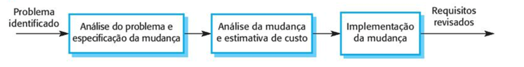
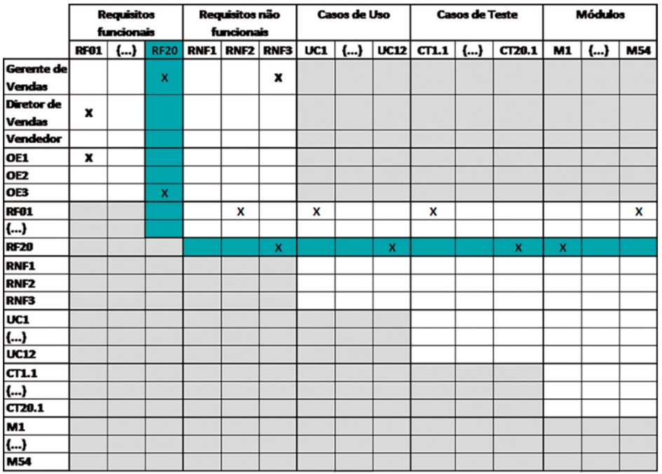

# Aula 4 — Validação e Modificações nos Requisitos

## Ponto de Partida

Nesta aula, iremos abordar três aspectos cruciais no desenvolvimento de software: **validação de requisitos**, **gestão de mudanças nos requisitos** e **rastreabilidade de requisitos**. Primeiramente, nos concentraremos na validação de requisitos, visando garantir que esses requisitos estejam alinhados com as necessidades dos usuários e do negócio. Usaremos técnicas como revisões sistemáticas e prototipagem para identificar e corrigir problemas antes do desenvolvimento do produto final.

Em seguida, exploraremos a gestão de mudanças nos requisitos, aprendendo a lidar com alterações imprevistas durante o processo de desenvolvimento. Implementaremos processos claros para solicitar, analisar e implementar essas mudanças de maneira eficiente, com técnicas para avaliar seu impacto e comunicá-las de forma eficaz. Por último, adentraremos no conceito de rastreabilidade de requisitos, que nos permite rastrear o desenvolvimento dos requisitos desde sua concepção até sua implementação.

> Para exercitar esses temas, vamos analisar o seguinte **estudo de caso**: uma loja está desenvolvendo um novo sistema de comércio eletrônico para substituir seu sistema legado. O objetivo é criar uma plataforma mais robusta e escalável para lidar com o crescimento do negócio e proporcionar uma melhor experiência ao cliente. O projeto envolve uma equipe multidisciplinar de desenvolvedores, designers, testadores e analistas de negócios.
>
> Um dos principais desafios enfrentados pela equipe de desenvolvimento é lidar eficientemente com **mudanças nos requisitos** do sistema. Como o mercado de comércio eletrônico é altamente dinâmico, novos requisitos e alterações nos requisitos existentes são esperados ao longo do ciclo de vida do projeto. No entanto, a falta de um processo formal para gerenciar essas mudanças pode levar a atrasos, custos adicionais e, em última instância, a um produto final que não atende às expectativas do cliente. **Proponha soluções que possam ajudar neste desafio.**

---

## Vamos Começar!

### Validação de requisitos

A validação de requisitos é um processo crucial para garantir que os requisitos definidos correspondam verdadeiramente ao sistema desejado pelo cliente. Este processo se destaca durante a elicitação e análise, concentrando-se na identificação de possíveis problemas. Sua importância é primordial, pois erros nos requisitos podem resultar em custos significativos de retrabalho, tanto durante o desenvolvimento quanto após a implementação do sistema (PRESSMAN, 2021).

> O custo de corrigir problemas nos requisitos, por meio de alterações no sistema, geralmente é **consideravelmente maior** do que corrigir erros de projeto ou de código. Uma mudança nos requisitos frequentemente implica em ajustes no projeto e na implementação do sistema, muitas vezes exigindo um reinício do processo.

Durante a validação de requisitos, é essencial realizar diferentes tipos de verificações nos requisitos documentados, incluindo (SOMMERVILLE, 2018):

| Verificação | O que checa |
|---|---|
| **Validade** | Se os requisitos refletem as reais necessidades dos usuários do sistema, considerando possíveis mudanças nas circunstâncias desde a elicitação inicial. |
| **Consistência** | Se os requisitos no documento não entram em conflito entre si, evitando restrições contraditórias ou descrições diferentes para a mesma função do sistema. |
| **Completude** | Se o documento de requisitos abrange todas as funções e restrições desejadas pelo usuário do sistema. |
| **Realismo** | Se os requisitos podem ser implementados dentro do orçamento proposto, considerando as tecnologias existentes e o cronograma de desenvolvimento. |
| **Verificabilidade** | Para diminuir o potencial de conflito entre o cliente e o contratante, os requisitos devem ser escritos de modo verificável: deve ser possível escrever um conjunto de testes que demonstrem que o sistema entregue satisfaz cada um dos requisitos especificados. |

Diversas **técnicas de validação** podem ser empregadas para garantir a qualidade dos requisitos de um sistema:

| Técnica | Descrição |
|---|---|
| **Revisões de requisitos** | Uma equipe de revisores examina os requisitos em busca de erros e inconsistências de forma sistemática. |
| **Prototipação** | Desenvolvimento de um modelo executável do sistema para que os usuários finais e clientes possam experimentá-lo, fornecendo *feedback* para possíveis mudanças nos requisitos. |
| **Geração de casos de teste** | Os requisitos devem ser testáveis, e o desenvolvimento de casos de teste revela problemas potenciais. Se um teste é difícil de conceber, pode indicar que os requisitos são complexos e precisam ser reconsiderados. |

A validação de requisitos é um desafio, pois é difícil demonstrar que um conjunto de requisitos atende verdadeiramente às necessidades dos usuários. Muitas vezes, problemas nos requisitos só são descobertos após o início da implementação do sistema, exigindo ajustes mesmo após o consenso inicial no documento de requisitos.

### Gestão de mudanças nos requisitos

Os requisitos de sistemas de software grandes estão sujeitos a mudanças frequentes devido à natureza dos problemas que esses sistemas abordam, muitas vezes complexos e difíceis de definir completamente. Como esses problemas são intrinsecamente desafiadores, os requisitos de software tendem a ser incompletos, pois não é possível uma definição abrangente. Durante o processo de desenvolvimento de software, a compreensão do problema pelos stakeholders está em constante evolução, o que exige uma adaptação contínua dos requisitos do sistema para refletir essa compreensão em mudança.

Após a instalação do sistema, é comum surgirem novos requisitos devido a:

- erros;
- mudanças no ambiente de negócios e tecnológico;
- diferentes necessidades dos stakeholders.

Os clientes e usuários finais podem impor requisitos conflitantes, e a diversidade de stakeholders pode levar a prioridades divergentes, exigindo uma conciliação. O gerenciamento de requisitos é crucial para acompanhar as mudanças e garantir que os requisitos sejam priorizados e vinculados adequadamente. Enquanto os processos ágeis de desenvolvimento podem lidar com mudanças de requisitos de forma mais flexível, é importante garantir uma abordagem sistemática para gerenciar as alterações e manter a coerência entre os requisitos do sistema.

O gerenciamento de mudança de requisitos é fundamental para avaliar a viabilidade e o impacto das mudanças propostas após a aprovação do documento de requisitos de um sistema. Um **processo formal** de gerenciamento de mudança garante que todas as propostas sejam tratadas de forma consistente e controlada. Este processo envolve três etapas principais, apresentadas na Figura 1.

> **Figura 1** — Gerenciamento de mudança dos requisitos. *Fonte: Sommerville (2018, p. 116).*

O detalhamento do processo segue três etapas fundamentais (SOMMERVILLE, 2018):

| Etapa | O que acontece |
|---|---|
| **1. Análise do problema e especificação da mudança** | Inicia-se com a identificação de um problema de requisito ou uma proposta de mudança específica. O problema ou proposta é analisado para determinar sua validade, e o requisitante da mudança pode fornecer uma proposta mais específica ou optar por abandonar a solicitação. |
| **2. Análise da mudança e estimativa de custo** | O impacto da mudança proposta é avaliado com base na rastreabilidade das informações e no conhecimento geral dos requisitos do sistema. Uma estimativa de custo é feita, considerando as modificações necessárias nos documentos de requisitos, no projeto e na implementação. Após a análise, uma decisão é tomada sobre a execução da mudança. |
| **3. Implementação da mudança** | Os documentos de requisitos, e se aplicável, de projeto e implementação do sistema, são ajustados conforme necessário. É importante organizar o documento de requisitos de forma a facilitar futuras mudanças, minimizando referências externas e tornando as seções modulares para permitir alterações sem afetar outras partes do documento. |

> **Cuidado com a pressa:** quando surge a necessidade de implementar um novo requisito com urgência, há uma tentação de modificar o sistema primeiro e, em seguida, ajustar retrospectivamente o documento de requisitos. No entanto, isso frequentemente resulta em uma discrepância entre a especificação dos requisitos e a implementação do sistema. Após as mudanças serem feitas, é fácil esquecer de atualizar o documento de requisitos. Embora em certas circunstâncias seja necessário realizar mudanças emergenciais no sistema, é crucial atualizar o documento de requisitos o mais rápido possível.

---

## Siga em Frente...

### Rastreabilidade de requisitos

Para realizar uma análise de impacto de mudança de maneira eficaz, é crucial estabelecer e compreender as conexões entre os requisitos, bem como entre esses requisitos e outros elementos do sistema. Essas conexões, conhecidas como **rastreabilidade de requisitos**, são fundamentais para embasar essa análise.

| Tipo | Descrição |
|---|---|
| **Para trás** (*backward traceability*) | Rastrear a **origem** de um requisito. |
| **Para frente** (*forward traceability*) | Acompanhar as **ramificações** de um requisito (o que foi gerado a partir dele). |
| **Horizontal** | Rastreabilidade **entre os próprios requisitos**, identificando as interdependências entre eles. |

As rastreabilidades para trás e para frente formam a rastreabilidade **vertical**. Geralmente, a rastreabilidade é implementada por meio de ferramentas de mapeamento de grafos ou matrizes bidimensionais.

#### Qual é a importância da rastreabilidade?

Essa técnica nos permite identificar os seguintes pontos com relação aos requisitos:

| Benefício | Descrição |
|---|---|
| **Identificação de requisitos ausentes** | Buscar requisitos de negócios não rastreados até requisitos de usuário e requisitos de usuário não vinculados a nenhum requisito funcional. Permite detectar lacunas que podem ter sido negligenciadas. |
| **Eliminação de requisitos desnecessários** | Buscar requisitos funcionais que não possuem rastreabilidade até os requisitos de usuário e de negócios, indicando sua possível desnecessidade. |
| **Certificação e conformidade** | Fornece informações valiosas em certificação de produtos críticos para a segurança, permitindo demonstrar a implementação de todos os requisitos (embora não garanta sua correta implementação). Também demonstra o tratamento de requisitos de conformidade regulatória, especialmente em setores como saúde e finanças. |
| **Análise de impacto de mudanças** | A ausência de informações de rastreabilidade aumenta o risco de ignorar elementos do sistema afetados por adições, remoções ou modificações de requisitos. |
| **Manutenção de software** | Facilita mudanças precisas e completas. Uma tabela que indica onde cada regra de negócio foi abordada nos requisitos funcionais, nos projetos e no código simplifica a implementação das mudanças. Permite identificar relações de causa e efeito de falhas e dá suporte a estimativas de mudança. |
| **Executar testes** | Quando um teste falha, as ligações entre os testes, os requisitos e o código apontam os desenvolvedores para as áreas prováveis do defeito. |

Manter a rastreabilidade de todos os elementos de um projeto é desafiador e pode ser dispendioso. É essencial **priorizar** e manter apenas os relacionamentos críticos para o desenvolvimento e manutenção do software. Isso requer uma decisão consciente por parte do time de desenvolvimento e stakeholders, semelhante à gerência de configuração. Itens como origem dos requisitos, requisitos críticos para o negócio, impacto na arquitetura e testes, bem como código e casos de teste cruciais para o sistema, são candidatos a serem rastreados. Essa abordagem ajuda a minimizar o risco de análises de impacto imprecisas e garante uma visão mais clara sobre a abrangência das mudanças no software.

#### Matriz de rastreabilidade

A representação mais comum da rastreabilidade de requisitos é no formato de **matriz**, que pode ser implementada usando-se planilha eletrônica ou ferramenta automatizada. Uma implementação eficiente de uma rastreabilidade mais robusta deve ser realizada por meio de ferramentas automatizadas. Existem ferramentas de modelagem UML, por exemplo, que já oferecem formas de registrar e manter a rastreabilidade dos requisitos e dos demais artefatos do ciclo de desenvolvimento de software.

A Figura 2 apresenta um modelo de matriz bidimensional que representa a rastreabilidade de requisitos.

> **Figura 2** — Exemplo de matriz de rastreabilidade de requisitos usando planilha eletrônica. *Fonte: Reinehr (2020, p. 79).*

Como ler a matriz (REINEHR, 2020):

- **Primeira coluna:** listamos todos os elementos que poderão ser rastreados entre si. Nesse exemplo: *stakeholders*, objetivos estratégicos, requisitos funcionais, requisitos não funcionais, casos de uso, casos de teste e módulos de código.
- **Primeira linha:** listamos os mesmos elementos. Note que não foram listados na linha 1 os stakeholders e nem os objetivos estratégicos, pois não temos interesse em rastrear o relacionamento entre eles, mas sim com os requisitos que eles geraram (funcionais e não funcionais).
- **Células em cinza:** relacionamentos suprimidos (a interseção dos stakeholders e dos objetivos estratégicos com casos de uso, casos de teste e módulos) ou já representados na parte superior da tabela. Poderíamos ter mapeado todos os relacionamentos do Gerente de vendas com os elementos desdobrados a partir do RF20, mas isso iria poluir desnecessariamente a planilha.
- **Células brancas:** o único mapeamento possível é entre o stakeholder solicitante e os requisitos funcionais e não funcionais. Estão marcados com um **"X"** todos os relacionamentos entre os elementos.

**Exemplo em destaque verde — o requisito funcional RF20:**

| Tipo de rastreabilidade | O que mostra |
|---|---|
| **Para trás** (origem) | Foi solicitado pelo **Gerente de vendas** e se relaciona com o objetivo estratégico **OE3**. |
| **Para frente** (artefatos gerados) | Caso de uso **UC12**, caso de teste **CT20.1** e módulo implementado **M1**. |
| **Horizontal** (entre elementos do mesmo tipo) | Relacionamento com o requisito não funcional **RNF3**. |

> Manter a rastreabilidade é importante para o software, especialmente durante a manutenção. É essencial encontrar um equilíbrio na quantidade de informações rastreadas para garantir sua atualização constante. **Pior do que não ter uma informação, nesse caso, é ter uma informação incompleta ou incorreta.**

---

## Vamos Exercitar?

A equipe de gerenciamento de projetos de uma loja decidiu implementar um sistema de **gerenciamento de mudanças de requisitos e rastreabilidade**. Eles optaram por utilizar uma ferramenta de gerenciamento de requisitos que permitisse a captura, documentação e rastreamento de todos os requisitos do sistema, bem como suas interdependências.

### Passos implementados

1. **Identificação de requisitos:** a equipe trabalhou em estreita colaboração com os stakeholders para identificar e documentar todos os requisitos do sistema, incluindo requisitos funcionais, não funcionais e de negócios.
2. **Priorização de requisitos:** os requisitos foram priorizados com base na sua importância para o sucesso do projeto e seu impacto no cronograma e no orçamento.
3. **Estabelecimento de um processo de mudança:** foi definido um processo formal para solicitação, avaliação, aprovação e implementação de mudanças nos requisitos. Isso incluiu a designação de um **comitê de controle de mudanças** responsável por revisar e aprovar todas as solicitações de mudança.
4. **Rastreabilidade de requisitos:** a ferramenta foi configurada para rastrear as relações entre os requisitos, permitindo à equipe entender como uma mudança em um requisito afeta outros requisitos e componentes do sistema.

### Resultados

A implementação do sistema de gerenciamento de mudanças de requisitos e rastreabilidade teve vários benefícios significativos:

| Resultado | Descrição |
|---|---|
| **Redução de atrasos** | A equipe conseguiu lidar com mudanças nos requisitos de forma mais eficiente, evitando atrasos no cronograma do projeto. |
| **Controle de custos** | O processo de controle de mudanças ajudou a evitar custos adicionais associados a mudanças de escopo não gerenciadas. |
| **Maior satisfação do cliente** | A capacidade de rastrear requisitos e suas interdependências resultou em um produto final que atendeu melhor às expectativas do cliente. |
| **Melhoria da qualidade** | O sistema de rastreabilidade permitiu identificar e resolver mais facilmente inconsistências e conflitos nos requisitos, resultando em um produto final de maior qualidade. |

> **Conclusão:** a implementação de um sistema de gerenciamento de mudanças de requisitos e rastreabilidade foi fundamental para o sucesso do projeto de desenvolvimento de software da loja. A abordagem estruturada para lidar com mudanças nos requisitos ajudou a equipe a manter o controle sobre o escopo do projeto, evitar atrasos e custos adicionais, e fornecer um produto final que atendeu às expectativas do cliente. Este caso destaca a importância de uma abordagem sistemática para gerenciar mudanças em projetos de desenvolvimento de software.

---

## Saiba mais

1. **Gerenciamento e controle de mudanças nos requisitos**: leia o artigo:
   > DEVMEDIA. **Gerenciamento e controle de mudanças de requisitos**. [s. d.]

2. **Mudanças em requisitos**: leia o Capítulo 4.6 do livro *Engenharia de Software*:
   > SOMMERVILLE, I. **Engenharia de software**. 10. ed. São Paulo, SP: Pearson, 2018.

3. **Rastreabilidade de Requisitos**: leia o Capítulo 13 do livro *Engenharia de requisitos*:
   > REINEHR, S. **Engenharia de requisitos**. Grupo A, 2020.

## Referências

- PRESSMAN, R. S. Engenharia de software: uma abordagem profissional. 9. ed. Porto Alegre: AMGH, 2021.
- REINEHR, S. Engenharia de requisitos. Grupo A, 2020.
- SOMMERVILLE, I. Engenharia de software. 10. ed. São Paulo: Pearson, 2018.
