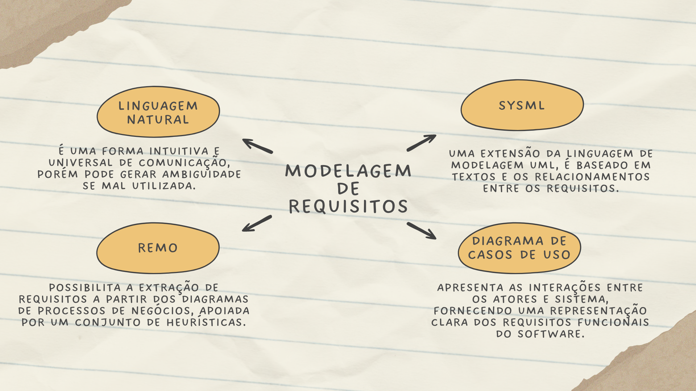

# Aula 5 — Videoaula de Encerramento

## Ponto de Chegada

Olá, estudante! Para desenvolver a competência desta Unidade, que é **identificar os tipos de requisitos e suas características para a modelagem de sistemas**, você deverá primeiramente conhecer os fundamentos da Engenharia de requisitos.

### Fundamentos da engenharia de requisitos

A engenharia de requisitos abrange a descrição detalhada das funcionalidades, serviços e restrições de um sistema, refletindo as necessidades dos usuários e contribuindo para um produto de qualidade. Os requisitos de um sistema vão além de funções e qualidades, incluindo especificações de serviços, restrições e características gerais. Exemplos concretos de requisitos para um jogo de perguntas e respostas ilustram a importância de redigir requisitos de forma clara e concisa, garantindo compreensão mútua entre cliente e desenvolvedores.

Na elaboração dos requisitos, é essencial determinar suas **prioridades**:

| Prioridade | Resumo |
|---|---|
| **Essencial** | Vital para a completude do software. |
| **Importante** | Secundário, mas ainda relevante. |
| **Desejável** | Opcional. |

Essa categorização permite priorizar o desenvolvimento e atualização do software de acordo com as necessidades do projeto, embora as prioridades possam mudar ao longo da evolução do sistema.

### Tipos de requisitos

Na engenharia de requisitos, é crucial distinguir entre os tipos de descrições de requisitos, conforme afirmado por Sommerville (2018):

- **Requisitos do usuário:** delineiam as necessidades dos clientes de forma compreensível, abordando tanto os requisitos funcionais quanto os não funcionais do sistema.
- **Requisitos do sistema:** especificam os detalhes técnicos do sistema com base nos requisitos do usuário, podendo servir como parte de um contrato entre as partes envolvidas no desenvolvimento.

A categorização dos requisitos em um sistema, conforme descrito por Sommerville (2018) e Pressman (2021), engloba três categorias principais:

| Categoria | Resumo |
|---|---|
| **Funcionais** | Definem as funcionalidades específicas que o sistema deve executar. Identificados por uma sigla (RF) seguida de uma numeração. |
| **Não funcionais** | Estabelecem restrições e padrões relacionados ao desempenho, segurança e usabilidade; são categorizados e mensurados de acordo com diferentes métricas. |
| **De domínio** | Descrevem as características específicas do ambiente em que o sistema será utilizado, impondo condições adicionais aos requisitos funcionais e estabelecendo critérios para validar determinadas funcionalidades. |

A elaboração detalhada dos requisitos desempenha um papel crucial na comunicação com o cliente e na orientação do desenvolvimento do sistema.

### Atividades da engenharia de requisitos

Outro ponto fundamental para alcançar a competência da unidade é entender o conjunto de atividades da engenharia de requisitos, que envolvem desde a coleta inicial de informações sobre o sistema a ser desenvolvido até a validação dos requisitos pelo usuário final. Essas atividades, conforme descritas por Pressman (2021) e Sommerville (2018), incluem:

1. **Concepção**
2. **Elicitação**
3. **Elaboração**
4. **Negociação**
5. **Especificação**
6. **Validação**
7. **Gerenciamento**

Cada etapa tem como objetivo primordial a elaboração de um **documento de requisitos** detalhado e preciso, que servirá como base para o desenvolvimento do sistema. Desde a definição do escopo geral do sistema até o gerenciamento contínuo dos requisitos ao longo do ciclo de vida do produto, todas as atividades visam garantir a compreensão das necessidades do cliente e a conformidade dos requisitos com o escopo do projeto.

> **Em suma:** os requisitos funcionais delineiam as funcionalidades e características específicas do sistema, enquanto os requisitos não funcionais estabelecem atributos e qualidades do sistema, como desempenho e segurança. O processo de engenharia de requisitos é dinâmico e envolve a participação ativa do cliente e dos usuários ao longo de todo o ciclo de desenvolvimento.

### Elicitação de requisitos

Na engenharia de requisitos, a elicitação desempenha um papel central na definição das necessidades de um sistema específico, envolvendo a coleta e análise de informações a partir de diversas fontes e interações com *stakeholders* relevantes, conforme destacado por Pressman (2021). Essa fase requer a colaboração de várias partes interessadas, incluindo analistas de sistemas, gerentes de projetos e usuários finais do sistema, como mencionado por Sommerville (2018), visando resolver problemas de forma colaborativa.

A elicitação busca estabelecer uma compreensão clara do escopo do sistema, identificar oportunidades de reutilização de soluções existentes e elicitar requisitos funcionais e não funcionais. A partir daí, ocorre a negociação e validação dos requisitos, garantindo que não haja conflitos entre eles e que atendam às necessidades dos stakeholders. O resultado é a documentação detalhada dos requisitos, que serve como principal meio de comunicação entre os desenvolvedores e o cliente.

O processo de levantamento e análise de requisitos é uma sequência **contínua e iterativa** de atividades que visam validar as necessidades do sistema, desde a compreensão do domínio do problema até a documentação final dos requisitos. A validação contínua é essencial, pois qualquer alteração requer revisão e ajustes (SOMMERVILLE, 2018).

O processo de elicitação pode variar entre as empresas, envolvendo atividades como **descoberta, classificação, priorização e especificação** de requisitos. Essa fase é colaborativa e interativa, com a participação ativa dos stakeholders, utilizando técnicas como **pesquisa, entrevistas, reuniões e análise documental** para obter uma visão abrangente do problema a ser resolvido.

### Especificação, prototipagem e negociação

A **especificação** de requisitos consiste na formalização das funcionalidades que o sistema deve executar, seguindo uma abordagem hierárquica para detalhar progressivamente os requisitos. Essa etapa é fundamental para criar um documento claro e objetivo que servirá como base para o desenvolvimento do software, garantindo que os requisitos sejam compreendidos de forma unívoca pelos desenvolvedores e stakeholders (PFLEEGER, 2004).

A **prototipagem** é uma técnica valiosa, permitindo a criação de versões simplificadas do sistema para avaliar sua viabilidade e identificar problemas precocemente. A **negociação** de requisitos também é essencial para desenvolver um plano de projeto que atenda às demandas dos stakeholders, considerando as restrições de orçamento, pessoal, tecnologia e tempo impostas à equipe de desenvolvimento (PAULA FILHO, 2019).

### Monitoramento e gestão de mudanças

O **monitoramento** de requisitos é crucial para garantir que o escopo do software seja atendido, exigindo a rastreabilidade das alterações através de ferramentas de controle apropriadas. Ao modificar um requisito, é essencial atribuir um status apropriado e manter uma matriz de rastreabilidade atualizada, incluindo todas as informações relevantes sobre cada requisito. A gestão de mudanças de requisitos visa analisar o impacto das alterações propostas para determinar sua viabilidade técnica e financeira, evitando inconsistências decorrentes de documentação desatualizada.

Os sistemas de software de grande porte enfrentam desafios recorrentes devido à complexidade inerente dos problemas que abordam, muitas vezes resultando em requisitos incompletos devido à dificuldade em defini-los integralmente. Ao longo do processo de desenvolvimento, a compreensão do problema pelos stakeholders está em constante evolução, exigindo uma adaptação contínua dos requisitos. Após a implementação, novos requisitos podem surgir devido a erros, mudanças no ambiente de negócios e tecnológico, bem como diferentes necessidades dos stakeholders.

O gerenciamento de mudança de requisitos desempenha um papel crucial na avaliação da viabilidade e do impacto das mudanças propostas após a aprovação do documento de requisitos. O processo tem três etapas:

1. **Análise do problema** e especificação da mudança.
2. **Avaliação do impacto** e estimativa de custo da mudança.
3. **Implementação** da mudança.

> É imperativo atualizar o documento de requisitos após as mudanças serem realizadas, para manter a coesão entre a especificação dos requisitos e a implementação do sistema.

### Validação de requisitos

A validação é fundamental para garantir que a especificação seja consistente com as necessidades do cliente. Realizada durante a elicitação e análise, visa identificar problemas que poderiam resultar em custos significativos de retrabalho durante o desenvolvimento ou após a implementação do sistema (PRESSMAN, 2021). Durante esse processo, são realizadas diversas verificações nos requisitos documentados: **validade, consistência, completude, realismo e verificabilidade** (SOMMERVILLE, 2018). O propósito é eliminar erros comuns, como inconsistências, contradições e ambiguidades, visando evitar atrasos e aumentos de custos (PFLEEGER, 2004).

Para assegurar a qualidade dos requisitos, são empregadas diferentes técnicas de validação:

| Técnica | Resumo |
|---|---|
| **Revisões de requisitos** | Uma equipe de revisores examina sistematicamente os requisitos em busca de erros e inconsistências. |
| **Prototipagem** | Desenvolvimento de um modelo executável do sistema para que os usuários finais forneçam *feedback*. |
| **Geração de casos de teste** | Revela problemas potenciais nos requisitos ao torná-los testáveis. |
| ***Checklists*** | Listas de perguntas elaboradas para analisar cada requisito; identificam erros em vários níveis e garantem que o software atenda aos padrões estabelecidos. |

No entanto, a validação de requisitos é um desafio, pois é difícil demonstrar que um conjunto de requisitos atende verdadeiramente às necessidades dos usuários. Muitas vezes, problemas só são descobertos após o início da implementação do sistema, exigindo ajustes mesmo após o consenso inicial no documento de requisitos.

### Rastreabilidade

A rastreabilidade de requisitos é essencial para a análise de impacto das mudanças e para a manutenção do software, permitindo:

- a identificação de requisitos ausentes;
- a eliminação de requisitos desnecessários;
- a garantia de certificação e conformidade;
- a análise do impacto das mudanças;
- a facilitação da manutenção do software;
- a execução de testes.

Embora manter a rastreabilidade seja desafiador, é fundamental para garantir uma compreensão clara do escopo das mudanças no software. Uma forma comum de representá-la é através de uma **matriz bidimensional**, que pode ser implementada utilizando uma planilha eletrônica ou uma ferramenta automatizada, assegurando a atualização contínua das informações rastreadas.

### Modelagem de requisitos

A modelagem de requisitos se concentra no **"o que será feito"** em vez do **"como será feito"**, com o objetivo de descrever as necessidades do cliente, fornecer uma base para o desenvolvimento do software e produzir requisitos validáveis (PRESSMAN, 2021). Para compreender completamente os requisitos, é crucial considerar não apenas o fluxo de informações no sistema, mas também as transformações de dados e todas as restrições de comportamento e desempenho. As técnicas de modelagem incluem a separação entre requisitos funcionais e não funcionais, o agrupamento dos requisitos por prioridade e a especificação detalhada em documentos formais.

A redação dos requisitos em **linguagem natural** é uma prática comum, mas pode levar a interpretações diversas e inconsistências. Para mitigar isso, são sugeridas diretrizes como estabelecer um formato padrão, destacar partes importantes e associar um racional a cada requisito, conforme recomendado por Sommerville (2018). Além disso, a **linguagem estruturada** e o uso de modelos e diagramas, como os fornecidos pela **UML** e pelo **SysML**, são úteis para organizar os requisitos de forma mais clara e eficiente.

Diversas técnicas de modelagem de requisitos são empregadas, incluindo a técnica **REMO** para extração de requisitos a partir de diagramas de processos de negócios e a utilização de **diagramas de caso de uso** na UML para detalhar as interações entre os atores e o sistema. A especificação de cada caso de uso é essencial para comunicar as funcionalidades específicas a serem implementadas, geralmente redigida de forma simplificada para facilitar a compreensão.

> **Em resumo:** a engenharia de requisitos é um processo essencial e contínuo durante todo o desenvolvimento de software, assegurando a compreensão e tradução precisa das necessidades dos stakeholders em requisitos claros. Ao fornecer uma estrutura para várias etapas, como elicitação, análise, documentação, validação e gerenciamento de requisitos, ela desempenha um papel fundamental na criação de sistemas de software bem-sucedidos que atendem às metas do cliente e do usuário final. Destaca-se também a importância da adaptação contínua dos requisitos para acompanhar as mudanças no ambiente empresarial e tecnológico.

---

## É Hora de Praticar!

### Estudo de Caso: Sistema de reservas de hotéis on-line

Esta atividade tem como objetivo compreender a diferença entre **requisitos funcionais** e **estruturais** (também conhecidos como requisitos não funcionais) em projetos de desenvolvimento de software. Você vai praticar a classificação de requisitos para um projeto de software fictício, aprimorando sua capacidade de identificar e diferenciar esses dois tipos de requisitos.

> **Projeto de software fictício: Sistema de reservas de hotéis on-line.** O sistema permite que os usuários busquem hotéis, vejam detalhes dos quartos, comparem preços, façam reservas e paguem on-line. Ele também deve oferecer uma interface administrativa para os hotéis cadastrarem e atualizarem informações sobre quartos, preços e disponibilidade.

**Lista de requisitos para classificação:**

1. O sistema deve permitir que os usuários criem uma conta usando seu endereço de e-mail.
2. O sistema deve criptografar as senhas dos usuários antes de armazená-las no banco de dados.
3. O tempo de resposta para buscas de hotéis não deve exceder 2 segundos.
4. O sistema deve permitir que os usuários filtrem hotéis por localização, preço e disponibilidade.
5. O sistema deve enviar um e-mail de confirmação após a conclusão de uma reserva.
6. O sistema deve ser acessível em dispositivos móveis e desktops.
7. O sistema deve manter um registro de todas as reservas feitas, acessível pelos administradores do hotel.
8. O sistema deve garantir uma disponibilidade de 99,9%.
9. O sistema deve oferecer suporte a múltiplos idiomas.
10. O sistema deve permitir que os administradores do hotel gerenciem as informações de seus hotéis.

**Tarefa:**

1. **Classificação:** classifique os requisitos acima em "Funcionais" ou "Estruturais".
2. **Discussão:** após a classificação, apresente a razão por trás da sua classificação, destacando a importância de cada tipo de requisito para o sucesso do projeto.

### Reflita

1. Definir os requisitos de um sistema é fundamental para o sucesso de um software. Será que existem requisitos que, se não forem prontamente atendidos, podem colocar em risco o sucesso do programa ao ponto de o cliente não utilizar o software desenvolvido?
2. Estabelecer uma boa comunicação na elicitação de requisitos é fundamental para se ter sucesso. Como podemos determinar uma boa comunicação entre todas as partes envolvidas, estabelecendo um entendimento comum? Como diminuir os problemas de comunicação entre todos os stakeholders?
3. Como a modelagem de software pode influenciar a qualidade e a eficácia dos sistemas desenvolvidos, além de proporcionar uma compreensão mais profunda das necessidades dos usuários e dos requisitos do projeto?

### Dê o Play!

Clique aqui para acessar os slides do *Dê o play!* (disponível na plataforma da instituição).

### Resolução do Estudo de Caso

Para o projeto de software fictício "Sistema de reservas de hotéis on-line", o gabarito sugerido para a classificação dos requisitos em funcionais e estruturais é:

#### Requisitos funcionais

| # | Requisito | Justificativa |
|:---:|---|---|
| 1 | O sistema deve permitir que os usuários criem uma conta usando seu endereço de e-mail. | Descreve uma funcionalidade específica relacionada à interação do usuário com o sistema. |
| 2 | O sistema deve permitir que os usuários filtrem hotéis por localização, preço e disponibilidade. | Detalha uma funcionalidade que permite aos usuários realizar buscas baseadas em critérios específicos. |
| 3 | O sistema deve enviar um e-mail de confirmação após a conclusão de uma reserva. | Especifica o comportamento do sistema de enviar notificações automáticas para os usuários. |
| 4 | O sistema deve manter um registro de todas as reservas feitas, acessível pelos administradores do hotel. | Indica uma funcionalidade relacionada à gestão de informações de reservas. |
| 5 | O sistema deve permitir que os administradores do hotel gerenciem as informações de seus hotéis. | Descreve uma funcionalidade administrativa do sistema para os provedores de serviço (hotéis). |

#### Requisitos estruturais (não funcionais)

| # | Requisito | Justificativa |
|:---:|---|---|
| 1 | O sistema deve criptografar as senhas dos usuários antes de armazená-las no banco de dados. | Relacionado à segurança e proteção de dados; não é uma funcionalidade direta do ponto de vista do usuário. |
| 2 | O tempo de resposta para buscas de hotéis não deve exceder 2 segundos. | Especifica um critério de desempenho que o sistema deve cumprir. |
| 3 | O sistema deve ser acessível em dispositivos móveis e desktops. | Define um requisito de compatibilidade e acessibilidade do sistema. |
| 4 | O sistema deve garantir uma disponibilidade de 99,9%. | Estabelece um critério operacional relacionado à disponibilidade do sistema. |
| 5 | O sistema deve oferecer suporte a múltiplos idiomas. | Indica um requisito de internacionalização, relacionado à usabilidade e acessibilidade, mas não é uma funcionalidade específica do ponto de vista da lógica de negócios. |

> Essa classificação ajuda a destacar a diferença entre **o que o sistema faz** (requisitos funcionais) e **como o sistema deve ser** (requisitos estruturais). Os requisitos funcionais estão diretamente relacionados às ações que o sistema deve ser capaz de executar, enquanto os requisitos estruturais descrevem propriedades gerais e critérios que o sistema deve atender para garantir qualidade, segurança, desempenho e usabilidade.

### Assimile

Este infográfico oferece uma visão sobre a modelagem de requisitos, um processo crucial na Engenharia de Software. Ao longo deste recurso visual, exploramos os diferentes aspectos da modelagem de requisitos, abrangendo as técnicas mais utilizadas, compreendendo a importância da linguagem natural na redação de requisitos e como os diagramas, como o diagrama de casos de uso e a notação SysML, podem ser empregados para visualizar e comunicar eficazmente os requisitos do sistema.

> **Figura** — Modelagem de requisitos. *Fonte: elaborada pela autora.*

---

## Referências

- PAULA FILHO, W. P. Engenharia de software: produtos. 4. ed. Rio de Janeiro: LTC, 2019.
- PFLEEGER, S. L. Engenharia de Software: teoria e prática. 2. ed. São Paulo: Prentice Hall, 2004.
- PRESSMAN, R. S. Engenharia de software: uma abordagem profissional. 9. ed. Porto Alegre: AMGH, 2021.
- SOMMERVILLE, I. Engenharia de software. 10. ed. São Paulo: Pearson, 2018.
