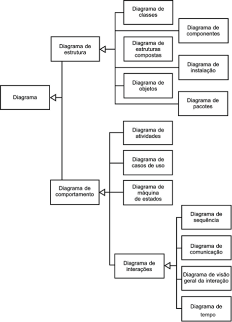

# Aula 1 — Linguagem de Modelagem Unificada (UML)

## Ponto de Partida

Nesta aula, exploraremos uma linguagem essencial para a modelagem de sistemas de software, a **UML** (*Unified Modeling Language*). Começaremos discutindo a importância da UML como uma ferramenta padronizada e visualmente intuitiva para representar conceitos complexos de engenharia de software. Em seguida, abordaremos os **diagramas estruturais**, como o diagrama de classes e o diagrama de componentes, que são cruciais para compreender a organização estática de um sistema, incluindo suas classes, interfaces e relacionamentos. Estes diagramas são fundamentais durante as fases de design e arquitetura do software, ajudando os desenvolvedores a visualizar e comunicar a estrutura do sistema de forma clara e precisa.

Além disso, exploramos os **diagramas comportamentais**, como o diagrama de sequência e o diagrama de atividade, que oferecem *insights* valiosos sobre o fluxo dinâmico de interações e eventos em um sistema de software. Esses diagramas são essenciais para entender como os diferentes componentes do sistema interagem entre si ao longo do tempo, permitindo aos desenvolvedores modelar e analisar o comportamento funcional do software. Compreender os diagramas comportamentais é crucial para garantir que o sistema atenda aos requisitos funcionais e de desempenho esperados, além de facilitar a detecção e resolução de potenciais problemas de design.

> Pensando nesses diagramas, vamos imaginar a seguinte situação: a empresa XYZ está planejando desenvolver um novo sistema de gerenciamento de projetos online chamado **"ProjectMaster"**. Este sistema permitirá que os usuários criem projetos, atribuam tarefas, acompanhem o progresso, gerenciem recursos, colaborem em tempo real e gerem relatórios de desempenho. "ProjectMaster" será um sistema complexo com várias interações entre usuários e componentes do sistema, bem como uma estrutura de banco de dados abrangente para manter informações sobre projetos, tarefas, usuários e relatórios.
>
> Como atividade, você deve refletir sobre o problema descrito e determinar quais diagramas UML seriam mais úteis para planejar e modelar o sistema "ProjectMaster". Sua tarefa é escolher **ao menos três tipos de diagramas UML** e justificar como cada um contribuirá para o desenvolvimento do sistema.
>
> Para cada diagrama UML escolhido, você deve fornecer:
>
> 1. **Nome do diagrama UML:** especifique qual diagrama você está escolhendo.
> 2. **Propósito do diagrama:** descreva qual aspecto do sistema o diagrama ajudará a modelar.
> 3. **Justificativa:** explique por que você acredita que esse diagrama é uma boa escolha para o problema descrito e como ele pode beneficiar a equipe de desenvolvimento do "ProjectMaster".

---

## Vamos Começar!

### Fundamentos da UML

A Linguagem de Modelagem Unificada (*Unified Modeling Language* — UML) é uma linguagem visual projetada para modelar software baseado no **paradigma de orientação a objetos**. Ela é uma linguagem de modelagem de propósito geral, aplicável a uma ampla variedade de domínios de aplicação. Nos últimos anos, a UML emergiu como a linguagem-padrão de modelagem adotada internacionalmente pela indústria de engenharia de software.

> **Atenção:** a UML **não é uma linguagem de programação**; é uma linguagem de modelagem, uma notação destinada a auxiliar engenheiros de software na definição das características do sistema. Isso inclui requisitos, comportamento, estrutura lógica, dinâmica de processos e até mesmo requisitos físicos relacionados ao hardware no qual o sistema será implantado. Essas características podem ser definidas por meio da UML antes do início do desenvolvimento do software (FOWLER, 2005).

Adicionalmente, a UML não está intrinsecamente ligada a um processo específico de desenvolvimento de software. Ela é completamente independente e pode ser utilizada por uma variedade de processos de desenvolvimento diferentes, ou até mesmo de maneiras personalizadas, de acordo com a preferência do engenheiro.

#### Por que modelar um software?

Muitos profissionais argumentam que conseguem discernir todas as necessidades de um sistema de informação de forma intuitiva e sempre operaram dessa maneira. Da mesma forma, por que projetar uma casa? Um pedreiro experiente não seria capaz de construí-la sem um projeto detalhado? Embora essas afirmações possam ser verdadeiras em alguns casos, a questão é muito mais complexa e abrange uma série de fatores, incluindo levantamento e análise de requisitos, prototipagem, escala do projeto, complexidade, prazos, custos, documentação, manutenção e reutilização, entre outros (GUEDES, 2011).

A diferença entre construir uma pequena casa e erigir um prédio de vários andares é marcante. Para edificar um prédio, é imprescindível elaborar um projeto minucioso, com cálculos precisos e corretos. Além disso, é necessário estimar custos, determinar o tempo de construção, avaliar a mão de obra necessária, especificar a quantidade de materiais, escolher o local de construção e muito mais. Grandes projetos não podem ser improvisados, e mesmo a maioria dos projetos pequenos demanda uma abordagem estruturada.

Na realidade, qualquer sistema, por mais simples que seja, deve ser modelado antes de sua implementação, principalmente porque os sistemas de informação tendem a crescer em tamanho, complexidade e alcance. Muitos profissionais consideram os sistemas de informação como "vivos" porque estão sempre sujeitos a mudanças. Na verdade, a designação mais precisa seria "dinâmicos", pois estão constantemente evoluindo. Essas mudanças são motivadas por diversos fatores:

- solicitações de clientes por modificações ou melhorias;
- mudanças no mercado que exigem adaptações nas estratégias das empresas;
- alterações na legislação que requerem ajustes nos sistemas.

Portanto, é essencial que os sistemas de informação possuam documentação detalhada, precisa e atualizada para facilitar sua manutenção sem introduzir novos erros. A modelagem é uma maneira eficaz de documentar um sistema, mas não se limita a isso. Além da documentação, a modelagem oferece diversas outras vantagens (GUEDES, 2011).

#### O que é um modelo de software?

A modelagem de software envolve a criação de modelos de software. Um **modelo de software** representa uma perspectiva de um sistema físico; é uma representação abstrata do sistema com um propósito específico, como descrever aspectos estruturais ou comportamentais do software. Esse propósito determina o que deve ser incorporado ao modelo e o que é considerado irrelevante. Portanto, um modelo abrange completamente os aspectos do sistema físico que são relevantes para o propósito do modelo, no nível apropriado de detalhamento.

| Modelo | O que mostra |
|---|---|
| **Modelo de casos de uso** | Uma visão dos requisitos essenciais do sistema, identificando as funcionalidades do software e os usuários que poderão interagir com elas, sem detalhar aspectos adicionais. |
| **Modelo conceitual** | As classes relacionadas ao domínio do problema, sem entrar em detalhes sobre seus métodos. |
| **Modelo de domínio** | Amplia o modelo conceitual, incluindo informações relacionadas à solução do problema, como os métodos necessários para essa solução. |

> *Fonte: Guedes (2011).*

#### Os diagramas da UML

Atualmente, a versão mais recente da UML, conhecida como **UML 2.5.1**, oferece **13 diagramas** diferentes para uso na modelagem de software (PRESSMAN, 2021). Os diagramas da UML podem ser categorizados em dois grandes grupos: os diagramas UML **estruturais** e os diagramas UML **comportamentais**. Além disso, existem os **diagramas de interação**, que geralmente se enquadram no grupo dos diagramas comportamentais. Essa distinção permite uma visualização do sistema a partir de diferentes perspectivas. A Figura 1 apresenta essa classificação e os diagramas que fazem parte de cada grupo.

> **Figura 1** — Classificação dos tipos de diagrama da UML. *Fonte: adaptada de Fowler (2005, [s. p.]).*

Embora os manuais da linguagem UML não prescrevam uma ordem específica para a criação e utilização dos diagramas em um fluxo de desenvolvimento de software, geralmente os diagramas são apresentados em uma sequência didática. Essa sequência segue uma lógica baseada na complexidade dos diagramas, onde os mais simples são abordados primeiro para facilitar a compreensão do processo de criação. Seguindo essa abordagem, começamos de maneira simplificada com os diagramas estruturais e, em seguida, avançamos para os diagramas comportamentais, incluindo uma subdivisão para os diagramas de interação.

---

## Siga em Frente...

### Diagramas estruturais

Os diagramas estruturais revelam a organização de um sistema em suas partes constituintes, componentes e as interconexões entre esses elementos. Esses diagramas são frequentemente vinculados à **modelagem estática**, já que descrevem a estrutura do sistema em si. Geralmente, são concebidos durante a fase inicial do projeto de arquitetura do sistema, representando conceitos significativos como abstrações, considerações de implementação e características do mundo real (FOWLER, 2005).

Os diagramas estruturais são seis, descritos a seguir, iniciando com o diagrama que provavelmente é um dos mais utilizados até por desenvolvedores que não estão totalmente familiarizados com os conceitos da UML: o diagrama de classes.

| Diagrama | Descrição |
|---|---|
| **Classes** | Um dos elementos mais essenciais e frequentemente utilizados na UML (GUEDES, 2011). Funciona como base para a maioria dos outros diagramas, fornecendo uma representação estruturada das classes empregadas pelo sistema. Delineia os **atributos e métodos** de cada classe, além de especificar os relacionamentos e interações entre elas. |
| **Pacotes** | Representa os **subsistemas ou submódulos** incluídos em um sistema, identificando suas partes constituintes. Pode ser empregado de forma autônoma ou em conjunto com outros diagramas. Útil para ilustrar a arquitetura de uma linguagem (como a UML) e para definir as camadas de um software ou processo de desenvolvimento (PRESSMAN, 2021). |
| **Componentes** | Intimamente ligado à linguagem de programação escolhida. Visualiza os componentes do sistema **no momento da implementação**, representando-os como módulos de código-fonte, bibliotecas, formulários, arquivos de ajuda, entre outros (FOWLER, 2005). Determina a estrutura e a interação dos componentes. |
| **Instalação** (*deployment*) | Descreve a estrutura de **hardware e software** necessária para a correta execução do software. Permite relacionar quais componentes do software serão executados em cada um dos nós de hardware descritos. |
| **Objetos** | Complemento essencial e dependente do diagrama de classes (GUEDES, 2011). Oferece uma perspectiva dos **valores contidos pelos objetos** em um instante específico durante a execução de um processo de software. |
| **Estrutura composta** | Representação detalhada da organização interna de um classificador (classe ou componente), delineando suas partes constituintes, comunicação e colaboração entre elas. Também descreve uma colaboração na qual um conjunto de instâncias trabalha em conjunto para realizar uma tarefa. |

### Diagramas comportamentais

Os diagramas comportamentais têm como finalidade representar o **fluxo de informações e eventos ao longo do tempo** no sistema. Em outras palavras, ilustram a resposta do sistema a eventos do ambiente, exibindo o comportamento dinâmico dos objetos e como o sistema reage a ações específicas ou eventos.

Os **diagramas de interação** estão incluídos no conjunto de diagramas comportamentais e são utilizados para modelar as interações dentro do sistema ou entre os seus componentes.

| Diagrama | Descrição |
|---|---|
| **Casos de uso** | Amplamente reconhecido como o diagrama mais abrangente e informal da UML, frequentemente empregado no levantamento e análise de requisitos. Continua a ser uma referência ao longo de todo o processo de modelagem e pode servir como base para outros diagramas. Usa linguagem simples para proporcionar aos usuários uma visão geral do comportamento esperado do sistema (PRESSMAN, 2021). Identifica os **atores** (usuários, outros sistemas ou hardware especializado) e os serviços ou funcionalidades oferecidas a eles, os **casos de uso**. |
| **Atividade** | Descreve os passos necessários para a conclusão de uma determinada atividade, que pode variar desde um método de certa complexidade até um algoritmo ou um processo completo. Sua principal preocupação é o **fluxo de controle** durante a execução. |
| **Visão geral de interação** | Derivação do diagrama de atividade, projetado para oferecer uma perspectiva global dentro de um sistema ou processo de negócios. Foi introduzido na UML 2. |
| **Sequência** | Concentra-se na **ordem temporal das mensagens** trocadas entre os objetos envolvidos em um processo. Tipicamente se baseia em um caso de uso de mesmo nome e usa o diagrama de classes para identificar os objetos envolvidos. Identifica o evento que desencadeia o processo e o ator responsável, e delineia como o processo se desdobra por meio da invocação de métodos por mensagens enviadas entre objetos. |
| **Máquina de estados** | Ilustra o comportamento de um elemento através de um conjunto finito de **transições de estado**. Quando descreve o comportamento de uma parte do sistema, é a máquina de estado comportamental; também pode expressar o protocolo de uso de uma parte do sistema (máquina de estado de protocolo). Pode ser baseado em um caso de uso ou rastrear os estados de outros elementos, como uma instância de uma classe. |
| **Comunicação** | Complemento do diagrama de sequência, com informações muitas vezes semelhantes, mas com abordagem distinta: enquanto o de sequência foca na **ordem temporal**, o de comunicação destaca **como os elementos estão conectados** e quais mensagens são trocadas entre eles. |
| **Tempo** | Representa a evolução do estado ou condição de uma instância de classe ou seu papel **ao longo de um período específico**. Frequentemente ilustra a alteração no estado de um objeto ao longo do tempo em resposta a eventos externos (GUEDES, 2011). |

---

## Vamos Exercitar?

Esta atividade visa desenvolver a capacidade de tomada de decisão do estudante sobre quais diagramas UML são mais adequados para modelar diferentes aspectos de um sistema de software. Com isso, você deve selecionar e justificar o uso de diagramas UML específicos com base em um cenário de problema fornecido no início da aula.

Um exemplo de resposta é:

> **Diagrama UML:** diagrama de casos de uso
>
> **Propósito do diagrama:** representar as funcionalidades do sistema a partir da perspectiva do usuário, mostrando como diferentes atores interagem com o sistema.
>
> **Justificativa:** esse diagrama é crucial para entender as necessidades dos usuários e garantir que o "ProjectMaster" ofereça as funcionalidades necessárias para gerenciamento de projetos. Ele ajuda a definir os requisitos do sistema de uma maneira que todos os stakeholders possam entender.

---

## Saiba mais

1. **UML Essencial**: apresenta os principais conceitos da UML, além de trazer diversos exemplos de diagramas.
   > FOWLER, Martin. **UML essencial**. 3. ed. Porto Alegre: Bookman, 2005.

2. **UML e Programação Orientada a Objetos**: a UML é uma linguagem de modelagem que suporta o paradigma Orientado a Objetos. No livro você vê diversos exemplos utilizando a UML para a POO.
   > WAZLAWICK, R. S. **Análise e Design Orientados a Objetos para Sistemas de Informação: Modelagem com UML, OCL e IFML**. Grupo GEN, 2014.

## Referências

- FOWLER, M. UML essencial: um breve guia para a linguagem-padrão de modelagem de objetos. 3. ed. Porto Alegre: Bookman, 2005.
- GUEDES, Gilleanes T. A. UML 2: uma abordagem prática. 2. ed. São Paulo: Novatec Editora, 2011.
- PRESSMAN, Roger S. Engenharia de software: uma abordagem profissional. 9. ed. Porto Alegre: AMGH, 2021.
