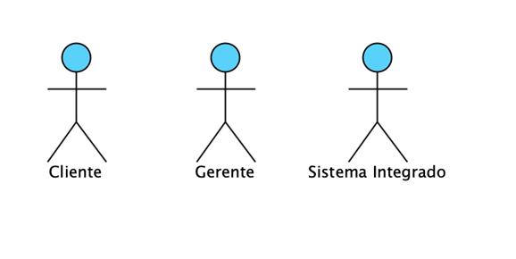
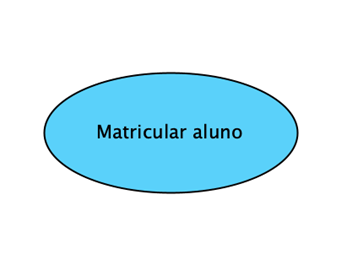
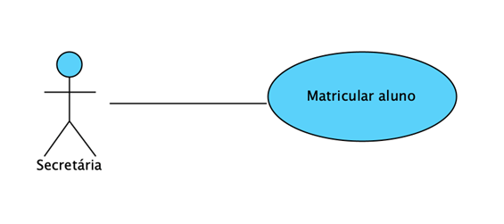
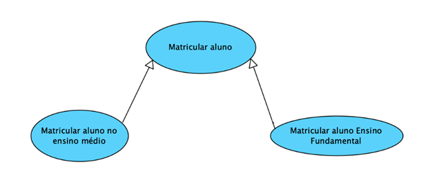
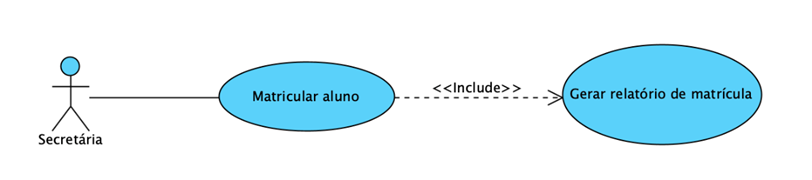
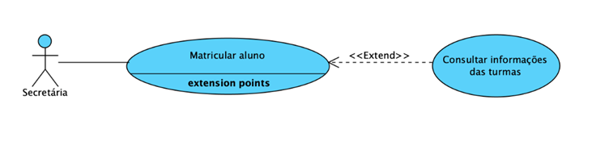
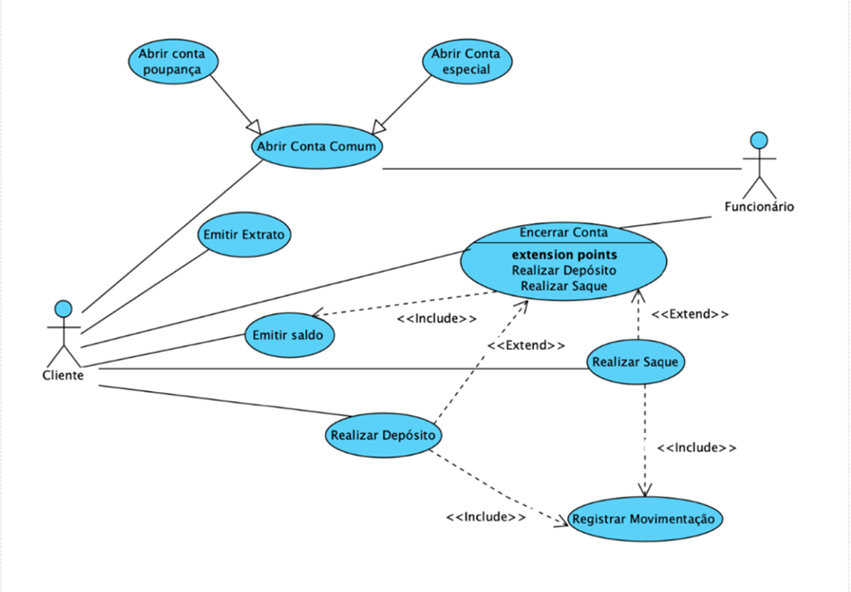
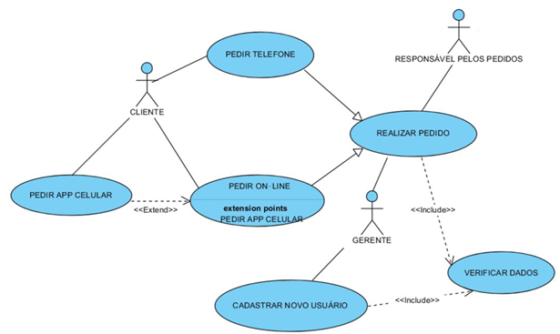

# Aula 2 — Diagrama de Casos de Uso

## Ponto de Partida

Nesta aula, exploraremos um dos aspectos fundamentais da modelagem de sistemas de software: o **Diagrama de casos de uso**. Este diagrama é uma ferramenta poderosa da Linguagem de Modelagem Unificada (UML), essencial para capturar as funcionalidades de um sistema do ponto de vista dos usuários. Ao entender como criar e interpretar um diagrama de casos de uso, você estará equipado para visualizar o escopo de um projeto, detalhar interações entre o sistema e seus usuários e identificar requisitos críticos de uma maneira organizada e eficiente. Estudaremos **atores, casos de uso, relações de inclusão e extensão**. Todos os componentes que juntos fornecem uma visão clara das expectativas dos usuários e dos requisitos funcionais do sistema.

Compreender o diagrama de casos de uso é mais do que um exercício acadêmico; é uma habilidade prática que melhora a comunicação entre desenvolvedores, analistas de sistemas, stakeholders e usuários finais. Essa compreensão assegura que o desenvolvimento do software esteja alinhado com as necessidades reais dos usuários, evitando mal-entendidos e retrabalhos dispendiosos.

> Para exercitar o que será aprendido nesta aula, **elabore um diagrama de casos de uso** da seguinte situação:
>
> *"O sistema de pedidos da empresa oferece uma série de funcionalidades para facilitar e gerenciar a forma como os clientes realizam pedidos. Os clientes podem fazer pedidos de três maneiras diferentes: por telefone, on-line através do website, ou usando o aplicativo móvel. Quando um pedido é realizado, independente do método, ele é gerenciado por um responsável pelos pedidos, que tem a tarefa de assegurar que o pedido seja processado corretamente. Para os pedidos on-line, existe a possibilidade de extensão para fazer pedidos utilizando o aplicativo móvel. Além disso, antes de um pedido ser confirmado, o gerente do sistema deve verificar os dados do pedido, uma etapa incluída no processo de realização de pedido. O sistema também permite o cadastro de novos usuários, que é uma funcionalidade acessível pelo cliente e inclui um passo adicional onde o gerente deve verificar os dados fornecidos pelo novo usuário."*

---

## Vamos Começar!

### Introdução ao diagrama de casos de uso

O diagrama de casos de uso tem como objetivo simplificar a compreensão do **comportamento externo** do sistema, mostrando suas funcionalidades de forma acessível a qualquer pessoa e destacando a perspectiva do usuário. É o diagrama **mais abstrato e flexível** da UML, sendo comumente utilizado nas fases iniciais de modelagem do sistema, especialmente durante o levantamento e análise de requisitos. No entanto, ele continua sendo consultado e ajustado ao longo do processo de engenharia, servindo de base para outros diagramas.

Este diagrama oferece uma visão panorâmica das funcionalidades que o sistema deve disponibilizar aos usuários, sem entrar em detalhes sobre sua implementação. Ele é fundamental para identificar e compreender os requisitos do sistema, ajudando a especificar, visualizar e documentar as características, funções e serviços desejados pelos usuários. Além disso, ajuda a identificar os diferentes tipos de usuários que interagirão com o sistema, os papéis que desempenharão e as funções que cada usuário poderá solicitar.

Devido à sua linguagem informal e capacidade de proporcionar uma visão geral do comportamento do sistema a ser desenvolvido, o diagrama de casos de uso é uma ferramenta valiosa para ser apresentada durante as primeiras reuniões com os clientes. Ele serve como uma forma de ilustrar o funcionamento do sistema de informação, tornando mais fácil para os usuários compreenderem e identificarem possíveis lacunas na especificação. Recomenda-se fortemente apresentar o diagrama de casos de uso juntamente com um **protótipo**, pois isso permite que um complemente o outro.

O primeiro passo ao desenvolver um caso de uso é estabelecer o conjunto de **atores** envolvidos na narrativa. Os atores são as diversas entidades (sejam pessoas ou dispositivos) que interagem com o sistema ou produto dentro do contexto das funcionalidades e comportamentos a serem descritos. Eles representam os papéis que estas entidades desempenham enquanto o sistema está em operação. Em termos mais formais, um ator é qualquer entidade externa ao sistema ou produto que se comunica com ele e possui uma ou mais metas específicas ao usar o sistema.

> **Ator ≠ usuário.** Enquanto um usuário típico pode assumir diversos papéis ao interagir com um sistema, um ator representa uma classe de entidades externas (que podem ser pessoas, mas não necessariamente) que desempenham **apenas um papel** dentro do contexto de um caso de uso específico.
>
> **Exemplo:** um usuário utiliza um software para configurar os sensores de alarme em um edifício virtual. O software requer quatro modos de interação: posicionamento, teste, monitoramento e diagnóstico. Assim, podemos definir **quatro atores**: o editor, o testador, o monitorador e o diagnosticador. Em alguns casos, uma única pessoa pode desempenhar todos esses papéis, enquanto em outros, diferentes pessoas podem assumir cada papel.

### Elementos do diagrama de casos de uso

#### Atores

O diagrama de casos de uso se concentra em dois elementos principais: **atores** e **casos de uso**. Os atores representam os papéis desempenhados pelos vários usuários que podem utilizar os serviços e funções do sistema de alguma forma. Em alguns casos, um ator pode representar hardware especializado ou até mesmo outro software que interaja com o sistema, como em um sistema integrado. Portanto, um ator pode ser qualquer entidade externa que interaja com o software. Os atores são representados por símbolos de **"bonecos magros"** (*stick figures*), acompanhados de uma breve descrição abaixo de seu símbolo, identificando o papel que o ator desempenha no contexto do diagrama. A Figura 1 apresenta a representação de três possíveis atores de um sistema.

> **Figura 1** — Atores. *Fonte: elaborado pela autora.*

Nesse exemplo, os atores **Cliente** e **Gerente** representam usuários normais, enquanto o ator **Sistema Integrado** representa um software que interage de alguma forma com o sistema.

#### Casos de uso

Os casos de uso servem para capturar os requisitos do sistema, ou seja, englobam os serviços, tarefas ou funcionalidades identificadas como essenciais para o software e que podem ser utilizados pelos atores que interagem com o sistema. Eles são empregados para expressar e documentar os comportamentos desejados das funções do sistema. Podem ser divididos em:

| Tipo | Descrição | Exemplo |
|---|---|---|
| **Primário** | Processo crucial que se concentra em um dos requisitos funcionais do software. | Efetuar um saque ou gerar um extrato em um sistema bancário. |
| **Secundário** | Processo periférico. | A manutenção de um cadastro. |

> *Fonte: Guedes (2011).*

Em algumas situações, um caso de uso pode estar associado a um formulário do sistema, embora isso não seja uma regra absoluta, uma vez que uma funcionalidade do sistema, ou seja, um caso de uso, pode abranger vários formulários ou até mesmo consistir em uma pequena opção de interface, como um botão. Os casos de uso são representados por **elipses** contendo um texto que descreve a funcionalidade a que se refere. Não há um limite específico para o texto dentro da elipse, mas geralmente a descrição de um caso de uso é concisa. A Figura 2 exemplifica um caso de uso, representando a funcionalidade de matricular aluno.

> **Figura 2** — Exemplo de casos de uso. *Fonte: elaborada pela autora.*

Os casos de uso costumam ser documentados, fornecendo instruções em linhas gerais de como será seu funcionamento, quais atividades deverão ser executadas, qual evento forçará sua execução, quais atores poderão utilizá-los e quais suas possíveis restrições, entre outras.

A documentação de um caso de uso geralmente inclui informações básicas sobre sua função, os atores envolvidos, as etapas necessárias para sua execução por parte do ator e do sistema, os parâmetros necessários e quaisquer restrições ou validações aplicáveis. No entanto, **não há um formato fixo** para a documentação de casos de uso definido pela UML, o que reflete a própria flexibilidade do diagrama. Assim, o formato pode variar amplamente, permitindo diferentes abordagens, incluindo o uso de pseudocódigo ou até mesmo código de programação real. No entanto, o objetivo principal do diagrama de casos de uso é utilizar uma linguagem simples e acessível, compreensível até mesmo para usuários não técnicos.

Por essa razão, é recomendável evitar o uso de pseudocódigo na documentação de casos de uso, uma vez que isso é mais apropriado para outros tipos de diagramas, como o de atividade. Além disso, os casos de uso também podem ser documentados usando outros tipos de diagramas, como o de sequência, de estado ou de atividade (GUEDES, 2011). O Quadro 1 oferece uma sugestão de como documentar o caso de uso representado na Figura 2.

#### Quadro 1 — Especificação do caso de uso: Matricular Aluno

| Campo | Conteúdo |
|---|---|
| **Nome do caso de uso** | Matricular Aluno |
| **Ator principal** | Aluno |
| **Atores secundários** | Secretária |
| **Resumo** | Este caso de uso tem por objetivo detalhar o processo de matrícula do aluno no sistema. |
| **Pré-condições** | 1. O aluno deverá estar matriculado no sistema. 2. Não poderá haver nenhuma pendência financeira no sistema. |

**Fluxo principal**

| Passo | Ações do ator | Ações do sistema |
|:---:|---|---|
| 1 | O aluno informa a matrícula e senha para se logar no sistema. | |
| 2 | | O sistema deverá verificar a matrícula e validar a senha do aluno. |
| 3 | | Deverão ser apresentadas as disciplinas que o aluno poderá cursar. |
| 4 | O aluno poderá escolher a disciplina que cursará num total de 6 disciplinas por semestre. | |
| 5 | O aluno deverá finalizar a escolha da disciplina apertando o botão FINALIZAR. | |
| 6 | O aluno poderá escolher entre imprimir ou salvar o comprovante de matrícula. | Um comprovante de matrícula deverá ser gerado em formato PDF. |

**Fluxos alternativos**

| Passo | Ações do ator | Ações do sistema |
|:---:|---|---|
| 1.1 | O aluno poderá redefinir a sua senha. | |
| 2.1 | | Caso o aluno não tenha senha, o sistema deverá permitir o cadastramento da senha ou a sua redefinição. |
| 3.1 | | Deverá ser verificado o semestre atual do aluno; se for o 1º semestre do aluno, ele deverá escolher todas as disciplinas. |
| 3.2 | | Deverá ser verificada a quantidade de disciplinas a serem escolhidas (o limite deve ser igual a 6). |

> *Fonte: adaptado de Werlich (2020, p. 159).*

#### Associação

As associações representam as interações ou conexões entre os atores dentro do diagrama, entre os atores e os casos de uso, ou entre os próprios casos de uso. Os relacionamentos entre os casos de uso recebem nomes específicos: **inclusão, extensão e generalização** (FOWLER, 2015). Uma associação entre um ator e um caso de uso indica que o ator está de alguma forma envolvido na utilização da funcionalidade representada pelo caso de uso, seja solicitando a execução dessa função, seja recebendo o resultado produzido por ela em resposta a uma ação de outro ator.

Essa associação é denotada por uma **linha** conectando o ator ao caso de uso. Em certos casos, as extremidades dessa linha podem ter setas, indicando a direção do fluxo de informações: se elas são fornecidas pelo ator ao caso de uso, se são transmitidas pelo caso de uso ao ator ou se ocorre uma troca de informações bidirecional (nesse caso, a linha não possui setas, indicando que as informações fluem em ambas as direções). As setas também esclarecem quem inicia a comunicação. Além disso, uma associação pode conter uma descrição própria para esclarecer a natureza das informações transmitidas ou para atribuir um nome à associação, quando necessário. A Figura 3 apresenta uma associação entre ator e caso de uso.

> **Figura 3** — Associação entre ator e um caso de uso. *Fonte: elaborada pela autora.*

Ao examinarmos a Figura 3, percebemos que o ator **Secretária** utiliza, de alguma forma, a funcionalidade de *Matricular aluno*, representada pelo caso de uso, e que a informação referente a esse processo trafega nas duas direções.

#### Generalização / Especialização

O relacionamento de generalização/especialização é uma forma de associação entre casos de uso em que dois ou mais casos de uso compartilham características semelhantes, mas apresentam pequenas diferenças entre si. Nesse cenário, costuma-se criar um caso de uso **genérico** que descreve as características comuns a todos os casos de uso envolvidos, e então relacioná-lo aos casos de uso **específicos**, cuja documentação incluirá apenas as características distintas de cada um.

Dessa forma, torna-se desnecessário repetir a mesma documentação para todos os casos de uso, uma vez que todas as características do caso de uso genérico são **herdadas** pelos casos de uso especializados. Além disso, os casos de uso especializados também herdam quaisquer associações de inclusão ou extensão do caso de uso genérico, bem como as associações com os atores que utilizam o caso de uso genérico (GUEDES, 2011).

O relacionamento é representado por uma **linha com uma seta mais espessa**, que indica o caso de uso genérico (ponta da seta) e os casos de uso especializados (extremidade oposta, apontando para o genérico). Um exemplo pode ser observado na Figura 4.

> **Figura 4** — Generalização/Especialização. *Fonte: elaborada pela autora.*

#### Inclusão (*include*)

A associação de inclusão é frequentemente aplicada quando há uma rotina, situação ou cenário comum a múltiplos casos de uso. Nesse contexto, a documentação dessa rotina é centralizada em um caso de uso específico para que outros casos de uso possam utilizar esse serviço, evitando a redundância na descrição de uma mesma sequência de passos em vários casos de uso. As associações de inclusão indicam uma **dependência obrigatória**: quando um caso de uso possui uma associação de inclusão com outro, a execução do primeiro implica automaticamente a execução do segundo. Essa relação pode ser comparada à chamada de uma sub-rotina ou função, um conceito comum em diversas linguagens de programação (GUEDES, 2011).

Uma associação de inclusão é representada por uma **linha tracejada**, contendo uma seta em uma das extremidades, que aponta para o caso de uso que está sendo incluído pelo caso de uso posicionado na outra extremidade da linha. Essas associações costumam incluir um **estereótipo** com o texto `<<include>>`. Os estereótipos são utilizados para destacar componentes ou associações, atribuindo-lhes características especiais em relação aos demais. Um exemplo pode ser observado na Figura 5.

> **Figura 5** — Inclusão (*include*). *Fonte: elaborada pela autora.*

Ao analisarmos a Figura 5, percebemos que sempre que ocorrer a matrícula de um aluno, o sistema deve gerar um relatório referente a essa matrícula.

#### Extensão (*extend*)

As associações de extensão são empregadas para descrever **cenários opcionais** dentro de um caso de uso. Os casos de uso estendidos descrevem situações que ocorrerão apenas sob circunstâncias específicas, dependendo se determinada condição for satisfeita ou não. Assim, indicam a necessidade de uma avaliação para determinar se é necessário ou não executar o caso de uso estendido. Representam eventos que não ocorrem sempre, embora isso não signifique que sejam raros.

A representação é muito semelhante à da inclusão: também é uma **linha tracejada**. A diferença está na direção da seta, que aponta para o caso de uso que aciona a extensão, e na presença de um estereótipo com o texto `<<extend>>` em vez de `<<include>>` (GUEDES, 2011). Para ilustrar o conceito, apresentamos um exemplo na Figura 6.

> **Figura 6** — Extensão (*extend*). *Fonte: elaborada pela autora.*

No caso de uso anterior, pode-se notar que *matricular aluno* e *consultar informações das turmas* são casos de uso e existe uma relação de extensão entre eles. Isso demonstra que consultar informações de turmas poderá ser chamado a partir do caso de uso matricular aluno, porém isso **não é obrigatório**.

#### Resumo dos relacionamentos

| Relacionamento | Significado | Representação |
|---|---|---|
| **Associação** | Ligação entre ator e caso de uso (ou entre atores/casos de uso) | Linha, com ou sem setas |
| **Generalização/Especialização** | Herança entre casos de uso (ou atores) | Linha com seta mais espessa |
| **Include** | Dependência **obrigatória**: executar um implica executar o outro | Linha tracejada com seta + `<<include>>` |
| **Extend** | Cenário **opcional**, sob condição | Linha tracejada com seta + `<<extend>>` |

---

## Siga em Frente...

### Exemplos de utilização do diagrama

Para exemplificar os elementos estudados, vamos ver o exemplo da Figura 7, que apresenta um diagrama de casos de uso para o **sistema bancário**.

> **Figura 7** — Diagrama de casos de uso de um sistema bancário. *Fonte: adaptada de Guedes (2011).*

A Figura 7 mostra o diagrama de casos de uso relacionado a um sistema de controle bancário. Este sistema possibilita que os clientes realizem a abertura e o encerramento de contas, bem como efetuem depósitos ou saques e solicitem saldos ou extratos. As quatro últimas funcionalidades mencionadas podem ser utilizadas diretamente pelo cliente por meio de um caixa eletrônico. No entanto, para abrir ou encerrar uma conta, o cliente precisa interagir com um funcionário do banco, que também pode executar algumas operações de manutenção em seu cadastro, como registrá-lo ou alterar seus dados.

Lendo o diagrama, relacionamento por relacionamento:

| Relacionamento | Entre | Por quê |
|---|---|---|
| **Generalização** | "Abrir Conta Comum" (genérico) → "Abrir Conta Especial" e "Abrir Conta Poupança" | Os processos de abertura para cada tipo de conta são muito semelhantes entre si; as especializações detalham apenas as características específicas em sua documentação. |
| **Extend** | "Abrir Conta Comum" (herdada pelas especializações) → "Manter Clientes" | A criação de uma conta normalmente implica o registro do novo cliente ou a atualização de seus dados, mas isso nem sempre é necessário: só será executado se o cliente não estiver registrado ou precisar atualizar seus dados. |
| **Include** | "Abrir Conta Comum" (herdada) → "Realizar Depósito" | É necessário depositar algum valor no momento da abertura da conta; sempre que uma conta é aberta, as instruções de "Realizar Depósito" são executadas. |
| **Include** | "Encerrar Conta" → "Emitir Saldo" | Antes de encerrar, é obrigatório verificar o saldo para determinar se é necessário devolver dinheiro ao cliente ou se ele precisa depositar para encerrar a conta. |
| **Extend** | "Encerrar Conta" → "Realizar Saque" (saldo positivo) e "Realizar Depósito" (saldo negativo) | Não é possível prever se será necessário sacar ou depositar, por isso são extensões. |
| **Extend** | "Encerrar Conta" → "Manter Cliente" | A conta encerrada pode ser a única conta do cliente. Nesse caso, o registro é mantido, identificando-o como inativo, pois, uma vez cliente, seu registro não pode ser excluído do sistema. |
| **Include** | "Realizar Saque" e "Realizar Depósito" → "Registrar Movimento" | Para garantir o registro adequado das transações, ambos obrigatoriamente envolvem "Registrar Movimento", que registra qualquer saque ou depósito para fins de histórico bancário. |

Além disso, há os casos de uso "Emitir Saldo" e "Emitir Extrato", que são serviços simples utilizados diretamente pelo cliente por meio de um caixa eletrônico, sem a intermediação de um funcionário. Esses casos de uso não requerem interações com outros casos de uso do diagrama, embora "Emitir Saldo" seja utilizado por "Encerrar Conta". "Realizar Saque" e "Realizar Depósito", normalmente, também são utilizados diretamente pelo cliente, assim como "Saldo" e "Extrato".

> O exemplo do sistema bancário é relativamente complexo, envolvendo diversos tipos de associações. Entretanto, o diagrama de casos de uso é geralmente concebido para oferecer uma **visão externa simplificada** do sistema ao usuário, caracterizando-se muitas vezes por sua simplicidade. Portanto, sempre que possível, deve-se evitar desenvolver diagramas de casos de uso excessivamente complexos (GUEDES, 2011).

---

## Vamos Exercitar?

Nesta atividade, você deve desenvolver um diagrama de casos de uso para um sistema de pedidos de compras. Na Figura 8, está apresentada uma possível solução para o sistema proposto.

> **Figura 8** — Diagrama de casos de uso do sistema de pedidos. *Fonte: elaborada pela autora.*

---

## Saiba mais

1. **Visual Paradigm Online**: plataforma intuitiva e acessível para criar diagramas UML com facilidade.
   > VISUAL PARADIGM ONLINE. **Modelos de diagramas**. [s. d.]

2. **UML Essencial**: apresenta os principais conceitos do diagrama de casos de uso no Capítulo 9.
   > FOWLER, M. **UML essencial**. 3. ed. Porto Alegre: Bookman, 2005.

3. **Engenharia de Software — Pressman**: aborda o diagrama de casos de uso diversas vezes; o Apêndice 1 traz a descrição deste diagrama e exemplos de aplicações.
   > PRESSMAN, R. S.; MAXIM, B. R. **Engenharia de software**. Grupo A, 2021.

## Referências

- FOWLER, M. UML essencial: um breve guia para a linguagem-padrão de modelagem de objetos. 3. ed. Porto Alegre: Bookman, 2005.
- GUEDES, G. T. A. UML 2: uma abordagem prática. 2. ed. São Paulo: Novatec Editora, 2011.
- PRESSMAN, R. S. Engenharia de software: uma abordagem profissional. 9. ed. Porto Alegre: AMGH, 2021.
- WERLICH, C. Análise e modelagem de sistemas. Londrina: Editora e Distribuidora Educacional S.A., 2020.
