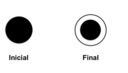
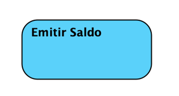
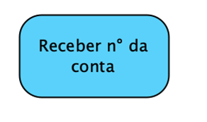
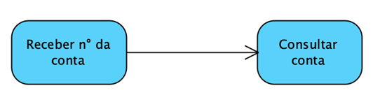
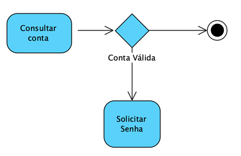
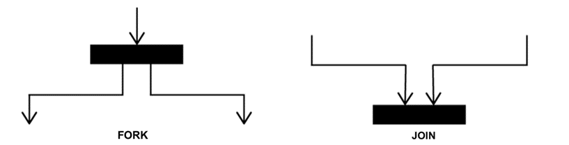
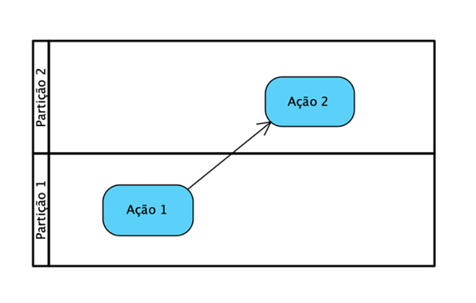
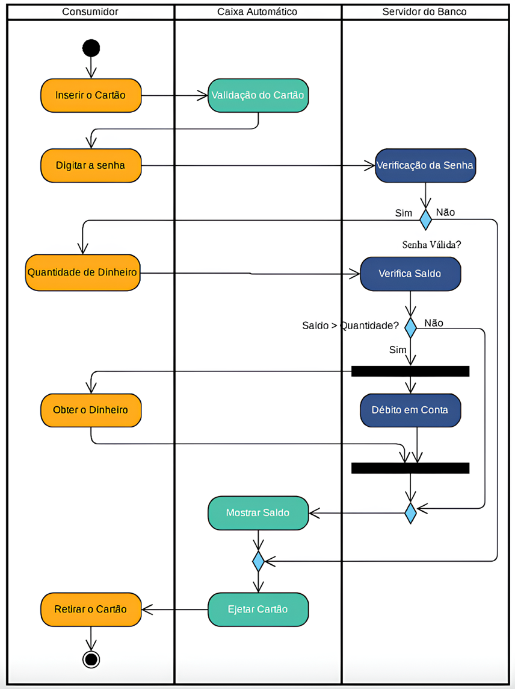
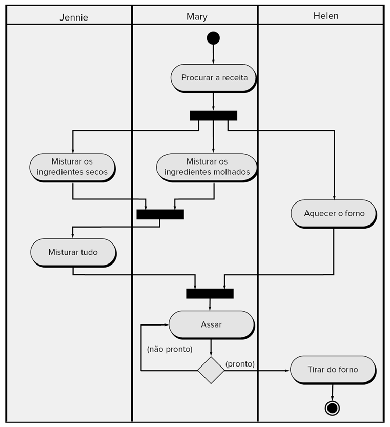

# Aula 3 — Diagrama de Atividades

## Ponto de Partida

Nesta aula, vamos nos aprofundar no **Diagrama de atividades**, uma parte integral da Linguagem de Modelagem Unificada (UML) que nos permite mapear processos e fluxos de trabalho dentro de sistemas complexos. Este diagrama é uma ferramenta valiosa que fornece uma visão dinâmica das sequências de ações, decisões e paralelismo em operações de negócios e sistemas de software. A importância dos Diagramas de Atividades vai além da simples documentação; eles são fundamentais para a compreensão e a otimização de processos. Ao visualizar as etapas de um processo, podemos identificar gargalos, redundâncias e oportunidades para melhorias, garantindo que o design do sistema seja tanto eficiente quanto eficaz.

Durante a aula, examinaremos os elementos que compõem o diagrama de atividades, como **nós de atividades, transições, decisões, ramificações e junções**, assim como **pontos de sincronização**. Estes elementos trabalham juntos para fornecer um mapa claro de como um processo é realizado, permitindo que todos os envolvidos no desenvolvimento do sistema tenham a mesma compreensão de como as coisas devem funcionar. Com o conhecimento prático desses conceitos, você estará bem equipado para enfrentar os desafios do design de processos em seus projetos futuros.

> Para colocar em prática o que veremos em aula, pense na seguinte situação: *"o processo de preparação de um bolo é um esforço colaborativo que envolve várias etapas coordenadas entre **Jennie, Mary e Helen**. Inicialmente, Mary é responsável por procurar a receita, enquanto Jennie e Helen preparam os ingredientes necessários. Jennie mistura os ingredientes secos e Mary mistura os ingredientes molhados. Uma vez que os ingredientes secos e molhados estão prontos, Jennie mistura tudo. Paralelamente, Helen é encarregada de aquecer o forno. Após a mistura estar pronta e o forno aquecido, a massa é levada para assar. A etapa de assar inclui uma verificação de conclusão, onde o bolo é testado para ver se está pronto. Se não estiver pronto, o bolo continua a assar; se estiver pronto, ele é retirado do forno por Mary, concluindo o processo de preparação do bolo."*

---

## Vamos Começar!

### Introdução ao diagrama de atividades

O diagrama de atividades, anteriormente, era considerado uma variante do antigo diagrama de gráfico de estados, agora chamado de diagrama de máquina de estados na versão atual da UML. A partir da versão 2.0 da UML, esse diagrama foi elevado à categoria de um diagrama totalmente independente, deixando de se basear em máquinas de estados e passando a se basear em **redes de Petri** (GUEDES, 2011).

A modelagem de atividade enfatiza a sequência e as condições para coordenar comportamentos de baixo nível. Assim, o diagrama de atividade destaca-se como o diagrama **mais focado no nível de algoritmo** da UML e provavelmente um dos mais detalhados. Compartilha muitas semelhanças com os antigos **fluxogramas** utilizados para desenvolver a lógica de programação e determinar o fluxo de controle de um algoritmo.

Este diagrama é empregado, conforme o próprio nome sugere, para modelar atividades, que podem ser um método ou um algoritmo, ou mesmo um processo completo. As atividades podem ser usadas em três contextos (GUEDES, 2011):

- **Computação procedural:** os métodos correspondem às operações sobre classes.
- **Modelagem organizacional:** engenharia de processos de negócios e fluxo de trabalho.
- **Modelagem de sistemas de informação:** especificar processos ao nível do sistema.

Uma atividade é composta por um conjunto de **ações**, ou seja, os passos necessários para que a atividade seja concluída.

Um diagrama de atividade pode modelar mais de uma atividade. Embora uma atividade sempre contenha ações, não é obrigatório que elas estejam representadas dentro da própria atividade, podendo ser feita referência a uma atividade já modelada ou para economizar espaço no diagrama. Além disso, o diagrama pode ser usado para representar dois tipos de fluxo: **de controle** e **de objetos**.

### Elementos do diagrama de atividades

Em geral, a criação dos diagramas de atividades é realizada do topo para o final e, normalmente, possui os seguintes elementos principais:

1. Estados iniciais e finais
2. Atividades e nós de ação
3. Fluxo de controle
4. Nó de decisão
5. Fork e Join
6. Swimlanes (partições)

#### Estados iniciais e finais

Todo diagrama possui os estados iniciais e finais em sua notação, conforme ilustrado na Figura 1. Em um diagrama de atividades, pode-se ter um símbolo inicial e um símbolo final.

> **Figura 1** — Estado inicial e final. *Fonte: elaborada pela autora.*

| Nó | Função | Símbolo |
|---|---|---|
| **Inicial** | Representa o início do fluxo quando a atividade é invocada. | Círculo preenchido |
| **Final** | Representa o fim de um fluxo de uma atividade. | Círculo preenchido dentro de um círculo vazio |

#### Atividades e nós de ação

Uma **atividade** define a coordenação das execuções de comportamentos subordinados utilizando um modelo de fluxo de controle e dados. Esses comportamentos subordinados podem ser acionados quando outros comportamentos no modelo terminam sua execução, quando objetos e dados se tornam disponíveis, ou quando eventos externos ocorrem (GUEDES, 2011). Uma atividade é representada por um **retângulo grande com bordas arredondadas**, conforme a Figura 2.

> **Figura 2** — Exemplo de atividade. *Fonte: elaborada pela autora.*

Este exemplo retrata a atividade relacionada ao processo de emissão de saldo de uma conta, que faz parte do sistema de controle bancário. As atividades podem incluir ações de diversos tipos, como:

- execução de funções primitivas, como operações aritméticas;
- chamadas de comportamento, como a execução de outras atividades;
- ações de comunicação, como o envio de sinais;
- manipulação de objetos, como a leitura ou gravação de atributos, ou até mesmo a criação ou destruição de objetos.

O **nó de ação** é o elemento fundamental de uma atividade. Representa os passos ou etapas que devem ser executados dentro de uma atividade. Um nó de ação é considerado **atômico**, ou seja, não pode ser decomposto em partes menores. É simbolizado por um **pequeno retângulo com bordas arredondadas**, semelhante a uma atividade, porém em tamanho reduzido (GUEDES, 2011). Um exemplo é apresentado na Figura 3.

> **Figura 3** — Exemplo de ação. *Fonte: elaborada pela autora.*

#### Fluxo de controle

O fluxo de controle é uma conexão que une dois nós, transmitindo sinais de controle entre eles. É representado por uma **linha com uma seta** que aponta para o novo nó, partindo do nó anterior. Esta linha pode conter uma descrição, uma condição de guarda ou uma restrição, conhecida neste diagrama como **peso** (*weight*), que especifica, por exemplo, o número mínimo de sinais que devem ser transmitidos pelo fluxo (GUEDES, 2011).

Um sinal (*token*) pode conter valores de controle, objetos ou dados. No entanto, os objetos e dados só podem ser transmitidos através de um **fluxo de objetos**. Um exemplo de fluxo de controle é apresentado na Figura 4.

> **Figura 4** — Exemplo de fluxo de controle. *Fonte: elaborada pela autora.*

Neste exemplo, há dois nós de ação: o primeiro representa a entrada do número de uma conta, enquanto o segundo representa a consulta da conta fornecida. A transição entre uma ação e outra é indicada pela linha do fluxo de controle que conecta os dois nós, e a seta indica a ordem em que as ações serão executadas.

#### Nó de decisão

Um nó de decisão é também um nó de controle, utilizado para representar uma **escolha entre dois ou mais fluxos possíveis**, em que um dos fluxos será escolhido em detrimento dos outros (FOWLER, 2005). Normalmente, é acompanhado por **condições de guarda**, expressas entre colchetes, que determinam as condições para a seleção de um determinado caminho. Além disso, um nó de decisão pode ser usado para reunir fluxos divergentes originados de um nó de decisão anterior; nesse caso, é denominado **nó de junção**. A Figura 5 ilustra um exemplo.

> **Figura 5** — Exemplo de nó de decisão. *Fonte: elaborada pela autora.*

Neste exemplo, continuamos a atividade que representa o processo de emissão de saldo, onde, após a consulta da conta, uma decisão deve ser tomada, representada por um **losango**. Se a conta for inválida, o processo é encerrado; caso contrário, é solicitada a senha. As condições para essa decisão são definidas por meio de condições de guarda, apresentadas entre colchetes e posicionadas sobre os dois fluxos alternativos.

#### Fork e Join

| Elemento | Função | Representação |
|---|---|---|
| **Fork** | Indica a **separação** de atividades em duas ou mais atividades **concorrentes**. Cada seta de saída é um fluxo de controle que pode ser executado simultaneamente com os demais (PRESSMAN, 2021). Podem rodar em um único computador, usando diferentes *threads*, ou em computadores diferentes. | Barra horizontal preta com uma seta chegando e duas ou mais saindo |
| **Join** (junção) | **Sincroniza** fluxos de controle concorrentes. O fluxo de saída não pode iniciar até que todos os fluxos de entrada tenham sido completados. | Barra horizontal preta com duas ou mais setas chegando e uma saindo |

A Figura 6 apresenta esses elementos.

> **Figura 6** — Fork e Join. *Fonte: elaborada pela autora.*

#### Swimlanes

Swimlanes são divisões **horizontais ou verticais** em um diagrama de atividades que ajudam a visualizar a responsabilidade e a interação entre diferentes participantes ou entidades envolvidas em um processo. Cada swimlane representa uma unidade organizacional, um papel ou uma entidade distinta que desempenha um conjunto específico de atividades dentro do processo. Essa abordagem ajuda a tornar mais claro **quem é responsável por cada etapa** do processo e como as informações fluem entre as partes envolvidas. São uma ferramenta útil para modelar e analisar processos complexos, permitindo uma compreensão mais clara das interações entre os diferentes componentes do sistema (PRESSMAN, 2021). A Figura 7 apresenta um exemplo.

> **Figura 7** — Exemplo de swimlanes. *Fonte: elaborado pela autora, 2023.*

#### Resumo dos elementos

| Elemento | Símbolo |
|---|---|
| **Nó inicial** | Círculo preenchido |
| **Nó final** | Círculo preenchido dentro de um círculo vazio |
| **Atividade** | Retângulo grande de bordas arredondadas |
| **Nó de ação** | Retângulo pequeno de bordas arredondadas (atômico) |
| **Fluxo de controle** | Linha com seta |
| **Nó de decisão / junção** | Losango, com condições de guarda entre colchetes |
| **Fork / Join** | Barra preta horizontal |
| **Swimlane** | Divisão horizontal ou vertical por responsável |

---

## Siga em Frente...

### Exemplos de utilização do diagrama

Para exemplificar os elementos estudados, vamos ver o exemplo da Figura 8, que apresenta um diagrama de atividades de um processo de **retirada de dinheiro em um caixa eletrônico**.

> **Figura 8** — Exemplo de diagrama de atividades que apresenta um processo de retirada de dinheiro em um caixa eletrônico. *Fonte: elaborada pela autora.*

Baseado no diagrama de atividades apresentado, o enunciado apropriado poderia ser o seguinte:

> O diagrama descreve o processo de retirada de dinheiro em um caixa eletrônico a partir da interação entre o **Consumidor**, o **Caixa Automático** e o **Servidor do Banco**. Inicialmente, o consumidor insere o cartão no caixa automático, que então valida o cartão com o servidor do banco. Após a validação, o consumidor digita a senha, que é verificada pelo servidor do banco. Se a senha estiver correta, o sistema verifica o saldo da conta. Caso o saldo seja suficiente para a quantidade de dinheiro solicitada, o servidor do banco procede com o débito na conta do consumidor e o caixa automático disponibiliza o dinheiro. Em seguida, o consumidor pode optar por mostrar o saldo restante na tela do caixa automático. Por fim, o consumidor retira o cartão quando o caixa automático o ejeta, concluindo a transação. Se em algum ponto do processo a senha digitada estiver incorreta ou o saldo for insuficiente, o caixa automático não procederá com a retirada do dinheiro e ejeta o cartão, também finalizando a sessão.

---

## Vamos Exercitar?

Nesta atividade, você deve desenvolver um diagrama de atividades que represente a **preparação de um bolo**, conforme apresentada no início da aula. Na Figura 9, está apresentada uma possível solução para o problema proposto.

> **Figura 9** — Diagrama de atividades do processo de fazer um bolo. *Fonte: Pressman (2021).*

---

## Saiba mais

1. **UML Essencial**: apresenta no Capítulo 11 os principais conceitos do diagrama de atividades, além de diversos exemplos.
   > FOWLER, M. **UML essencial**. Grupo A, 2011.

2. **Utilizando UML e Padrões**: traz explicações e exemplos de como aplicar o diagrama de atividades no Capítulo 27.
   > LARMAN, C. **Utilizando UML e padrões**. 3. ed. Porto Alegre: Bookman, 2005.

## Referências

- FOWLER, M. UML essencial: um breve guia para a linguagem-padrão de modelagem de objetos. 3. ed. Porto Alegre: Bookman, 2005.
- GUEDES, G. T. A. UML 2: uma abordagem prática. 2. ed. São Paulo: Novatec Editora, 2011.
- PRESSMAN, R. S. Engenharia de software: uma abordagem profissional. 9. ed. Porto Alegre: AMGH, 2021.
