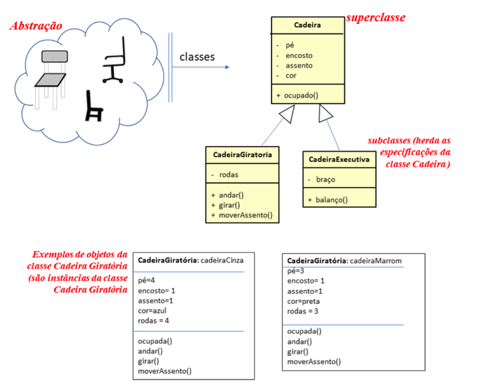
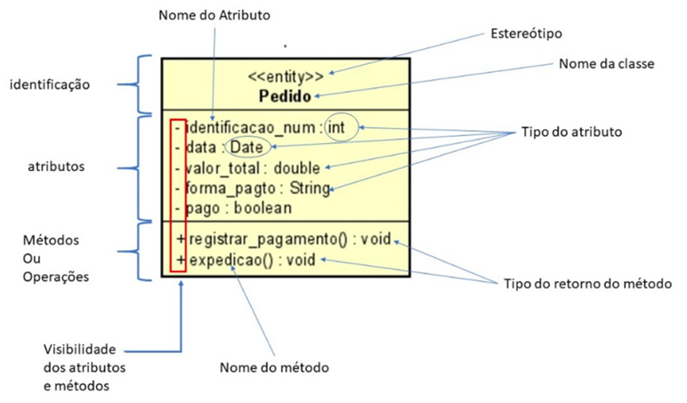
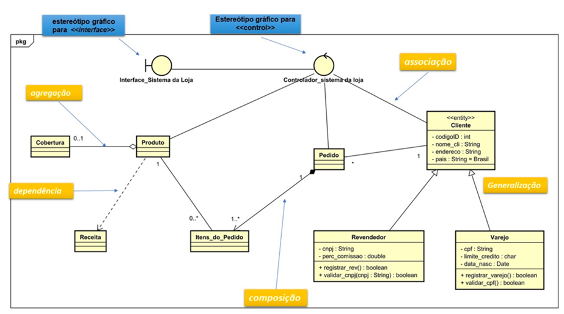
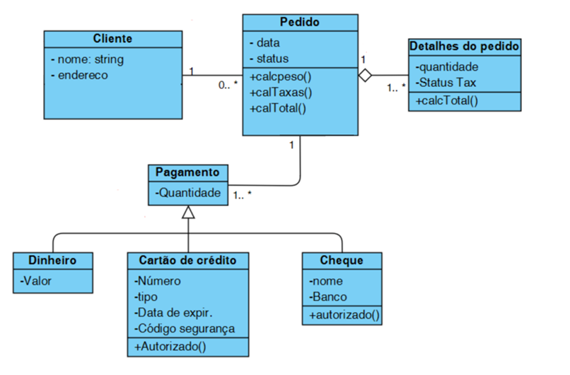
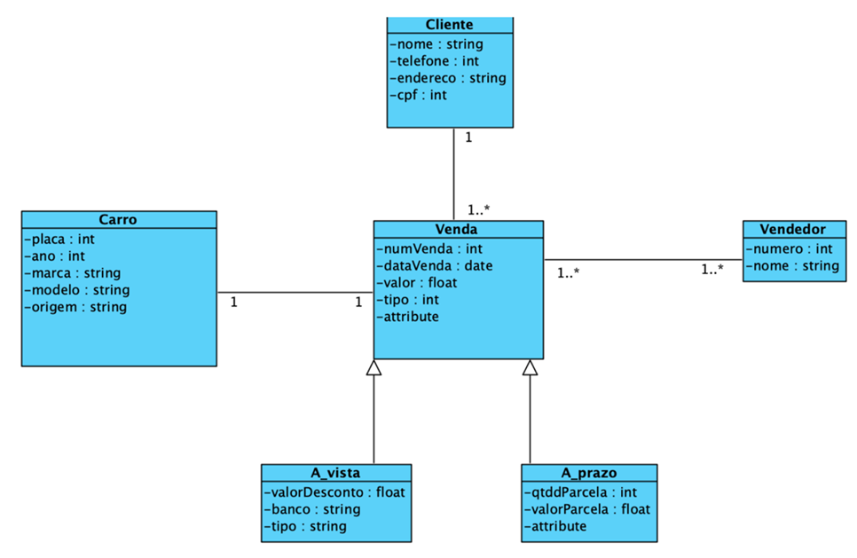

# Aula 4 — Diagrama de Classes

## Ponto de Partida

Nesta aula, vamos nos concentrar na introdução ao **paradigma orientado a objetos**, um pilar fundamental na programação moderna e design de software. Vamos dissecar os elementos do **Diagrama de Classes**, uma ferramenta essencial da UML que nos ajuda a visualizar a estrutura e o design de um sistema de software.

Abordaremos os conceitos-chave da orientação a objetos, como **classes, objetos, atributos, métodos** e as relações entre eles, como **herança, associação, agregação e composição**. Esses conceitos não são apenas teóricos; eles são a base para a criação de código real e funcional que você irá escrever e interagir no seu dia a dia como desenvolvedor.

Ao analisar exemplos práticos de utilização do Diagrama de classes, você começará a ver como esses conceitos se traduzem em aplicações do mundo real. Esta compreensão é crítica, pois permite que você estruture seus projetos de software de maneira lógica e sustentável.

> Para colocar em prática o que foi aprendido, **desenvolva um diagrama de classes** para o seguinte problema: *"o sistema de vendas de veículos é projetado para capturar as relações entre carros, clientes, vendas e vendedores."*
>
> | Classe | Atributos |
> |---|---|
> | **Carro** | placa, ano, marca, modelo, origem |
> | **Cliente** | nome, telefone, endereço, CPF |
> | **Venda** | número de venda, data, valor, tipo |
> | **A_vista** (especialização de Venda) | valor do desconto, banco, tipo |
> | **A_prazo** (especialização de Venda) | quantidade e valor das parcelas, além de um atributo genérico |
> | **Vendedor** | número, nome |
>
> A classe "Venda" é especializada em duas formas de pagamento: "A vista" e "A_prazo". Cada venda está associada a um único "Cliente" e um "Vendedor", mas tanto clientes quanto vendedores podem estar ligados a várias vendas.

Esta aula é um investimento na sua capacidade de pensar e projetar sistematicamente, uma habilidade que será aplicada em qualquer situação de desenvolvimento de software. Então, vamos mergulhar de cabeça e começar a construir uma base sólida no paradigma orientado a objetos.

---

## Vamos Começar!

### Introdução ao paradigma orientado a objetos

Frequentemente, você pode encontrar expressões como "Este é um novo paradigma" ou "A mudança de paradigma fez toda a diferença". Mas afinal, o que é um paradigma?

Um **paradigma** é considerado como um modelo previamente testado que segue princípios específicos para resolver problemas computacionais. Seguir um modelo traz uma vantagem significativa, pois facilita o desenvolvimento e a compreensão da solução encontrada.

#### Um pouco de história

| Ano | Marco |
|---|---|
| **1966** | Linguagem **SIMULA** introduz o conceito de objeto. |
| **1980** | **Smalltalk 80** expande e aprimora o conceito, tratando todos os itens como objetos, o que aproximou o paradigma dos objetos físicos do mundo real. |
| **1983** | Surge a linguagem **C with Classes**. |
| **1986** | **C++**, evolução do C with Classes. |
| **1997** | O paradigma ganha ampla adoção com o surgimento da **UML**. |

Tanto a Smalltalk 80 quanto a SIMULA suportavam recursos de orientação a objetos, como abstração, herança e vinculação dinâmica (FOWLER, 2005). Com o advento do paradigma orientado a objetos, não apenas emergiu um novo padrão para o desenvolvimento de software, mas também uma nova forma de pensar como modelar os problemas do mundo real.

A orientação a objetos é um paradigma de programação que organiza o software em torno de **objetos e suas interações**. Cada objeto é uma instância de uma classe, que define seu comportamento e estrutura. Essas interações entre objetos são realizadas através de **trocas de mensagens**.

### Conceitos e princípios básicos de POO

Entre os conceitos e princípios básicos de POO (Programação Orientada a Objetos) destacaremos (GUEDES, 2011):

#### 1. Abstração

A essência do paradigma orientado a objetos reside na abstração. Na prática da abstração, referimo-nos a um objeto (um item do mundo real, como casa, bolo, carro, sanduíche, boleto, contrato, etc.) sem nos preocuparmos com detalhes específicos, como cor, tamanho, código ou validade, entre outros. Frequentemente, associamos a abstração à categorização do objeto. Portanto, o processo de modelagem de um objeto começa pela abstração, que ocorre quando reconhecemos os objetos. Por exemplo, ao ouvir o termo "cadeira", concebemos uma ideia geral do que é uma cadeira, e isso é um ato de abstração.

#### 2. Classe

Uma classe representa essa abstração; é o ponto em que se definem as características que todas as cadeiras devem possuir e as ações que elas podem realizar.

#### 3. Atributos e métodos

| Conceito | Definição | Exemplo (classe "Cadeira") |
|---|---|---|
| **Atributos** | Características técnicas dentro de uma classe. | pés, rodinhas, encosto, assento, cor |
| **Métodos** | Ações ou comportamentos. | mover o encosto, elevar o assento, deslocar-se |

A classe é conceitualmente abstrata, mas se torna uma definição do projeto de uma cadeira. Quando uma cadeira é instanciada a partir dessa classe, obtemos um objeto do tipo "Cadeira", ou seja, um objeto que segue as características e comportamentos definidos pela classe.

#### 4. Objeto

O objeto é a representação concreta e única de uma classe, e a essa representação específica damos o nome de **instância** da classe. Portanto, um objeto é uma instância única de uma classe. Embora pertençam à mesma classe, os objetos são distintos uns dos outros devido aos valores de seus atributos e comportamentos (ações).

#### 5. Classe × objeto

Uma classe é a abstração de um conjunto de objetos; em outras palavras, é a representação abstrata do objeto com seus atributos e comportamentos. Ao criarmos uma cadeira chamada "cadeiraCinza" a partir da classe "Cadeira", obtemos um objeto do tipo "Cadeira" com cor cinza, rodinhas, pés, encosto e assento, capaz de mover o encosto e deslocar-se. A cadeiraCinza é única. Em um programa, a classe "Cadeira" existe e, ao instanciarmos a "cadeiraCinza" a partir dessa classe, ela ocupará um espaço na memória do computador, onde serão armazenados seus atributos e métodos, além de receber um endereço único que a identifica. Em resumo, o objeto é a realização concreta de um exemplar do tipo de classe que o define.

> Em UML, utiliza-se uma representação simples para uma classe: **um retângulo dividido em três partes** — nome da classe, atributos e métodos.

#### 6. Herança

A herança permite criar classes a partir de classes já existentes, **sem duplicar nenhum código**. Durante o processo de abstração, podemos definir classes amplas, que serão refinadas e estendidas durante a modelagem para formar subclasses. Essas subclasses podem herdar as características e comportamentos da classe mais geral, conhecida como **superclasse** (classe pai). A classe que herda essas características é denominada **subclasse** (classe filha), como ilustrado na Figura 1.

É importante destacar que a subclasse pode adicionar novos atributos e comportamentos, além de modificar os existentes, pois ela é uma nova entidade. Tais modificações afetam exclusivamente a nova classe especificada.

Retomando o exemplo: poderíamos criar uma classe genérica "Cadeira" contendo apenas os atributos "encosto", "assento" e "pés" — esta seria nossa superclasse. Em seguida, aproveitando suas características, poderíamos construir uma nova classe "CadeiraGiratória", acrescentando o atributo "rodas" e os métodos "andar", "girar" e "mover assento". Outro exemplo na Figura 1 é a classe "CadeiraExecutiva", que herda de "Cadeira" e adiciona o atributo "braço" e o método "balanço".

> **Nota de revisão:** o texto original diz que a seta de herança, com ponta vazada, aponta *para a classe "CadeiraGiratória"* (a subclasse). Na notação UML, a seta de generalização aponta **da subclasse para a superclasse** (a ponta vazada fica na classe "Cadeira"). Confira na Figura 1.

> **Figura 1** — POO: abstração, classe, herança e instanciação. *Fonte: Werlich (2020, p. 172).*

#### 7. Encapsulamento

O encapsulamento é a prática de unir partes isoladas de um programa, permitindo que essas partes sejam acessadas separadamente. Na POO, o encapsulamento tem a capacidade de **ocultar ou restringir a visibilidade** das informações e os detalhes da implementação dos métodos de uma classe. Em outras palavras, ele esconde do usuário da classe como uma determinada ação é realizada ou como os dados são representados. É o processo de dissimulação de todos os detalhes de um objeto que não contribuem para suas características essenciais (WERLICH, 2020).

> **Exemplo:** ao utilizar um caixa eletrônico (um objeto), você simplesmente fornece sua identificação e senha para acesso, e os serviços são liberados para utilização. Você não precisa entender como o caixa eletrônico valida suas informações, onde elas estão armazenadas ou como a senha é descriptografada. O usuário interage com o objeto sem precisar compreender os processos internos.

No diagrama de classes, a visibilidade é indicada por símbolos:

| Símbolo | Significado |
|:---:|---|
| **`-`** (traço) | O atributo ou método está encapsulado (privado): somente o objeto da classe pode modificá-lo ou acessá-lo. |
| **`+`** (adição) | O atributo ou método é visível para outros objetos, ou seja, é **público**. |

#### 8. Polimorfismo

O polimorfismo significa que a **mesma operação (método) pode atuar de modos diversos em classes diferentes**. Essa característica da POO confere flexibilidade às classes na construção de soluções e no reuso do código. Dentro de uma classe, um método (ou operação) pode ser definido várias vezes, pois pode ter comportamentos distintos nas subclasses.

#### POO × A/POO

Agora que você está familiarizado com os principais conceitos e princípios da POO, será mais fácil perceber as vantagens desse paradigma, pois ele abrange a análise, o projeto e a implementação.

- **POO** aplica os conceitos da Orientação a Objetos (OO) no desenvolvimento do **código**.
- **A/POO** (Análise e Projeto Orientados a Objetos) aplicam os conceitos da OO na **análise e na elaboração do projeto**, etapas que precedem a programação. Durante a análise, um instrumento utilizado é o **caso de uso**, enquanto no projeto é empregada a **UML**.

Segundo Sommerville (2018), um projeto que adote o paradigma orientado a objetos deve empregar essa estratégia em todo o seu processo de desenvolvimento, observando as práticas tanto no projeto quanto na programação.

| ✅ Vantagens | ⚠️ Desvantagens |
|---|---|
| Reutilização de código | Exige desenvolvedores familiarizados com esse paradigma |
| Um único modelo conceitual para análise, projeto e implementação | A modelagem requer maior atenção em comparação com a análise estruturada |
| Aceleração do tempo de desenvolvimento do software | Necessita de uma documentação minuciosa e detalhada |
| Simplificação da construção de sistemas complexos: cada objeto é simples, fácil de testar e integrar com outros objetos, o que prolonga o ciclo de vida do software | |
| Potencial redução dos custos de desenvolvimento | |

---

## Siga em Frente...

### Elementos do diagrama de classes

O diagrama de classes é uma das ferramentas mais importantes e amplamente utilizadas na UML. Seu foco principal é possibilitar a visualização das classes que compõem o sistema, juntamente com seus atributos e métodos correspondentes. Além disso, o diagrama destaca as relações entre essas classes, mostrando como elas se complementam e trocam informações entre si. Oferece uma **visão estática** da organização das classes, concentrando-se na definição da estrutura lógica das mesmas. Também serve como base para a construção de muitos outros diagramas na UML. Essencialmente, é composto pelas próprias classes e pelas associações entre elas, ou seja, pelos relacionamentos entre as classes.

Alguns métodos de desenvolvimento de software, como o Processo Unificado, recomendam o uso do diagrama de classes desde a fase de análise. Nesta etapa, um **modelo conceitual** é elaborado para representar as informações necessárias ao software: apenas classes, seus atributos e as associações entre elas (PRESSMAN, 2021). Detalhes como os métodos não são modelados nesta fase, pois fazem parte da implementação do software. Somente na fase de projeto é que o modelo conceitual é utilizado para produzir o **modelo de domínio**, que aborda diretamente a solução do problema. Os métodos necessários às classes são identificados a partir da modelagem de diagramas de interação, como o diagrama de sequência.

A representação da classe é um retângulo dividido em três partes: o **nome** da classe, os **atributos** e os **métodos**, como mostra a Figura 2.

> **Figura 2** — Representação de uma classe em UML. *Fonte: Werlich (2020, p. 206).*

#### Estereótipos

Os estereótipos são um recurso de extensibilidade amplamente empregado na UML, especialmente nos diagramas de classes. Sua finalidade é categorizar elementos do diagrama que compartilham características semelhantes. Podem ser definidos pelo desenvolvedor ou já estar predefinidos na linguagem. A UML possui 50 estereótipos predefinidos, conforme a especificação OMG (2017), sendo que três dos mais comuns são (GUEDES, 2011):

| Estereótipo | Identifica | Exemplo na Figura 3 |
|---|---|---|
| **`<<entity>>`** | Classes de persistência, responsáveis por armazenar dados recebidos pelo sistema. Além da notação textual, pode ser representada graficamente por um símbolo. | Classe "Produto" |
| **`<<boundary>>`** | Classe de fronteira, que atua na comunicação entre atores externos e o sistema. | Interface "Sistema_da_Loja" |
| **`<<control>>`** | Classes responsáveis por implementar regras de negócio. | Classe "controlador_Sistema_da_Loja" |

#### Relacionamentos entre classes

As classes estabelecem diferentes tipos de relacionamentos entre si, conforme especificado na UML (GUEDES, 2011):

| Relacionamento | Descrição | Exemplo (Figura 3) |
|---|---|---|
| **Dependência** | O tipo de relacionamento **mais fraco**, representando uma relação semântica entre duas classes. Uma alteração na classe independente pode afetar a classe dependente. | Entre "Produto" e "Receita": embora existam independentemente, uma mudança em "Receita" pode impactar "Produto". |
| **Associação** | O tipo **mais comum**, indicando que a classe A tem algum tipo de relação com a classe B. É um relacionamento genérico. | — |
| **Agregação** | Relacionamento mais específico, onde a classe filha **pode existir independentemente** da classe pai. | "Produto" (pai) e "Cobertura" (filha): se um "Produto" deixar de existir, a "Cobertura" continua a existir. |
| **Composição** | Tipo específico de associação em que, se o objeto da classe pai for destruído, **não faz sentido** a existência do objeto associado à classe filha. | "Pedido" e "Item_de_Pedido": os itens são partes integrantes do pedido; se o pedido for excluído, os itens também. |
| **Generalização/especialização** | A classe filha herda as características da classe pai (especialização da classe). | "Revendedor" e "Varejo" são filhas de "Cliente". |
| **Multiplicidade** | Indica quantas instâncias dos objetos estão envolvidas na associação. | Mostrada na Figura 3. |

> **Figura 3** — Diagrama de classe representando a venda de bolos com as indicações dos tipos de relacionamentos entre as classes. *Fonte: Werlich (2020, p. 208).*

### Exemplo de utilização do diagrama

Para exemplificar e explicar os elementos de um diagrama de classes, analise a Figura 4, que apresenta uma modelagem de um **sistema de pedidos**.

> **Figura 4** — Diagrama de classes. *Fonte: elaborada pela autora.*

O diagrama de classes apresentado descreve um sistema de pedidos com foco na interação entre clientes, pedidos e formas de pagamento. No sistema, cada "Cliente", identificado por nome e endereço, pode fazer vários "Pedidos". Cada "Pedido" tem uma data, um status e está associado a um ou mais "Detalhes do pedido", que descrevem a quantidade de itens pedidos e o status fiscal. Os pedidos têm métodos para calcular peso, impostos e o total do pedido.

Para realizar o pagamento de um pedido, são oferecidas múltiplas formas de pagamento, representadas pela classe "Pagamento", que é uma classe generalizada para "Dinheiro", "Cartão de crédito" e "Cheque":

| Forma de pagamento | Atributos | Operações |
|---|---|---|
| **Dinheiro** | Apenas o valor | — |
| **Cartão de crédito** | Número, tipo, data de expiração e código de segurança | Verificar se a transação está autorizada |
| **Cheque** | Nome e banco | Validação |

O diagrama ilustra como diferentes formas de pagamento são integradas ao processo de finalização de pedidos no sistema.

---

## Vamos Exercitar?

Este diagrama destaca a estrutura de dados que fundamenta o **sistema de vendas de veículos**, conforme apresentado no início da aula, e permite que desenvolvedores e analistas compreendam as relações e atributos necessários para implementar as funcionalidades desejadas no sistema de gerenciamento de vendas de veículos.

> **Figura 5** — Diagrama de classes para o sistema de venda de veículos. *Fonte: elaborada pela autora.*

---

## Saiba mais

1. **Diagramas de classes e programação**: o Capítulo 6 apresenta os fundamentos dos diagramas de classes e os relaciona com exemplos em programação.
   > WAZLAWICK, R. S. **Análise e Design Orientados a Objetos para Sistemas de Informação: Modelagem com UML, OCL e IFML**. Grupo GEN, 2014.

2. **UML Essencial**: apresenta os principais conceitos do diagrama de classes no Capítulo 5.
   > FOWLER, M. **UML essencial**. 3. ed. Porto Alegre: Bookman, 2005.

3. **Utilizando UML e Padrões**: traz esses padrões de maneira clara e simplificada no Capítulo 16.
   > LARMAN, C. **Utilizando UML e padrões**. Grupo A, 2011.

## Referências

- FOWLER, M. UML essencial: um breve guia para a linguagem-padrão de modelagem de objetos. 3. ed. Porto Alegre: Bookman, 2005.
- GUEDES, G. T. A. UML 2: uma abordagem prática. 2. ed. São Paulo: Novatec Editora, 2011.
- PRESSMAN, R. S. Engenharia de software: uma abordagem profissional. 9. ed. Porto Alegre: AMGH, 2021.
- SOMMERVILLE, I. Engenharia de software. 10. ed. São Paulo: Pearson, 2018.
- WERLICH, C. Análise e modelagem de sistemas. Londrina: Editora e Distribuidora Educacional S.A., 2020.
