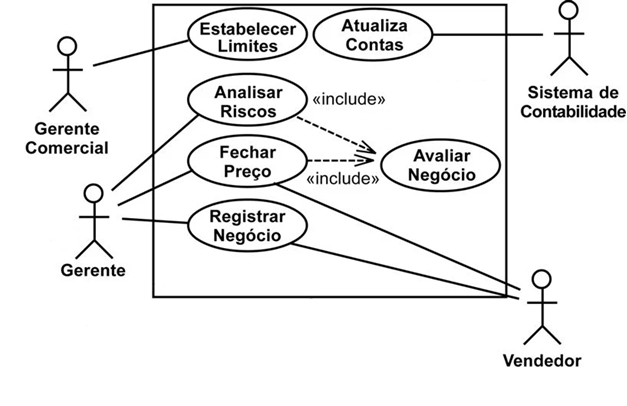
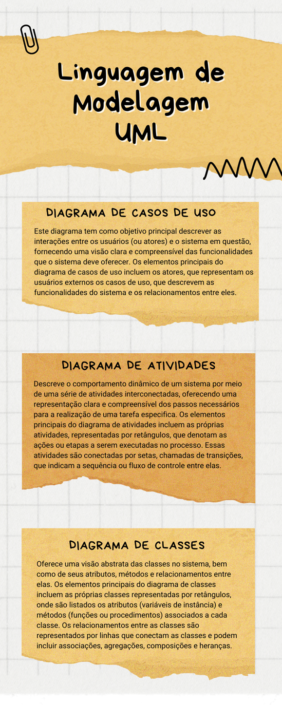

# Aula 5 — Videoaula de Encerramento

## Ponto de Chegada

Olá, estudante! Para desenvolver a competência desta Unidade, que é **elaborar diagramas de acordo com as especificações da UML**, você deverá primeiramente conhecer os conceitos fundamentais da Linguagem de Modelagem Unificada, conhecida como UML.

### Fundamentos da UML

A UML é uma linguagem visual que se tornou padrão na indústria de engenharia de software para modelar sistemas baseados em orientação a objetos. Diferentemente de uma linguagem de programação, a UML é uma **notação** para auxiliar engenheiros de software a definir as características do sistema, abrangendo desde requisitos até aspectos físicos do hardware onde o sistema será implantado. A UML é flexível, podendo ser adaptada a diversos processos de desenvolvimento de software, conforme a preferência do engenheiro (FOWLER, 2005).

Modelar software é essencial devido à sua complexidade e à constante evolução dos sistemas de informação. A modelagem não se limita à documentação, mas também oferece vantagens como facilitar a compreensão do sistema, estimar custos e identificar mudanças necessárias ao longo do tempo. Um **modelo de software** representa uma perspectiva abstrata do sistema, detalhando aspectos estruturais e comportamentais conforme o propósito do modelo, seja identificar requisitos essenciais, definir classes ou especificar métodos para resolver problemas.

A UML 2.5.1 oferece uma variedade de diagramas para modelagem de software, divididos em **estruturais** e **comportamentais**, permitindo aos desenvolvedores representarem e comunicarem diferentes aspectos dos sistemas (PRESSMAN, 2021). Embora não haja uma ordem prescrita para a criação e utilização dos diagramas, geralmente eles seguem uma sequência didática, começando pelos mais simples, como os estruturais, e avançando para os comportamentais, incluindo os de interação.

### Diagramas estruturais

Os diagramas estruturais da UML revelam a organização e interconexões de um sistema em suas partes constituintes. Fornecem uma **visão estática** da estrutura do sistema e são fundamentais na fase inicial do projeto de arquitetura. Entre os **seis** tipos de diagramas estruturais, o diagrama de classes se destaca como um dos mais essenciais.

| Diagrama | Resumo |
|---|---|
| **Classes** | Delineia atributos, métodos e relacionamentos entre as classes. |
| **Pacotes** | Subsistemas. |
| **Componentes** | Visualiza os módulos de código-fonte e bibliotecas. |
| **Instalação** | Descreve a configuração necessária de hardware e software para a execução do sistema, oferecendo uma visão abrangente da infraestrutura (FOWLER, 2005). |

### Diagramas comportamentais

Os diagramas comportamentais da UML visam representar o fluxo de informações e eventos ao longo do tempo em um sistema, evidenciando o comportamento dinâmico dos objetos e suas respostas a ações específicas ou eventos. Os **diagramas de interação**, como o de sequência e o de comunicação, modelam interações dentro do sistema ou entre seus componentes, enquanto o **diagrama de casos de uso** destaca os atores e as funcionalidades do sistema de forma mais abrangente e informal, servindo como base para outros diagramas (GUEDES, 2011).

| Diagrama | Resumo |
|---|---|
| **Atividade** | Descreve os passos necessários para concluir uma atividade específica, incluindo o fluxo de controle durante a execução. |
| **Máquina de estados** | Ilustra o comportamento de um elemento através de transições de estado. |
| **Tempo** | Destaca a evolução do estado de uma instância ao longo do tempo em resposta a eventos externos. |

### Diagrama de casos de uso

Outro ponto importante para alcançar a competência da unidade é conhecer e saber aplicar o diagrama de casos de uso. Esse diagrama é uma ferramenta fundamental para compreender as funcionalidades do sistema de forma abstrata e acessível, destacando a perspectiva do usuário e simplificando a compreensão do comportamento externo do sistema. Ele é amplamente utilizado nas fases iniciais de modelagem, especialmente durante o levantamento e análise de requisitos, servindo como base para outros diagramas ao longo do processo de engenharia. Ao oferecer uma visão panorâmica das funcionalidades desejadas pelos usuários sem entrar em detalhes de implementação, ajuda a identificar, especificar e documentar os requisitos do sistema, além de auxiliar na identificação dos diferentes tipos de usuários e suas interações com o sistema.

| Elemento | Resumo |
|---|---|
| **Atores** | Representam os papéis desempenhados pelos usuários e entidades externas que interagem com o sistema. Podem ser usuários comuns, hardware especializado ou outros sistemas integrados, representados por **"bonecos magros"** (GUEDES, 2011). |
| **Casos de uso** | Descrevem as funcionalidades ou serviços que o sistema oferece aos atores. Identificam e documentam as atividades essenciais do sistema, divididos em **primários** e **secundários**, representados por **elipses** com uma descrição concisa. |

As associações são fundamentais para representar as interações no diagrama:

| Relacionamento | Resumo |
|---|---|
| **Inclusão** (*include*) | Descreve rotinas comuns a múltiplos casos de uso, evitando a redundância na documentação. |
| **Extensão** (*extend*) | Trata de cenários opcionais que ocorrem sob circunstâncias específicas. |
| **Generalização/especialização** | Relaciona casos de uso genéricos a casos de uso especializados, permitindo herdar características comuns e associações entre eles. |

### Diagrama de atividades

Este diagrama anteriormente era considerado uma variação do diagrama de gráfico de estados. Na UML, foi promovido à sua própria categoria a partir da versão 2.0, deixando de se basear em máquinas de estados para se fundamentar em **redes de Petri**. Destaca-se por sua ênfase na sequência e nas condições para coordenar comportamentos de baixo nível, tornando-se um dos mais detalhados e focados em nível de algoritmo na UML (PRESSMAN, 2021). Comumente associado aos antigos **fluxogramas**, é utilizado para modelar atividades que podem variar de métodos e algoritmos a processos completos, sendo aplicável tanto para computação procedural quanto para modelagem organizacional e sistemas de informação.

Cada atividade, que pode ser um método, algoritmo ou processo, é composta por um conjunto de **ações** representando os passos necessários para sua conclusão. Embora uma atividade deva conter ações, estas não precisam estar todas representadas dentro da própria atividade no diagrama, permitindo referências a atividades já modeladas ou economia de espaço. Além disso, o diagrama é capaz de modelar dois tipos de fluxo: o de **controle**, que descreve a ordem das ações, e o de **objetos**, que representa como os objetos são passados entre as ações durante a execução.

A criação dos diagramas de atividades geralmente segue uma abordagem de cima para baixo e envolve vários elementos principais (GUEDES, 2011):

| Elemento | Resumo |
|---|---|
| **Estados inicial e final** | Marcam o início e o término do fluxo de uma atividade, representados por símbolos específicos. |
| **Atividades** | Representam as etapas ou processos no diagrama. |
| **Nós de ação** | Elementos fundamentais dentro de uma atividade, cada um representando uma etapa a ser executada. |
| **Fluxo de controle** | Conexões entre os nós, indicando a ordem de execução das ações, podendo conter descrições ou condições. |
| **Nós de decisão** | Escolhem entre diferentes caminhos de fluxo, com base em condições especificadas, e também podem reunir fluxos divergentes. |
| **Fork** | Separação de atividades em múltiplos fluxos concorrentes. |
| **Join** | Sincroniza esses fluxos, garantindo que a execução prossiga somente quando todos os caminhos concorrentes forem completados. |
| **Swimlanes** | Divisões horizontais ou verticais que ajudam a visualizar a responsabilidade e a interação entre diferentes participantes ou entidades envolvidas em um processo. |

### Diagrama de classes e paradigma OO

O diagrama mais utilizado da UML é o **diagrama de classes**. Para compreendê-lo é indispensável conhecer o paradigma orientado a objetos. Um **paradigma** é um modelo testado que segue princípios específicos para resolver problemas computacionais, simplificando o desenvolvimento e a compreensão das soluções encontradas. O paradigma orientado a objetos, amplamente adotado desde o surgimento da UML em 1997, organiza o software em torno de objetos e suas interações, cada objeto sendo uma instância de uma classe que define sua estrutura e comportamento.

| Conceito | Resumo |
|---|---|
| **Abstração** | Essencial na POO, representada por classes que definem características e comportamentos de objetos. |
| **Encapsulamento** | Oculta detalhes de implementação, permitindo que partes isoladas do programa sejam acessadas separadamente. |
| **Herança** | Possibilita a criação de classes a partir de outras já existentes. |
| **Polimorfismo** | Confere flexibilidade às classes ao permitir que uma mesma operação tenha comportamentos distintos em diferentes classes. |

Adotar o paradigma orientado a objetos não só estabelece um novo padrão para o desenvolvimento de software, mas também muda a forma como problemas são modelados, abrangendo análise, projeto e implementação de maneira integrada, embora exija atenção à modelagem e documentação detalhada.

O diagrama de classes é uma ferramenta essencial para visualizar a **estrutura estática** de um sistema de software, destacando as classes, seus atributos e métodos, bem como as relações entre elas. Utilizado desde a fase de análise até o projeto, concentra-se na representação conceitual das informações necessárias ao software, sendo a base para a construção de outros diagramas na UML. As classes são representadas por retângulos divididos em três partes (nome, atributos e métodos), enquanto os relacionamentos entre classes (dependência, associação, agregação, composição e herança) são definidos para mostrar como as classes interagem entre si.

Além disso, os **estereótipos** são amplamente empregados para categorizar elementos do diagrama de classes, como classes de persistência (`<<entity>>`), fronteira (`<<boundary>>`) e controle (`<<control>>`). Os tipos de relacionamentos entre as classes, como dependência, associação, agregação, composição, generalização/especialização e **multiplicidade**, são especificados para indicar a natureza das interações entre elas (GUEDES, 2011).

> **Em resumo:** a compreensão e aplicação da UML e seus diagramas, como casos de uso, atividades e classes, é fundamental para o desenvolvimento eficaz e eficiente de software. Essas ferramentas oferecem uma representação visual clara e concisa dos requisitos do sistema, das interações entre os usuários e o software, das atividades necessárias para alcançar determinados objetivos e da estrutura lógica do software em si. Ao aplicar adequadamente os conceitos e técnicas da UML, os desenvolvedores podem comunicar de forma mais eficaz as necessidades do cliente, planejar e projetar sistemas de software de maneira abrangente e construir soluções que atendam às expectativas e requisitos do usuário final.

---

## É Hora de Praticar!

### Estudo de Caso: Sistema de gerenciamento de vendas

Os diagramas de casos de uso são uma ferramenta essencial na modelagem de sistemas, pois ajudam a capturar os requisitos do sistema de forma clara e concisa. Eles descrevem como os usuários interagem com o sistema em diferentes cenários, identificando suas necessidades e objetivos. Sabendo disso, leia o enunciado a seguir e **elabore um diagrama de casos de uso**.

> O diagrama de casos que será desenvolvido deve ilustrar o fluxo de operações em um **sistema de gerenciamento de vendas**. O sistema envolve três atores principais: **Gerente Comercial**, **Gerente** e **Vendedor**, cada um com responsabilidades específicas e interações com o sistema de contabilidade. O objetivo do sistema é facilitar e registrar as atividades comerciais, garantindo que os processos de negócio sejam conduzidos de maneira eficiente e controlada.

| Ator | Responsabilidades (casos de uso) |
|---|---|
| **Gerente Comercial** | **"Estabelecer Limites"** para as operações de vendas, assegurando controle sobre as margens comerciais e os riscos associados; e **"Analisar Riscos"**, para avaliar potenciais problemas que possam afetar as transações comerciais. |
| **Gerente** | **"Fechar Preço"** nas negociações, um passo crítico no processo de venda. Esta ação inclui a avaliação do negócio **de modo obrigatório** (relacionamento *include*). |
| **Vendedor** | **"Atualização de Contas"** no Sistema de Contabilidade e **"Registrar Negócio"**, interagindo diretamente com o sistema para garantir que todas as informações de vendas sejam devidamente documentadas e contabilizadas. |
| **Sistema de Contabilidade** (ator secundário) | Serve como repositório para registrar as transações e manter as contas atualizadas. Essencial para manter a integridade dos dados financeiros e para o funcionamento geral do processo de vendas. |

### Reflita

1. Considerando o investimento significativo de tempo e recursos que as empresas dedicam à modelagem de software, como você avalia o papel da UML nesse processo?
2. É possível que a complexidade inerente à UML possa, em certos contextos, aumentar a carga de trabalho ao invés de simplificá-la?
3. Qual é a importância de selecionar os diagramas adequados da UML durante o processo de desenvolvimento de software?
4. Como as empresas podem tomar decisões informadas ao escolher os diagramas mais apropriados para seus projetos específicos, levando em consideração as necessidades do cliente, a complexidade do sistema e os recursos disponíveis?

### Dê o Play!

Clique aqui para acessar os slides do *Dê o play!* (disponível na plataforma da instituição).

### Resolução do Estudo de Caso

Uma possível solução para o exercício está apresentada a seguir:

> **Figura 1** — Resolução. *Fonte: Fowler (2005, [s. p.]).*

### Assimile

Desvende a essência da modelagem de sistemas com a UML. Este infográfico apresenta a descrição dos **diagramas de casos de uso**, a dinâmica dos processos com **diagramas de atividades**, e a estrutura sólida do sistema com **diagramas de classes**.

> **Figura** — Linguagem de Modelagem UML. *Fonte: elaborada pela autora.*

---

## Referências

- GUEDES, G. T. A. UML 2: uma abordagem prática. 2. ed. São Paulo: Novatec Editora, 2011.
- FOWLER, M. UML essencial: um breve guia para a linguagem-padrão de modelagem de objetos. 3. ed. Porto Alegre: Bookman, 2005.
- PRESSMAN, R. S. Engenharia de software: uma abordagem profissional. 9. ed. Porto Alegre: AMGH, 2021.
