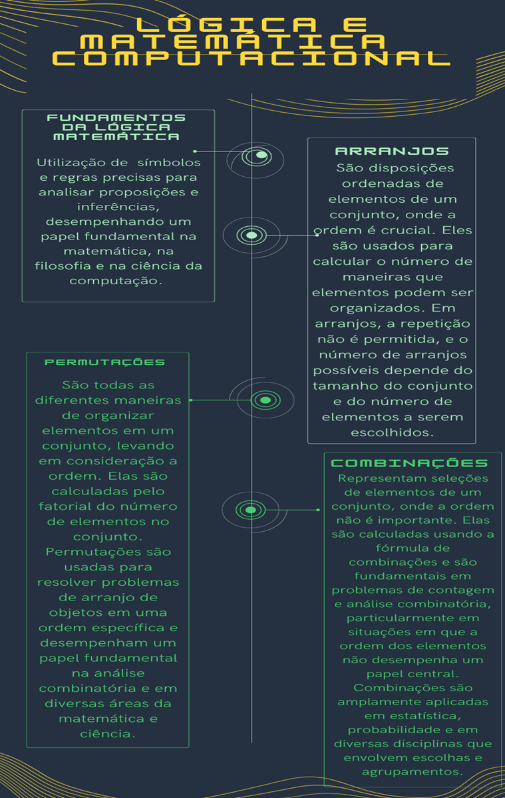

# Aula 5 — Fundamentos da Lógica, Arranjos, Permutações e Combinações

## Ponto de Chegada

Olá, estudante! Para desenvolver a competência desta Unidade, que é conhecer os fundamentos da lógica matemática, em conjunto com as combinações, os arranjos e as permutações matemáticas, você deverá primeiramente conhecer os conceitos fundamentos sobre: proposições, premissas, argumentos, conectivos lógicos, falácia, silogismo, inferência, lógica dedutiva e indutiva, arranjos, permutações e combinações. Bom, então vamos lá.

### Fundamentos da lógica

- **Proposições**: é uma afirmação ou declaração que pode ser classificada como verdadeira ou falsa, mas não ambas. Proposições são usadas como a base para a construção de argumentos lógicos e raciocínio matemático. Elas são muitas vezes representadas por letras minúsculas, como "p" ou "q", e podem ser combinadas por meio de operadores lógicos para formar argumentos mais complexos.
- **Premissas**: são afirmações iniciais ou suposições que servem como a base para um argumento, teorema, cálculo ou processo de raciocínio. Elas são as declarações iniciais das quais se parte para chegar a uma conclusão ou para realizar um cálculo. As premissas são fundamentais na lógica e na matemática computacional, pois ajudam a estabelecer a estrutura lógica e as condições iniciais de um problema ou argumento.
- **Argumentos**: é um conjunto de proposições que inclui uma ou mais premissas e uma conclusão. O objetivo de um argumento é apresentar uma justificação lógica para a aceitação da conclusão com base nas premissas. Em outras palavras, um argumento é uma estrutura lógica que tenta demonstrar que a conclusão é verdadeira com base em informações fornecidas pelas premissas.
- **Conectivos lógicos**: são símbolos ou palavras, usados para combinar proposições (afirmações) para formar novas proposições ou para modificar o valor de verdade de proposições existentes. Os conectivos lógicos são fundamentais para a construção de argumentos, a análise de proposições complexas e a resolução de problemas lógicos.
- **Falácia**: é um tipo de erro de raciocínio, argumentação ou inferência que pode ser enganoso, ilusório ou logicamente incorreto. As falácias são argumentos que parecem ser válidos, mas, na realidade, não são. Elas podem ser usadas de forma deliberada para enganar, mas também podem surgir devido a erros de pensamento ou falta de rigor lógico. Reconhecer falácias é importante para a análise crítica e a construção de argumentos válidos.
- **Silogismo**: é uma forma específica de argumento em lógica que consiste em duas premissas e uma conclusão, seguindo uma estrutura lógica muito particular. Os silogismos são amplamente usados na lógica clássica e na matemática computacional para fazer inferências válidas a partir de premissas dadas. Eles foram formalizados e sistematizados por Aristóteles, um filósofo grego antigo.
- **Inferência**: a inferência em lógica e matemática computacional refere-se ao processo de derivar conclusões lógicas com base em premissas, regras lógicas e raciocínio. É a etapa crucial em que se extrai uma afirmação ou conclusão a partir de informações dadas. Em outras palavras, a inferência envolve a aplicação de princípios lógicos para determinar o que pode ser considerado verdadeiro, com base no que já é conhecido ou aceito.
- **Lógica dedutiva e indutiva**: em matemática computacional, a lógica dedutiva e a lógica indutiva são dois tipos de raciocínio lógico que desempenham papéis distintos na análise, modelagem e solução de problemas. Na matemática computacional, ambos os tipos de lógica desempenham papéis importantes.
  - A **lógica dedutiva** é fundamental para a construção de algoritmos, a prova de teoremas, a verificação de programas e a resolução de problemas matemáticos. Ela fornece uma base sólida para garantir a validade de operações computacionais.
  - A **lógica indutiva** é usada em áreas como aprendizado de máquina, mineração de dados e modelagem estatística, nos quais os computadores são treinados para fazer previsões com base em padrões e tendências observados nos dados.
  - Ambas as formas de raciocínio desempenham papéis complementares em matemática computacional, permitindo a construção de modelos precisos, a tomada de decisões informadas e a solução de uma ampla variedade de problemas computacionais.

### Análise combinatória

- **Arranjos**: são uma combinação específica de objetos (geralmente números ou elementos) dispostos em uma ordem particular. Em matemática, "arranjo" é um termo que descreve a organização ordenada de elementos de um conjunto, em que a ordem é importante.
- **Permutações**: referem-se a todas as possíveis maneiras de rearranjar um conjunto de elementos em uma ordem específica. Em outras palavras, uma permutação é uma disposição ordenada de elementos de um conjunto. A ordem dos elementos é importante em permutações, o que significa que duas permutações que tenham os mesmos elementos, mas em ordens diferentes, são consideradas distintas.
- **Combinações**: são agrupamentos de elementos de um conjunto em que a ordem dos elementos não é considerada. Em outras palavras, combinações representam a seleção de elementos sem se preocupar com a ordem em que eles são dispostos. As combinações são frequentemente usadas em problemas de contagem e análise combinatória para determinar o número de maneiras de escolher um subconjunto de elementos de um conjunto maior, na qual a ordem dos elementos não importa.

---

## É Hora de Praticar!

### Estudo de Caso: Organização de um Torneio de Xadrez

> Suponha que você seja o organizador de um torneio de xadrez com 8 participantes: Alice, Bob, Carol, Lucas, Eva, Frank, Grace e Helena. O torneio será uma competição de eliminação simples, onde os jogadores se enfrentam em partidas individuais até que apenas um vencedor seja coroado. Você precisa determinar quantas partidas no total serão necessárias para completar o torneio além disso, quantas maneiras diferentes podemos organizar os 8 jogadores em 4 partidas considerando a ordem dos pares?

### Reflita

- Como a matemática dos arranjos nos ajuda a desenvolver habilidades de resolução de problemas e a aplicar a lógica em diversos campos?
- Como a capacidade de calcular permutações nos ajuda a resolver problemas de contagem e a explorar a variedade de maneiras pelas quais elementos podem ser organizados?
- Em que situações a matemática das combinações desempenha um papel fundamental, como na probabilidade, na estatística e em problemas práticos?

### Resolução do Estudo de Caso

**Primeiro ponto é:**

Serão **7**, pois temos 4 partidas nas quartas de final, mais 2 partidas na semifinal e mais a final.

**Para determinar a combinação dos 8 jogadores nas primeiras 4 partidas devemos fazer:**

$$C_8^2 = \dfrac{8!}{2!(8-2)!} = 28$$

$$C_6^2 = \dfrac{6!}{2!(6-2)!} = 15$$

$$C_4^2 = \dfrac{4!}{2!(4-2)!} = 6$$

$$C_2^2 = \dfrac{2!}{2!(2-2)!} = 1$$

Precisamos multiplicar as combinações:

$$28 \times 15 \times 6 \times 1 = 2.520$$

Portanto, serão necessárias **7 partidas** e podemos ter **2.520** maneiras de organizar a primeira rodada com 4 partidas.

> **Nota de revisão:** duas correções em relação ao material original: (1) com 8 jogadores, a primeira rodada tem 4 partidas, que são as **quartas** de final (o texto dizia "oitavas"); (2) a frase final dizia "podemos ter 2.520 partidas a primeira rodada" — o valor 2.520 é o número de **maneiras** de organizar os confrontos da primeira rodada (considerando a ordem das partidas), não um número de partidas.

Esse estudo de caso demonstra como a combinação podem ser aplicadas na organização de competições e na determinação do número de jogos possíveis em uma situação específica. Em contextos do mundo real, as combinações podem ser usadas para resolver problemas de contagem e organização, como em planejamento de eventos, sistemas de votação e muito mais.

### Assimile

**Figura 1** | Síntese dos conteúdos abordados durante os estudos

## Referências

- ARAUJO, L. M. M. et al. Fundamentos de matemática. Grupo A, 2018.
- LUSTOSA, D. Raciocínio Lógico-matemático para concursos públicos: teoria e prática. (Série Provas & Concursos). Grupo GEN, 2023.
- QUILELLI, P. Raciocínio lógico matemático para concursos. 3. ed. Editora Saraiva, 2015.
- ROSEN, K. H. Matemática discreta e suas aplicações. Grupo A, 2010.
