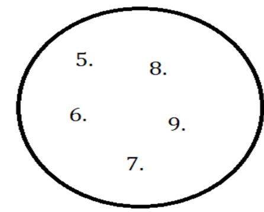
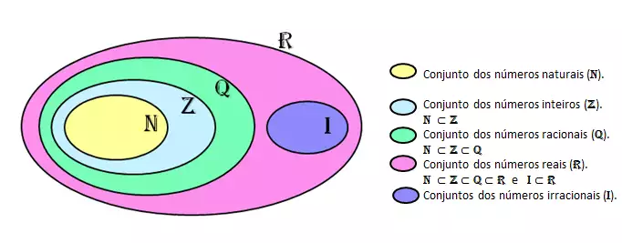

# Aula 2 — Teoria dos Conjuntos

## Ponto de Partida

Olá, estudante! Nesta aula, você terá a oportunidade de explorar os conceitos essenciais relacionados à teoria dos conjuntos. Este conhecimento será fundamental para capacitá-lo a compreender o funcionamento da programação e criar algoritmos de forma eficiente.

Durante os estudos, você aprenderá o que são **conjuntos**, como podemos **representá-los**, o que é **cardinalidade** de um conjunto, o que são **quantificadores** (universal e existencial).

> Para motivar sua aprendizagem, imagine que você foi contratado por uma grande empresa do setor de Tecnologia da Informação (TI) e está trabalhando em uma equipe no desenvolvimento de um aplicativo para telefones móveis. Você ficou responsável por elaborar diferentes chaves de acesso para esse aplicativo, e durante esse trabalho, você se deparou com o problema de identificar quantos e quais são os subconjuntos derivados de um conjunto constituído por quatro elementos arbitrários {1, 2, 3, 4}. As possíveis combinações (subconjuntos) encontradas deverão ser apresentadas para o restante da equipe que utilizará essas informações para finalizar o layout da tela inicial do aplicativo.
>
> Você conseguiria determinar quantos subconjuntos podem ser formados, independentemente do seu "tamanho" (número de elementos) a partir da conjugação dos quatro elementos arbitrários? Você saberia identificar todos esses subconjuntos?

Determinar quantos subconjuntos podem ser formados, independentemente do seu "tamanho" (número de elementos) e identificá-los (um a um) é uma tarefa que exige raciocínio combinatório, metodologia e organização. Para resolver tal problema, será necessário compreender o significado de subconjunto e as relações entre conjuntos.

Aproveite ao máximo a oportunidade de praticar o estudo álgebra de conjuntos. Esses conceitos são de suma importância para profissionais que desenvolvem sistemas de software utilizando diferentes linguagens de programação e algoritmos, permitindo que executem suas funções técnicas de forma eficaz e alcancem resultados profissionais excepcionais.

Bons estudos!

---

## Vamos Começar!

### O que é um conjunto

**Conjuntos** podem ser definidos como coleções não ordenadas de objetos que podem ser, de alguma forma, relacionados (Ferreira, 2001). Considere, por exemplo, o conjunto A das cores da bandeira do Brasil. Temos que A = {verde, amarelo, azul, branco}. Em geral, objetos de um mesmo conjunto gozam de uma propriedade em comum. Assim, qualquer objeto que verifique a propriedade "ser cor da bandeira do Brasil" será considerado um elemento do conjunto A. Normalmente, utilizam-se letras maiúsculas do nosso alfabeto para representar os conjuntos.

### Formas de descrever um conjunto

Para descrever um determinado conjunto, é necessário identificar seus elementos. Para tanto, pode-se proceder de três maneiras distintas:

1. **Listando todos os elementos do conjunto**, como foi feito com o conjunto A, que representa as cores da bandeira do Brasil. Dependendo do conjunto que se deseja descrever, essa maneira de representação pode se revelar trabalhosa, sendo mais indicada para conjuntos finitos, com um pequeno número de elementos.
2. **Indicando os primeiros elementos do conjunto** (presumindo que os elementos do conjunto possam ser ordenados) que denotem um padrão para uma listagem indefinida. Por exemplo, considere o conjunto B = {2, 4, 6, ...}. É possível deduzir, a partir do padrão indicado, que o conjunto B é infinito, constituído pelos números inteiros positivos pares.
3. **Escrevendo uma propriedade que caracterize os elementos** que constituem o conjunto. Por exemplo, considere o conjunto C = { x | x um número inteiro e 4 < x ≤ 9 }. Lê-se: C é o conjunto de todos os x, tal que x é inteiro, maior do que 4 e menor ou igual a 9. Listando todos os elementos de C, tem-se que: C = {5, 6, 7, 8, 9}. Escrever a propriedade característica dos elementos de um conjunto por meio de palavras é a maneira mais usual de descrever um conjunto. Isso porque, muitas vezes, ao se trabalhar com conjuntos que possuem um número muito grande de elementos (ou até mesmos conjuntos infinitos), a listagem de todos os elementos do conjunto não se torna viável.

### Diagramas de Venn

Há ainda uma maneira alternativa de representação de conjuntos com forte apelo visual. Trata-se dos **Diagramas de Venn**. John Venn (1834-1923) foi um matemático inglês, tendo-se licenciado na Universidade de Cambridge onde, depois, ensinou Lógica e Teoria das Probabilidades. Venn introduziu os diagramas em seus trabalhos baseado nos círculos eulerianos, por isso, alguns autores referem-se aos diagramas de Venn como diagramas de Euler-Venn (Novaes, 2014).

Os diagramas de Venn consistem em círculos (que podem estar intersectados), os quais representam os conjuntos. No interior dos círculos são listados os elementos do conjunto. Por exemplo, o conjunto C = { x | x é um número inteiro e 4 < x ≤ 9 } pode ser representado pelo diagrama apresentado na Figura 1.

**Figura 1** | Conjunto C

---

## Siga em Frente...

### Pertinência

Um objeto pertencente a um conjunto é chamado de **elemento** do conjunto. A relação de pertinência é indicada pelo símbolo **∈**, e a relação de não pertinência, pelo símbolo **∉**. Assim, a indicação x ∈ A significa que o objeto x é um elemento do conjunto A. Retomando o conjunto das cores da bandeira do Brasil A = {verde, amarelo, azul, branco}, podemos afirmar que verde ∈ A e que vermelho ∉ A. A relação ∈ pode ser lida como "é membro de" ou "está em" ou "é elemento de" ou "pertence a".

### Cardinalidade

Além de saber descrever um conjunto a partir das propriedades comuns de seus elementos, também é importante saber determinar quantos elementos constituem o conjunto. Vale destacar que, ao número de objetos (elementos) de um determinado conjunto dá-se o nome de **cardinalidade**. As barras de valor absoluto em torno de um conjunto representam a cardinalidade ou o tamanho do conjunto (isto é, o número de elementos do conjunto). Assim, considerando o conjunto A = {verde, amarelo, azul, branco}, pode-se afirmar que a cardinalidade de A é igual a 4, ou seja, **|A| = 4**. De maneira análoga, considerando o conjunto C = { x | x é um número inteiro e 4 < x ≤ 9 }, pode-se afirmar que a cardinalidade de C é igual a 5, ou seja, **|C| = 5**.

Um conjunto é chamado de **finito** quando sua cardinalidade é um número inteiro, caso contrário, é chamado de **infinito**. Um conjunto é chamado de **conjunto vazio** quando sua cardinalidade é igual a zero, ou seja, é um conjunto desprovido de elementos.

### Conjuntos numéricos

É muito comum nos depararmos com alguns conjuntos padrão. As Tabelas 1 e a figura 2 ilustram os conjuntos numéricos naturais, inteiros, racionais e irracionais.

| Conjunto | Exemplos | Descrição |
|---|---|---|
| **(ℕ) Naturais** | 0, 1, 2, 3, 4, 5... | Positivos inteiros a partir do 0 |
| **(ℤ) Inteiros** | -2, -1, 0, 1, 2, 3... | Naturais + os negativos |
| **(ℚ) Racionais** | -1, 0, 1, 2 e frações (½, ⅗...) | Naturais + frações e dízimas periódicas |
| **(𝕀) Irracionais** | π, √2, √3, -√5... | Raízes não inteiras e dízimas não periódicas |

*Tabela 1 | Conjuntos numéricos*

> **Nota de revisão:** na linha dos Racionais, a descrição original diz "Naturais + frações e dízimas periódicas", mas o próprio exemplo inclui o −1. O mais preciso é "**Inteiros** + frações e dízimas periódicas", já que ℤ ⊂ ℚ (todo inteiro, inclusive negativo, é racional).

**Figura 2** | Conjunto numéricos. Fonte: Estudo Prático, 2019.

### Quantificadores

Na Teoria de Conjuntos, há certas afirmações que não podem ser escritas adequadamente por meio de símbolos proposicionais, parênteses e conectivos lógicos. Elas contêm um elemento **quantificador**. Os quantificadores são frases como "para todo", "para cada" ou "para algum", que indicam, de alguma forma, quantos objetos têm uma determinada propriedade.

Por exemplo, considere as seguintes afirmações:

- Todo inteiro é par ou ímpar.
- Existe um número natural que é primo e par.

A primeira afirmação traduz uma relação de **universalidade**, já a segunda afirmação traduz uma relação de **existência**. Utilizaremos uma notação específica para representar cada uma dessas situações.

| Quantificador | Símbolo | Leitura | Forma geral | Exemplo |
|---|:---:|---|---|---|
| **Universal** | ∀ | "para todo" ou "qualquer que seja" | ∀ x ∈ A, afirmações sobre x | ∀ x ∈ ℤ, x é par ou x é ímpar |
| **Existencial** | ∃ | "há" ou "existe" | ∃ x ∈ A, afirmações sobre x | ∃ x ∈ ℕ, x é primo e par |

O **quantificador universal** é simbolizado por um A de cabeça para baixo, ∀, e é lido "para todo" ou "qualquer que seja". A forma geral para essa notação é ∀ x ∈ A, afirmações sobre x. A primeira afirmação "todo inteiro é par ou ímpar" ficaria representada como ∀ x ∈ ℤ, x é par ou x é ímpar.

O **quantificador existencial** é simbolizado por um E espelhado, ∃, e é lido como "há" ou "existe". A forma geral para essa notação é ∃ x ∈ A, afirmações sobre x. A segunda afirmação "existe um número natural que é primo e par" ficaria representada como ∃ x ∈ ℕ, x é primo e par.

### Subconjuntos

Considere, agora, os conjuntos A = {2, 5, 7, 9} e B = {1, 2, 3, 4, 5, 6, 7, 8, 9}. Perceba que todos os elementos pertencentes ao conjunto A também pertencem ao conjunto B. Nesse caso, dizemos que A é um **subconjunto** de B.

Sejam os conjuntos A e B. Dizemos que A é um subconjunto de B se, e somente se, todo elemento de A também for elemento de B. A notação **A ⊆ B** significa que A é subconjunto de B.

Se A é um subconjunto de B, mas A ≠ B, ou seja, existe pelo menos um elemento de B que não é elemento de A, então, A é chamado de **subconjunto próprio** de B. Subconjuntos próprios podem alternativamente ser representados pelo sinal **⊂**.

> **Atenção:** observe que ⊆ e ∈ têm significados relacionados, porém, diferentes! O símbolo **∈** é utilizado para representar uma relação de **pertinência** entre um objeto e um conjunto. Por exemplo, seja o conjunto A = {5, 7, 9, 11, 13}, podemos afirmar que 7 ∈ A. Já o símbolo **⊆** é utilizado para representar uma relação de **continência** (subconjunto) entre conjuntos. Por exemplo, seja A = {5, 7, 9, 11, 13} e B = {5, 11, 13}, podemos afirmar que B ⊆ A. Tome cuidado! Os sinais ⊆ e ∈ não podem ser permutados.

### Número de subconjuntos

Um problema recorrente envolvendo subconjuntos diz respeito à determinação do número de subconjuntos de um determinado conjunto. Por exemplo, quantos subconjuntos têm o conjunto A = {a, b, c}?

Uma maneira para resolver esse problema é listar todas as possibilidades. Como a cardinalidade de A é igual a 3 (|A| = 3), qualquer subconjunto de A pode ter de zero a três elementos. Consideremos a Tabela 2 com a descrição de todas as possibilidades:

| Número de elementos | Subconjuntos | Número de subconjuntos |
|:---:|---|:---:|
| 0 | ∅ | 1 |
| 1 | {a}, {b}, {c} | 3 |
| 2 | {a,b}, {a,c}, {b,c} | 3 |
| 3 | {a, b, c} | 1 |
| **Total** | | **8** |

*Tabela 2 | Subconjuntos de A (cardinalidade 3)*

Portanto, A = {a, b, c} tem **oito subconjuntos**. É importante, nesse momento, retomar a definição de conjunto como uma coleção não ordenada de objetos. Isso significa dizer que o subconjunto {a, b} e o subconjunto {b, a} são iguais e, portanto, contabilizados uma única vez. Também é importante destacar que o conjunto vazio e o próprio conjunto A também são subconjuntos de A.

Nesse exemplo, conseguimos listar e contabilizar todos os subconjuntos de A. Como |A| = 3, essa tarefa não se mostrou muito trabalhosa. No entanto, imagine no caso de um conjunto com cardinalidade igual a 10: quantos subconjuntos poderiam ser contabilizados?

O teorema a seguir permite contabilizar o número de subconjuntos de um conjunto qualquer conhecendo-se a sua cardinalidade.

> **Teorema:** seja A um conjunto finito. O número de subconjuntos de A é $2^{|A|}$.

Seja A um conjunto com cardinalidade igual a 10, quantos subconjuntos de A poderiam ser contabilizados? Como |A| = 10, utilizando o resultado do Teorema anterior, o número de subconjuntos de A é igual a:

$$2^{|A|} = 2^{10} = 1024$$

Nesta aula, você, estudante, aprendeu o que são conjuntos, como podemos representá-los, o que é cardinalidade de um conjunto, o que são quantificadores (universal e existencial) e como podemos listar e contabilizar os subconjuntos de um determinado conjunto. Todos esses conceitos serão de suma importância na resolução de situações-problema que envolvam conjuntos e relações entre conjuntos.

---

## Vamos Exercitar?

Você se lembra da situação-problema apresentada no início da aula? Vamos retomá-la?

> Você foi contratado por uma grande empresa do setor de Tecnologia da Informação (TI) e está trabalhando em uma equipe no desenvolvimento de um aplicativo para telefones móveis. Durante o desenvolvimento do aplicativo, você se deparou com o problema de identificar quantos e quais são os subconjuntos derivados de um conjunto constituído por quatro elementos arbitrários {1, 2, 3, 4}. Você conseguiria determinar quantos subconjuntos podem ser formados, independentemente do seu "tamanho" (número de elementos) e a partir da conjugação desses quatro elementos arbitrários? Você saberia identificar todos esses subconjuntos? Lembre-se de que as possíveis combinações (subconjuntos) encontradas deverão ser apresentadas para o restante da equipe, que utilizará essas informações para finalizar o layout da tela inicial do aplicativo.

Em primeiro lugar, vamos elucidar o significado da palavra **arbitrário**. Quando dizemos que x é um elemento arbitrário de um conjunto A, queremos dizer que x pode ser qualquer elemento de A e não podemos fazer qualquer outra suposição sobre x.

Denotando o conjunto {1, 2, 3, 4} por A, podemos determinar a sua cardinalidade. Temos que |A| = 4, logo, o número de subconjuntos de A é igual a:

$$2^{|A|} = 2^4 = 16$$

Resta, agora, identificar todos esses 16 subconjuntos. Como a cardinalidade de A é igual a 4, podemos ter subconjuntos com 0, 1, 2, 3 ou 4 elementos. Por exemplo, {1, 3, 4} é subconjunto de A, pois {1, 3, 4} ⊆ A. {2, 3} também é subconjunto de A, pois {2, 3} ⊆ A.

Para identificar todos os subconjuntos de A, vamos elaborar uma lista, representados no Tabela 3.

| Número de elementos | Subconjuntos | Número de subconjuntos |
|:---:|---|:---:|
| 0 | ∅ | 1 |
| 1 | {1}, {2}, {3}, {4} | 4 |
| 2 | {1,2}, {1,3}, {1,4}, {2,3}, {2,4}, {3,4} | 6 |
| 3 | {1, 2, 3}, {1, 2, 4}, {1, 3, 4}, {2, 3, 4} | 4 |
| 4 | {1, 2, 3, 4} | 1 |
| **Total** | | **16** |

*Tabela 3 | Subconjuntos de A (cardinalidade 4)*

Vale ressaltar que, como a cardinalidade do conjunto A era igual a 4, não tivemos maiores dificuldades em listar todos os 16 subconjuntos. Problemas envolvendo conjuntos de maior cardinalidade costumam exigir a contabilização do número de subconjuntos, sem necessariamente precisar identificá-los. Inúmeros problemas envolvendo o raciocínio computacional exigem essa habilidade.

> **Reflita:** Você conseguiria determinar quantos subconjuntos poderiam ser obtidos a partir de um conjunto com cardinalidade igual a 20? Que estratégia você utilizaria para identificá-los (um a um)? Pense nisso!

---

## Saiba mais

Álgebra de conjuntos são fundamentais para a compreensão da disciplina Lógica e Matemática Computacional. A seguir, algumas indicações para um estudo profundo sobre o tema.

1. O capítulo 1 (Conjuntos Numéricos) deste livro aborda de uma forma simples os seguintes tópicos mencionados nesta disciplina: (a) conjuntos numéricos. (b) Diagramas de Venn.
   > ARAUJO, L. M. M. et al. **Fundamentos de matemática**. Grupo A, 2018.

2. O capítulo 1 (Teoria dos conjuntos) deste livro aborda de uma forma simples o tópico relacionado aos conjuntos numéricos.
   > LIPSCHUTZ, S.; LIPSON, M. **Matemática discreta**. Grupo A, 2013.

## Referências

- BISPO FILHO, C. A. F.; CASTANHEIRA, L. B.; SOUZA FILHO, O. M. Introdução à lógica matemática. São Paulo: Cengage Learning, 2017.
- FAJARDO, R. Lógica matemática. 1. ed. São Paulo: Edusp, 2017.
- FERREIRA, J. C. Elementos de lógica matemática e teoria dos conjuntos. Lisboa: Departamento de Matemática do Instituto Superior Técnico, 2001.
- MUNDIM, R. P. A Lógica Formal – princípios elementares. Revista Economia & Gestão, Belo Horizonte, v. 2, n. 3, jan./jun. 2002.
- NOVAES, G. P. Reflexões sobre o ensino de conjuntos Diagramas de Venn. Revista do Professor de Matemática, São Paulo, v. 32, n. 84, p. 44-47, maio/ago. 2014.
- OLIVEIRA, N. C. N. Números irracionais. Estudo Prático, 2019. Disponível em: https://www.estudopratico.com.br/numeros-irracionais-surgimento-e-classificacao/. Acesso em: 25 abr. 2024.
