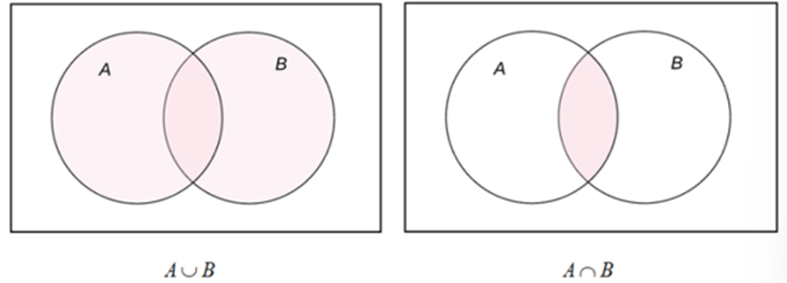
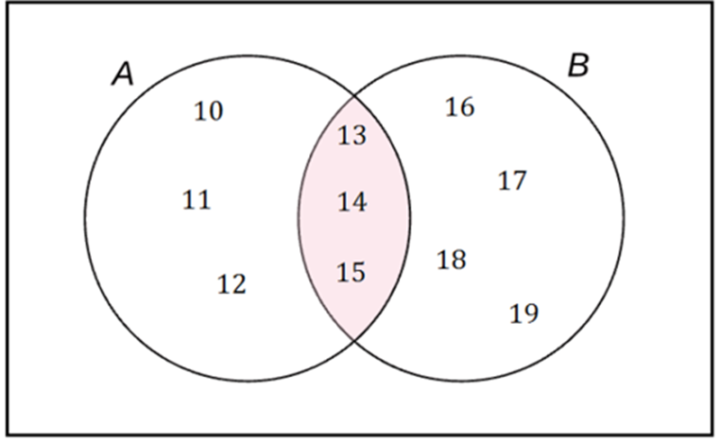
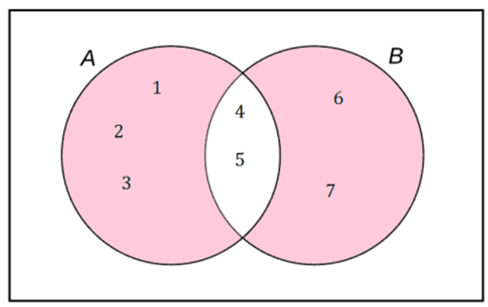
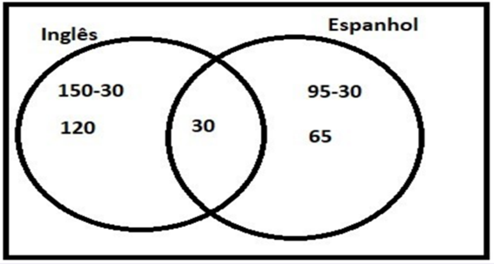
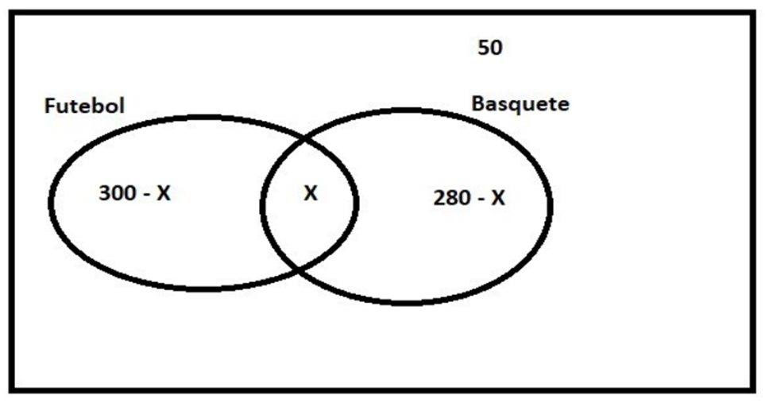
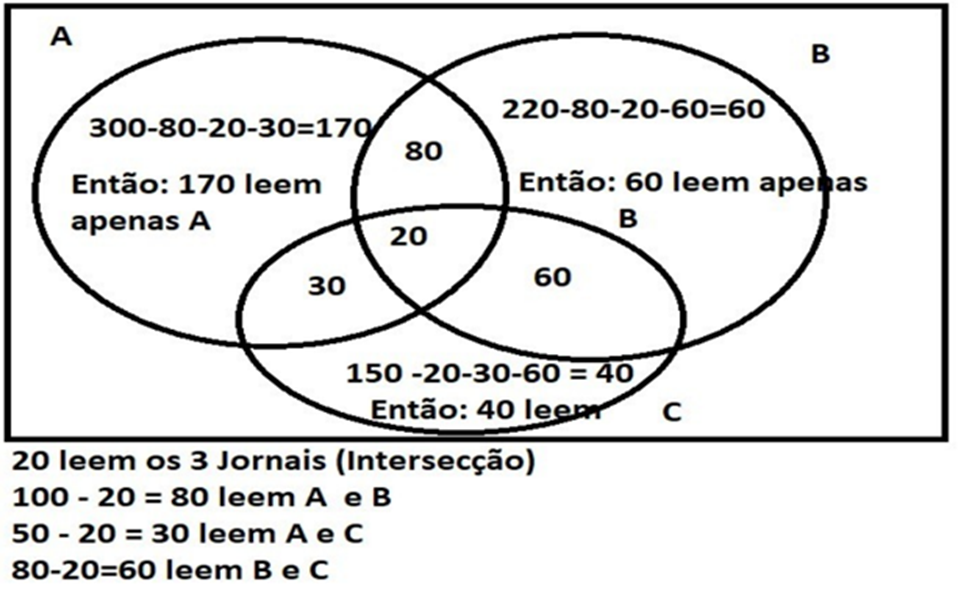
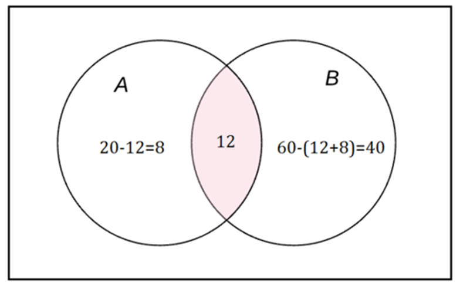

# Aula 3 — Álgebra de Conjuntos

## Ponto de Partida

Olá, estudante! Nesta aula, estudaremos as operações de conjuntos. Conjuntos são coleções não ordenadas de objetos que podem ser, de alguma forma, relacionados. Estudaremos, portanto, que relações são essas, direcionando nosso olhar especialmente para as operações de **união (∪)**, **intersecção (∩)** e **diferença (−)** entre conjuntos.

> Lembre-se de que você foi contratado por uma grande empresa do setor de Tecnologia da Informação (TI) e está trabalhando em uma equipe de desenvolvimento de um aplicativo para telefones móveis. No desenvolvimento desse aplicativo, por sua vez, surgiu um novo problema: a equipe de desenvolvimento de software percebeu que alguns comandos de busca desse aplicativo (ações solicitadas pelo usuário para sua execução) direcionam a busca do usuário para o Banco de Dados A, enquanto outros comandos direcionam a busca do usuário para o Banco de Dados B e, ainda, há comandos que realizam essa busca em ambos os Bancos de Dados (A e B).
>
> Considere que há 20 comandos que direcionam a busca do usuário para o Banco de Dados A, que no total há 60 comandos distintos, e que 12 comandos direcionam a busca para os Bancos de Dados A e B. Você saberia informar quantos desses 60 comandos realizam a busca no Banco de Dados B?
>
> Você deverá apresentar a representação e resolução desse problema à equipe de desenvolvimento de software para que ela decida sobre a viabilidade de unificação desses Bancos de Dados.

Perceba que, apesar de parecer ser um problema de simples solução, é necessário tomar cuidado para não contabilizar comandos em duplicidade. E agora, como resolver essa situação?

Nesta aula, você aprenderá a encontrar a união, a interseção e a diferença entre conjuntos e a utilizar essas relações na resolução de situações-problema como essa. Bons estudos!

---

## Vamos Começar!

Em Matemática, quando nos referimos a operações, automaticamente nos recordamos das operações numéricas fundamentais (adição, subtração, multiplicação e divisão), porém, em Teoria de Conjuntos, também há várias operações que podem ser realizadas. Podemos, por exemplo, somar ou multiplicar os elementos de conjuntos, reuni-los, considerar apenas os elementos comuns, enfim, há uma série de operações que podem ser feitas. Dessas operações, as mais fundamentais são denominadas **união** e **intersecção**. A operação união é representada pelo símbolo **∪** e a operação intersecção pelo símbolo **∩**.

Consideremos, por exemplo, o conjunto M constituído por todos os alunos de uma determinada universidade. Podemos afirmar que o conjunto A formado pelos alunos do curso de Análise e Desenvolvimento de Sistemas dessa mesma universidade, é um subconjunto de M (A ⊆ M), ou seja, cada aluno que pertence ao conjunto A (alunos do curso de Análise e Desenvolvimento de Sistemas) também pertence ao conjunto M (também são alunos da universidade). Analogamente, consideremos também o conjunto B, formado pelos alunos do curso de Matemática dessa mesma universidade, logo, podemos afirmar que B também é subconjunto de M (B ⊆ M).

### União

Um novo conjunto de alunos pode ser definido como consistindo em todos os alunos que sejam estudantes do curso de Análise e Desenvolvimento de Sistemas ou Matemática (ou ambos). Esse conjunto é chamado de **união** de A e B. A operação de união de A e B pode ser denotada como:

> **A ∪ B = { x | x ∈ A ou x ∈ B }**

Nesse exemplo, a união A ∪ B compreende todos os alunos que cursam Análise e Desenvolvimento de Sistemas (A) ou Matemática (B) ou ambos os cursos.

### Intersecção

Outro conjunto pode ser definido como sendo composto por todos os alunos do curso de Análise e Desenvolvimento de Sistemas e de Matemática, ou seja, alunos que cursam simultaneamente ambos os cursos. Esse novo conjunto (que pode ser vazio) é chamado de **intersecção** de A e B. A operação de intersecção de A e B pode ser denotada como:

> **A ∩ B = { x | x ∈ A e x ∈ B }**

Nesse exemplo, a intersecção A ∩ B compreende todos os alunos que cursam simultaneamente Análise e Desenvolvimento de Sistemas (A) e Matemática (B).

> **Nota de revisão:** no material original, esta frase dizia "a **união** A ∩ B compreende..." — o correto é **intersecção**, como indica o próprio símbolo ∩.

### Exemplo 1

Como exemplo, podemos utilizar os conjuntos A = {10, 11, 12, 13, 14, 15} e B = {13, 14, 15, 16, 17, 18, 19}, o conjunto A ∪ B consiste no conjunto formado por todos os elementos de A e de B.

- **A ∪ B = {10, 11, 12, 13, 14, 15, 16, 17, 18, 19}**. Repare que há elementos pertencentes a ambos os conjuntos, porém, ao efetuarmos a operação união (∪), esses elementos são contabilizados uma única vez. Em relação à cardinalidade desses conjuntos, temos que: |A| = 6, |B| = 7 e |A ∪ B| = 10.
- Já o conjunto A ∩ B consiste no conjunto formado pelos elementos comuns aos conjuntos A e B. **A ∩ B = {13, 14, 15}**, temos ainda que |A ∩ B| = 3.

Os Diagramas de Venn podem ser utilizados para ilustrar as operações binárias de união e intersecção de conjuntos. Na Figura 1 visualizamos a imagem mental dessas operações:

**Figura 1** | União e intersecção de conjuntos

A região sombreada no primeiro diagrama representa A ∪ B; já a região sombreada no segundo diagrama representa A ∩ B. A representação do Exemplo 1 por meio de Diagramas de Venn pode ser observada na Figura 2:

**Figura 2** | Exemplo de união e interseção de A e B

---

## Siga em Frente...

### Diferença

Além das operações: união (∪) e intersecção (∩), outra operação que costuma aparecer com frequência ao estudarmos álgebra de conjuntos é a operação **diferença** de conjuntos. Sejam A e B dois conjuntos, a diferença A − B é o conjunto de todos os elementos de A que não estão em B, ou seja:

> **A − B = { x | x ∈ A e x ∉ B }**

Considere, por exemplo, os conjuntos A = {1, 2, 3, 4, 5} e B = {4, 5, 6, 7}. Para determinarmos a diferença A − B temos de verificar quais elementos pertencem ao conjunto A, mas não pertencem ao conjunto B, ou seja, **A − B = {1, 2, 3}**. Analogamente, podemos definir o conjunto B − A, que consiste em todos os elementos pertencentes a B, mas que não pertencem ao conjunto A, ou seja, **B − A = {6, 7}**.

### Diferença simétrica

Outra operação utilizada na álgebra de conjuntos é a chamada **diferença simétrica**. A diferença simétrica de A e B pode ser denotada por A ∆ B. A diferença simétrica de A e B é o conjunto de todos os elementos que pertencem a A, mas não pertencem a B ou que pertencem a B, mas não pertencem a A. Essa diferença simétrica pode ser representada como:

> **A ∆ B = (A − B) ∪ (B − A)**

Considere, por exemplo, os conjuntos A = {1, 2, 3, 4, 5} e B = {4, 5, 6, 7}. A diferença simétrica A ∆ B ficaria definida como:

> A ∆ B = (A − B) ∪ (B − A) = {1, 2, 3} ∪ {6, 7} = **{1, 2, 3, 6, 7}**

> **Nota de revisão:** no material original o resultado estava escrito com parênteses — "(1, 2, 3) ∪ (6, 7) = (1, 2, 3, 6, 7)". Conjuntos se escrevem com **chaves** { }; parênteses indicam pares/listas ordenadas (ver produto cartesiano na Aula 4). Os elementos do resultado não mudam.

Utilizando Diagramas de Venn, a diferença simétrica A ∆ B ficaria representada como observado na Figura 3.

**Figura 3** | Diferença simétrica

### Exemplo 1 — Escola de idiomas

> Uma certa escola de idiomas constatou que:
>
> - 150 alunos estudam inglês.
> - 95 alunos estudam espanhol.
> - 30 alunos estudam inglês e espanhol.
>
> Neste contexto, podemos realizar os seguintes questionamentos.
>
> 1. Quantos alunos estudam somente inglês?
> 2. Quantos alunos estudam apenas 1 (um) idioma?
> 3. Quantos alunos estudam inglês ou espanhol?

Para resolver este problema devemos seguir os seguintes passos:

1. Comece sempre pela **intersecção**, neste caso, 30 alunos estudam inglês e espanhol.
2. Os alunos que estudam **somente inglês** são 150 (menos) 30, que é a intersecção dos alunos que estudam inglês e espanhol.
3. Com relação aos alunos que estudam **somente espanhol**, segue a mesma regra definida na etapa 2, que é o resultado de 95 alunos que estudam espanhol (menos) a intersecção 30.

A Figura 4 ilustra a resolução deste exercício.

**Figura 4** | Resolução do exercício

**Em resumo:**

| Pergunta | Cálculo | Resposta |
|---|---|:---:|
| Somente inglês | 150 − 30 | **120 alunos** |
| Somente um idioma | 120 (somente inglês) + 65 (somente espanhol) | **185 alunos** |
| Inglês ou espanhol | 120 (somente inglês) + 30 (inglês e espanhol) + 65 (somente espanhol) | **215 alunos** |

> **Nota de revisão:** no texto original, a última linha dizia "30 alunos que estudam inglês **ou** espanhol" — o correto é inglês **e** espanhol (a intersecção). O total de 215 não muda.

### Exemplo 2 — Pesquisa sobre esportes

> Uma pesquisa foi realizada com 500 pessoas e os dados obtidos foram:
>
> - 300 pessoas gostam de jogar futebol.
> - 280 pessoas gostam de jogar basquete.
> - 50 pessoas não gostam destes esportes.
>
> Neste contexto, temos a seguinte pergunta: Quantos pessoas gostam de futebol e basquete?

**Resolução:**

A resolução deste exercício será descrita nos passos a seguir:

1. O primeiro passo é desenhar o Diagrama de Venn representado por 2 conjuntos (Futebol e Basquete).
2. A intersecção será representada por **X**, pois é o valor que devemos obter.
3. A quantidade de pessoas que gostam de jogar Futebol será representada por: 300 pessoas (menos) a intersecção que é o valor (X).
4. A quantidade de pessoas que gostam de jogar basquete será representada por: 280 pessoas (menos) a intersecção que é o valor (X).
5. Para descobrir o valor de X, teremos que realizar a seguinte equação:

$$300 - X + X + 280 - X + 50 = 500 \text{ (Total de pessoas)}$$

onde:

- **300 − X** representa a quantidade de alunos que jogam apenas Futebol.
- **280 − X** representa a quantidade de alunos que jogam apenas Basquete.
- **50** é o total de pessoas que não gostam dos 2 esportes.

A Figura 5 ilustra o desenvolvimento deste exercício em forma do Diagrama de Venn.

**Figura 5** | Diagrama de Venn

Neste contexto, podemos destacar que:

$$300 - X + X + 280 - X + 50 = 500$$

$$630 - X = 500$$

$$X = 630 - 500$$

$$X = 130$$

Dessa maneira, podemos concluir que **130 alunos gostam de futebol e basquete**.

### Exemplo 3 — Pesquisa com leitores de jornais

> Uma pesquisa foi feita com 600 leitores, nesta pesquisa os resultados encontrados foram:
>
> - 300 pessoas leem o jornal A.
> - 220 pessoas leem o jornal B.
> - 150 pessoas leem o jornal C.
> - 100 pessoas leem os jornais A e B.
> - 80 pessoas leem os jornais B e C.
> - 50 pessoas leem os jornais A e C.
> - 20 pessoas leem os 3 jornais.
>
> Neste contexto:
>
> 1. Quantos leitores leem apenas 1 jornal?
> 2. Quantos leitores leem apenas 2 jornais?
> 3. Quantos leitores leem o jornal A, B ou C?

**Resolução:**

Para a resolução devemos seguir os seguintes passos:

1. Definir o valor da intersecção, ou seja, quantas pessoas leem os 3 jornais. Neste caso **20** pessoas leem os 3 jornais.
2. Definir quantas pessoas leem **apenas** os jornais A e B. Neste caso 100 pessoas (menos) 20 (que é a intersecção dos 3), com isso chegamos aos valores: 100 − 20 = **80**, ou seja, 80 pessoas leem apenas os jornais A e B.
3. Definir quantas pessoas leem **apenas** os jornais B e C. Neste caso 80 pessoas (menos) 20 que é o valor da intersecção, com isso chegamos aos valores: 80 − 20 = **60** pessoas leem apenas os jornais B e C.
4. Definir quantas pessoas leem **apenas** os jornais A e C. Neste caso 50 pessoas (menos) 20 que é o valor da intersecção: 50 − 20 = **30** pessoas leem apenas os jornais A e C.
5. Para saber quantas pessoas leem **apenas o jornal A**, temos que realizar a seguinte operação: 300 (total de pessoas que leem o jornal A) − 20 (intersecção dos 3) − 80 (apenas A e B) − 30 (apenas A e C). Então temos: 300 − 20 − 80 − 30 = **170**, ou seja, 170 pessoas leem apenas o jornal A.
6. Para saber quantas pessoas leem **apenas o jornal B**, temos que realizar a seguinte operação: 220 (total de pessoas que leem o jornal B) − 20 (intersecção dos 3) − 80 (apenas A e B) − 60 (apenas B e C). Então temos: 220 − 20 − 80 − 60 = **60**, ou seja, 60 pessoas leem apenas o jornal B.
7. Para saber quantas pessoas leem **apenas o jornal C**, temos que realizar a seguinte operação: 150 (total de pessoas que leem o jornal C) − 20 (intersecção dos 3) − 30 (apenas A e C) − 60 (apenas B e C). Então temos: 150 − 20 − 30 − 60 = **40**, ou seja, 40 pessoas leem apenas o jornal C.

> **Nota de revisão:** os resultados finais do material original (170, 60, 40, 270, 170 e 460) estão corretos, mas a descrição dos passos tinha erros, corrigidos acima:
>
> - o passo "A e C" calculava, na verdade, B e C (80 − 20 = 60) — e o cálculo de A e C (50 − 20 = 30) não aparecia;
> - nos passos de "apenas A" e "apenas B", os rótulos estavam trocados: o **80** era chamado de "intersecção dos 3 valores" e o **20** de "intersecção de A e B" — é o contrário (20 = os 3 jornais; 80 = apenas A e B);
> - faltava a palavra "apenas" nas intersecções de dois jornais: 100 pessoas leem A e B, mas só 80 leem **apenas** A e B.

A Figura 6, ilustra o desenvolvimento desta questão, representando os 3 jornais.

**Figura 6** | Diagrama de Venn referente ao terceiro exercício

Neste contexto podemos observar que:

| Pergunta | Cálculo | Resposta |
|---|---|:---:|
| 1) Quantos leitores leem apenas 1 jornal? | 170 (A) + 60 (B) + 40 (C) | **270 leitores** |
| 2) Quantos leem apenas 2 jornais? | 80 + 30 + 60 | **170 leitores** |
| 3) Quantas pessoas leem o jornal A, B ou C? | 170 + 80 + 20 + 30 + 60 + 60 + 40 (a soma de todos) | **460 pessoas** |

---

## Vamos Exercitar?

Você se lembra da situação-problema apresentada no início da seção? Vamos retomá-la?

> Você está trabalhando em uma grande empresa do setor de Tecnologia da Informação (TI) e a sua equipe está responsável pelo desenvolvimento de um aplicativo para telefones móveis. Foi então que você se deparou com um novo problema: a equipe de desenvolvimento de software percebeu que alguns comandos de busca desse aplicativo direcionam a pesquisa do usuário para o Banco de Dados A, outros comandos direcionam a pesquisa do usuário para o Banco de Dados B, e ainda outros que realizam essa busca em ambos os Bancos de Dados (A e B). Sabendo que há 20 comandos que direcionam a busca do usuário para o Banco de Dados A, que no total há 60 comandos distintos e que há 12 comandos que direcionam a busca para os Bancos de Dados A e B, como você determinaria quantos desses 60 comandos realizam a busca no Banco de Dados B? Lembre-se de que você deverá apresentar a representação e resolução desse problema à equipe de desenvolvimento de software para que juntos decidam sobre a viabilidade de unificação desses Bancos de Dados.

Trata-se de um problema envolvendo operações de conjuntos. Uma vez que |A| = 20, |A ∩ B| = 12 e |A ∪ B| = 60, é preciso saber quanto é |B|.

Podemos recorrer ao método de contagem chamado **inclusão-exclusão**, que consiste em:

$$|A \cup B| = |A| + |B| - |A \cap B|$$

Assim, temos que:

$$60 = 20 + |B| - 12$$

$$|B| = 60 - 20 + 12$$

$$|B| = 52$$

Portanto, dos 60 comandos existentes, há **52 comandos** que realizam a busca no Banco de Dados B (incluindo 12 comandos que também realizam a busca no Banco de Dados A).

Para apresentar esse resultado à equipe de desenvolvimento de software, você pode recorrer a um Diagrama de Venn, conforme ilustrado na Figura 7.

**Figura 7** | Problema dos comandos de busca

O diagrama permite ainda aferir que **8 comandos** efetuam a busca apenas no Banco de Dados A enquanto que **40 comandos** efetuam a busca apenas no Banco de Dados B. É devido ao poder de síntese que a utilização de diagramas é recomendada ao se trabalhar com problemas envolvendo conjuntos.

---

## Saiba mais

Álgebra de conjuntos são fundamentais para a compreensão da disciplina Lógica e Matemática Computacional. A seguir, algumas indicações para um estudo profundo sobre o tema.

1. O capítulo 1 (Conjuntos Numéricos) deste livro aborda de uma forma simples os seguintes tópicos mencionados nesta disciplina: (a) conjuntos numéricos. (b) Diagramas de Venn.
   > ARAUJO, L. M. M. et al. **Fundamentos de matemática**. Grupo A, 2018.

2. O capítulo 1 (Teoria dos conjuntos) deste livro aborda de uma forma simples o tópico relacionado aos conjuntos numéricos, aos Diagramas de Venn e às operações em conjunto.
   > LIPSCHUTZ, S.; LIPSON, M. **Matemática discreta**. Grupo A, 2013.

## Referências

- BISPO FILHO, C. A. F.; CASTANHEIRA, L. B.; SOUZA FILHO, O. M. Introdução à lógica matemática. São Paulo: Cengage Learning, 2017.
- FAJARDO, R. Lógica matemática. 1. ed. São Paulo: Edusp, 2017.
- FERREIRA, J. C. Elementos de lógica matemática e teoria dos conjuntos. Lisboa: Departamento de Matemática do Instituto Superior Técnico, 2001.
- MUNDIM, R. P. A Lógica Formal – princípios elementares. Revista Economia & Gestão, Belo Horizonte, v. 2, n. 3, jan./jun. 2002.
- NOVAES, G. P. Reflexões sobre o ensino de conjuntos Diagramas de Venn. Revista do Professor de Matemática, São Paulo, v. 32, n. 84, p. 44-47, maio/ago. 2014.
