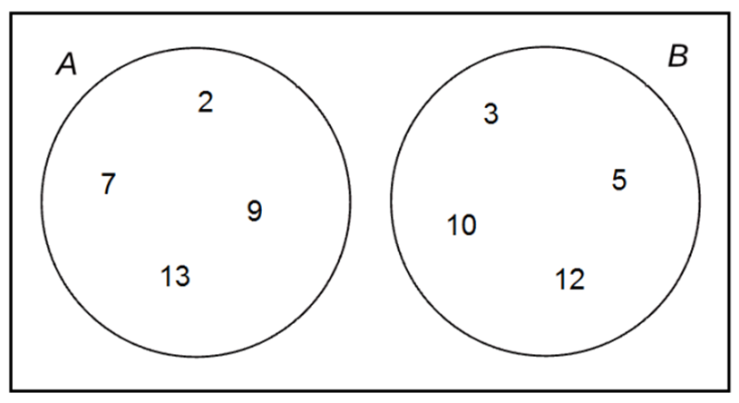
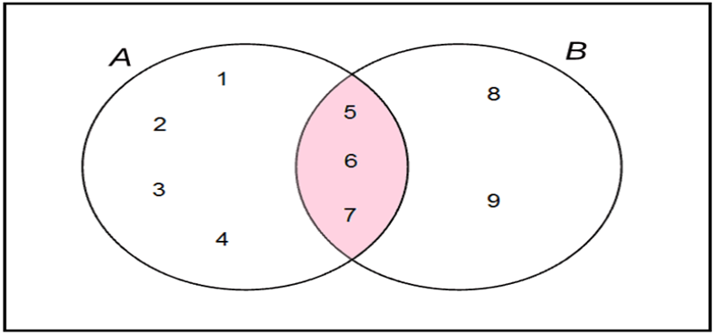
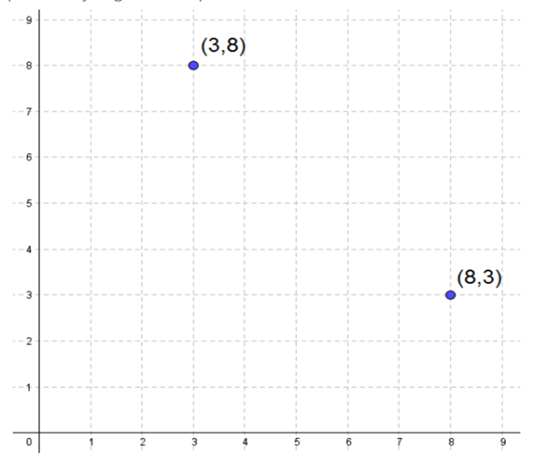
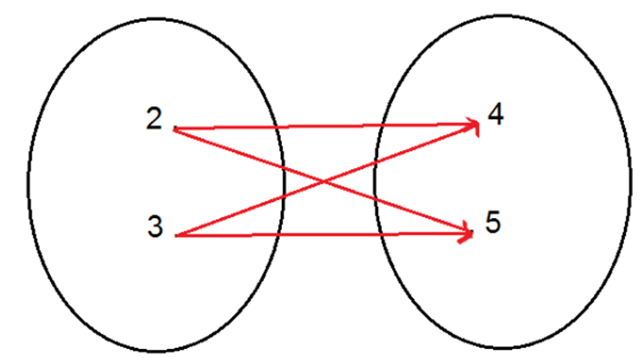
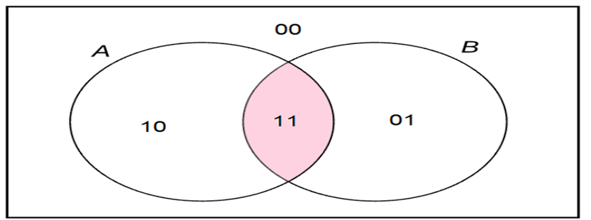
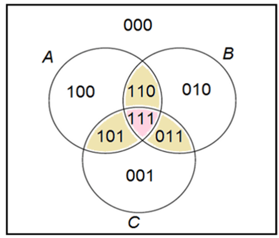

# Aula 4 — Aplicações de Teoria dos Conjuntos

## Ponto de Partida

Olá, estudante! Nesta aula, estudaremos mais algumas operações e relações entre conjuntos, incluindo o **complemento** de um conjunto, a **diferença simétrica** e o **produto cartesiano**.

Imagine, por exemplo, que, em vez de determinar o conjunto de usuários que avaliaram positivamente um determinado aplicativo, você esteja interessado no conjunto de usuários que não forneceu uma avaliação positiva. Ou então, que você precise determinar todas as maneiras pelas quais um elemento de um conjunto pode se relacionar com um elemento de outro conjunto. Essas duas situações servem para ilustrar os conceitos de complemento de conjunto e produto cartesiano que serão estudados nesta seção.

> Como funcionário de uma grande empresa do setor de Tecnologia da Informação (TI), você se depara agora com uma situação inusitada: após trabalhar no desenvolvimento de um aplicativo para telefones móveis, você e sua equipe foram contemplados com um curso de aprimoramento profissional na área de lógica computacional. Um dos desafios do curso consiste em representar uma relação arbitrária de três conjuntos, utilizando diferentes esquemas de representação, como representações diagramáticas (com diagramas) e tabulares (com tabelas).
>
> Embora você já compreenda algumas relações entre conjuntos, sua missão agora é apresentar de maneira original uma relação arbitrária entre três conjuntos A, B e C. Ou seja, você deverá elaborar um esquema que indique se um determinado elemento pertence ao conjunto A, B ou C, considerando todas as intersecções possíveis. Após elaborar sua solução, você deverá realizar uma apresentação para a sua equipe, demonstrando o esquema de representação escolhido e explicando sua interpretação.

Conseguir pensar nas relações entre conjuntos de maneira genérica é um componente importante do que chamamos de raciocínio computacional. Além disso, saber representar essas relações de forma clara, de modo que possam ser compreendidas por outras pessoas da sua equipe de trabalho, é um exercício crucial. Frequentemente, enfrentamos desafios ao tentar expressar nossas ideias por escrito ou visualmente, tornando a capacidade de representação de conjuntos uma habilidade valiosa no ambiente de trabalho!

---

## Vamos Começar!

### Complemento de um conjunto

Em Teoria dos Conjuntos, as operações com as quais trabalhamos mais frequentemente são as operações: união (∪), intersecção (∩) e diferença (−) de conjuntos. Uma nova relação que aprenderemos nesta seção é a operação denominada **complemento** ou **complementar** de um conjunto. O complemento de um conjunto é um conceito estreitamente relacionado com a operação de diferença de conjuntos. O Dicionário Houaiss da Língua Portuguesa (Houaiss, 2009) define complemento como um elemento que se integra a um todo para completá-lo ou aperfeiçoá-lo. Relacionando essa definição com a Teoria de Conjuntos, podemos, de forma simplista, assumir que o complemento de um conjunto significa preencher o que falta.

Quando falamos em complementos de conjuntos, é necessário ter em mente um conjunto mais abrangente (U) sobre o qual estabeleceremos a relação de complementaridade.

Seja o conjunto A um subconjunto de U, ou seja, A ⊆ U. O complemento do conjunto A contido no conjunto U, denotado por $C_U^A$, é a diferença entre os conjuntos U e A, ou seja, é o conjunto de todos os elementos que pertencem ao conjunto U e não pertencem ao conjunto A. Podemos representar simbolicamente essa relação como:

$$C_U^A = U - A = \lbrace x \mid x \in U \text{ e } x \notin A \rbrace$$

que significa que o complemento do conjunto A em relação ao conjunto U equivale à diferença entre os conjuntos U e A que compreende todos os elementos que pertencem a U, mas não pertencem a A.

#### Exemplificando

Seja A = {1, 2, 3, 4, 5, 6, 7, 8, 9, 10} e B = {1, 2, 3, 5, 8, 9}. O complemento de B em relação a A consiste no conjunto constituído por todos os elementos pertencentes a A que não pertencem a B. Temos, portanto:

$$C_B^A = \lbrace 4, 6, 7, 10 \rbrace$$

Em outras palavras, podemos dizer que o complemento de B em relação a A consiste no conjunto formado por elementos que pertencem exclusivamente a A, quando comparados com os elementos de B.

#### Pontos de atenção

Há dois fatos que merecem atenção no estudo do complemento de um conjunto.

**1. Condição de existência.** O primeiro fato ao qual devemos ficar atentos é que para que um conjunto complementar a outro exista, há uma condição que deve ser respeitada: para que haja o cálculo do conjunto complementar de B em relação a A, **B deve ser subconjunto de A**. Então, ao nos depararmos com conjuntos disjuntos, ou com conjuntos que possuem apenas alguns elementos em comum, não é possível obter o conjunto complementar de um deles em relação ao outro. Considere, a título de ilustração, os conjuntos A = {2, 7, 9, 13} e B = {3, 5, 10, 12} (Figura 1).

**Figura 1** | Conjuntos disjuntos

Esses dois conjuntos são **conjuntos disjuntos**, pois a intersecção entre eles é um conjunto vazio. Como B não é subconjunto de A, então não é possível determinar o complemento de B em relação a A. De modo análogo, também concluímos que não é possível determinar o complemento de A em relação a B.

**2. Notação.** Outro fato que também merece atenção diz respeito à maneira como o conjunto complementar é representado simbolicamente. É importante notar que $C_B^A \neq C_A^B$. Para determinarmos $C_B^A$ fazemos A − B, enquanto para determinarmos $C_A^B$ fazemos B − A (lembrando que nem sempre é possível determinar o complemento de um determinado conjunto).

Ainda em relação à representação simbólica (notação) do complementar de um conjunto não há, na literatura, um consenso em relação a essa representação. A representação do complementar do conjunto A em relação ao conjunto universo U pode se dar tanto como $C_A^U$ quanto $C_U^A$.

Quando não há dúvida sobre o universo U em que estamos trabalhando, podemos simplesmente representar o complementar de A em relação a U como $\overline{A}$, ou A', ou ainda, $A^C$.

Desse modo, quando não tivermos dúvida em relação ao conjunto universo U com o qual estamos trabalhando, representaremos o complementar de A em relação a U simplesmente utilizando a notação $A^C$. Por exemplo, considere U = {12, 13, 14, 15, 16, 17, 18} e A = {12, 13, 14, 15}. Neste caso, podemos representar o complementar de A em relação a U simplesmente como **$A^C$ = {16, 17, 18}**.

Vimos, portanto, que o complemento do conjunto A em relação ao conjunto U equivale à diferença entre os conjuntos U e A, dado que A ⊆ U.

### Diferença simétrica

Cabe, nesse momento, chamar a atenção para outro tipo de diferença de conjuntos, denominado **diferença simétrica**. Diferença simétrica de A e B é o conjunto de todos os elementos que pertencem a A, mas não pertencem a B, ou que pertencem a B, mas não pertencem a A. Essa diferença simétrica pode ser representada como **A ∆ B = (A − B) ∪ (B − A)**. Seja A = {1, 2, 3, 4, 5, 6, 7} e B = {5, 6, 7, 8, 9}. A diferença simétrica A ∆ B ficaria definida como:

> A ∆ B = (A − B) ∪ (B − A) = {1, 2, 3, 4} ∪ {8, 9} = **{1, 2, 3, 4, 8, 9}**

> **Nota de revisão:** no material original, o resultado estava escrito com parênteses — "(1, 2, 3, 4) ∪ (8,9) = (1, 2, 3, 4, 8, 9)" — e havia um sinal "−" solto após o ∪. Conjuntos se escrevem com **chaves**; parênteses indicam pares ordenados (ver produto cartesiano abaixo). Os elementos do resultado não mudam.

Essa propriedade pode ser mais bem visualizada por meio do Diagrama de Venn apresentado na Figura 2.

**Figura 2** | Diferença simétrica de conjuntos

### Operação binária e pares ordenados

Outra aplicação que estudaremos no âmbito da Teoria de Conjuntos é a operação denominada **produto cartesiano**. Mas, para entender o que é o produto cartesiano, vamos primeiro definir o que é uma **operação binária**.

Um conjunto, por si só, não é objeto de muito interesse até que se faça algo com seus elementos. Podemos, por exemplo, realizar diversas operações aritméticas sobre os elementos de um determinado conjunto numérico. Tomemos, a título de ilustração, a operação aritmética subtração no conjunto dos números inteiros ℤ. Dizemos que a subtração é uma operação binária em ℤ. Ela é chamada de operação binária pois atua sobre dois números. Considerando a operação aritmética de subtração em ℤ temos que para quaisquer dois inteiros x e y, a operação x − y resultará em uma resposta única, e essa resposta também será um número inteiro. Dizemos, portanto, que a operação de subtração foi realizada sobre um **par ordenado** de números.

Denotamos um par ordenado por **(x, y)** em que x representa o primeiro componente do par ordenado e y, o segundo. A ordem é importante, pois muitas operações não são comutativas. Por exemplo, 8 − 3 não gera o mesmo resultado que 3 − 8. Atente para o fato de que os conjuntos {3, 8} e {8, 3} são iguais, mas os pares ordenados (3, 8) e (8, 3) não. Essa diferença fica muito bem ilustrada quando representamos os pares ordenados em um plano cartesiano, conforme podemos observar na Figura 3.

**Figura 3** | Representação gráfica de pares ordenados

A representação de pares ordenados por meio de pontos no plano cartesiano facilita a compreensão a respeito da importância de se estabelecer uma ordem entre os elementos do par ordenado. O ponto (3, 8) é diferente do ponto (8, 3).

---

## Siga em Frente...

### Produto cartesiano

Agora que já aprendemos o que é uma operação binária entre conjuntos, voltemos à definição de produto de cartesiano. Sejam os conjuntos A e B. O **produto cartesiano** de A e B, denotado por **A × B**, é o conjunto de todos os pares ordenados (listas de dois elementos) formados, tomando-se um elemento de A, juntamente com um elemento de B de todas as maneiras possíveis. Ou seja:

$$A \times B = \lbrace (a, b) \mid a \in A,\ b \in B \rbrace$$

Cabe aqui fazer uma observação em relação à cardinalidade do conjunto obtido através da operação produto cartesiano. No exemplo apresentado temos que |A| = 3, |B| = 3 e conjunto obtido pela operação produto cartesiano A × B tem cardinalidade igual a 9, ou seja, |A × B| = 9.

> **Nota de revisão:** o material original se refere a um "exemplo apresentado" com |A| = 3 e |B| = 3, mas esse exemplo não aparece no texto. Um exemplo que ilustra o caso: A = {1, 2, 3} e B = {x, y, z} → A × B = {(1,x), (1,y), (1,z), (2,x), (2,y), (2,z), (3,x), (3,y), (3,z)}, com 3 · 3 = 9 pares.

Como o produto cartesiano é obtido tomando-se um elemento de A juntamente com um elemento de B de todas as maneiras possíveis, podemos aferir que, sendo A e B conjuntos finitos:

$$|A \times B| = |A| \times |B|$$

Os Diagramas de Venn podem ser adaptados para representar o produto cartesiano entre dois conjuntos. Considere, por exemplo, os conjuntos A = {2, 3} e B = {4, 5}. O produto cartesiano A × B pode ser representado pelos diagramas da Figura 4.

**Figura 4** | Produto cartesiano em diagrama

Temos, portanto, o produto cartesiano **A × B = {(2, 4), (2, 5), (3, 4), (3, 5)}**, como o conjunto formado por todos os pares possíveis formados com os elementos de A e de B.

### Relação arbitrária entre dois conjuntos

Vale destacar que, os Diagramas de Venn também podem ser usados para resolver problemas sobre cardinalidade de conjuntos, isto é, problemas que envolvem a contagem do número de elementos de conjuntos finitos. Mas, o Diagrama de Venn não é apenas um esquema para ajudar o raciocínio. O Diagrama de Venn foi concebido como uma representação diagramática capaz de atender a todas as possíveis relações lógicas entre as classes em estudo, sendo úteis, inclusive, para demonstrar relações arbitrárias entre conjuntos.

Vamos aqui utilizar um Diagrama de Venn para demonstrar uma relação arbitrária entre dois conjuntos A e B (Figura 5). No caso de dois conjuntos A e B, os compartimentos do diagrama representam as partes disjuntas do universo: utilizaremos uma numeração binária, composta apenas pelos algarismos 0 e 1, em que o primeiro algarismo é 0 ou 1, conforme um objeto desse compartimento pertença ou não ao conjunto A, enquanto o segundo algarismo é 0 ou 1, conforme um objeto desse compartimento pertença ou não ao conjunto B.

> **Nota de revisão:** a frase "0 ou 1, conforme pertença ou não" pode confundir pela ordem: na numeração usada, **1 = pertence** e **0 = não pertence** (como mostram os exemplos logo abaixo: 10 = exclusivamente A).

**Figura 5** | Representação diagramática de uma relação arbitrária entre dois conjuntos

A numeração binária mostra que $2^2 = 4$ compartimentos esgotam todas as possibilidades lógicas para um objeto do universo.

| Código | Leitura | Significado |
|:---:|---|---|
| **10** | um, zero | objetos que pertençam exclusivamente ao conjunto A |
| **01** | zero, um | objetos que pertençam exclusivamente ao conjunto B |
| **11** | um, um | objetos que pertençam simultaneamente aos conjuntos A e B (intersecção de A e B) |
| **00** | zero, zero | objetos que não pertencem a nenhum dos conjuntos A e B |

Uma maneira equivalente de representar essa relação arbitrária é a utilização de **tabelas-verdade**, que serão apresentadas posteriormente. Apresentamos na Tabela 1 a tabela-verdade para a relação arbitrária entre dois conjuntos.

| Compartimento | x ∈ A | x ∈ B | x ∈ A ∩ B |
|:---:|:---:|:---:|:---:|
| 00 | F | F | F |
| 01 | F | V | F |
| 10 | V | F | F |
| 11 | V | V | V |

*Tabela 1 | Tabela verdade de uma relação arbitrária entre dois conjuntos*

Na primeira coluna da tabela indicamos os $2^2 = 4$ compartimentos que compõem o Diagrama de Venn para dois conjuntos, representados por números binários. Na segunda coluna anotamos V (verdadeiro) ou F (falso) conforme o objeto representado pelo seu respectivo número binário pertença, ou não, ao conjunto A. Na terceira coluna anotamos V (verdadeiro) ou F (falso) conforme o objeto representado pelo seu respectivo número binário pertença, ou não, ao conjunto B. Finalmente, na última coluna, anotamos V (verdadeiro) ou F (falso) conforme o objeto representado pelo seu respectivo número binário pertença, ou não, ao conjunto A ∩ B.

Nesta aula, pudemos aprender um pouco mais sobre as operações entre conjuntos e suas aplicações. Além de nos debruçarmos sobre as operações de complementar de um conjunto, diferença simétrica e produto cartesiano, também pudemos aplicar a utilização de Diagramas de Venn, tanto na representação de tais operações, quanto na representação de relações arbitrárias entre conjuntos. Compreender a natureza dessas operações é componente importante no desenvolvimento do raciocínio computacional.

---

## Vamos Exercitar?

Você se lembra do desafio apresentado no início desta seção?

> Você está fazendo um curso de aprimoramento profissional sobre lógica computacional e um dos desafios do curso consiste em representar uma relação arbitrária de três conjuntos, A, B e C, utilizando diferentes esquemas de representação, ou seja, você deverá elaborar um esquema que indique se um determinado elemento pertence ao conjunto A, B ou C, considerando todas as intersecções possíveis e, após elaborar sua solução, você deverá realizar uma apresentação para a sua equipe para demonstrar o esquema de representação escolhido e explicar sua interpretação.

Vimos que o Diagrama de Venn, além ser um esquema para ajudar o raciocínio, também consiste em uma representação diagramática capaz de atender a todas as possíveis relações lógicas entre as classes em estudo, sendo úteis, inclusive, para demonstrar relações arbitrárias entre conjuntos.

Portanto, vamos utilizar um Diagrama de Venn para demonstrar uma relação arbitrária entre três conjuntos A, B e C. Utilizaremos uma numeração binária, composta apenas pelos algarismos 0 e 1, em que o primeiro algarismo é 0 ou 1, conforme um objeto desse compartimento pertença ou não ao conjunto A, o segundo algarismo é 0 ou 1, conforme um objeto desse compartimento pertença ou não ao conjunto B e o terceiro algarismo é 0 ou 1, conforme um objeto desse compartimento pertença ou não ao conjunto C (Figura 6).

**Figura 6** | Representação diagramática de uma relação arbitrária entre 3 conjuntos

A numeração binária mostra que $2^3 = 8$ compartimentos esgotam todas as possibilidades lógicas para um objeto do universo.

| Código | Leitura | Significado |
|:---:|---|---|
| **100** | um, zero, zero | objetos que pertençam exclusivamente ao conjunto A |
| **010** | zero, um, zero | objetos que pertençam exclusivamente ao conjunto B |
| **001** | zero, zero, um | objetos que pertençam exclusivamente ao conjunto C |
| **000** | zero, zero, zero | objetos que não pertencem a nenhum dos conjuntos A, B e C |

Temos ainda as intersecções:

| Código | Conjunto |
|:---:|---|
| **110** | $A \cap B \cap C^C$ |
| **101** | $A \cap B^C \cap C$ |
| **011** | $A^C \cap B \cap C$ |
| **111** | $A \cap B \cap C$ |

> **Nota de revisão:** no material original, a terceira intersecção aparecia como "**001** = A^C ∩ B ∩ C". O código correto é **011** (não pertence a A, pertence a B e a C) — o 001 já representa "exclusivamente C".

Vejamos na Tabela 2 como ficaria a tabela-verdade para representação dessa relação:

| Compartimento | x ∈ A | x ∈ B | x ∈ C | x ∈ B ∩ C | x ∈ A ∪ (B ∩ C) |
|:---:|:---:|:---:|:---:|:---:|:---:|
| 000 | F | F | F | F | F |
| 001 | F | F | V | F | F |
| 010 | F | V | F | F | F |
| 011 | F | V | V | V | V |
| 100 | V | F | F | F | V |
| 101 | V | F | V | F | V |
| 110 | V | V | F | F | V |
| 111 | V | V | V | V | V |

*Tabela 2 | Tabela Verdade de uma relação arbitrária entre três conjuntos*

> **Nota de revisão:** a legenda original da Tabela 2 dizia "entre **dois** conjuntos"; o correto é **três** conjuntos (A, B e C).

Na primeira coluna da tabela indicamos os $2^3 = 8$ compartimentos que compõem o Diagrama de Venn para três conjuntos, representados por números binários. Na segunda coluna anotamos V (verdadeiro) ou F (falso) conforme o objeto representado pelo seu respectivo número binário pertença, ou não, ao conjunto A. Na terceira coluna anotamos V (verdadeiro) ou F (falso) conforme o objeto representado pelo seu respectivo número binário pertença, ou não, ao conjunto B. Na quarta coluna anotamos V (verdadeiro) ou F (falso) conforme o objeto representado pelo seu respectivo número binário pertença, ou não, ao conjunto C. Na quinta coluna anotamos V (verdadeiro) ou F (falso) conforme o objeto representado pelo seu respectivo número binário pertença, ou não, à intersecção dos conjuntos B e C. Por fim, na última coluna, anotamos V (verdadeiro) ou F (falso) conforme o objeto representado pelo seu respectivo número binário pertença, ou não, ao conjunto A ∪ (B ∩ C). As proposições apresentadas na primeira linha da tabela foram escolhidas a título de ilustração.

Assim, conseguimos representar uma relação arbitrária entre três conjuntos A, B e C utilizando representações com diagramas e tabelas.

---

## Saiba mais

Aplicações de teoria dos conjuntos são fundamentais para a compreensão da disciplina Lógica e Matemática Computacional. A seguir, algumas indicações para um estudo profundo sobre o tema.

1. O capítulo 1 (Conjuntos Numéricos) deste livro aborda de uma forma simples os seguintes tópicos mencionados nesta disciplina: (a) conjuntos numéricos. (b) Diagramas de Venn e (c) Operações em conjunto.
   > ARAUJO, L. M. M. et al. **Fundamentos de matemática**. Grupo A, 2018.

2. O capítulo 1 (Teoria dos conjuntos) deste livro aborda de uma forma simples o tópico relacionado aos conjuntos numéricos, aos Diagramas de Venn e às operações em conjunto.
   > LIPSCHUTZ, S.; LIPSON, M. **Matemática discreta**. Grupo A, 2013.

## Referências

- ARAUJO, L. M. M. et al. Fundamentos de matemática. Grupo A, 2018.
- LUSTOSA, D. Raciocínio lógico-matemático para concursos públicos: teoria e prática. (Série Provas & Concursos): Grupo GEN, 2023.
- HOUAISS, A. Dicionário eletrônico Houaiss da Língua Portuguesa 3.0. [S. l.]: Objetiva, 2009. CD-ROM.
- SANTOS, M. da S. dos et al. Lógica computacional. Grupo A, 2021.
