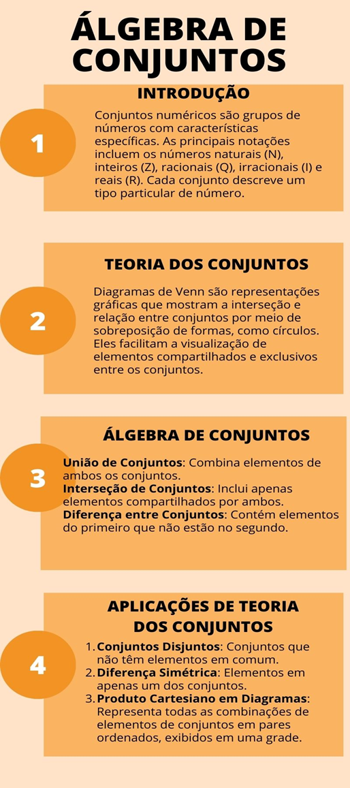

# Aula 5 — Fundamentos da Álgebra de Conjuntos

## Ponto de Chegada

Olá, estudante! Para desenvolver a competência desta Unidade, que é conhecer os fundamentos da álgebra de conjuntos, você deverá primeiramente conhecer os conceitos fundamentos sobre: (a) conjuntos numéricos, (b) notação de conjuntos, (c) operações básicas de conjuntos (união, intersecção, complemento), (d) representação gráfica de operações de conjuntos, (e) por fim diferença simétrica de conjuntos. Bom, então vamos lá.

- **Conjuntos numéricos**: conjuntos numéricos são agrupamentos de números que compartilham características comuns. Os principais conjuntos incluem os números naturais (ℕ), inteiros (ℤ), racionais (ℚ) e reais (ℝ), cada um representando diferentes tipos de números na matemática. Eles são fundamentais para a classificação e as operações matemáticas.
- **Notação de conjuntos**: a notação de conjuntos é uma forma de representar grupos de elementos em matemática. Usa chaves {} para listar elementos e símbolos como ∈ (pertence a) e ∪ (união) para denotar relações entre conjuntos. Por exemplo, {1, 2, 3} é um conjunto com três elementos, e A ⊆ B indica que o conjunto A está contido em B. É uma ferramenta essencial na teoria dos conjuntos e na matemática em geral.
- **Operações básicas de conjuntos (união, intersecção, complemento)**: as operações básicas sobre conjuntos incluem união (∪), intersecção (∩), diferença (\ ou -), complemento (') em relação a um conjunto universal e diferença simétrica (∆). Essas operações permitem combinar, encontrar elementos em comum, subtrair, identificar elementos excluídos e encontrar elementos exclusivos entre conjuntos. São ferramentas fundamentais na teoria dos conjuntos, sendo amplamente utilizadas na resolução de problemas matemáticos e lógicos, bem como em diversas áreas, como estatística e ciência da computação.
- **Representação gráfica de operações de conjuntos**: a representação gráfica das operações de conjuntos é feita por meio de Diagramas de Venn, que usam círculos sobrepostos para ilustrar as relações entre conjuntos. Por exemplo, para representar a união de dois conjuntos, desenhamos dois círculos sobrepostos e colorimos a área combinada. A intersecção é a área em que os círculos se sobrepõem. A diferença é a parte do primeiro conjunto que não se sobrepõe ao segundo. Esses diagramas visuais facilitam a compreensão das operações de conjuntos, especialmente em situações com múltiplos conjuntos.
- **Diferença simétrica de conjuntos**: a diferença simétrica de conjuntos, denotada por ∆, representa os elementos que estão em um ou no outro conjunto, mas não em ambos. Em uma representação gráfica usando diagramas de Venn, a diferença simétrica é a área que está fora da intersecção dos conjuntos, ou seja, a parte que não é compartilhada. Isso significa que a diferença simétrica inclui elementos exclusivos de ambos os conjuntos, mas exclui aqueles que são comuns a ambos. É uma operação que destaca a dissimilaridade entre conjuntos.

| Operação | Símbolo | Resultado |
|---|:---:|---|
| União | ∪ | elementos de A, de B ou de ambos |
| Intersecção | ∩ | elementos comuns a A e B |
| Diferença | \ ou − | elementos de A que não estão em B |
| Complemento | ' | elementos do universo U que não estão em A |
| Diferença simétrica | ∆ | elementos exclusivos de A ou exclusivos de B |

---

## É Hora de Praticar!

### Estudo de Caso: Planejamento Financeiro

> Maria é uma jovem profissional que está começando a pensar em suas finanças pessoais. Ela decidiu estudar os conjuntos numéricos para entender melhor como eles podem ser aplicados em suas decisões financeiras.
>
> Maria tem uma renda mensal de R$ 3.000 e está interessada em economizar dinheiro para várias finalidades, como uma viagem de férias, uma reserva de emergência e investimentos de longo prazo. Ela deseja saber como aplicar os conceitos de conjuntos numéricos para tomar decisões financeiras informadas.

### Reflita

Estudante, neste estudo de caso, nós vamos explorar como Maria usou conjuntos numéricos para planejar suas finanças.

### Resolução do Estudo de Caso

| Conjunto | Uso no planejamento de Maria |
|---|---|
| **Números Naturais (ℕ)** | Maria começa definindo o conjunto dos números naturais (ℕ) para representar a contagem de meses a partir de agora. Ela usará ℕ para planejar a distribuição de suas economias ao longo do tempo. |
| **Números Inteiros (ℤ)** | Maria também reconhece o conjunto dos números inteiros (ℤ) ao considerar que, às vezes, suas finanças podem ser positivas (economias) ou negativas (dívidas). Portanto, ela mantém um controle de seu saldo financeiro no conjunto ℤ. |
| **Números Racionais (ℚ)** | Ao planejar seu orçamento mensal, Maria usa o conjunto dos números racionais (ℚ) para representar as frações de sua renda que ela planeja economizar. Por exemplo, se ela planeja economizar 20% de sua renda, isso é uma fração racional de 0,2. |
| **Números Reais (ℝ)** | Quando Maria decide investir parte de suas economias em ações ou outros ativos financeiros, ela lida com números reais (ℝ). Os valores dos investimentos podem variar ao longo do tempo, e ela precisa considerar números reais para avaliar seu retorno. |

**Aplicação:**

- **Viagem de férias**: para sua viagem de férias, Maria usa o conjunto ℕ para definir um período de 12 meses até a data da viagem. Ela distribui o valor total necessário ao longo desse período, considerando as variações de preço e custos associados.
- **Reserva de emergência**: para sua reserva de emergência, Maria utiliza ℤ para manter um registro de seu saldo financeiro. Ela se certifica de que sempre haja um valor não negativo no conjunto ℤ para garantir que tenha dinheiro disponível em caso de despesas inesperadas.
- **Investimentos de longo prazo**: ao planejar investimentos de longo prazo, Maria lida com números reais (ℝ). Ela analisa diferentes opções de investimento e seus retornos prováveis ao longo do tempo.
- **Orçamento mensal**: para seu orçamento mensal, Maria usa ℚ para representar a porcentagem de sua renda que planeja economizar em seu fundo de emergência, fundo de férias e investimentos.

Maria aprendeu a aplicar os conceitos de conjuntos numéricos em suas finanças pessoais. Ela usa ℕ, ℤ, ℚ e ℝ de forma eficaz para planejar suas economias, monitorar seu saldo financeiro e tomar decisões informadas sobre investimentos. Isso a ajuda a manter suas finanças sob controle e a atingir seus objetivos financeiros de forma mais eficaz.

### Assimile

**Figura 1** | Síntese dos conteúdos abordados durante os estudos

## Referências

- ARAUJO, L. M. M. et al. Fundamentos de matemática. Grupo A, 2018.
- LUSTOSA, D. Raciocínio lógico-matemático para concursos públicos: teoria e prática. (Série Provas & Concursos). Grupo GEN, 2023.
- QUILELLI, P. Raciocínio lógico matemático para concursos. 3. ed. Editora Saraiva, 2015.
- ROSEN, K. H. Matemática discreta e suas aplicações. Grupo A, 2010.
