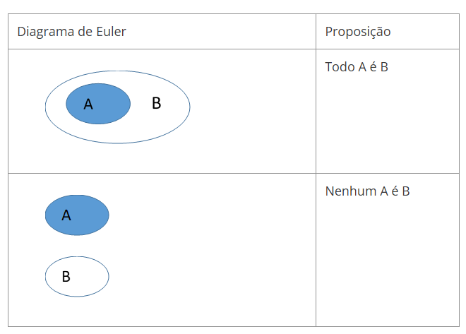

# Aula 1 — Introdução à Lógica Proposicional

## Ponto de Partida

Iniciamos agora nossa introdução à lógica proposicional. Esse conhecimento o capacitará a construir condições lógicas embasadas em regras e a valorar o resultado dessa condição. Sem dúvida, esse conhecimento é imprescindível na construção de algoritmos computacionais.

> Imagine que você está concorrendo a uma vaga de desenvolvedor de software em uma empresa e precisa criar um programa que permita aos funcionários acessar áreas específicas com base em suas permissões. O sistema deve ser capaz de tomar decisões lógicas para permitir ou negar o acesso com base em premissas específicas.
>
> **Premissas:**
>
> - Existem três áreas de acesso na empresa: Sala A, Sala B e Sala C.
> - Existem cinco funcionários: Alice, Bob, Carol, Dave e Eve.
> - Cada funcionário tem um conjunto de permissões que define quais áreas ele pode acessar.
>   - Alice pode acessar a Sala A.
>   - Bob pode acessar a Sala A e a Sala B.
>   - Carol pode acessar a Sala B.
>   - Dave não tem permissão para acessar nenhuma sala.
>   - Eve pode acessar a Sala C.
>
> **Problema:**
>
> Como candidato à vaga de desenvolvedor da empresa, você foi encarregado de implementar um algoritmo que, com base nas premissas citadas anteriormente, determine se um funcionário específico tem permissão para acessar uma determinada área. O algoritmo deve receber o nome de um funcionário e o nome de uma área e retornar uma conclusão lógica sobre se o acesso deve ser permitido ou negado.

Agora é com você! Como você poderá usar as dicas e transformá-las em proposições simples e/ou compostas? Quantas proposições serão necessárias para cada figura geométrica? Quais operadores lógicos você terá que usar para construir as regras? Para vencer esse desafio, nesta seção iremos aprender sobre a lógica proposicional, o que são as proposições simples e como criar as proposições compostas, utilizando os conectivos lógicos de conjunção e disjunção.

> **Nota de revisão:** a pergunta "Quantas proposições serão necessárias para cada **figura geométrica**?" não tem relação com o problema das salas e funcionários — parece ter sobrado de outra versão do material. Leia como "para cada **funcionário/sala**".

Vamos em frente garantir essa vaga de emprego!

---

## Vamos Começar!

Na lógica computacional, vamos utilizar as mesmas regras da Lógica Formal, porém iremos **valorar** os conteúdos, como verdadeiro ou falso, a fim de extrair nossas conclusões.

### Argumentos: premissas e conclusão

Em nosso cotidiano, usamos a linguagem natural para nos expressar por meio de frases, que em alguns casos podem ser argumentativas sendo assim compostas por premissas e conclusões. Vejamos um exemplo extraído de Machado e Cunha (2008, p. 16). Observe o argumento de uma professora sobre o desempenho de um certo aluno:

> "É lógico que Pedro será aprovado nos exames, pois ele é inteligente e estuda muito e todos os alunos inteligentes e estudiosos são aprovados".

Esse argumento foi construído embasado por premissas (razões) e que levam a uma única conclusão, conforme ilustra o Quadro 1.

| Premissas (razões) | Conclusão |
|---|---|
| 1. Pedro é inteligente. 2. Pedro estuda muito. 3. Todos os alunos inteligentes e estudiosos são aprovados. | Pedro será aprovado |

*Quadro 1 | Premissas (razões). Fonte: adaptado de Machado e Cunha (2008, p. 16).*

Veja no Quadro 1 que separamos a frase em premissas e conclusão. Nesse caso, três premissas permitiram chegar a uma conclusão coerente. Extrair essa conclusão do argumento só foi possível devido às regras da lógica proposicional, que por meio de premissas e conectores extraem-se resultados lógicos. Fazer essa separação (premissa / conclusão) é muito importante, pois nem toda frase é um argumento. Além disso, imagina que queiramos criar um algoritmo para classificar se um aluno foi aprovado ou reprovado, essas premissas precisam ser programadas em forma de regras, as quais aprenderemos em breve.

Para ser um argumento é preciso existir uma conclusão, logo, **nem toda frase é um argumento**. Por exemplo:

- a frase "Segure firme!" não possui premissas e conclusões, pois trata-se de uma sentença **imperativa** (ordem);
- a frase "Você pode abrir a porta?" também não é um argumento, pois estamos diante de uma sentença **interrogativa**;
- as sentenças **exclamativas**, como por exemplo, "Que lindo!", "Parabéns!" também não são consideradas argumentos.

### Proposição

No estudo da lógica, além de distinguir se uma frase é ou não um argumento, também é importante distinguirmos se uma sentença pode ou não ser classificada como verdadeira ou falsa (não ambas ao mesmo tempo). Por exemplo, considere as frases:

| # | Frase | Valoração |
|:---:|---|:---:|
| 1 | O Brasil é um país da América Latina. | Verdadeira |
| 2 | Minas Gerais é um estado do Nordeste. | Falso |
| 3 | São Paulo é a capital do Paraná. | Falso |
| 4 | Três mais um é igual a quatro. | Verdadeira |
| 5 | Que horas são? | ? |

As quatro primeiras frases podem ser classificadas (valoradas) em verdadeira (V) ou falso (F). Mas a quinta frase não pode ser valorada em V ou F, pois a resposta é um certo horário.

Essa distinção entre os tipos de sentenças é crucial para o estudo da lógica, pois uma frase que pode ser classificada como verdadeira ou falsa (não ambas ao mesmo tempo) é chamada **proposição**.

> **Proposição** é uma sentença declarativa que pode ser classificada como verdadeira ou falsa, jamais ambas ao mesmo tempo. Ou seja, não pode haver dúvida quanto à classificação da sentença. Também podemos dizer que se trata de uma classificação binária, pois só existem dois resultados possíveis: V ou F, ou ainda 1 ou 0.

---

## Siga em Frente...

Nem sempre classificar se uma sentença é ou não uma proposição é uma tarefa trivial. Para que seja uma proposição, a sentença declarativa não pode deixar dúvidas quanto ao resultado. Por exemplo, a sentença "Está chovendo agora" não pode ser classificada como V ou F, pois deixa dúvida (por exemplo, pode estar chovendo em um ponto da cidade e em outro não). Para que essa frase se torne uma proposição ela precisa de um contexto, por exemplo, "Está chovendo agora na minha rua", ou seja, o locutor da frase especificou o local, então agora é possível valorar se o que ele disse é verdadeiro ou falso.

Sabendo que uma proposição é uma sentença declarativa que pode ser classificada como V ou F, podemos encontrá-la nas mais diversas formas. Observe o Quadro 2. Nele temos diagramas de Euler representando conjuntos e sentenças que podem ser classificadas como V ou F, baseado no diagrama, portanto, são proposições.

*Quadro 2 | Diagramas de Euler e proposições*

Podemos utilizar letras maiúsculas do alfabeto para representar as proposições, portanto, a partir de agora adotaremos essa notação para representar as proposições. Por exemplo:

- **A**: Quinze é menor que vinte.
- **B**: Todos os italianos são europeus.

### Princípios básicos

Segundo Bispo e Castanheira (2011), toda proposição deve seguir três princípios básicos:

| Princípio | Enunciado | Forma (sendo P uma proposição) |
|---|---|---|
| **Identidade** | "Toda proposição é idêntica a si mesma". | P é P |
| **Não Contradição** | "Uma proposição não pode ser verdadeira e falsa ao mesmo tempo". | não (P e não P) |
| **Terceiro excluído** | "Toda proposição ou é verdadeira ou é falsa, não existindo um terceiro valor que ela possa assumir". | P ou não P |

### Proposições simples e compostas

As proposições podem ser classificadas como **simples** ou **compostas**. A proposição será simples quando existir uma única afirmação na frase. Por outro lado, uma proposição é composta quando for constituída de, pelo menos, duas proposições simples "ligadas" por um **conectivo lógico**, também chamado de conector lógico, conectivo proposicional ou operação lógica.

#### Exemplificando

Observe as proposições A, B, C a seguir:

- **A**: 11 é um número ímpar.
- **B**: 11 é um número primo.
- **C**: 11 é um número ímpar e primo.

As proposições A e B são compostas por uma única verdade.

- A: verdadeira
- B: verdadeira

Já a proposição C é composta por duas proposições simples (nesse caso, pelas proposições A e B) que são ligadas pela palavra "e". A valoração da proposição C depende da valoração independente de A e de B, aplicada ao operador lógico que está unindo as duas proposições simples. Veremos em breve como fazer essa valoração.

#### Exemplos

**Exemplo a:** Considere a frase: "Os suíços fabricam os melhores relógios e os franceses, o melhor vinho". Se extrairmos as proposições simples das frases teremos:

- **P**: Os suíços fabricam os melhores relógios.
- **S**: Os franceses fabricam o melhor vinho.

Podemos reescrever a frase, utilizando uma notação simbólica, então o resultado será: **P e S**. Veja que temos a palavra "e" ligando as duas proposições simples.

**Exemplo b:** Considere a frase: "Se eu prestar atenção na aula, então tirarei boa nota na prova". Novamente, se extrairmos as proposições simples das frases teremos:

- **A**: Eu presto atenção na aula.
- **R**: Eu tiro boa nota na prova.

Veja que ao extrair as proposições simples, podemos fazer adequações nos verbos, o mesmo acontece quando usamos proposições simples para fazer as compostas.

### Exercício 1

> Considere as seguintes premissas:
>
> 1. Todos os seres humanos são mortais.
> 2. Sócrates é um ser humano.
>
> Usando essas premissas, determine a conclusão lógica.

**Solução:**

- **Premissa 1**: Todos os seres humanos são mortais.
- **Premissa 2**: Sócrates é um ser humano.

A conclusão lógica que podemos tirar dessas premissas é:

- **Conclusão**: Sócrates é mortal.

Isso segue a lógica do **silogismo**, que é uma forma comum de raciocínio lógico. O silogismo é uma forma de argumento em que se conclui uma proposição a partir de duas outras premissas que são relacionadas. Neste caso, a primeira premissa estabelece uma relação geral entre todos os seres humanos e sua mortalidade, e a segunda premissa identifica Sócrates como um ser humano específico. A conclusão lógica é que, se Sócrates é um ser humano, ele também é mortal, com base nas premissas dadas.

### Exercício 2

> Considere as seguintes premissas:
>
> 1. Todos os mamíferos têm espinha dorsal.
> 2. Todos os cães são mamíferos.
> 3. Max é um cão.
>
> Usando essas premissas, determine a conclusão lógica.

**Solução:**

- **Premissa 1**: Todos os mamíferos têm espinha dorsal.
- **Premissa 2**: Todos os cães são mamíferos.
- **Premissa 3**: Max é um cão.

A conclusão lógica que podemos tirar dessas premissas é:

- **Conclusão**: Max tem uma espinha dorsal.

A primeira premissa estabelece uma relação geral entre mamíferos e a presença de uma espinha dorsal. A segunda premissa afirma que todos os cães são mamíferos, e a terceira premissa identifica Max como um cão. Portanto, com base nas premissas, podemos concluir que Max, como um cão (que é um mamífero), também tem uma espinha dorsal.

---

## Vamos Exercitar?

Chegou a hora de pensarmos como resolver seu desafio de lógica para a vaga de desenvolvedor trainee de uma grande empresa de tecnologia.

> Imagine que você está concorrendo a uma vaga de desenvolvedor de software em uma empresa e precisa criar um programa que permita aos funcionários acessar áreas específicas com base em suas permissões. O sistema deve ser capaz de tomar decisões lógicas para permitir ou negar o acesso com base em premissas específicas.

**Premissas:**

- Existem três áreas de acesso na empresa: Sala A, Sala B e Sala C.
- Existem cinco funcionários: Alice, Bob, Carol, Dave e Eve.
- Cada funcionário tem um conjunto de permissões que define quais áreas ele pode acessar:

| Funcionário | Sala A | Sala B | Sala C |
|---|:---:|:---:|:---:|
| Alice | ✔ | | |
| Bob | ✔ | ✔ | |
| Carol | | ✔ | |
| Dave | | | |
| Eve | | | ✔ |

**Problema:**

Como desenvolvedor da empresa, você foi encarregado de implementar um algoritmo que, com base nas premissas citadas anteriormente, determine se um funcionário específico tem permissão para acessar uma determinada área. O algoritmo deve receber o nome de um funcionário e o nome de uma área e retornar uma conclusão lógica sobre se o acesso deve ser permitido ou negado.

**Conclusões:**

Para resolver o problema, você pode usar a seguinte lógica:

- **Se** o funcionário tem permissão para acessar a área, a conclusão é "Acesso Permitido."
- **Se** o funcionário não tem permissão para acessar a área, a conclusão é "Acesso Negado."

Aqui estão alguns exemplos de conclusões com base nas premissas:

| Funcionário | Área | Conclusão |
|---|---|---|
| Alice | Sala A | "Acesso Permitido." |
| Bob | Sala C | "Acesso Negado." |
| Dave | Sala B | "Acesso Negado." |

Você pode implementar esse algoritmo em uma linguagem de programação de sua preferência, e testá-lo com diferentes combinações de funcionários e áreas para verificar se ele está produzindo as conclusões corretas com base nas premissas fornecidas.

Este estudo de caso demonstra a aplicação de lógica e matemática computacional para resolver um problema prático de tomada de decisões com base em premissas definidas.

---

## Saiba mais

Os fundamentos da lógica são fundamentais para a compreensão da disciplina Lógica e Matemática Computacional. A seguir, algumas indicações para um estudo profundo sobre o tema.

1. O capítulo 1 deste livro além de aborda de uma forma simples proposições em lógica e matemática computacional.
   > BISPO, C. A. F.; CASTANHEIRA, L. B.; FILHO, O. M. S. **Introdução à lógica matemática**. Cengage Learning Brasil, 2017.

2. O capítulo 4 deste livro aborda de uma forma simples o tópico de proposições e sentenças.
   > ROSEN, K. H. **Matemática discreta e suas aplicações**. Grupo A, 2010.

## Referências

- BISPO, F.; CASTANHEIRA, L. B. Introdução à lógica matemática. São Paulo: Cengage Learning, 2011.
- GERSTING, J. L. Fundamentos matemáticos para a ciência da computação. Tradução de Valeria de Magalhaes Iorio. 7. ed. Rio de Janeiro: LTC, 2017.
- MACHADO, N. J; CUNHA, M. O. da. Lógica e linguagem cotidiana: verdade, coerência, comunicação, argumentação. 2. ed. Belo Horizonte: Autêntica, 2008.
- SANTOS, M. da S. dos et al. Lógica computacional. Porto Alegre: SAGAH, 2021.
