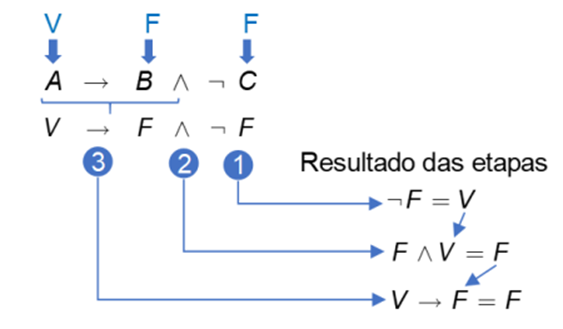
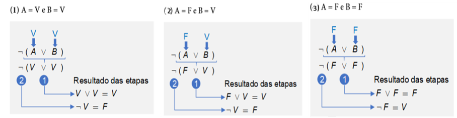
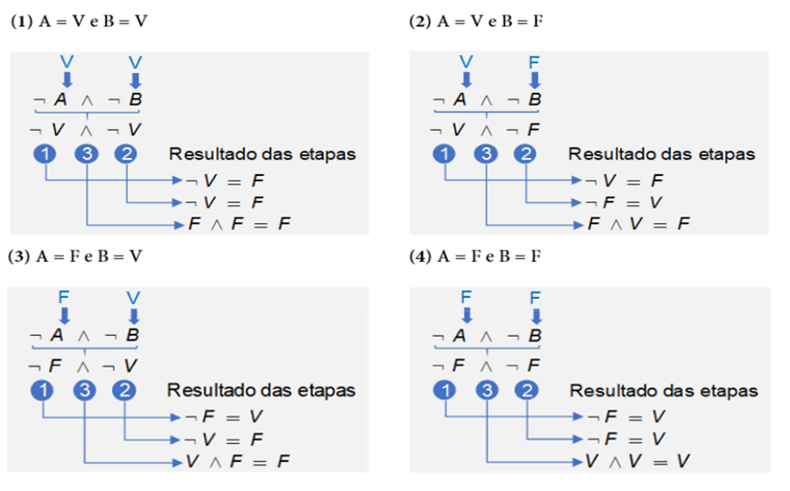

# Aula 2 — Conectivos e Classificação Textual

## Ponto de Partida

Olá, estudante! Iniciamos agora mais uma aula do nosso estudo de introdução à lógica proposicional. Nesta nova etapa, você aprenderá novos conectivos lógicos, o que lhe possibilitará valorar proposições compostas mais complexas, desenvolvendo suas habilidades de aplicar a lógica proposicional com suas regras e formas. Você já deve ter ouvido e falado muito frases do tipo "Se chover, eu não vou sair de casa", ou então "Se eu ganhar na loteria, não vou mais trabalhar!". Esse tipo de frase possui uma estrutura lógica embasada em uma condição: se algo acontecer, então outro evento também irá acontecer. Nesta seção, vamos entender esse tipo de estrutura lógica, bem como outros importantes conceitos.

> Imagine que Carlos é um funcionário de uma empresa e está planejando suas férias de verão. Ele tem duas opções para suas férias: uma viagem à praia ou um passeio pelas montanhas.
>
> **Informações sobre Carlos:**
>
> 1. Carlos gosta de ambas as opções, mas tem preferência por montanhas, pois gosta de esportes ao ar livre.
> 2. No entanto, Carlos também considera o fato de que alguns de seus amigos vão para a praia durante o mesmo período de férias.
>
> **Problema:**
>
> Carlos quer tomar uma decisão sobre onde passar suas férias de verão, considerando suas preferências pessoais e o desejo de passar um tempo com seus amigos.

Carlos está confrontando um dilema em relação à escolha de seu destino de férias de verão. Ele aprecia as duas opções disponíveis, mas deve decidir com base em suas preferências pessoais e outros fatores, como o desejo de passar um tempo com amigos que planejam uma viagem à praia durante o mesmo período de férias.

Por fim, ele precisa tomar uma decisão que leve em consideração suas preferências e a oportunidade de desfrutar da companhia de seus amigos na praia. A problematização se concentra na aplicação do conectivo lógico de disjunção (ou "ou") para resolver esse dilema.

Agora é com você! Para vencer esse desafio, nesta seção iremos aprender sobre os fundamentos da lógica, seus conectivos e por fim o conceito de fórmulas bem-formuladas (fbf).

> **Nota de revisão:** o material original escreve "fórmulas bem **faturadas**" — o termo correto é fórmula **bem-formulada** (ou bem-formada), como a própria aula usa mais adiante.

Vamos em frente para desvendar este mistério!

---

## Vamos Começar!

### Conectivo lógico de conjunção – e (∧)

Vamos começar estudando o conectivo lógico "e", que também pode ser visto na literatura escrito em inglês **AND** ou ainda por meio do seu símbolo **∧**. Essa operação lógica é chamada **conjunção** e sua valoração será verdadeira somente quando ambas as proposições simples forem verdadeiras. Resumindo, se A e B forem proposições simples verdadeiras, a proposição composta A ∧ B (lê-se "A e B") será verdadeira. Para compreendermos melhor, considere as proposições a seguir:

- **A**: Quatro é um número par.
- **B**: Três é um número ímpar.
- **C**: Cinco é maior que dez.
- **P**: Quatro é um número par e três é um número ímpar.
- **R**: Quatro é um número par e cinco é maior que dez.

Vamos começar valorando as proposições simples (A, B, C): A: verdadeira. B: verdadeira. C: falsa.

Para facilitar nossa compreensão, vamos reescrever as proposições P, R utilizando notação simbólica, portanto temos:

- **P**: A ∧ B
- **R**: A ∧ C

Na proposição P temos que as proposições simples A, B são verdadeiras, portanto, P = V e V, o que resulta em **verdadeiro**, ou seja, a proposição P pode ser valorada como verdadeira. Já na proposição R, temos que A é verdadeiro, mas C é falso, portanto, R = V e F, o que resulta em **falso**, ou seja, a proposição R deve ser valorada como falsa, já que para essa operação lógica ambas as proposições precisam ser verdadeiras para o resultado também ser verdadeiro.

### Conectivo lógico de disjunção – ou (inclusivo) (∨)

Outro conector muito utilizado tanto na Lógica Formal, quanto na computacional é "ou" que também pode ser visto na literatura escrito em inglês **OR** ou ainda por meio do seu símbolo **∨**. Essa operação lógica é chamada de **disjunção** e seu operador lógico pode ser utilizado de duas formas distintas: inclusivo ou exclusivo. Veremos nesta seção a forma inclusiva do operador.

O operador lógico de disjunção usado na forma inclusiva terá sua valoração falsa somente quando ambas as proposições simples forem falsas. Resumindo, se A e B forem proposições simples falsas, a proposição composta A ∨ B (lê-se "A ou B") será falsa, nos demais casos a valoração é verdadeira. Para compreendermos melhor, considere as proposições a seguir:

- **A**: Quatro é um número par.
- **B**: Três é um número ímpar.
- **C**: Cinco é maior que dez.
- **D**: Sete é um número par.
- **P**: Quatro é um número par ou três é um número ímpar.
- **R**: Quatro é um número par ou cinco é maior que dez.
- **S**: Cinco é maior que dez ou sete é um número par.

Vamos começar valorando as proposições simples (A, B, C, D):

- A: verdadeira.
- B: verdadeira.
- C: falsa.
- D: falsa.

Para facilitar nossa compreensão, vamos reescrever as proposições P, R, S utilizando notação simbólica, portanto, temos:

- **P**: A ∨ B
- **R**: A ∨ C
- **S**: C ∨ D

Na proposição P temos que as proposições simples A, B são verdadeiras, portanto, P = V ou V, o que resulta em **verdadeiro**, ou seja, a proposição P pode ser valorada como verdadeira. Na proposição R, temos que A é verdadeira, mas C é falsa, portanto, R = V ou F, como se trata da disjunção inclusiva, o resultado será **verdadeiro**, pois para ser falso ambas as proposições simples têm que ser falsas. Já na proposição S, temos que C, D são proposições simples falsas, portanto, S = F ou F, o que resulta em **falso**.

**Resumo da valoração:**

| A | B | A ∧ B | A ∨ B |
|:---:|:---:|:---:|:---:|
| V | V | V | V |
| V | F | F | V |
| F | V | F | V |
| F | F | F | F |

---

## Siga em Frente...

### Operador lógico de negação – não (¬)

Os operadores lógicos de conjunção e disjunção são **binários**, ou seja, juntam duas expressões para formar uma nova proposição. O operador lógico de negação é **unário**, ou seja, ele não junta duas proposições, ele age sobre uma única proposição (que pode ser resultado de uma operação binária). A palavra usada para fazer a negação é o **não** que também pode ser visto na literatura em inglês **NOT**, ou ainda de forma simbólica como **~**, **¬**, **'**. Os dois primeiros símbolos são usados antes da letra que representa a proposição, já o terceiro é usado depois da letra. Por exemplo, as expressões: ~A, ¬B, C' representam as negações das proposições A, B, C.

A operação lógica de negação troca o valor-verdade da proposição. Ou seja, se a proposição é verdadeira, quando acompanhada do operador de negação passará a ser falsa; por outro lado, se ela for falsa passará a ser verdadeira. Vejamos um exemplo, considere a proposição:

- **A**: Luís gosta de viajar.

A negação de A (~A) pode ser lida como:

- ~A: Luís não gosta de viajar.
- ~A: É falso que Luís gosta de viajar.
- ~A: Não é verdade que Luís gosta de viajar.

### Conectivo condicional (Implicação lógica) – se... então (→)

Dadas as proposições simples A, B, elas formam uma **condicional** (ou implicação lógica) se for possível construir a estrutura: se A, então B. A primeira proposição é chamada **antecedente**, e a segunda **consequente**. A condicional significa que a verdade da primeira proposição implica a verdade da segunda proposição (Gersting, 2017). O símbolo usado para representar a implicação lógica é o **→**, logo a regra se A, então B, pode ser escrita como **A → B**.

#### Exemplificando

Considere as proposições a seguir:

- **P**: João estuda para a prova.
- **R**: João passa de ano.

A proposição P → R (lê-se Se P, então R), deve ser traduzida como: *Se João estudar para a prova, então passará de ano.* Veja que para fazer sentido a composição da sentença condicionada, ajustamos os verbos estudar e passar. Mas o que realmente importa é entender a condição que foi criada. Veja que a proposição R está condicionada à proposição P, ou seja, R depende de P para acontecer.

> **Nota de revisão:** o material original diz "a proposição **B** está condicionada à proposição **A**", mas o exemplo usa as letras **P** e **R**. Ajustado para R e P.

Na valoração do condicional, se o antecedente e o consequente forem verdadeiros então o resultado será verdadeiro. Ou seja, **V → V = V**. Porém, se o antecedente for verdadeiro e o consequente for falso, o resultado será falso (**V → F = F**). Vejamos um exemplo:

- **A**: O interruptor da sala foi desligado.
- **B**: A luz da sala apagou.
- **C**: A → B.

A proposição C deve ser traduzida como "Se o interruptor da sala for desligado, então a luz se apagará". Se as duas proposições realmente acontecerem, então temos o caso V → V = V, ou seja, C é verdade. Porém, se o interruptor for desligado, mas por algum motivo a luz não se apagar, então temos o caso V → F = F, ou seja, C é falso.

> **Reflita:** Em um condicional existe o antecedente e o consequente, ou seja, uma proposição depende da outra. Se trocarmos a ordem do antecedente pelo consequente alteramos o resultado da condição? Quais implicações essa troca poderia trazer ao algoritmo?

#### Condicional em algoritmos

Na construção de algoritmos, os condicionais são amplamente utilizados, veja o que nos diz um grande autor da área da computação: *"Do ponto de vista computacional, uma condição é uma expressão booleana cujo resultado é um valor lógico falso ou verdadeiro. Assim, uma expressão booleana como condição é conseguida com uma relação lógica entre dois elementos e um operador relacional"*. Veja que na computação usamos o mesmo recurso da Lógica Formal. A expressão booleana mencionada refere-se à álgebra Booleana que está embasada na Lógica Clássica. Uma expressão booleana é uma proposição que resultará em verdadeiro ou falso.

Na construção de algoritmos, o condicional aparece nas estruturas de decisão, também chamada **Desvio Condicional**. O nome "desvio" representa exatamente o que acontece em um algoritmo, quando aparece um condicional, pois dependendo do resultado (V ou F) o programa fará uma ação diferente. Por exemplo, imagine que estamos implementando um software para uma loja que oferece opções de pagamento à vista ou a prazo. Caso o comprador pague à vista ele terá um desconto de 10% na compra, que deve ser aplicado pelo próprio sistema. Pois bem, dadas as proposições:

- **A**: Pagamento feito à vista.
- **B**: Conceder desconto de 10%.

No algoritmo deverá ser implementada a regra: **A → B**. "Se o pagamento for à vista, então será concedido um desconto de 10%". A expressão "Se... então" é a mais comum de se utilizar para o condicional, até mesmo porque na construção de algoritmos usamos exatamente essas palavras. Mas a implicação lógica pode ser escrita de outras formas, conforme ilustra o Quadro 1, que nos apresenta oito formas diferentes de "traduzir" essa expressão lógica.

| Expressão em português | Conectivo lógico | Expressão lógica |
|---|:---:|:---:|
| Se A, então B A condicional B A, logo B A só se B; A somente se B B segue de A A é uma condição suficiente para B Basta A para B B é uma condição necessária para A | Condicional | A → B |

*Quadro 1 | Expressões para condicional. Fonte: adaptado de Gersting (2017, p. 4).*

### Conectivo Bicondicional – se, e somente se (↔)

Dadas as proposições simples A, B, elas formam uma **bicondicional** se for possível construir a estrutura: A se, e somente se, B. O símbolo usado para representar esse conectivo é o **↔**, então a expressão A se, e somente se, B, pode ser expressa simbolicamente por **A ↔ B**. Vejamos um exemplo. Considere as proposições a seguir:

- **P**: Lucas receberá o dinheiro.
- **Q**: Lucas completará o trabalho.
- **S**: P ↔ Q.

> **Nota de revisão:** no material original estava "S: **A ↔ B**", mas as proposições do exemplo são **P** e **Q**.

A proposição S, deve ser traduzida como "Lucas receberá o dinheiro se, e somente se, completar o trabalho".

Segundo Gersting (2017), o bicondicional é um atalho para a expressão lógica: **(A → B) ∧ (B → A)**. Nessa expressão temos a conjunção entre o resultado de duas condicionais que alteram seus antecedentes e consequentes. Para ficar mais claro, usando as proposições P, Q criadas anteriormente, dizer que "Lucas receberá o dinheiro se, e somente se, completar o trabalho" é o mesmo que dizer "Se Lucas receber o dinheiro então completará o trabalho e se Lucas completar o trabalho então receberá o dinheiro". Como podemos observar, o bicondicional resume a sentença, facilitando até mesmo a compreensão. A valoração do conectivo bicondicional será verdadeira quando o valor-lógico das duas proposições forem iguais, tanto para verdadeiro como para falso. Ou seja, **V ↔ V = V** e **F ↔ F = V**.

**Resumo dos conectivos:**

| Conectivo | Símbolo | Leitura | É falso quando... |
|---|:---:|---|---|
| Negação | ¬ (ou ~, ') | não A | A é verdadeira |
| Conjunção | ∧ | A e B | pelo menos uma é falsa |
| Disjunção (inclusiva) | ∨ | A ou B | ambas são falsas |
| Condicional | → | se A, então B | A é V e B é F |
| Bicondicional | ↔ | A se, e somente se, B | A e B têm valores diferentes |

### Fórmula bem-formulada ou fbf

Já sabemos que é possível criar proposições compostas, fazendo conexões entre proposições simples. Na verdade, podemos encadear proposições, conectivos e parênteses (ou colchetes) e formar novas expressões lógicas, as quais chamamos **fórmula**. Por exemplo, como a que vimos no conectivo bicondicional (A → B) ∧ (B → A). Embora "Uma sequência qualquer de elementos do vocabulário do cálculo proposicional constitui uma fórmula", nem toda fórmula é válida. Segundo Gersting (2017), certas regras de sintaxe precisam ser seguidas, assim como acontece em qualquer linguagem de programação.

Podemos fazer uma analogia entre as fórmulas do cálculo proposicional com as fórmulas matemáticas. Os conectivos lógicos são como os operadores matemáticos (soma, subtração, etc.), portanto sempre teremos um conectivo entre duas proposições. O operador de negação é como o sinal negativo na matemática e, por isso, ele pode aparecer perto de outro conector. Uma fórmula que segue as regras de sintaxe é chamada de **fórmula bem-formulada** ou ainda, em inglês, *well-formed formula* – **wff**. Observe o Quadro 2. Nele temos três exemplos de fórmulas matemáticas, três de fórmulas válidas (fbf) e três de fórmulas inválidas.

| Linha | Expressão matemática | fbf | Não fbf |
|:---:|---|---|---|
| 1 | (2+3)x5 | (A → B) ∨ C | *(símbolos perdidos na extração)* |
| 2 | (3+4)x(2+3) | (A → B) ∧ (B → A) | *(símbolos perdidos na extração)* |
| 3 | 2+3x-5 | A → B ∧ ¬C | *(símbolos perdidos na extração)* |

*Quadro 2 | Fórmulas matemáticas e proposicional*

> **Nota de revisão:** na extração do material, os símbolos lógicos do Quadro 2 se perderam. A coluna **fbf** foi reconstruída a partir do próprio texto da aula (linha 1 = condicional seguida de **disjunção**; linha 2 = conjunção de duas condicionais; linha 3 = A → B ∧ ¬C, valorada na Figura 1). A coluna **Não fbf** ficou ilegível no original (sobraram só "AA B", "AB" e "B") e **não foi possível recuperá-la** — a ideia é que são sequências que quebram a sintaxe, como dois conectivos seguidos sem proposição entre eles ou proposições sem conectivo entre elas.

#### Ordem de precedência

Vamos começar a analisar as fórmulas do Quadro 2 falando sobre os parênteses. Na fórmula matemática da linha 1, o resultado é 25, certo? E se não tivesse parênteses delimitando a adição, o resultado seria o mesmo? A resposta é não, o resultado seria 17, afinal a multiplicação tem precedência de resolução sobre a adição. Na fbf da linha 1 também temos parênteses e o motivo é o mesmo da expressão matemática: queremos que a condicional seja resolvida antes da disjunção. Portanto, os parênteses no cálculo proposicional também têm o papel de delimitar e indicar quais operações devem ser efetuadas primeiro. Assim como os operadores matemáticos, os conectivos lógicos também possuem ordem de precedência, sendo ela:

1. Para conectivos dentro de vários parênteses, efetuam-se primeiro as expressões dentro dos parênteses mais internos.
2. Negação (¬).
3. Conjunção e disjunção (∧ ∨).
4. Condicional (→).
5. Bicondicional (↔).

Quando dois operadores tiverem a mesma ordem de precedência, será valorado primeiro o que estiver mais à esquerda, da mesma forma que acontece em uma fórmula matemática.

Agora que sabemos a ordem de precedência dos conectivos lógicos, podemos interpretar a fbf da linha 2 no Quadro 2. Veja que primeiro será valorada a fórmula (A → B), em seguida (B → A) e, por fim, a conjunção entre os dois resultados.

Já na fbf da linha 3, não temos parênteses, então devemos seguir a ordem de precedência e valorar da esquerda para direita. Então seria primeiro efetuada a negação ¬C, em seguida seria calculado a conjunção de B com o resultado da negação: B ∧ ¬C e, por fim, seria feita a condicional entre A o resultado da conjunção.

#### Valorando uma fbf

Esse entendimento é muito importante, então vamos valorar a fbf da linha 3, dadas as seguintes entradas para as proposições A, B, C.

- A é verdadeira.
- B é falsa.
- C é falsa.

Observe a Figura 1, ao submeter os valores-lógicos de entrada das proposições, seguindo a ordem de execução, tem-se a seguinte sequência:

**Figura 1** | Esquema de valoração de fórmulas

1. ¬F que resulta em V.
2. F ∧ V que resulta em F.
3. V → F que resulta em F.

Portanto, o resultado da fbf **A → B ∧ ¬C é falso**.

Ao observar o resultado das etapas na Figura 1, fica claro que o resultado de uma etapa é usado em outra etapa, pois a fórmula precisa ser resolvida em partes seguindo a ordem de precedência.

#### Exemplo: equivalência ¬(A ∨ B) e ¬A ∧ ¬B

> **Nota de revisão:** no material original, o parágrafo que apresentava este exemplo se perdeu — o texto passa direto para "a Figura 2 ilustra cada passo...". O objetivo do exemplo (deduzido das figuras e da conclusão) é **mostrar que ¬(A ∨ B) e ¬A ∧ ¬B são equivalentes**, valorando as duas fórmulas para todas as combinações de entrada. Essa equivalência é uma das **Leis de De Morgan**, que reaparece na Aula 4.

Por outro lado, a Figura 2 ilustra cada passo para a valoração da fórmula, para cada combinação possível de entrada. Como resultado lógico temos que para as entradas (1), (2) o resultado é F, já para a entrada (3) o resultado é V.

**Figura 2** | Valoração da fórmula ¬(A ∨ B)

> **Nota de revisão:** a Figura 2 mostra só 3 das 4 combinações possíveis — falta **A = V e B = F**, que resulta em ¬(V ∨ F) = ¬V = **F**. Com ela, as duas fórmulas ficam comparáveis linha a linha (a Figura 3 mostra as 4).

Agora vamos fazer a valoração da fórmula, do lado direito da equivalência, ou seja, ¬A ∧ ¬B, para cada uma das combinações possíveis de entrada. A Figura 3 ilustra cada passo para a valoração da fórmula. Como resultado lógico temos que para as entradas (1), (2), e (3) o resultado é F, já para a entrada (4) o resultado é V.

**Figura 3** | Valoração da fórmula ¬A ∧ ¬B

Resumindo as duas figuras:

| A | B | ¬(A ∨ B) | ¬A ∧ ¬B |
|:---:|:---:|:---:|:---:|
| V | V | F | F |
| V | F | F | F |
| F | V | F | F |
| F | F | V | V |

Como podemos ver, os resultados lógicos das fórmulas ¬(A ∨ B) e ¬A ∧ ¬B, para todas as combinações possíveis de entradas, são os mesmos, portanto demonstramos que essas fórmulas são **equivalentes**. Com essa demonstração, finalizamos nossa seção. Agora que já conhecemos todos os conectivos lógicos e como criar fórmulas válidas (fbf) para fazer a valoração de uma fbf, devemos seguir a ordem de precedência e ir resolvendo parte a parte da fórmula.

Até a próxima!

---

## Vamos Exercitar?

Chegou a hora de pensarmos como resolver seu desafio de lógica para saber qual será o destino de Carlos em suas férias e qual decisão ele poderá tomar.

> Carlos é um funcionário de uma empresa e está planejando suas férias de verão. Ele tem duas opções para suas férias: uma viagem à praia ou um passeio pelas montanhas.
>
> **Informações sobre Carlos:**
>
> 1. Carlos gosta de ambas as opções, mas tem preferência por montanhas, pois gosta de esportes ao ar livre.
> 2. No entanto, Carlos também considera o fato de que alguns de seus amigos vão para a praia durante o mesmo período de férias.
>
> **Problema:**
>
> Carlos está confrontando um dilema em relação à escolha de seu destino de férias de verão. Ele aprecia as duas opções disponíveis, mas deve decidir com base em suas preferências pessoais e outros fatores, como o desejo de passar tempo com amigos que planejam uma viagem à praia durante o mesmo período de férias.
>
> Carlos precisa tomar uma decisão que leve em consideração suas preferências e a oportunidade de desfrutar da companhia de seus amigos na praia. A problematização se concentra na aplicação do conectivo lógico de disjunção (ou "ou") para resolver esse dilema.

**Solução:**

Carlos pode usar o conectivo lógico de disjunção (ou "ou") para tomar sua decisão.

1. A primeira opção é "Viagem à Praia." Vamos representar isso como **"P"** (praia).
2. A segunda opção é "Passeio pelas Montanhas." Vamos representar isso como **"M"** (montanhas).

Agora, vamos aplicar o conectivo lógico "ou" para determinar a escolha de Carlos:

- Carlos prefere passeios pelas montanhas (M) **OU**
- Carlos quer passar tempo com seus amigos na praia (P)

As escolhas de Carlos podem ser representadas da seguinte forma:

> **(M) OR (P)** — ou seja, M ∨ P

Usando a lógica de disjunção, Carlos pode escolher qualquer uma das opções. Se ele escolher "M," ele terá férias nas montanhas e desfrutará de esportes ao ar livre. Se ele escolher "P," ele terá férias na praia e passará tempo com seus amigos.

Portanto, usando a lógica de disjunção, Carlos pode tomar sua decisão com base em suas preferências pessoais ou seu desejo de passar tempo com seus amigos. Ele pode escolher uma das opções com base no que considera mais importante para suas férias de verão.

---

## Saiba mais

Os fundamentos da lógica são fundamentais para a compreensão da disciplina Lógica e Matemática Computacional. A seguir, algumas indicações para um estudo profundo sobre o tema.

1. O capítulo 1 deste livro aborda de uma forma simples proposições em lógica e matemática computacional, em especial, a classificação dos conectivos.
   > BISPO, C. A. F.; CASTANHEIRA, L. B.; FILHO, O. M. S. **Introdução à lógica matemática**. Cengage Learning Brasil, 2017.

2. O capítulo 1 aborda o tema de lógica proposicional e em específico os conectivos.
   > SILVA, F. S. C. da; FINGER, M.; MELO, A. C. V. de. **Lógica para computação**. 2. ed. Cengage Learning Brasil, 2018.

## Referências

- BISPO, C. A. F.; CASTANHEIRA, L. B.; FILHO, O. M. S. Introdução à lógica matemática. Cengage Learning Brasil, 2017.
- GERSTING, J. L. Fundamentos matemáticos para a ciência da computação: matemática discreta e suas aplicações. 7. ed. Rio de Janeiro: LTC, 2017.
- ROSEN, K. H. Matemática discreta e suas aplicações. Grupo A, 2010.
- SILVA, F. S. C. da; FINGER, M.; MELO, A. C. V. de. Lógica para computação. 2. ed. Cengage Learning Brasil, 2018.
