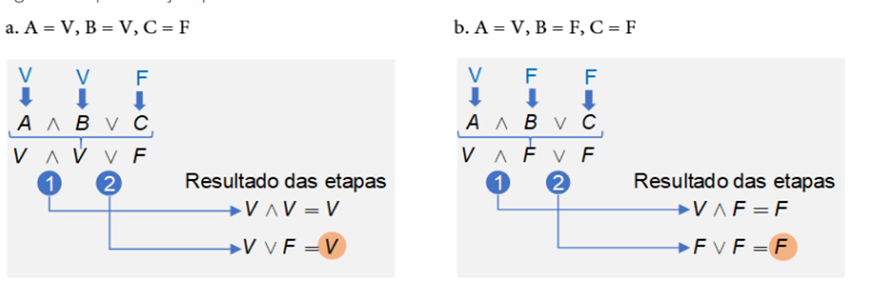

# Aula 3 — Métodos Dedutivos

## Ponto de Partida

Olá, estudante! Dando continuidade ao nosso estudo de lógica computacional, chegou um momento muito importante no qual aprenderemos a fazer **demonstrações lógicas**. O raciocínio usado para fazer uma dedução lógica é similar ao usado para construir sequências lógicas em um algoritmo, pois, em ambos os casos, é necessário escrever uma sequência correta de passos, tanto em termos de sintaxe, quanto em relação ao raciocínio e às regras necessárias para alcançar o resultado desejado.

> Você foi contratado para criar um sistema automatizado responsável por avaliar o desempenho dos estudantes em várias disciplinas e emitir relatórios de aprovação ou reprovação com base em critérios específicos. Este sistema deve ser capaz de processar resultados de provas em diferentes disciplinas e determinar se um aluno passou ou falhou de acordo com as regras da escola.
>
> **Problema a ser abordado:**
>
> O problema é desenvolver um sistema de avaliação de desempenho que possa avaliar automaticamente as notas dos alunos em várias disciplinas e determinar se eles passaram ou falharam de acordo com as regras da escola.

Para vencer esse desafio, você aprenderá nesta seção os conteúdos referentes aos métodos dedutivos e à lógica proposicional que irão te auxiliar no desenvolvimento de estudo de caso e torná-lo um grande desenvolvedor.

Vamos em frente!

---

## Vamos Começar!

### Definição

**Métodos dedutivos** são uma abordagem lógica de raciocínio que envolve a aplicação de regras lógicas para chegar a conclusões a partir de premissas ou axiomas. Esses métodos desempenham um papel fundamental em várias disciplinas, incluindo lógica, matemática, filosofia e ciência da computação. Aqui estão algumas informações adicionais sobre métodos dedutivos:

- **Premissas e conclusões**: em um argumento dedutivo, você começa com premissas, que são afirmações iniciais consideradas verdadeiras, e aplica regras lógicas para derivar conclusões. A ideia é que, se as premissas são verdadeiras e as regras lógicas são válidas, então as conclusões também serão verdadeiras.
- **Validade dedutiva**: um argumento dedutivo é válido quando a estrutura lógica do argumento garante que, se todas as premissas são verdadeiras, a conclusão também será verdadeira. Se um argumento é válido e todas as premissas são verdadeiras, ele é considerado uma demonstração.
- **Regras de inferência**: as regras de inferência são diretrizes lógicas que governam como você pode passar de premissas para conclusões. Exemplos de regras de inferência incluem o *modus ponens*, *modus tollens* e silogismo hipotético na lógica proposicional.
- **Lógica proposicional e de primeira ordem**: na lógica proposicional, as afirmações são representadas por proposições, enquanto na lógica de primeira ordem, você lida com predicados e quantificadores. A lógica proposicional é usada quando se trabalha com afirmações simples, enquanto a lógica de primeira ordem é usada para expressar relações mais complexas e quantificação.
- **Prova de teoremas**: em matemática e lógica, a prova de teoremas é um exemplo clássico de aplicação de métodos dedutivos. Os matemáticos usam métodos dedutivos para provar teoremas, começando com axiomas e aplicando regras lógicas para chegar à conclusão.
- **Sistemas formais**: em muitos casos, os métodos dedutivos são aplicados em sistemas formais, em que a estrutura e as regras lógicas são rigorosamente definidas. Exemplos incluem sistemas axiomáticos como o sistema de Peano para a aritmética ou sistemas de prova assistida por computador, como o Coq.
- **Aplicações na Ciência da Computação**: na ciência da computação, a dedução lógica é usada em áreas como verificação formal de software, raciocínio baseado em conhecimento, resolução de problemas de IA e muitas outras aplicações.
- **Limitações**: embora os métodos dedutivos sejam poderosos para garantir a validade de argumentos, eles têm limitações. Eles dependem da qualidade das premissas e das regras lógicas usadas. Além disso, nem todos os problemas podem ser resolvidos de maneira dedutiva, levando ao uso de abordagens indutivas e abdutivas em alguns casos.

Em resumo, os métodos dedutivos são uma ferramenta essencial para a análise lógica e a construção de argumentos válidos em diversas áreas do conhecimento, incluindo matemática, filosofia, ciência da computação e muito mais. Eles desempenham um papel crucial na garantia da validade de raciocínios e na resolução de problemas complexos.

---

## Siga em Frente...

### Lógica proposicional

A lógica proposicional é composta por proposições e conectivos lógicos que permitem criar uma série de fórmulas que quando escritas corretamente são chamadas **fbfs** (fórmula bem-formulada). Uma fbf é valorada em verdadeira (V) ou falsa (F), a partir da valoração das proposições com o conectivo lógico em questão, respeitando a ordem de precedência dos operadores lógicos. A valoração de uma fórmula também depende dos valores lógicos de entrada para cada uma das proposições.

Por exemplo, dada a fórmula **A ∧ B ∨ C** ela será verdadeira ou falsa? A valoração depende dos valores lógicos de entrada para as proposições A, B, C. Observe a Figura 1, na qual fazemos a valoração para as entradas A = V, B = V, C = F, veja que o resultado final é V. Considerando os valores lógicos: A = V, B = F, C = F, a mesma fórmula teve valoração final F (Figura 1). Portanto, a valoração de uma fbf depende das entradas lógicas e dos conectivos lógicos que são usados.

**Figura 1** | Valoração para a fórmula A ∧ B ∨ C

| A | B | C | A ∧ B | A ∧ B ∨ C |
|:---:|:---:|:---:|:---:|:---:|
| V | V | F | V | **V** |
| V | F | F | F | **F** |

### Argumento

Quando uma fórmula apresenta um conjunto de proposições, das quais uma delas é uma conclusão, dizemos que tal fórmula é um **argumento**. *"Um argumento é um conjunto de proposições, ou de fórmulas, nas quais uma delas (conclusão) deriva, ou é consequência, das outras (premissas)"*. Um argumento pode ser representado de forma simbólica por:

$$P_1 \land P_2 \land P_3 \land \dots \land P_n \rightarrow C$$

Onde $P_1, P_2, P_3, \dots, P_n$ são as **hipóteses**. Essas hipóteses podem ser tanto proposições simples, como uma fbf. A letra C representa a **conclusão** do argumento, a qual também pode ser tanto uma proposição simples como uma fbf.

> **Assimile:** Um argumento é composto por hipóteses e conclusão, e ambas podem ser compostas por proposições simples ou fbf. No argumento, as proposições são ligadas logicamente pelo conectivo de conjunção (e), as quais implicam logicamente a conclusão. Por isso, a ligação entre as hipóteses e a conclusão é feita por meio do conectivo condicional.

Dado um argumento é importante validar se ele é válido ou inválido, o grande desafio é como fazer essa validação. A lógica possui mecanismos que permitem validá-lo, os quais são compostos pelas **regras de equivalência** e **inferência lógica**. Essas regras vão nos permitir avaliar a relação entre as hipóteses e a conclusão, que também pode ser chamada de consequência lógica, dedução lógica, conclusão lógica ou implicação lógica.

> *"Uma proposição pode ser verdadeira ou falsa e não pode ser válida ou inválida; do mesmo modo, um argumento pode ser válido ou inválido e não pode ser verdadeiro ou falso"*.

#### Exemplificando

Vamos analisar o seguinte argumento.

> D. Pedro I proclamou a independência do Brasil e Thomas Jefferson escreveu a Declaração de Independência dos Estados Unidos. Portanto, todo dia tem 24 horas.

Vamos separar as proposições do argumento em hipóteses e conclusão.

- **A**: D. Pedro I proclamou a independência do Brasil.
- **B**: Thomas Jefferson escreveu a Declaração de Independência dos Estados Unidos.
- **C**: Todo dia tem 24 horas.

Nosso conhecimento nos permite valorar as três proposições, logo, A, B, C são todas verdadeiras. Embora, tanto as hipóteses, quanto a conclusão sejam proposições verdadeiras, o argumento é **inválido**, pois a conclusão nada tem a ver com as hipóteses.

Esse exemplo deixa claro que, basear-se apenas no conteúdo de um argumento não é suficiente para dizer se ele é válido ou não.

Segundo a Lógica Formal, devemos nos basear apenas nas **regras** para validar um argumento e não no conteúdo. O exemplo mencionado anteriormente deixa claro o motivo dessa restrição. Mas, afinal, quais são essas regras?

Para começarmos a entender as regras, vamos traduzir o argumento para notação simbólica, logo temos a seguinte fórmula: **A ∧ B → C**. Nessa fórmula quando o valor lógico de entrada das proposições A e B for verdadeiro e de C for falso, o resultado da implicação será falso, ou seja, existe pelo menos uma combinação de entradas, para a qual a fórmula resultará em falsa, logo essa fórmula não é uma tautologia e, consequentemente, não é um argumento válido.

> **Nota de revisão:** o material original diz que a implicação fica falsa "quando A for verdadeiro e **B for falso**". Isso está errado: com B falso, A ∧ B = F, e F → C é sempre **verdadeiro**. A combinação que torna A ∧ B → C falsa é **A = V, B = V e C = F** (antecedente verdadeiro, consequente falso). A conclusão — a fórmula não é tautologia, então o argumento é inválido — continua valendo.

**Tautologia** é um resultado no qual todas as entradas possíveis de uma fórmula obtêm verdadeiro como resultado. Ainda, segundo a mesma autora, **um argumento só é válido quando a fórmula é uma tautologia**.

> **Reflita:** Um argumento composto por proposições verdadeiras não necessariamente é um argumento válido. Um argumento que contenha proposições falsas, pode ser um argumento válido?

### Sequência de demonstração

Para saber se um argumento é válido ou não, precisamos saber se ele é uma tautologia. Para fazer essa checagem, poderíamos testar todas as combinações de entrada possíveis para o argumento. Porém, se tratando da Lógica Formal, podemos usar um sistema de regras de dedução e, seguindo uma sequência de demonstração provar se o argumento é válido ou não.

> *"Uma sequência de demonstração é uma sequência de fbfs nas quais cada fbf é uma hipótese ou o resultado de se aplicar uma das regras de dedução do sistema formal a fbfs anteriores na sequência"*.

Para construir a sequência de demonstração, cada hipótese, que é uma proposição e que pode ser uma fbf, deve ser disposta conforme descrita na Tabela 1:

| Linha | fbf | Justificativa |
|:---:|:---:|---|
| 1 | $P_1$ | (hipótese) |
| 2 | $P_2$ | (hipótese) |
| ... | ... | ... |
| n | $P_n$ | (hipótese) |
| n+1 | $fbf_1$ | (resultado da aplicação de uma regra de dedução à hipóteses anteriores) |
| n+2 | $fbf_2$ | (resultado da aplicação de uma regra de dedução à hipóteses anteriores) |
| ... | ... | ... |
| n+n | C | (resultado da aplicação de uma regra de dedução à hipóteses anteriores) |

*Tabela 1 | Estrutura de uma sequência de demonstração*

Na sequência de demonstração, cada proposição deve ficar em uma linha, enumeramos para facilitar na hora de aplicar as regras de dedução. Na frente de cada linha devemos indicar o que ela representa, se é uma hipótese ou então a regra que foi aplicada. Após elencar todas as proposições é hora de começar a aplicar as regras e, consequentemente, obter novas fbfs. A quantidade varia de caso para caso, mas as regras de dedução devem ser aplicadas até que se consiga provar que o argumento é verdadeiro, ou então, que não existam mais regras a serem aplicadas, mostrando, assim, que o argumento é falso.

> **Nota de revisão:** pela própria definição citada acima, um argumento é **válido ou inválido**, não "verdadeiro ou falso". Leia: aplicar as regras até provar que o argumento é **válido**. Além disso, não conseguir encontrar uma demonstração não prova, por si só, que o argumento é inválido — para isso, o caminho seguro é mostrar uma combinação de entradas que torna a fórmula falsa (como no exemplo de D. Pedro I).

### Exercício

> Considere o argumento a seguir. Se George Washington foi o primeiro presidente dos Estados Unidos, então John Adams foi o primeiro vice-presidente. George Washington foi o primeiro presidente dos Estados Unidos. Portanto, John Adams foi o primeiro vice-presidente.

Este argumento tem duas hipóteses:

1. Se George Washington foi o primeiro presidente dos Estados Unidos, então John Adams foi o primeiro vice-presidente.
2. George Washington foi o primeiro presidente dos Estados Unidos.

**Conclusão:** John Adams foi o primeiro vice-presidente.

Uma representação simbólica desse argumento tem a forma:

$$(A \rightarrow B) \land A \rightarrow B$$

Uma tabela-verdade ou o algoritmo *TestaTautologia* mostra que esse argumento é uma tautologia. O argumento é **válido**; sua forma é tal que a conclusão segue, inevitavelmente, das hipóteses. De fato, essa forma de argumento, conhecida pelo nome em latim ***modus ponens*** ("método de afirmação"), é uma das regras de raciocínio que usaremos para construir a lógica proposicional.

| A | B | A → B | (A → B) ∧ A | (A → B) ∧ A → B |
|:---:|:---:|:---:|:---:|:---:|
| V | V | V | V | **V** |
| V | F | F | F | **V** |
| F | V | V | F | **V** |
| F | F | V | F | **V** |

---

## Vamos Exercitar?

Chegou a hora de resolver o seu último desafio que é criar um sistema automatizado responsável por avaliar o desempenho dos estudantes em várias disciplinas e emitir relatórios de aprovação ou reprovação com base em critérios específicos. Este sistema deve ser capaz de processar resultados de provas em diferentes disciplinas e determinar se um aluno passou ou falhou de acordo com as regras da escola.

> **Problema a ser abordado:**
>
> O problema é desenvolver um sistema de avaliação de desempenho que possa avaliar automaticamente as notas dos alunos em várias disciplinas e determinar se eles passaram ou falharam de acordo com as regras da escola.

**Solução:**

A escola decide aplicar métodos dedutivos para criar um sistema de avaliação de desempenho baseado em valoração de fórmulas lógicas.

**Etapas do estudo de caso:**

1. **Definição de critérios de avaliação**: a equipe de desenvolvimento começa definindo os critérios de avaliação para cada disciplina. Por exemplo, pode ser definido que um aluno precisa obter uma média de pelo menos 5,0 em Matemática para ser aprovado.
2. **Modelagem de fórmulas lógicas**: para cada disciplina, são definidas fórmulas lógicas que especificam os critérios de aprovação. Por exemplo, `Média em Matemática >= 5,0` é uma fórmula que determina se um aluno passou em Matemática.
3. **Entrada de notas**: os professores inserem as notas dos alunos em um sistema computacional que calcula automaticamente a média e aplica as fórmulas lógicas correspondentes.
4. **Valoração de fórmulas lógicas**: o sistema avalia as fórmulas lógicas para cada disciplina com base nas notas do aluno. Se todas as fórmulas são verdadeiras, o aluno é aprovado na disciplina; caso contrário, é reprovado.
5. **Emissão de relatórios**: o sistema gera automaticamente relatórios de aprovação ou reprovação para cada aluno, com base nas valorações das fórmulas lógicas. Os relatórios podem ser impressos e entregues aos alunos e seus responsáveis.
6. **Testes e verificação**: a equipe realiza testes para garantir que o sistema avalie corretamente as notas e aplique as fórmulas lógicas de acordo com as regras da escola.

**Resultado:**

O estudo de caso mostra como a valoração de fórmulas lógicas pode ser aplicada na prática para avaliar o desempenho dos estudantes em diferentes disciplinas e determinar aprovações e reprovações automaticamente. Isso economiza tempo e recursos, garantindo que as regras da escola sejam rigorosamente seguidas.

Este estudo de caso ilustra uma aplicação prática de métodos dedutivos em matemática computacional, em que a valoração de fórmulas lógicas é usada para tomar decisões automáticas com base em critérios estabelecidos.

---

## Saiba mais

Métodos dedutivos são fundamentais para a compreensão da disciplina Lógica e Matemática Computacional. A seguir, algumas indicações para um estudo profundo sobre o tema.

1. **Fundamentos da lógica**: Leitura do capítulo 1 do livro. O capítulo 1 deste livro aborda os tópicos referentes a: proposições, argumentos e exercícios referentes ao conteúdo ministrado.
   > GERSTING, J. L. **Fundamentos matemáticos para a ciência da computação**. Rio de Janeiro: Grupo GEN, 2016.

## Referências

- BISPO FILHO, C. A. F.; CASTANHEIRA, L. B.; SOUZA FILHO, O. M. Introdução à lógica matemática. São Paulo: Cengage Learning, 2017.
- FAJARDO, R. Lógica matemática. 1. ed. São Paulo: Edusp, 2017.
- MUNDIM, R. P. A Lógica Formal – princípios elementares. Revista Economia & Gestão, Belo Horizonte, v. 2, n. 3, jan./jun. 2002.
- SANTOS, M. da S. dos et al. Lógica computacional. Grupo A, 2021.
