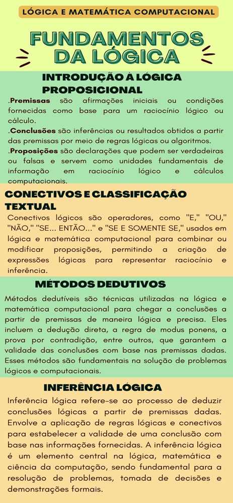

# Aula 5 — Fundamentos da Lógica Proposicional

## Ponto de Chegada

Olá, estudante! Para desenvolver a competência desta Unidade, que é conhecer os fundamentos da lógica matemática, você deverá primeiramente conhecer os conceitos fundamentais sobre: (a) premissas, conclusões e proposição, (b) operadores lógicos e fórmulas bem-formuladas (fbf), (c) métodos dedutivos, (d) inferência lógica. Bom, então vamos lá.

### Aula 1 — Premissas, conclusões e proposições

Na primeira aula desta unidade foram abordados os tópicos referentes: premissas, conclusões e proposições. Esses elementos desempenham um papel central na construção de argumentos lógicos, inferências e cálculos computacionais. Vamos agora explorar mais a fundo essas definições:

- **Premissas**: são as afirmações iniciais ou condições fornecidas como base para um raciocínio lógico ou cálculo em lógica e matemática computacional.
- **Conclusões**: são as inferências ou os resultados obtidos a partir das premissas por meio de regras lógicas ou algoritmos em lógica e matemática computacional.
- **Proposição**: é uma declaração que pode ser verdadeira ou falsa e serve como uma unidade fundamental de informação em raciocínio lógico e cálculos computacionais em lógica e matemática computacional.

### Aula 2 — Conectivos lógicos

Na segunda aula, foram abordados os tópicos referentes aos conectivos lógicos, pois são peças-chave no universo da lógica e da matemática computacional. Em lógica e matemática computacional, os conectivos lógicos são operadores que permitem combinar, modificar ou avaliar a veracidade de proposições. Os conectivos mais comuns incluem "E" (conjunção), "OU" (disjunção), "NÃO" (negação), "SE... ENTÃO..." (implicação) e "SE E SOMENTE SE" (equivalência). Eles desempenham um papel fundamental na construção de expressões lógicas para representar raciocínios e cálculos, permitindo-nos realizar análises e tomar decisões lógicas de maneira precisa e estruturada.

Conectivos lógicos são peças-chave no universo da lógica e da matemática computacional. Eles desempenham um papel essencial na construção de argumentos, na representação de relações entre proposições e na solução de problemas lógicos e computacionais. Estes operadores lógicos são ferramentas poderosas que permitem combinar e modificar proposições, tornando-os indispensáveis na programação, na tomada de decisões e em muitas outras aplicações.

| Conectivo | Símbolo | Leitura |
|---|:---:|---|
| Negação | ¬ | NÃO |
| Conjunção | ∧ | E |
| Disjunção | ∨ | OU |
| Condicional (implicação) | → | SE... ENTÃO... |
| Bicondicional (equivalência) | ↔ | SE E SOMENTE SE |

### Aula 3 — Métodos dedutivos

Na terceira aula, foram abordados os tópicos referentes aos métodos dedutivos, que são técnicas que partem de premissas ou princípios gerais e seguem regras lógicas para chegar a conclusões específicas. Esse processo de dedução é estruturado e garante a validade lógica das conclusões obtidas, desde que as premissas sejam verdadeiras e as regras lógicas sejam aplicadas corretamente. A dedução é fundamental na construção de argumentos sólidos, na solução de problemas lógicos e na formulação de provas matemáticas, entre outros contextos, em que a precisão e a coerência são essenciais.

Métodos dedutivos são um pilar central da lógica e do raciocínio, sendo amplamente empregados para estabelecer a validade de argumentos e inferências. Ao contrário dos métodos indutivos, que generalizam a partir de observações específicas, a dedução opera a partir de premissas gerais para obter conclusões específicas. Essa abordagem é essencial na matemática, filosofia e ciência da computação, garantindo a precisão e a validade dos resultados lógicos.

### Aula 4 — Inferência lógica

Por fim, na quarta aula foram abordados os tópicos referentes à inferência lógica. Em lógica e matemática computacional, inferência refere-se ao processo de deduzir conclusões lógicas com base em premissas, regras lógicas e princípios estabelecidos. Isso envolve a aplicação sistemática do raciocínio lógico para obter novas informações a partir das informações existentes. A inferência é usada em uma variedade de contextos, desde demonstrações matemáticas até sistemas de inteligência artificial, em que a capacidade de derivar conclusões válidas a partir de dados é fundamental. Ela desempenha um papel crítico na análise de informações, na resolução de problemas complexos e na tomada de decisões informadas em muitos domínios da ciência e da computação.

---

## É Hora de Praticar!

### Estudo de Caso: Sistema de Aprovação de Empréstimos em um Banco

> **Definição:**
>
> O banco ABCXY está implementando um sistema automatizado de aprovação de empréstimos para seus clientes. Este sistema usará conectivos lógicos para determinar se um cliente é elegível para um empréstimo.
>
> **Problema:**
>
> O banco precisa estabelecer critérios de elegibilidade para empréstimos. Eles decidem usar três fatores para tomar essa decisão: histórico de crédito (C), renda mensal (R) e idade do cliente (A). Os critérios são definidos da seguinte forma:
>
> O cliente deve ter um bom histórico de crédito (C) **E** uma renda mensal adequada (R) **E** ser maior de 18 anos (A >= 18) para ser elegível para um empréstimo.

### Reflita

- Como os conectivos lógicos podem ser aplicados para melhorar a eficiência e a precisão em áreas além da lógica matemática, como na tomada de decisões, na programação de computadores e na solução de problemas do mundo real?
- Até que ponto os métodos dedutivos podem ser usados para estabelecer a validade de argumentos complexos na vida cotidiana e em áreas como inteligência artificial e aprendizado de máquina, em que a lógica desempenha um papel fundamental?
- Como a inferência lógica é fundamental para a capacidade de máquinas e sistemas de inteligência artificial tomarem decisões lógicas e responderem a situações complexas, e quais são os desafios associados à aplicação da inferência lógica em contextos do mundo real?

### Resolução do Estudo de Caso

**Solução:**

O sistema de aprovação de empréstimos utiliza conectivos lógicos para combinar esses critérios da seguinte forma:

> (C = Verdadeiro) **E** (R >= Valor Mínimo) **E** (A >= 18)

Onde "C = Verdadeiro" indica um bom histórico de crédito, "R >= Valor Mínimo" indica uma renda mensal adequada e "A >= 18" indica que o cliente tem mais de 18 anos.

> **Nota de revisão:** a condição **A >= 18** inclui quem tem **exatamente** 18 anos, então o correto é "tem 18 anos ou mais" — não "mais de 18 anos" / "maior de 18", como diz o texto. Para "mais de 18" a condição seria A > 18.

**Resultado:**

O sistema de aprovação de empréstimos avalia automaticamente cada cliente com base nesses critérios e os conectivos lógicos. Se todos os critérios forem atendidos, o cliente é considerado elegível para o empréstimo. Caso contrário, a solicitação é rejeitada. Isso resulta em um processo eficiente e consistente de aprovação de empréstimos, reduzindo erros e garantindo que apenas os clientes elegíveis recebam empréstimos do banco ABCXY.

### Assimile

**Figura 1** | Lógica e matemática computacional

## Referências

- BISPO FILHO, C. A. F.; CASTANHEIRA, L. B.; SOUZA FILHO, O. M. Introdução à lógica matemática. São Paulo: Cengage Learning, 2017.
- GERSTING, J. L. Fundamentos matemáticos para a ciência da computação: 7. ed. Rio de Janeiro: LTC, 2017.
- ROSEN, K. H. Matemática discreta e suas aplicações. Grupo A, 2010.
- SILVA, F. S. C. da; FINGER, M.; MELO, A. C. V. de. Lógica para computação. 2. ed. Cengage Learning Brasil, 2018.
