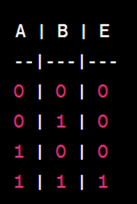
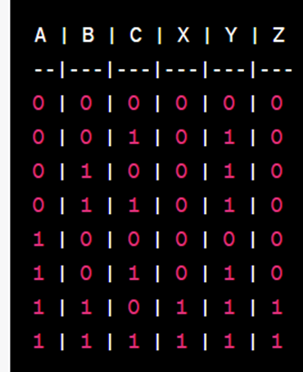
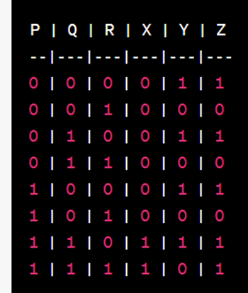
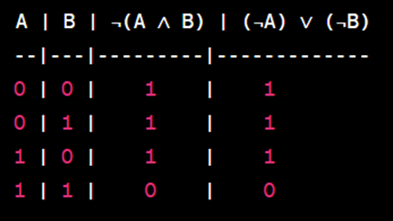
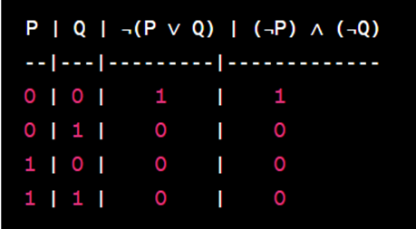
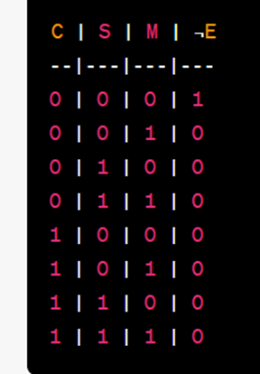

# Aula 1 — Fundamentos da Tabela Verdade

## Ponto de Partida

Olá, estudante! Chegou um momento muito importante no qual aprenderemos os fundamentos da **tabela verdade**. O conhecimento sobre os fundamentos da tabela verdade fornecerão uma base sólida para analisar e avaliar a validade de argumentos lógicos, expressões booleanas e sistemas lógicos complexos. Eles permitem determinar de forma sistemática e objetiva os valores lógicos de expressões, ajudando a estabelecer a consistência e a coerência em raciocínios e tomadas de decisão, além de serem essenciais para a programação e para o design de circuitos lógicos em computação.

> Suponhamos que estamos lidando com um sistema de controle de acesso a um escritório em que existem regras de segurança para permitir a entrada de funcionários.
>
> **Cenário:**
>
> A política de segurança do escritório exige que um funcionário seja permitido a entrar apenas se atender a uma das seguintes condições:
>
> 1. O funcionário tem um cartão de acesso válido (C).
> 2. O funcionário é um membro da equipe de segurança (S).
> 3. O funcionário é um gerente (M).
>
> A pergunta é: "Sob que condições um funcionário deve ser permitido a entrar no escritório?"

Para vencer esse desafio, você aprenderá nesta seção os conteúdos referentes aos fundamentos da tabela verdade que irão te auxiliar no desenvolvimento de estudo de caso e torná-lo um grande desenvolvedor.

Vamos em frente!

---

## Vamos Começar!

### Definição

Uma **tabela verdade**, em lógica e matemática computacional, é uma representação tabular de todas as possíveis combinações de valores de entrada e as correspondentes saídas de uma expressão lógica ou função booleana. Essa tabela é usada para determinar o valor lógico de uma expressão em todas as situações possíveis, com base em suas variáveis de entrada.

A estrutura de uma tabela verdade é composta por colunas que representam as variáveis de entrada e uma coluna adicional que representa o resultado da expressão ou função booleana para cada combinação possível das variáveis de entrada.

Vamos considerar um exemplo simples. Suponha que tenhamos uma expressão lógica AND (E) com duas variáveis de entrada A e B. A Figura 1, ilustra uma tabela verdade para essa expressão:

**Figura 1** | Exemplo de tabela verdade

Neste exemplo, as colunas "A" e "B" representam as variáveis de entrada, enquanto a coluna "E" representa o resultado da operação AND entre A e B. A tabela verdade mostra todas as combinações possíveis de valores de A e B, bem como o resultado correspondente da operação AND.

A tabela verdade é frequentemente usada em várias aplicações, incluindo:

1. **Análise de Expressões Lógicas**: Ela é utilizada para avaliar o valor lógico de uma expressão lógica complexa em diferentes cenários. Isso é particularmente útil ao simplificar ou otimizar expressões lógicas.
2. **Projeto de Circuitos Lógicos**: Engenheiros e projetistas de hardware usam tabelas verdade para criar e testar circuitos digitais. Isso permite a verificação de como um circuito se comportará para todas as combinações possíveis de entrada.
3. **Programação com Lógica Booleana**: Em programação, a lógica booleana é comum em estruturas de controle, como condicionais e loops. Tabelas verdade são usadas para entender como as condições são avaliadas e as decisões são tomadas em um programa.
4. **Tomada de Decisões Lógicas**: Em sistemas de controle, automação e inteligência artificial, as tabelas verdade são usadas para modelar o comportamento lógico e tomar decisões com base nas entradas fornecidas.

As tabelas verdade são uma ferramenta fundamental em lógica e matemática computacional, ajudando a entender o comportamento de expressões lógicas e funções booleanas em diversas aplicações, como projeto de circuitos, programação e tomada de decisões baseadas em lógica.

---

## Siga em Frente...

### Tabela verdade com proposições intermediárias

Uma **tabela verdade com proposições intermediárias**, às vezes chamada de **tabela de verdade estendida**, é uma representação tabular de todas as possíveis combinações de valores de entrada e as correspondentes saídas de uma expressão lógica que inclui variáveis intermediárias ou proposições intermediárias. Essas proposições intermediárias são frequentemente usadas para representar etapas intermediárias de um cálculo ou para descrever o comportamento de sistemas lógicos mais complexos.

Uma definição mais ampla de tabela verdade com proposições intermediárias pode ser a seguinte:

> Uma tabela verdade com proposições intermediárias é uma estrutura de dados tabular usada na lógica, matemática, ciência da computação e engenharia para analisar e representar o comportamento de expressões lógicas que envolvem variáveis de entrada, variáveis intermediárias e saídas lógicas. Essa tabela abrange todas as combinações possíveis de valores de entrada, bem como os valores intermediários, que são as etapas intermediárias do cálculo ou do sistema lógico, juntamente com os resultados finais.

Essas tabelas verdade estendidas são particularmente úteis ao lidar com sistemas lógicos complexos, em que o cálculo ou a representação do processo envolve etapas intermédias que são relevantes para a análise e tomada de decisões. Elas ajudam a compreender como as proposições intermediárias evoluem em resposta às variações das variáveis de entrada e como elas afetam a saída final.

Essas tabelas verdade, podem ser usadas em diversos contextos, como otimização de circuitos digitais, verificação de algoritmos complexos, modelagem de sistemas lógicos, entre outros. Elas fornecem uma visão abrangente e detalhada do comportamento de sistemas lógicos que envolvem múltiplas camadas de proposições e variáveis intermediárias.

#### Exemplo

Suponha que tenhamos a seguinte expressão lógica que envolve proposições intermediárias:

- A, B e C são variáveis de entrada;
- X = A ∧ B
- Y = B ∨ C
- Z = X ∧ Y

Vamos criar uma tabela verdade estendida que abrange todas as combinações possíveis de valores de entrada e mostra os valores intermediários de X e Y junto com o resultado final que é Z.

**Figura 2** | Tabela verdade estendida

Neste exemplo, as colunas "A", "B" e "C" representam as variáveis de entrada, as colunas "X" e "Y" representam as proposições intermediárias, e a coluna "Z" representa o resultado final. A tabela verdade estendida mostra como os valores intermediários são calculados e como eles afetam o resultado final Z.

#### Exercício

> Considere a seguinte expressão lógica com proposições intermediárias:
>
> - P, Q, R são variáveis de entrada
> - X = P ∧ Q
> - Y = ¬R
> - Z = X ∨ Y
>
> Crie uma tabela verdade estendida que abrange todas as combinações possíveis de valores de entrada e mostre os valores intermediários X e Y junto com o resultado final Z.

**Figura 3** | Tabela verdade estendida (Resolução do exercício)

Neste exercício, conforme demonstrado na Figura 3, seguimos o mesmo procedimento que no exemplo anterior (Figura 2) para criar a tabela verdade estendida, levando em consideração as proposições intermediárias X e Y, e calculando o resultado final Z.

### Tabela verdade para a Lei De Morgan

A tabela verdade para a **Lei De Morgan** é usada para demonstrar como as Leis De Morgan se aplicam a operações lógicas, especificamente a negação de conjunção (NAND) e a negação de disjunção (NOR). As Leis De Morgan estabelecem as relações entre negações e operações de conjunção e disjunção. Essas Leis são essenciais na simplificação de expressões lógicas e no projeto de circuitos digitais.

#### Exemplo

Vamos considerar a Lei De Morgan aplicada a uma expressão lógica com duas variáveis, A e B.

1. A Lei de De Morgan para a **negação de conjunção** afirma que **¬(A ∧ B) = ¬A ∨ ¬B**
2. A Lei de De Morgan para a **negação de disjunção** afirma que **¬(A ∨ B) = ¬A ∧ ¬B**

Aqui está a tabela verdade que demonstra a primeira Lei de De Morgan (negação de conjunção):

**Figura 4** | Tabela verdade que demonstra a primeira Lei de Morgan (Negação de conjunção)

A Figura 4, ilustra a tabela verdade onde, as colunas "A" e "B" representam as variáveis de entrada, "¬(A ∧ B)" representa a negação da conjunção A ∧ B, e "(¬A) ∨ (¬B)" representa a disjunção das negações ¬A e ¬B. A tabela verdade demonstra que os valores são idênticos, confirmando a primeira Lei De Morgan.

#### Exercício

> Suponha que temos as variáveis P e Q e queremos demonstrar a segunda Lei De Morgan: ¬(P ∨ Q) = ¬P ∧ ¬Q. Crie uma tabela verdade que valide essa Lei.

**Solução do Exercício:**

A Figura 5, ilustra a tabela verdade que valida a segunda Lei De Morgan:

**Figura 5** | Tabela verdade, validação da segunda Lei De Morgan

Nesta tabela verdade, as colunas "P" e "Q" representam as variáveis de entrada, "¬(P ∨ Q)" representa a negação da disjunção P ∨ Q, e "(¬P) ∧ (¬Q)" representa a conjunção das negações ¬P e ¬Q. A tabela verdade demonstra que os valores são idênticos, confirmando a segunda Lei de De Morgan.

---

## Vamos Exercitar?

Chegou a hora de resolver seu desafio na qual estamos lidando com um sistema de controle de acesso a um escritório em que existem regras de segurança para permitir a entrada de funcionários.

> **Cenário:**
>
> A política de segurança do escritório exige que um funcionário seja permitido a entrar apenas se atender a uma das seguintes condições:
>
> 1. O funcionário tem um cartão de acesso válido (C).
> 2. O funcionário é um membro da equipe de segurança (S).
> 3. O funcionário é um gerente (M).
>
> A pergunta é: "Sob que condições um funcionário deve ser permitido a entrar no escritório?"

**Expressão Inicial:**

Podemos expressar essa política de segurança com a seguinte expressão lógica:

$$E = C \lor S \lor M$$

Aqui, usamos a operação de disjunção (∨) para indicar que o funcionário deve ser permitido a entrar se atender a pelo menos uma das condições.

**Aplicação da Lei De Morgan:**

Agora, aplicaremos a Lei De Morgan para negar a expressão, o que nos permitirá determinar quando o funcionário não deve ser permitido a entrar:

$$\neg E = \neg(C \lor S \lor M)$$

Usaremos a Lei De Morgan para a negação de uma disjunção:

$$\neg E = \neg C \land \neg S \land \neg M$$

> **Nota de revisão:** o material original diz "usaremos a **primeira** Lei De Morgan para a negação de uma disjunção", mas na própria aula a primeira lei é a da negação da **conjunção**; a da negação da **disjunção** é a **segunda**.

Aqui, usamos a operação de conjunção (∧) para indicar que o funcionário não deve ser permitido a entrar apenas se todas as condições não forem atendidas (ou seja, o funcionário não possui um cartão de acesso válido, não é membro da equipe de segurança e não é gerente).

**Tabela Verdade:**

Agora, vamos criar uma tabela verdade para as variáveis C, S, M e ¬E, demonstrando todas as combinações possíveis de estados das condições e se o funcionário deve ou não ser permitido a entrar.

**Figura 6** | Tabela verdade com todas as combinações possível

A Figura 6, ilustra a tabela verdade, as colunas representam os estados das condições: cartão de acesso (C), equipe de segurança (S), gerente (M) e a negação da permissão de entrada (¬E). A negação da permissão de entrada é igual a 1 quando o funcionário não deve ser permitido a entrar e igual a 0 quando o funcionário deve ser permitido a entrar.

A tabela verdade ilustrada na Figura 6, mostra que o funcionário deve ser permitido a entrar (¬E = 0) quando pelo menos uma das condições de segurança for atendida, ou seja, quando o funcionário possui um cartão de acesso válido, é membro da equipe de segurança ou é gerente. Isso reflete a política de segurança do escritório: um funcionário deve ser permitido a entrar se atender a pelo menos uma das condições de segurança.

> **Nota de revisão:** o original dizia "apenas quando **nenhuma das condições de segurança não for atendida**" — a dupla negação deixa a frase confusa. O sentido correto, como a própria frase completa em seguida, é "quando **pelo menos uma** das condições for atendida". Pela Figura 6, ¬E = 1 (entrada negada) só na linha C = S = M = 0.

Este estudo de caso simulado ilustra como a Lei De Morgan pode ser aplicada em um cenário de controle de acesso a um escritório, juntamente com a criação de uma tabela verdade para determinar as condições sob as quais um funcionário deve ser permitido a entrar.

---

## Saiba mais

Fundamentos da tabela verdade são fundamentais para a compreensão da disciplina Lógica e Matemática Computacional. A seguir, algumas indicações para um estudo profundo sobre o tema.

1. O capítulo 2 deste livro aborda os tópicos referentes a: (1) Tabela Verdade, (2) Critérios para a tabela verdade e (3) Exercícios.
   > BISPO, C. A. F.; CASTANHEIRA, L. B.; SOUZA FILHO, O. **Introdução à lógica matemática**. Cengage Learning Brasil, 2017.

2. O capítulo 2 aborda os tópicos relacionados à tabela verdade e as regras da Lei De Morgan.
   > QUILELLI, P. **Raciocínio lógico matemático para concursos**. 3. Ed. Editora Saraiva, 2015.

## Referências

- BISPO FILHO, C. A. F.; CASTANHEIRA, L. B.; SOUZA FILHO, O. M. Introdução à lógica matemática. São Paulo: Cengage Learning, 2017.
- FAJARDO, R. Lógica matemática. 1. ed. São Paulo: Edusp, 2017.
- MUNDIM, R. P. A Lógica Formal – princípios elementares. Revista Economia & Gestão, Belo Horizonte, v. 2, n. 3, jan./jun. 2002.
- SANTOS, M. da S. dos et al. Lógica computacional. Grupo A, 2021.
