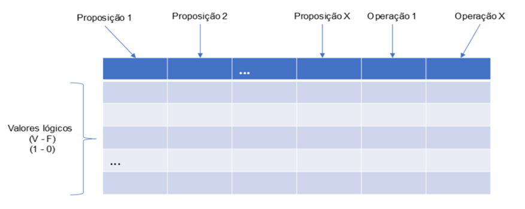

# Aula 2 — Construção da Tabela Verdade

## Ponto de Partida

Olá, estudante! Iniciaremos agora uma jornada que lhe capacitará compreender e aplicar a lógica por meio da construção de tabelas verdade. Quem tem irmão já deve ter ouvido a mãe gritar: "Você E seu irmão estão de castigo!", mas esse "E" tem a ver com o conectivo lógico AND? A resposta é sim, o resultado desse E é o mesmo, seja na linguagem natural ou na binária, por isso aprendemos lógica proposicional e a aplicamos no universo computacional.

> Você foi recentemente contratado como um funcionário trainee na área de analytics e almeja se tornar júnior em breve, mas para isso deve cumprir seus desafios e ajudar a equipe. Você recebeu uma planilha com os dados de compras de clientes, conforme ilustrado na Tabela 1. Dadas as seguintes proposições:
>
> - **p**: o cliente é do sexo feminino,
> - **q**: o cliente tem idade entre 20 e 30 anos,
>
> o seu desafio é construir uma Tabela Verdade que generalize a solução fazendo a conjunção e a disjunção para as proposições p e q, além de criar os resultados para a negação de ambas as fórmulas. Após criar a tabela verdade, você poderá analisar cada registro informando se o resultado é verdadeiro ou falso para cada um dos conectores lógicos propostos na Tabela 1. Tal resultado ajudará a equipe de vendas a criar rotinas para tomada de decisões.

| codigo_cli | nome_cli | genero_cli | idade_cli | valor_compra | E | OU |
|---|---|:---:|:---:|---:|:---:|:---:|
| 53682 | Karly Dillon | F | 40 | 74,84 | ? | ? |
| 58246 | Channing Vazquez | M | 49 | 98,04 | ? | ? |
| 27022 | Adria Key | F | 47 | 65,93 | ? | ? |
| 82075 | Ella Nelson | F | 34 | 94,01 | ? | ? |
| 90657 | Arden Battle | M | 48 | 21,73 | ? | ? |
| 80330 | Brittany Ramirez | F | 38 | 42,23 | ? | ? |
| 53989 | Moses Graham | M | 42 | 37,20 | ? | ? |
| 61370 | Jin Fuller | M | 49 | 65,60 | ? | ? |
| 41807 | Phelan Blair | M | 46 | 77,40 | ? | ? |
| 94269 | Porter West | M | 22 | 67,19 | ? | ? |

*Tabela 1 | Dados de compra dos clientes*

Para cumprir seu desafio, nesta seção você aprenderá o mecanismo de construção de uma tabela verdade, bem como utilizar os conectores lógicos de conjunção, disjunção e negação. Então, mãos à obra!

---

## Vamos Começar!

Provavelmente é do seu conhecimento que um computador é dividido em duas partes: o **hardware** (componentes físicos) e o **software** (os programas). Muitos pesquisadores contribuíram para que chegássemos ao nível de evolução computacional que vivenciamos. O avanço do hardware se deu por meio das pesquisas na área da eletrônica digital, que visa construir circuitos que representam grandezas por meio de valores discretos. Os componentes eletrônicos que compõem um computador são formados por pequenos elementos, chamados de **transistores**, que são capazes de lidar com dois estados, aberto ou fechado. Um conjunto de transistores pode ser usado para construir uma **porta lógica**, que ao receber sinais digitais de entrada produz uma determinada saída, que depende do tipo de operação lógica para o qual foi construído. Por exemplo, uma porta lógica pode receber um sinal de ligado (1) em uma entrada e um sinal de desligado (0) em outra, qual seria o resultado? Depende da operação lógica dessa porta; se for uma operação AND, o resultado seria "desligado", mas se fosse um OR, o resultado seria "ligado".

Assim como no hardware, o software também possui operações lógicas. Por exemplo, podemos escrever um programa que irá somar dois valores se, e somente se, ambos forem positivos. Nesse caso, teremos que construir o algoritmo utilizando o operador AND.

### Construção da tabela verdade

Dada a necessidade de se obter resultados lógicos da combinação de proposições e conectores, um dos métodos mais utilizados é o método da tabela verdade.

Por definição, a tabela verdade é um **método exaustivo** de geração de valorações para uma dada fórmula. Entendemos por fórmula a composição de proposições e conectores lógicos por exemplo, P ∨ Q. Observe o esquema geral da tabela verdade na Figura 1. Nas colunas, colocaremos primeiro as proposições (quantas forem necessárias testar) e, em seguida, as operações lógicas das quais queremos obter os resultados. Já nas linhas, colocaremos os valores lógicos (V – F) tanto para as proposições quanto para os resultados das fórmulas que obteremos, lembrando que nosso objetivo com a tabela verdade é analisar TODOS os resultados possíveis, e podemos compará-la com um mapa de resultados.

Obtida a tabela uma vez, basta consultá-la.

**Figura 1** | Esquema geral de uma tabela verdade

Alguns pontos sobre a lógica têm que estar bem claros para que possamos construir nossas tabelas verdade.

- Toda proposição é **binária**, ou seja, só pode assumir um dos seguintes valores: verdadeiro (V) ou falso (F). Você pode optar por utilizar 1 para V e 0 para F.
- Ao realizar uma operação lógica com duas proposições, temos que testar **todas as combinações** de respostas, o que influenciará diretamente a quantidade de linhas necessárias na tabela verdade.

---

## Siga em Frente...

### Tabela verdade de conjunção (and – e)

O conector lógico de **conjunção** (AND - E) é utilizado para realizar uma operação binária entre duas proposições, quando se deseja obter um resultado verdadeiro se, e somente se, as duas proposições forem verdadeiras. Utilizaremos o símbolo **∧** para representar esse conector lógico. Para construir a tabela verdade da conjunção, vamos considerar como entradas as proposições A e B. Queremos avaliar os resultados para a fórmula A ∧ B. Veja na Tabela 2 que na primeira coluna (C1) colocamos a proposição A, na segunda coluna (C2) a proposição B e na terceira coluna (C3) a fórmula que queremos avaliar. Sobre os resultados, vamos analisar linha a linha.

- Na linha 1 (L1), colocamos as proposições A e B com entrada V. Veja na coluna 3 (C3) que a saída para essas entradas também é V.
- Na linha 2 (L2), colocamos a proposição A com entrada V e a B com entrada F. Veja na coluna 3 (C3) que a saída para essas entradas é F.
- Na linha 3 (L3), colocamos a proposição A com entrada F e a B com entrada V. Veja na coluna 3 (C3) que a saída para essas entradas é F.
- Na linha 4 (L4), colocamos as proposições A e B com entrada F. Veja na coluna 3 (C3) que a saída para essas entradas é F.

| | C1 | C2 | C3 |
|---|:---:|:---:|:---:|
| | **A** | **B** | **A ∧ B** |
| **L1** | V | V | V |
| **L2** | V | F | F |
| **L3** | F | V | F |
| **L4** | F | F | F |

*Tabela 2 | Tabela verdade de conjunção*

> **Reflita:** Como usamos duas proposições, foram necessárias 4 linhas para gerar a valoração da fórmula A ∧ B. Repare na distribuição das entradas. Para a proposição A, primeiro foram dispostas as entradas V combinando com as entradas V e F da proposição B; em seguida, foram dispostas as entradas F combinando com as entradas V e F de B. Portanto, a primeira coluna ficou com entradas VVFF e a segunda coluna VFVF. Será que foi só uma coincidência ou existe uma lógica que ajuda na organização? Como ficariam dispostas as entradas da Tabela Verdade da conjunção para três proposições?

Quando utilizamos a lógica formal na construção de algoritmos, o conector lógico AND é um recurso muito valioso na tomada de decisões. O resultado dessa operação em uma linguagem de programação pode ser descrito por meio de uma tabela verdade. Por isso, entender esse mecanismo é fundamental para sua vida profissional.

#### Exemplificando

Vejamos um exemplo prático para a conjunção. Imagine que estamos criando uma aplicação que precisa informar se uma determinada pessoa irá pagar imposto ou não, a depender da sua renda, de acordo com a seguinte regra: Se o salário for superior a 5 mil e a idade menor que 40 anos, a pessoa pagará de imposto 10% do seu salário. Considere as seguintes proposições:

- **A**: o salário é maior que R$ 5 mil.
- **B**: a idade é menor que 40 anos.

Com base na tabela verdade da conjunção, vamos analisar qual seria o resultado da fórmula A ∧ B para uma pessoa que recebe um salário de R$ 4 mil e possui 32 anos.

Avaliando a proposição A para o caso, temos um resultado F (pois não ganha salário de 5 mil). Já a proposição B possui resultado V (a idade é menor que 40 anos).

Ao consultarmos a terceira linha da Tabela 2, vemos que o resultado de A ∧ B para tais entradas é falso. Portanto, para o caso analisado, o resultado da fórmula é **F**.

### Tabela verdade de disjunção (or – ou)

O conector lógico de **disjunção** (OR - OU) é utilizado para realizar uma operação binária entre duas proposições quando se deseja obter um resultado falso se, e somente se, as duas proposições forem falsas. Utilizaremos o símbolo **∨** para representar esse conector lógico. Para construir a tabela verdade da disjunção, vamos considerar como entradas as proposições A e B. Queremos avaliar os resultados para a fórmula A ∨ B. Veja na Tabela 3 que na primeira coluna colocamos a proposição A, na segunda coluna a proposição B e na terceira coluna a fórmula que queremos avaliar. Sobre os resultados, vamos analisar linha a linha.

- Na linha 1 (L1), colocamos as proposições A e B com entrada V. Veja na coluna 3 (C3) que a saída para essas entradas também é V.
- Na linha 2 (L2), colocamos a proposição A com entrada V e a B com entrada F. Veja na coluna 3 (C3) que a saída para essas entradas é V.
- Na linha 3 (L3), colocamos a proposição A com entrada F e a B com entrada V. Veja na coluna 3 (C3) que a saída para essas entradas é V.
- Na linha 4 (L4), colocamos as proposições A e B com entrada F. Veja na coluna 3 (C3) que a saída para essas entradas é F.

| | C1 | C2 | C3 |
|---|:---:|:---:|:---:|
| | **A** | **B** | **A ∨ B** |
| **L1** | V | V | V |
| **L2** | V | F | V |
| **L3** | F | V | V |
| **L4** | F | F | F |

*Tabela 3 | Tabela verdade com operador OR*

> **Nota de revisão:** no material original, o cabeçalho da coluna C3 desta tabela estava como **A ∧ B** — erro de cópia da tabela anterior. Como diz o texto e mostram os valores, é **A ∨ B**.

Como mostra a tabela verdade da disjunção, basta que uma entrada seja verdadeira para obtermos um resultado verdadeiro.

### Tabela verdade para negação

O operador lógico de **negação** tem a função de inverter, seja uma entrada ou o resultado de uma operação. Utilizaremos o símbolo **¬** para representar esse conector lógico. Na Tabela 4 (a), temos uma Tabela Verdade com negação para as proposições A, B. Veja que ¬A inverte o valor de A, ou seja, onde é V fica F e vice-versa. O mesmo acontece para ¬B, que inverte o valor de B. Na Tabela 4 (b), temos nas colunas 3 (C3) e 5 (C5) os resultados já conhecidos da conjunção e disjunção, e nas colunas 4 (C4) e 6 (C6) os novos resultados, sendo na coluna 4 (C4) os resultados para a negação da conjunção e na coluna 6 (C6) a negação da disjunção. Repare nos parênteses, que são obrigatórios, indicando que a negação é para toda a operação e não somente para uma proposição.

**a)**

| A | B | ¬A | ¬B |
|:---:|:---:|:---:|:---:|
| V | V | F | F |
| F | F | V | V |

*Tabela 4 | Tabela verdade com operador de negação (a)*

> **Nota de revisão:** a Tabela 4 (a) do material original tem só 2 linhas. Com duas proposições, a tabela completa tem 4 linhas — faltam **A = V, B = F → ¬A = F, ¬B = V** e **A = F, B = V → ¬A = V, ¬B = F**.

**b)**

| | C1 | C2 | C3 | C4 | C5 | C6 |
|---|:---:|:---:|:---:|:---:|:---:|:---:|
| | **A** | **B** | **A ∧ B** | **¬(A ∧ B)** | **A ∨ B** | **¬(A ∨ B)** |
| **L1** | V | V | V | F | V | F |
| **L2** | V | F | F | V | V | F |
| **L3** | F | V | F | V | V | F |
| **L4** | F | F | F | V | F | V |

*Tabela 4 | Tabela verdade com operador de negação (b)*

Para ficar claro como os parênteses podem afetar o resultado da operação lógica envolvendo a negação, observe a Tabela 5. Na coluna 4 (C4), temos os resultados para a fórmula ¬(A ∧ B), já na coluna 5 (C5) temos o resultado para a fórmula (A ∧ ¬B). Veja como é diferente. No primeiro caso estamos invertendo o resultado da operação toda, já no segundo caso, estamos invertendo apenas o valor de B e fazendo a conjunção com A.

| | C1 | C2 | C3 | C4 | C5 |
|---|:---:|:---:|:---:|:---:|:---:|
| | **A** | **B** | **¬B** | **¬(A ∧ B)** | **(A ∧ ¬B)** |
| **L1** | V | V | F | F | F |
| **L2** | V | F | V | V | V |
| **L3** | F | V | F | V | F |
| **L4** | F | F | V | V | F |

*Tabela 5 | Tabela verdade com operadores (negação-and)*

> **Nota de revisão:** no material original, o cabeçalho de C5 estava como **(A ∨ ¬B)**, mas o texto, a legenda ("negação-and") e os valores da coluna correspondem a **(A ∧ ¬B)**. Com ∨ os valores seriam V, V, F, V.

Como você já deve ter percebido, não adianta tentar decorar os resultados, você precisa entender os operadores básicos e, a partir daí, ir resolvendo as fórmulas, parte por parte, com auxílio da tabela verdade.

---

## Vamos Exercitar?

Chegou o momento de solucionarmos o desafio.

Como membro da equipe de analytics de uma empresa de varejo, dadas as seguintes proposições: **p**: o cliente é do sexo feminino e **q**: o cliente tem idade entre 20 e 30 anos, você foi encarregado de construir uma Tabela Verdade para as operações de conjunção e disjunção, além de criar a negação para as fórmulas. Com a Tabela Verdade criada, você deve avaliar os registros de clientes que foi lhe passado na Tabela 1, completando as colunas E/OU com V ou F.

A tabela verdade é um mecanismo que permite valorar fórmulas de forma genérica a partir de entradas binárias e conectores lógicos. Pois bem, como o problema proposto apresenta duas proposições, serão necessárias 4 linhas para contemplar todas as combinações possíveis das entradas. Além disso, serão necessárias 6 colunas, sendo 2 para as proposições (p, q), uma para a fórmula da conjunção, outra para a disjunção, outra para a negação da conjunção e uma última com a negação da disjunção. O resultado da tabela verdade deve estar conforme o Quadro 1.

| p | q | p ∧ q | p ∨ q | ¬(p ∧ q) | ¬(p ∨ q) |
|:---:|:---:|:---:|:---:|:---:|:---:|
| V | V | V | V | F | F |
| V | F | F | V | V | F |
| F | V | F | V | V | F |
| F | F | F | F | V | V |

*Quadro 1 | Tabela verdade do desafio*

A tabela verdade pode ser usada como um gabarito para as operações lógicas, pois contempla todas as entradas possíveis e suas combinações para as fórmulas em estudo. Com esse gabarito em mãos, podemos passar para a segunda etapa do desafio, que é fazer a valoração das fórmulas p ∧ q e p ∨ q para cada registro da base de clientes. Pois bem, vejamos na Tabela 2, como ficaram os resultados.

| linha | codigo_cli | nome_cli | genero_cli | idade_cli | valor_compra | E | OU |
|:---:|---|---|:---:|:---:|---:|:---:|:---:|
| 1 | 53682 | Karly Dillon | F | 40 | 74,84 | F | V |
| 2 | 58246 | Channing Vazquez | M | 49 | 98,04 | F | F |
| 3 | 27022 | Adria Key | F | 47 | 65,93 | F | V |
| 4 | 82075 | Ella Nelson | F | 34 | 94,01 | F | V |
| 5 | 90657 | Arden Battle | M | 48 | 21,73 | F | **F** |
| 6 | 80330 | Brittany Ramirez | F | 38 | 42,23 | F | **V** |
| 7 | 53989 | Moses Graham | M | 42 | 37,20 | F | **F** |
| 8 | 61370 | Jin Fuller | M | 49 | 65,60 | F | F |
| 9 | 41807 | Phelan Blair | M | 46 | 77,40 | F | F |
| 10 | 94269 | Porter West | M | 22 | 67,19 | F | V |

*Tabela 2 | Resultado da valoração (corrigido — ver nota)*

> **Nota de revisão:** três valores da coluna **OU** estavam errados no material original e foram corrigidos (em negrito):
>
> - **Linha 5 (Arden Battle)**: M, 48 anos → p = F, q = F → p ∨ q = **F** (o original dizia V).
> - **Linha 6 (Brittany Ramirez)**: F, 38 anos → p = V → p ∨ q = **V** (o original dizia F).
> - **Linha 7 (Moses Graham)**: M, 42 anos → p = F, q = F → p ∨ q = **F** (o original dizia V).
>
> A coluna **E** está toda correta (nenhuma cliente é mulher **e** tem entre 20 e 30 anos).

Nossa maior lição com esse desafio é entender como uma questão de lógica formal pode ser utilizada em um algoritmo, e isso, no mercado de trabalho, fornece resultados para as mais diversas áreas de uma empresa. Se fornecêssemos para a equipe de vendas o resultado da coluna da conjunção, a fim de comunicá-los sobre o lançamento de uma nova promoção, nenhum desses 10 receberia tal comunicado, por outro lado, se nosso resultado fosse baseado na disjunção, vários deles receberiam o comunicado.

É isso aí, você como um profissional deve ter consciência das suas responsabilidades e tomar as melhores decisões para a empresa!

---

## Saiba mais

Construção da tabela verdade são fundamentais para a compreensão da disciplina Lógica e matemática computacional. A seguir, algumas indicações para um estudo profundo sobre o tema.

1. O capítulo 2 deste livro aborda os tópicos referentes a: (1) Tabela verdade, (2) Disjunção (3) Conjunção e (4) Negação.
   > BISPO, C. A. F.; CASTANHEIRA, L. B.; SOUZA FILHO, O. M. S. **Introdução à lógica matemática**. Cengage Learning Brasil, 2017.

2. O capítulo 2 aborda os tópicos relacionados à tabela verdade, negação, conjunção e disjunção.
   > QUILELLI, P. **Raciocínio lógico matemático para concursos**. 3. ed. Editora Saraiva, 2015.

## Referências

- BISPO FILHO, C. A. F.; CASTANHEIRA, L. B.; SOUZA FILHO, O. M. Introdução à lógica matemática. São Paulo: Cengage Learning, 2017.
- FAJARDO, R. Lógica matemática. 1. ed. São Paulo: Edusp, 2017.
- MUNDIM, R. P. A Lógica Formal – princípios elementares. Revista Economia & Gestão, Belo Horizonte, v. 2, n. 3, jan./jun. 2002.
- SANTOS, M. da S. dos et al. Lógica computacional. Grupo A, 2021.
