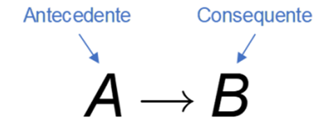

# Aula 3 — Resultados da Tabela Verdade

## Ponto de Partida

Olá, estudante! Os profissionais das mais diversas áreas tomam decisões o tempo todo em seu ambiente de trabalho. Todas as decisões precisam ser bem avaliadas, pois toda ação gera uma consequência. Por exemplo, em uma campanha promocional, se optar por desconto a um determinado grupo, poderá não vender tanto para um outro grupo potencial. No mundo da lógica computacional, as decisões são tomadas por meio de estruturas de decisão, que têm sua origem em um conector lógico chamado de **implicação**, o qual veremos sua tabela verdade nesta seção.

> Como funcionário trainee na área de analytics de uma empresa de varejo, você deve ajudar a equipe de marketing em uma campanha para o dia internacional da mulher.
>
> Dadas as proposições:
>
> - **A**: o cliente é do sexo feminino.
> - **B**: o cliente fez uma compra com valor superior a R$ 50,00.
> - **C**: ganhar cupom com 10% de desconto.
>
> Seu desafio consiste primeiro em avaliar a fórmula A ∧ B para cada um dos registros da Tabela 1. Essa avaliação lhe permitirá classificar a proposição C para cada um dos clientes, ou seja, se o cliente ganhará ou não o cupom de 10% de desconto.
>
> Após a classificação, você deverá generalizar, por meio de uma tabela verdade, as possíveis respostas para a fórmula P → Q, sendo P e Q duas proposições genéricas.

| codigo_cli | nome_cli | genero_cli | idade_cli | valor_compra | cupom_10 |
|---|---|:---:|:---:|---:|:---:|
| 53682 | Karly Dillon | F | 40 | 74,84 | ? |
| 58246 | Channing Vazquez | M | 49 | 98,04 | ? |
| 27022 | Adria Key | F | 47 | 65,93 | ? |
| 82075 | Ella Nelson | F | 34 | 94,01 | ? |
| 90657 | Arden Battle | M | 48 | 21,73 | ? |
| 80330 | Brittany Ramirez | F | 38 | 42,23 | ? |
| 53989 | Moses Graham | M | 42 | 37,20 | ? |
| 61370 | Jin Fuller | M | 49 | 65,60 | ? |
| 41807 | Phelan Blair | M | 46 | 77,40 | ? |
| 94269 | Porter West | M | 22 | 67,19 | ? |
| 56516 | Zena Skinner | F | 54 | 73,98 | ? |
| 38904 | Teagan Rios | M | 34 | 61,57 | ? |

*Tabela 1 | Dados de compra dos clientes*

Para cumprir seu desafio, nesta seção veremos a tabela verdade do conector de implicação, bem como outros importantes resultados da tabela verdade.

Pronto para o desafio?!

---

## Vamos Começar!

### Definição

A tabela verdade é utilizada como um método exaustivo de extração de resultados. Em outras palavras, construímos uma tabela verdade para testarmos todos os resultados possíveis para todas as combinações possíveis de entradas em uma determinada fórmula. Uma fórmula é composta por proposições e operadores lógicos, como, por exemplo, a negação (NOT), a conjunção (AND) e a disjunção (OR). Além desses conectores, as proposições podem ser combinadas na forma "se proposição 1, então proposição 2". O conectivo lógico dessa combinação é o **condicional**, representado por **→**, e significa que se a proposição 1 é verdadeira, implicará na verdade da proposição 2. Em outras palavras, podemos dizer que dada uma sequência de proposições, a partir da operação condicional é possível chegar a uma conclusão (um resultado), que é uma nova proposição. A primeira parte, antes do conector, é chamada de **antecedente**, e a segunda de **consequente** conforme ilustra a Figura 1.

**Figura 1** | Implicação lógica

Para entendermos como funciona a implicação, vejamos alguns exemplos.

**Exemplo 1.** Considere as proposições A e B:

- **A**: há uma falha na rede elétrica.
- **B**: a chave central irá desligar.

A fórmula A → B, que significa que B está condicionado a A, deve ser lida como: "se houver uma falha na rede elétrica, então, a chave central irá desligar".

**Exemplo 2.** Considere as proposições P, Q, R.

- **P**: a nota mínima necessária para ser aprovado é 6,0.
- **Q**: João tirou 8,0 na prova.
- **R**: João será aprovado.

Nesse exemplo, temos o resultado de uma conjunção implicando uma terceira proposição. Simbolicamente, escrevemos **(P ∧ Q) → R**, e deve ser lida como: "Se a nota mínima necessária para ser aprovado é 6,0 e João tirou 8,0 na prova, então, ele será aprovado."

Os possíveis resultados do operador condicional estão representados na tabela verdade apresentada na Tabela 1.

| | C1 | C2 | C3 |
|---|:---:|:---:|:---:|
| | **A** | **B** | **A → B** |
| **L1** | V | V | V |
| **L2** | V | F | F |
| **L3** | F | V | V |
| **L4** | F | F | V |

*Tabela 1 | Tabela verdade para o condicional*

Para entendermos os resultados da implicação, vejamos o seguinte exemplo.

- **A**: soltar a pedra.
- **B**: a queda da pedra.

A fórmula A → B deve ser lida como "Se a pedra for solta, então, a pedra cairá". Agora, vamos avaliar todas as respostas possíveis com base na tabela verdade acima.

- Na primeira linha (L1), temos como entrada a verdade das proposições A e B, em nosso exemplo, quer dizer que a pedra foi solta (proposição A é verdadeira) e caiu (proposição B é verdadeira), portanto, a condição era verdadeira e o resultado é V (linha 1 e coluna 3).
- Na linha dois (L2), temos como entrada que a proposição A é verdadeira e a proposição B é falsa, isso quer dizer que a pedra foi solta, mas não caiu. Nesse caso, a condicional não é verdadeira e o resultado é F (linha 2 e coluna 3).
- Nas demais linhas, terceira e quarta (L3 e L4), temos como entrada que a proposição A é falsa (que é o antecedente), nesse caso, não há como avaliar a condicional e o resultado é tomado como verdadeiro.

> **Assimile:** Os resultados lógicos das linhas 3 e 4 (L3 e L4) da tabela verdade da condicional não são tão fáceis de identificar. Como se trata de uma dependência, caso o antecedente seja falso, o resultado lógico será sempre verdadeiro. "Por convenção, A → B será considerada verdadeira se A for falsa, independentemente do valor lógico de B".

---

## Siga em Frente...

### Tautologia, contradição e contingência

Considerando a proposição A como:

- **A**: hoje está chovendo.

Vamos construir a tabela verdade para a fórmula **A ∨ ¬A**, que, traduzindo, quer dizer, "hoje está chovendo ou hoje não está chovendo". Veja o resultado no Quadro 2.

| A | ¬A | A ∨ ¬A |
|:---:|:---:|:---:|
| V | F | **V** |
| F | V | **V** |

*Quadro 2 | Tabela verdade da fórmula A ∨ ¬A*

Como podemos observar no Quadro 2, a coluna dos resultados (última coluna) para a fórmula obteve como resposta somente verdadeiro. Quando o resultado de uma fórmula obtém somente V como resposta, a fórmula é denominada **tautologia**.

Agora, vamos considerar a seguinte proposição B:

- **B**: hoje é segunda-feira.

Vamos construir a Tabela verdade para a fórmula **B ∧ ¬B**, que quer dizer, "Hoje é segunda-feira e hoje não é segunda-feira". Veja o resultado no Quadro 3.

| B | ¬B | B ∧ ¬B |
|:---:|:---:|:---:|
| V | F | **F** |
| F | V | **F** |

*Quadro 3 | Tabela verdade da fórmula B ∧ ¬B*

> **Nota de revisão:** no material original, o cabeçalho da última coluna do Quadro 3 estava como **B ∨ ¬B**; o correto é **B ∧ ¬B**, como indicam a legenda e os valores (com ∨ o resultado seria V, V). As referências aos quadros também foram ajustadas — o texto original citava "Quadro 1" e "Quadro 2" no lugar de Quadro 2 e Quadro 3.

Como podemos observar no Quadro 3, a coluna dos resultados (última coluna da tabela verdade) para a fórmula obteve como resposta somente falso. Quando o resultado de uma fórmula obtém somente F como resposta, a fórmula é denominada **contradição**.

Quando uma tabela verdade não é uma tautologia e não é uma contradição, então, ela é uma **contingência**.

| Classificação | Resultados da fórmula | Exemplo |
|---|---|---|
| Tautologia | sempre V | A ∨ ¬A |
| Contradição | sempre F | B ∧ ¬B |
| Contingência | V em algumas linhas, F em outras | A → B |

> **Reflita:** A tautologia é uma proposição em que, independentemente das entradas, todas as respostas são verdadeiras. Já a contradição é o resultado quando todas as possíveis respostas são falsas. Podemos afirmar que a tautologia acontecerá somente para as fórmulas com conectores lógicos de disjunção (OR) e a contradição para os conectores de conjunção (AND)?

### Equivalência aplicada na tabela verdade

Considere as seguintes proposições:

- **A**: o cliente tem 35 anos.
- **B**: o cliente gastou mais do que R$ 100,00 na última compra.

Dadas as proposições A e B, vamos construir a Tabela verdade (Quadro 4) para as seguintes fórmulas: A ∨ B e B ∨ A.

| A | B | A ∨ B | B ∨ A | A ∨ B ⇔ B ∨ A |
|:---:|:---:|:---:|:---:|:---:|
| V | V | V | V | V |
| V | F | V | V | V |
| F | V | V | V | V |
| F | F | F | F | V |

*Quadro 4 | Tabela verdade das fórmulas A ∨ B e B ∨ A*

> **Nota de revisão:** no material original, o cabeçalho da 4ª coluna do Quadro 4 estava como **A ∧ B**; o correto é **B ∨ A**, como dizem o texto e a legenda (com A ∧ B os valores seriam V, F, F, F).

As colunas 3 e 4 do Quadro 4 apresentam os possíveis resultados para as fórmulas A ∨ B e B ∨ A. Na quinta coluna, temos mais um teste lógico chamado de **equivalência**, no qual testamos se os resultados obtidos para a fórmula A ∨ B são iguais (equivalentes) aos obtidos por B ∨ A. Veja que usamos o símbolo ⇔ para denotar essa operação e que o resultado foi uma tautologia, o que nos permite concluir que as fórmulas A ∨ B e B ∨ A são equivalentes.

#### Exemplificando

Para saber se duas fórmulas são equivalentes, é necessário construir a tabela verdade e verificar se a equivalência é uma tautologia. Por exemplo, vamos construir uma tabela verdade (Quadro 5) para testar se as fórmulas A ∧ B e B ∧ A são equivalentes.

| A | B | A ∧ B | B ∧ A | A ∧ B ⇔ B ∧ A |
|:---:|:---:|:---:|:---:|:---:|
| V | V | V | V | V |
| V | F | F | F | V |
| F | V | F | F | V |
| F | F | F | F | V |

*Quadro 5 | Tabela verdade das fórmulas A ∧ B e B ∧ A*

Como podemos observar no Quadro 5, as fórmulas A ∧ B e B ∧ A também são equivalentes.

Os resultados obtidos nos quadros 4 e 5 não são uma coincidência, pois estamos diante de uma forte propriedade, a **comutativa**. Lembra das aulas de matemática quando aprendeu que o resultado de 2 + 3 é igual a 3 + 2? Pois bem, aqui na lógica também temos essa mesma propriedade: a ordem dos fatores não altera o resultado. Veja no Quadro 6 mais algumas propriedades.

| # | Disjunção | Conjunção | Propriedade |
|:---:|---|---|---|
| 1 | A ∨ B ⇔ B ∨ A | A ∧ B ⇔ B ∧ A | Comutatividade |
| 2 | (A ∨ B) ∨ C ⇔ A ∨ (B ∨ C) | (A ∧ B) ∧ C ⇔ A ∧ (B ∧ C) | Associatividade |
| 3 | A ∨ (B ∧ C) ⇔ (A ∨ B) ∧ (A ∨ C) | A ∧ (B ∨ C) ⇔ (A ∧ B) ∨ (A ∧ C) | Distributividade |

*Quadro 6 | Equivalências tautológicas*

> **Nota de revisão:** no material original, a associatividade da coluna "Conjunção" repetia a fórmula da disjunção. A forma correta para a conjunção é **(A ∧ B) ∧ C ⇔ A ∧ (B ∧ C)**.

#### Associatividade

Já vimos as tabelas verdade para a propriedade da comutatividade, vejamos agora para as demais, começando pela associativa **(A ∨ B) ∨ C ⇔ A ∨ (B ∨ C)**. O resultado está no Quadro 7. O primeiro detalhe é que, como temos três proposições envolvidas, vamos precisar de 8 linhas para representar todas as combinações possíveis (lembra, linhas = $2^n$). Outro detalhe é que para facilitar, resolvemos a fórmula em partes. Veja: na coluna C4, extraímos os resultados para A ∨ B, e na coluna C5 utilizamos o resultado de C4 para fazer a disjunção com a proposição C, obtendo o resultado do lado esquerdo da fórmula. O mesmo fizemos para o lado direito, na coluna C6, fizemos B ∨ C (como estava entre parênteses, fizemos primeiro) e depois, na coluna C7, utilizamos o resultado de C6 para fazer a disjunção com a proposição A. Por fim, na coluna C8, fizemos a equivalência verificando se os resultados obtidos em C5 e C7 eram iguais, como temos uma tautologia, então, podemos afirmar que elas de fato são equivalentes.

| C1 | C2 | C3 | C4 | C5 | C6 | C7 | C8 |
|:---:|:---:|:---:|:---:|:---:|:---:|:---:|:---:|
| **A** | **B** | **C** | **A ∨ B** | **(A ∨ B) ∨ C** | **B ∨ C** | **A ∨ (B ∨ C)** | **⇔** |
| V | V | V | V | V | V | V | V |
| V | V | F | V | V | V | V | V |
| V | F | V | V | V | V | V | V |
| V | F | F | V | V | F | V | V |
| F | V | V | V | V | V | V | V |
| F | V | F | V | V | V | V | V |
| F | F | V | F | V | V | V | V |
| F | F | F | F | F | F | F | V |

*Quadro 7 | Tabela verdade para propriedade associativa (A ∨ B) ∨ C ⇔ A ∨ (B ∨ C)*

> **Nota de revisão:** os cabeçalhos das colunas C4 a C8 (Quadro 7) e C4 a C9 (Quadro 8) ficaram em branco na extração. Foram preenchidos conforme a descrição de cada coluna no próprio texto; os valores V/F são os do material original.

#### Distributividade

Vamos agora verificar uma equivalência da propriedade da distributividade para a fórmula **A ∧ (B ∨ C) ⇔ (A ∧ B) ∨ (A ∧ C)**. O Quadro 8 apresenta o resultado. Resolvemos primeiro o lado esquerdo da equivalência, ou seja, a fórmula A ∧ (B ∨ C). Na coluna C4 fizemos a disjunção entre parênteses e na coluna C5 utilizamos o resultado obtido em C4 para fazer a conjunção com a proposição A. Nas colunas C6 e C7, resolvemos os parênteses da fórmula à direita da equivalência, e na C8, usamos os resultados de C6 e C7 para a disjunção. Por fim, na C9 comparamos os resultados obtidos em C5 e C8, provando que se trata de uma equivalência.

| C1 | C2 | C3 | C4 | C5 | C6 | C7 | C8 | C9 |
|:---:|:---:|:---:|:---:|:---:|:---:|:---:|:---:|:---:|
| **A** | **B** | **C** | **B ∨ C** | **A ∧ (B ∨ C)** | **A ∧ B** | **A ∧ C** | **(A ∧ B) ∨ (A ∧ C)** | **⇔** |
| V | V | V | V | V | V | V | V | V |
| V | V | F | V | V | V | F | V | V |
| V | F | V | V | V | F | V | V | V |
| V | F | F | F | F | F | F | F | V |
| F | V | V | V | F | F | F | F | V |
| F | V | F | V | F | F | F | F | V |
| F | F | V | V | F | F | F | F | V |
| F | F | F | F | F | F | F | F | V |

*Quadro 8 | Tabela verdade para a propriedade da distributividade A ∧ (B ∨ C) ⇔ (A ∧ B) ∨ (A ∧ C)*

> **Nota de revisão:** no material original, a fórmula aparecia como "A ∧ (B ∨ C) ⇔ (A ∧ B) ∨ (**B** ∧ C)" (no texto e na legenda). O correto é **(A ∧ B) ∨ (A ∧ C)** — como está no Quadro 6 e como mostram os próprios valores da coluna C7 (na linha A = V, B = F, C = V, a coluna vale V, o que só acontece com A ∧ C).

#### Leis De Morgan

Não poderíamos encerrar esta seção sem mencionar, além das propriedades, outros dois importantes resultados da equivalência, usados para fazer a negação de uma proposição composta. As duas equivalências são:

- **I** – ¬(A ∨ B) ⇔ ¬A ∧ ¬B
- **II** – ¬(A ∧ B) ⇔ ¬A ∨ ¬B

Observe que a primeira equivalência (I) trata da equivalência envolvendo a negação em uma disjunção e a segunda equivalência (II) corresponde a uma negação em uma conjunção. O Quadro 9 apresenta os resultados para a fórmula I e o Quadro 10 para a fórmula II.

| A | B | ¬(A ∨ B) | ¬A ∧ ¬B | ⇔ |
|:---:|:---:|:---:|:---:|:---:|
| V | V | F | F | V |
| V | F | F | F | V |
| F | V | F | F | V |
| F | F | V | V | V |

*Quadro 9 | Tabela verdade para a Lei De Morgan ¬(A ∨ B) ⇔ ¬A ∧ ¬B*

| A | B | ¬(A ∧ B) | ¬A ∨ ¬B | ⇔ |
|:---:|:---:|:---:|:---:|:---:|
| V | V | F | F | V |
| V | F | V | V | V |
| F | V | V | V | V |
| F | F | V | V | V |

*Quadro 10 | Tabela verdade para a Lei De Morgan ¬(A ∧ B) ⇔ ¬A ∨ ¬B*

O que podemos concluir das Leis De Morgan é que a negação de uma disjunção é equivalente à negação de cada uma das proposições em uma conjunção (fórmula I) e que a negação de uma conjunção é equivalente à negação de cada uma das proposições em uma disjunção (fórmula II).

---

## Vamos Exercitar?

Você foi encarregado da missão de direcionar a equipe de marketing em uma campanha para o dia internacional da mulher.

Dada as proposições:

- **A**: o cliente é do sexo feminino.
- **B**: o cliente fez uma compra com valor superior a R$ 50,00.
- **C**: ganhar cupom com 10% de desconto.

Você deve primeiro avaliar a fórmula A ∧ B para cada um dos registros da Tabela 1 classificando a proposição C, como V ou F, para cada um dos clientes, ou seja, se o cliente ganhará ou não o cupom de 10% de desconto.

Pois bem, vamos analisar o primeiro registro:

- **A**: O cliente é do sexo feminino. (SIM – V)
- **B**: O cliente fez uma compra com valor superior a R$ 50,00. (SIM – V)

Portanto, para o primeiro registro a fórmula A ∧ B resulta em V, pois V ∧ V = V, então a proposição C é V.

Já para o segundo registro, temos F ∧ V = F, pois o cliente é do sexo masculino. Então a proposição C é falsa para esse caso.

Ao analisar todos os registros, você deve chegar ao resultado da Tabela 2.

| linha | codigo_cli | nome_cli | genero_cli | idade_cli | valor_compra | cupom_10 |
|:---:|---|---|:---:|:---:|---:|:---:|
| 1 | 53682 | Karly Dillon | F | 40 | 74,84 | V |
| 2 | 58246 | Channing Vazquez | M | 49 | 98,04 | F |
| 3 | 27022 | Adria Key | F | 47 | 65,93 | V |
| 4 | 82075 | Ella Nelson | F | 34 | 94,01 | V |
| 5 | 90657 | Arden Battle | M | 48 | 21,73 | F |
| 6 | 80330 | Brittany Ramirez | F | 38 | 42,23 | F |
| 7 | 53989 | Moses Graham | M | 42 | 37,20 | F |
| 8 | 61370 | Jin Fuller | M | 49 | 65,60 | F |
| 9 | 41807 | Phelan Blair | M | 46 | 77,40 | F |
| 10 | 94269 | Porter West | M | 22 | 67,19 | F |
| 11 | 56516 | Zena Skinner | F | 54 | 73,98 | V |
| 12 | 38904 | Teagan Rios | M | 34 | 61,57 | F |

*Tabela 2 | Resultado para a equipe de marketing*

Agora, vamos generalizar as respostas construindo a tabela verdade para a fórmula P → Q, como mostra o Quadro 11.

| P | Q | P → Q |
|:---:|:---:|:---:|
| V | V | V |
| V | F | F |
| F | V | V |
| F | F | V |

*Quadro 11 | Tabela verdade para a fórmula P → Q*

Para finalizar, vamos fazer a conexão entre o resultado obtido na análise dos registros com o Quadro 11.

A primeira observação importante é que a proposição genérica P no desafio é o resultado da conjunção A ∧ B (e Q é a proposição C). Vamos fazer a análise com os dois primeiros registros.

No primeiro registro, a fórmula A ∧ B resultou em V e a proposição C também foi classificada como V. Temos aqui o caso V → V, que, consultando a tabela verdade da implicação tem como resultado também V, isso quer dizer que a proposição "O cliente é do sexo feminino e fez uma compra acima de R$ 50,00, então, ele ganhará desconto" é uma verdade.

Já para o segundo registro, temos A ∧ B = F, consequentemente a proposição C também é falsa. Temos aqui o caso F → F, que consultando a tabela verdade da implicação, tem como resultado V, mas o que esse resultado quer dizer? Quer dizer que a proposição "O cliente não é do sexo feminino e nem fez uma compra acima de R$ 50,00, então, ele não ganhará desconto" é uma verdade.

> **Nota de revisão:** a frase acima vem do material original, mas não descreve bem o segundo registro: Channing Vazquez **fez** uma compra acima de R$ 50,00 (R$ 98,04). A conjunção A ∧ B é falsa apenas porque **A é falsa** (cliente do sexo masculino) — basta uma das partes ser falsa para a conjunção ser falsa. O resultado (F → F = V) continua correto.

Termine de fazer as avaliações, caso a caso, pois quanto mais praticar, mais apto estará para avaliar as implicações lógicas e contribuir ainda mais com seu time!

---

## Saiba mais

Resultados da tabela verdade são fundamentais para a compreensão da disciplina Lógica e Matemática Computacional. A seguir, algumas indicações para um estudo profundo sobre o tema.

1. O capítulo 2 deste livro aborda os tópicos referentes: (1) à Tabela verdade, (2) aos Critérios para a tabela verdade e (3) aos Exercícios.
   > BISPO, C. A. F.; CASTANHEIRA, L. B.; SOUZA FILHO, O. M. S. **Introdução à Lógica Matemática**. Cengage Learning Brasil, 2017. E-book. ISBN 9788522115952. [Minha Biblioteca].

2. O capítulo 2 aborda os tópicos relacionados à tabela verdade.
   > QUILELLI, P. **Raciocínio lógico matemático para concursos**. 3. ed. Editora Saraiva, 2015.

## Referências

- BISPO FILHO, C. A. F.; CASTANHEIRA, L. B.; SOUZA FILHO, O. M. Introdução à lógica matemática. São Paulo: Cengage Learning, 2017.
- FAJARDO, R. Lógica matemática. 1. ed. São Paulo: Edusp, 2017.
- MUNDIM, R. P. A Lógica Formal – princípios elementares. Revista Economia & Gestão, Belo Horizonte, v. 2, n. 3, jan./jun. 2002.
- SANTOS, M. da S. dos et al. Lógica computacional. Grupo A, 2021.
