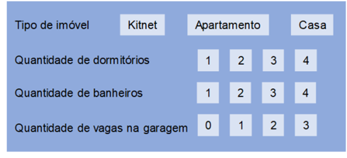

# Aula 4 — Aplicações da Tabela Verdade

## Ponto de Partida

Olá, estudante! Até você chegar ao ensino superior foram anos de estudos, não é mesmo? Tudo começou com o processo de alfabetização, tanto de leitura quanto das operações básicas de matemática (soma, subtração, divisão e multiplicação). Primeiro você aprendeu a fazer operações matemáticas simples, por exemplo, 2 + 3, depois apareceram os parênteses, por exemplo, (2 + 3) × 4. Mas será que esses parênteses são só de enfeite? Certamente que não! Eles influenciam a ordem que as operações devem ser resolvidas e, como você já deve saber, não seguir as regras certamente implica em chegar em resultados errôneos. Pois bem, da mesma forma que a matemática tem suas fórmulas e suas regras de resolução, a lógica formal também as possui, e nesta seção vamos aprender mais sobre elas.

> Como funcionário trainee na área de analytics de uma empresa de varejo, você deve dar continuidade em seu trabalho, fornecendo novos insights para a equipe de marketing realizar sua campanha promocional. Para esse novo desafio foi enviada a você uma base com novas informações, conforme ilustra a Tabela 1. Nessa base é possível encontrar o valor gasto na última compra do cliente, o total de compras já feito por ele e o ticket médio (valor médio gasto em cada compra). A partir desses dados você deve usar as regras da lógica para classificar se o cliente tem potencial para comprar na nova campanha e, se tiver, então ele ganhará um cupom com desconto de 10%. Caso não seja um cliente com potencial então ele ganhará somente um cupom com 5%.
>
> Vamos às regras: para ser classificado como um cliente com potencial de compra, não importa o gênero (pode ser feminino ou masculino), o cliente deve ter idade entre 30 e 45 anos, ter feito acima de 10 compras e ter um ticket médio acima de R$ 50,00.
>
> Seu desafio é montar uma fórmula que traduza essa regra e, então preencher a coluna "cliente_potencial" com o resultado da fórmula para cada registro. Dada a classificação, você deve escrever uma nova fórmula que traduza "Se o cliente tem potencial de compra, então ele deve ganhar um cupom com 10% de desconto", e outra fórmula que traduza "Se é falso que o cliente tem potencial de compra, então ele deve ganhar um cupom com 5% de desconto". Por fim, use a lógica de programação para preencher as colunas "cupom_10" e "cupom_5" valorando as condicionais.

| codigo_cli | nome_cli | genero_cli | idade_cli | valor_compra | total_compras | ticket_medio | cliente_potencial | cupom_10 | cupom_5 |
|---|---|:---:|:---:|---:|:---:|---:|:---:|:---:|:---:|
| 53682 | Karly Dillon | F | 40 | 74,84 | 5 | 45,00 | ? | ? | ? |
| 58246 | Channing Vazquez | M | 49 | 98,04 | 20 | 200,00 | ? | ? | ? |
| 27022 | Adria Key | F | 47 | 65,93 | 12 | 34,00 | ? | ? | ? |
| 82075 | Ella Nelson | F | 34 | 94,01 | 16 | 150,00 | ? | ? | ? |
| 90657 | Arden Battle | M | 48 | 21,73 | 4 | 23,00 | ? | ? | ? |
| 80330 | Brittany Ramirez | F | 38 | 42,23 | 1 | 42,23 | ? | ? | ? |
| 53989 | Moses Graham | M | 42 | 37,20 | 29 | 45,00 | ? | ? | ? |
| 61370 | Jin Fuller | M | 49 | 65,60 | 35 | 123,00 | ? | ? | ? |
| 41807 | Phelan Blair | M | 46 | 77,40 | 23 | 95,00 | ? | ? | ? |
| 94269 | Porter West | M | 22 | 67,19 | 6 | 35,00 | ? | ? | ? |
| 56516 | Zena Skinner | F | 54 | 73,98 | 15 | 60,00 | ? | ? | ? |
| 38904 | Teagan Rios | M | 34 | 61,57 | 17 | 71,00 | ? | ? | ? |

*Tabela 1 | Dados de compra dos clientes*

Para cumprir esse desafio, nesta seção você aprenderá a importância dos parênteses nas fórmulas, bem como seguir a regra de precedência dos operadores. Você também verá um caso de como fazer a ligação entre a lógica formal e a lógica na computação, assim já vai se preparando para em breve começar a programar.

Então vamos lá!

---

## Vamos Começar!

Ao longo de nossos estudos aprendemos diversas fórmulas; quem não se lembra da famosa fórmula de Bhaskara usada para encontrar as raízes de uma equação do segundo grau? Ou então da segunda lei Newton, que diz que a força é sempre diretamente proporcional ao produto da aceleração de um corpo pela sua massa? Para conseguirmos resolver esses tipos de equação, primeiro foi necessário aprender as operações matemáticas básicas (soma, subtração, multiplicação e divisão); depois essas operações passaram a se combinar em fórmulas mais elaboradas, e nesse momento foi necessário aprender a ordem de precedência dos operadores. Por exemplo: as fórmulas: (i) 2 + 3 × 4 e (ii) (2 + 3) × 4 apresentam o mesmo resultado? A resposta é não, pois a primeira tem como resultado 14 e a segunda, 20. Isso acontece porque, em uma fórmula, a multiplicação tem precedência sobre adição, então ao não usar parênteses na fórmula (i) a multiplicação foi feita antes da soma. Outro detalhe importante é que as fórmulas apresentam uma sintaxe correta, por exemplo: não podemos escrever 2 ++ 3, pois essa fórmula é inválida.

Assim como as fórmulas matemáticas, podemos construir expressões lógicas mais complexas a partir da combinação das proposições, dos conectivos e dos parênteses. Da mesma forma que as operações matemáticas têm ordem de precedência, os conectivos lógicos também a possui.

> **Assimile:** Para resolver uma expressão lógica que combina várias proposições com conectivos lógicos é preciso obedecer a seguinte regra de precedência:
>
> 1. Para expressões que tenham parênteses, primeiro efetuam-se as operações lógicas dentro dos parênteses mais internos.
> 2. ¬ (Negação) (maior precedência).
> 3. ∧ ∨ (Conjunção e disjunção).
> 4. → (Implicação).
> 5. ↔ (Bicondicional).

Ao seguir rigorosamente a ordem de precedência dos operadores, o uso de parênteses pode ser omitido nos casos adequados. Por exemplo: a fórmula A ∨ (¬B) pode simplesmente ser escrita como **A ∨ ¬B**, uma vez que, de acordo com a ordem de precedência, a negação será realizada primeiro, mesmo sem parênteses.

> **Nota de revisão:** no original, as duas formas apareciam iguais ("A ∨ (¬B) pode ser escrita como A ∨ (¬B)"); a forma sem parênteses é **A ∨ ¬B**.

#### Exemplificando

Para exemplificar como a ordem de precedência dos operadores lógicos pode influenciar o resultado, vamos construir uma tabela verdade para as fórmulas **A ∧ B → A** e **A ∧ (B → A)**. Veja no Quadro 1 que os resultados das colunas C4 e C6 são diferentes. Em C4, como o operador de conjunção tem precedência sobre a implicação, chegamos em uma tautologia, o que não ocorreu em C6 quando forçamos, por meio de parênteses, a implicação ser efetuada primeiro.

| C1 | C2 | C3 | C4 | C5 | C6 |
|:---:|:---:|:---:|:---:|:---:|:---:|
| **A** | **B** | **A ∧ B** | **A ∧ B → A** | **B → A** | **A ∧ (B → A)** |
| V | V | V | V | V | V |
| V | F | F | V | V | V |
| F | V | F | V | F | F |
| F | F | F | V | V | F |

*Quadro 1 | Tabela verdade das fórmulas A ∧ B → A e A ∧ (B → A)*

> **Nota de revisão:** no material original, a segunda fórmula aparecia como "A **∨** (B → A)" no texto e na legenda, mas o cabeçalho da coluna, o texto logo abaixo ("conjunção final em C6") e os valores correspondem a **A ∧ (B → A)**. O cabeçalho de C4 também saiu corrompido ("A ∧ → B → A").

Ainda no Quadro 1, observe que usamos a coluna C3 para efetuar a primeira operação da fórmula A ∧ B → A, e na coluna C4 usamos o resultado obtido em C3 para fazer a implicação. O mesmo acontece na coluna C5, em que fazemos a primeira operação da fórmula A ∧ (B → A), (considerando as regras da ordem de precedência) e depois usamos o resultado de C5 para fazer a conjunção final em C6. Esse processo de criar uma coluna para cada operação facilita o trabalho e nos auxilia a não cometer erros na construção da tabela verdade. Esses resultados intermediários podem ser representados por novas letras, por exemplo: poderíamos chamar o resultado da coluna C3 de P, então na coluna C4 teríamos P → A. Da mesma forma, poderíamos chamar o resultado da coluna C5 de R, então na coluna C6 teríamos a fórmula A ∧ R. O Quadro 2 mostra essa alternativa.

| | | P | | R | |
|:---:|:---:|:---:|:---:|:---:|:---:|
| **A** | **B** | **A ∧ B** | **P → A** | **B → A** | **A ∧ R** |
| V | V | V | V | V | V |
| V | F | F | V | V | V |
| F | V | F | V | F | F |
| F | F | F | V | V | F |

*Quadro 2 | Tabela verdade com proposições intermediárias P e R*

Dada uma fórmula com várias proposições, conectores e parênteses dentro de parênteses, a resolução deve começar pelos parênteses mais internos. Por exemplo, a fórmula **((A ∨ B) → C) ∧ A** deve ter a seguinte ordem de resolução:

1. A ∨ B (parênteses mais internos)
2. ((A ∨ B) → C) (parênteses mais externos)
3. ((A ∨ B) → C) ∧ A (operação fora dos parênteses).

O Quadro 3 mostra o resultado para essa fórmula. Veja que usamos proposições intermediárias para nomear os resultados. Primeiro obtemos **P** (A ∨ B) que é o resultado 1, depois usamos para obter **Q** (P → C), que é o resultado 2, e por fim, o usamos para obter o resultado da fórmula, o qual também nomeamos, por exemplo **R** (Q ∧ A).

| | | | P | Q | R |
|:---:|:---:|:---:|:---:|:---:|:---:|
| **A** | **B** | **C** | **A ∨ B** | **P → C** | **Q ∧ A** |
| V | V | V | V | V | V |
| V | V | F | V | F | F |
| V | F | V | V | V | V |
| V | F | F | V | F | F |
| F | V | V | V | V | F |
| F | V | F | V | F | F |
| F | F | V | F | V | F |
| F | F | F | F | V | F |

*Quadro 3 | Tabela verdade para a fórmula ((A ∨ B) → C) ∧ A*

> **Reflita:** Por praxe – mas não obrigatoriamente – construímos a tabela verdade colocando nas colunas mais à esquerda as proposições, em seguida, as colunas com as fórmulas. Em uma fórmula do tipo (A ∨ B) → A, precisamos primeiro obter o resultado de A ∨ B, para depois fazer a implicação. Quando o resultado de uma operação é usado para entrada em outra operação faz diferença a ordem das operações lógicas que serão consideradas? Em outras palavras, nessa operação (A ∨ B) → A, obteremos o mesmo resultado se fizermos A → (A ∨ B)?

---

## Siga em Frente...

Uma dúvida que pode surgir é sobre como vamos aplicar todas essas operações e regras no universo da programação. A resposta é simples: vamos utilizar para construir uma sequência de instruções, chamada de **algoritmo**.

Um algoritmo é uma sequência de passos que soluciona algum problema de diversas áreas do mundo real. Mais precisamente, as operações lógicas são usadas em **estruturas condicionais** (ou estruturas de decisão) e têm o objetivo de realizar testes alterando o fluxo de execução de um programa, de acordo com a resposta obtida. Por exemplo, imagine que acabou de se mudar e esteja realizando a busca de um apartamento em um site de aluguel de imóveis. O site oferece uma interface na qual você clica nas opções que deseja, conforme ilustra a Figura 1.



**Figura 1** | Interface de site de busca de imóvel

Vamos fazer algumas simulações para avaliarmos a lógica por trás da nossa seleção.

**Simulação 1:** Selecionar Apartamento; 1 dormitório; 1 banheiro; sem vaga de garagem.

A expressão lógica que será construída com base nessa simulação é:

> Apartamento **E** 1 quarto **E** 1 banheiro **E** sem garagem.

Serão exibidos na tela somente os imóveis que satisfazem todas essas alternativas; os demais serão ignorados, pois no algoritmo a instrução é composta pelo conector de conjunção.

**Simulação 2:** Selecionar Apartamento; 1, 2 dormitórios; 1, 2 banheiros; 0, 1 vaga de garagem.

Nesse caso a expressão lógica será:

> Apartamento **E** (1 quarto **OU** 2 quartos) **E** (1 banheiro **OU** 2 banheiros) **E** (0 **OU** 1 vaga de garagem).

Veja que nesse caso a expressão é mais complexa e envolve a resolução de parênteses internos. Como resultado da busca apareceriam tanto opções com 1 quanto com 2 quartos e banheiros e sem garagem ou com 1 vaga.

Todas essas opções devem estar implementadas no algoritmo por meio das estruturas condicionais.

Esse tipo de estrutura é amplamente usado em algoritmos computacionais. Quem nunca fez uma compra em um site? Ao finalizar a compra, o algoritmo faz uma conjunção dos itens que colocamos no carrinho de compras, para calcular o preço final.

### Exemplo com dados reais: preços de combustíveis

Para finalizar nossa seção, vamos utilizar uma base com dados reais e, a partir de uma tabela verdade, veremos como classificar os registros. Os dados usados são de domínio público e estão disponíveis no Portal Brasileiro de Dados Abertos.

Trata-se de uma base com os preços de combustíveis em algumas cidades do Brasil no ano de 2019, segregados por estado, cidade, estabelecimento de revenda, produto, data da pesquisa, valor de venda, valor de compra e bandeira do posto, conforme amostra dos dados na Tabela 2.

| # | Estado | Município | Revenda | Produto | Data da coleta | Valor de venda | Valor de compra | Bandeira |
|:---:|:---:|---|---|---|:---:|---:|---:|:---:|
| 1 | DF | Brasília | Abritta Postos de Serviços Ltda. | Diesel S10 | 23/01/2019 | 3,899 | | xx |
| 2 | DF | Brasília | Abritta Postos de Serviços Ltda. | Etanol | 16/01/2019 | 3,299 | 2,9999 | xx |
| 3 | RJ | Rio de Janeiro | 3Posto Julio de Castilho Limitada. | Gasolina | 07/03/2019 | 5,096 | 4,305 | xx |
| 4 | DF | Brasília | Abritta Postos de Serviços Ltda. | Etanol | 23/01/2019 | 4,299 | 3,6745 | xx |
| 5 | RJ | Rio de Janeiro | 3Posto Julio de Castilho Limitada. | Etanol | 03/01/2019 | 3,499 | 2,9711 | xx |
| 6 | DF | Brasília | Abritta Postos de Serviços Ltda. | Etanol | 23/01/2019 | 3,197 | 2,9416 | xx |
| 7 | DF | Brasília | Abritta Postos de Serviços Ltda. | Gasolina | 08/01/2019 | 4,187 | 3,735 | xx |
| 8 | SC | Blumenau | Auto Posto 7 Ltda. | Diesel S10 | 02/01/2019 | 3,597 | | xx |
| 9 | SC | Blumenau | Auto Posto 7 Ltda. | Gasolina | 12/02/2019 | 3,767 | | xx |

*Tabela 2 | Amostra dos dados de combustíveis automotivos*

Dadas as seguintes proposições:

- **A**: O município é Brasília.
- **B**: O combustível é gasolina.
- **C**: A bandeira é Petrobras.

Vamos construir a tabela verdade para a regra "Se a cidade não for Brasília e o combustível for gasolina então a bandeira é Petrobras.". Em seguida, vamos fazer a conexão entre a lógica formal com a lógica computacional, mais especificamente com a lógica de programação, para avaliar a regra para cada um dos registros. O primeiro passo é traduzir a regra para uma fórmula lógica, o que nos resulta em **(¬A ∧ B) → C**. O resultado da tabela verdade para a fórmula está no Quadro 4. Veja que a primeira operação que fizemos foi a negação, que está dentro dos parênteses (seguindo a ordem de precedência dos operadores), depois fizemos a conjunção e chamamos o resultado de R. Usamos esse resultado para fazer a implicação.

| | | | | R | |
|:---:|:---:|:---:|:---:|:---:|:---:|
| **A** | **B** | **C** | **¬A** | **¬A ∧ B** | **R → C** |
| V | V | V | F | F | V |
| V | V | F | F | F | V |
| V | F | V | F | F | V |
| V | F | F | F | F | V |
| F | V | V | V | V | V |
| F | V | F | V | V | F |
| F | F | V | V | F | V |
| F | F | F | V | F | V |

*Quadro 4 | Tabela verdade para a fórmula (¬A ∧ B) → C*

Lembrando que a tabela verdade nos permite avaliar a veracidade da expressão testando todas as combinações possíveis. Vamos interpretar alguns resultados do Quadro 4. Na linha 1, temos a seguinte expressão "Se é falso que a cidade não é Brasília e o combustível é gasolina, então a bandeira é Petrobras.". Tal expressão tem como resultado V, que se deve à falsidade no antecedente, impossibilitando avaliar o resultado que, portanto, é tomado como verdadeiro. Na linha 2, a expressão é "Se é falso que a cidade não é Brasília e o combustível é gasolina, então é falso que a bandeira é Petrobras". Dada a falsidade no antecedente e consequente, a expressão tem como resultado V. O único caso em que a implicação tem como resultado F, é quando o antecedente é verdadeiro e o consequente é falso.

Os operadores lógicos são usados na lógica de programação para dizer se uma condição seja verdadeira ou falsa. Nesse exemplo, queremos criar uma lógica de programação para avaliar regra "Se a cidade não for Brasília e o combustível for gasolina então a bandeira é Petrobras." Pois bem, o Quadro 5 apresenta o resultado da análise das proposições A e B para os registros da Tabela 2, bem como da conjunção ¬A ∧ B.

| Registro | A (Município) | B (Produto) | ¬A | ¬A ∧ B (Resultado) |
|:---:|:---:|:---:|:---:|:---:|
| 1 | V | F | F | F |
| 2 | V | F | F | F |
| 3 | F | V | V | V |
| 4 | V | **F** | F | F |
| 5 | F | F | V | F |
| 6 | V | F | F | F |
| 7 | V | V | F | F |
| 8 | F | F | V | F |
| 9 | F | V | V | V |

*Quadro 5 | Valoração de ¬A ∧ B para os registros da Tabela 2*

> **Nota de revisão:** no registro 4 (Brasília, **Etanol**), o material original marcava B = **V**, mas o combustível não é gasolina, então B = **F**. O resultado de ¬A ∧ B continua F (porque ¬A já é F).

Dentro de um algoritmo computacional, o resultado da conjunção, dentro de uma estrutura condicional, pode ser usado para classificar a proposição C, pois se a condição for satisfeita (V) a proposição C também será. Na programação, o operador de implicação é feito por meio do comando **se… então…** No nosso exemplo podemos dizer **se ¬A ∧ B então C**, ou seja, em que ¬A ∧ B for V, C também será. Para matar um pouco da nossa vontade de começar a programar, veja no Quadro 6 como ficaria esse comando dentro de três importantes linguagens de programação.

**C**

```c
if (A != "BRASILIA" && B == "GASOLINA")
{
    printf("Petrobras");
}
```

**Java**

```java
if (A != "BRASILIA" && B == "GASOLINA")
{
    System.out.println("Petrobras");
}
```

**Python**

```python
if A != "BRASILIA" and B == "GASOLINA":
    print("Petrobras")
```

*Quadro 6 | Estrutura condicional em linguagens de programação*

> **Nota de revisão:** no original, as aspas estavam misturadas ("BRASILIA' com aspa simples no fim e aspas tipográficas “ ”), o que não compila em nenhuma das linguagens; foram trocadas por aspas retas. Observação técnica, fora do escopo da aula: em C e em Java, `!=` e `==` **não comparam o conteúdo de textos** — em C usa-se `strcmp(A, "BRASILIA") != 0` e em Java `!A.equals("BRASILIA")`. O código do quadro serve para mostrar a **estrutura lógica** do `if`; o exemplo em Python funciona como está.

Como você pode observar no Quadro 6, o comando **se** é escrito em inglês (`if`) e o **então**, nas linguagens C e Java é a chave ( `{` ) e em python é o dois pontos ( `:` ). Outro detalhe é a escrita da conjunção; em C e Java é feito pelo `&&` e em python pelo comando `and`. Além desses conectivos lógicos, também foram usados operadores relacionais. A sintaxe `!=` significa "diferente" e a sintaxe `==` significa "igual". Como você pode ver, a solução geral de um problema está na lógica, que não muda de uma linguagem para outra, o que muda é a sintaxe. Por isso, compreender os operadores lógicos é essencial para sua carreira. Não deixe de aprofundar seus estudos e lembre-se: quanto mais você treinar, mais desenvolverá sua lógica e sua capacidade analítica.

---

## Vamos Exercitar?

Chegou o momento de resolvermos mais um desafio. Como funcionário na área de analytics de uma empresa de varejo. Você recebeu uma nova base de dados e precisa identificar os clientes que têm potencial de comprar na nova campanha. A regra para dizer se o cliente tem ou não potencial para comprar é dada pelas seguintes condições:

- Não importa o gênero (pode ser feminino ou masculino).
- Ele ou ela deve ter idade entre 30 e 45 anos.
- Ele ou ela deve ter feito acima de 10 compras.
- Ele ou ela deve ter um ticket médio acima de R$ 50,00.

A primeira parte do desafio consiste em escrever uma fórmula que traduza essas regras e, então classificar o resultado da fórmula para cada registro da base da dados.

Primeiro ponto importante para montar a fórmula é entender que todas as condições precisam ser satisfeitas, ou seja, estamos diante de conjunções. Como não importa o gênero – pode ser F ou M –, usaremos a disjunção. Agora é montar essa disjunção com as várias conjunções, utilizando os parênteses para indicar a ordem da valoração. Vamos começar escrevendo os itens já em fórmulas:

- (feminino OU masculino).
- (idade >= 30 E idade <= 45).
- (compra >= 10).
- (ticket médio >= 50).

Agora é só juntar os itens com a conjunção:

> (feminino OU masculino) **E** (idade >= 30 E idade <= 45) **E** (compra >= 10) **E** (ticket médio >= 50).

> **Nota de revisão:** a regra diz "**acima** de 10 compras" e ticket médio "**acima** de R$ 50,00", então o correto seria **> 10** e **> 50** (com >= um cliente com exatamente 10 compras ou ticket de R$ 50,00 entraria indevidamente). Nesta base nenhum cliente tem exatamente esses valores, então a classificação não muda por isso.

Veja que temos conectores que não são tão evidentes, como no caso da idade, em que precisamos usar a conjunção para delimitar a idade procurada. Agora vamos avaliar a fórmula para os dados. Observe os resultados na coluna "cliente_potencial" na Tabela 3.

Vamos analisar juntos alguns registros. Na linha 1, o gênero, a idade e o valor da última compra são satisfeitos, porém, o total de compras e o ticket médio não são, o que resulta em falso para a coluna que indica se o cliente é ou não potencial. Já na linha 4, todos os itens são atendidos, logo o cliente é classificado como V, ou seja, é um cliente com potencial de compra na campanha.

| codigo_cli | nome_cli | genero_cli | idade_cli | valor_compra | total_compras | ticket_medio | cliente_potencial | cupom_10 | cupom_5 |
|---|---|:---:|:---:|---:|:---:|---:|:---:|:---:|:---:|
| 53682 | Karly Dillon | F | 40 | 74,84 | 5 | 45,00 | F | ? | ? |
| 58246 | Channing Vazquez | M | 49 | 98,04 | 20 | 200,00 | F | ? | ? |
| 27022 | Adria Key | F | 47 | 65,93 | 12 | 34,00 | F | ? | ? |
| 82075 | Ella Nelson | F | 34 | 94,01 | 16 | 150,00 | V | ? | ? |
| 90657 | Arden Battle | M | 48 | 21,73 | 4 | 23,00 | F | ? | ? |
| 80330 | Brittany Ramirez | F | 38 | 42,23 | 1 | 42,23 | F | ? | ? |
| 53989 | Moses Graham | M | 42 | 37,20 | 29 | 45,00 | F | ? | ? |
| 61370 | Jin Fuller | M | 49 | 65,60 | 35 | 123,00 | **F** | ? | ? |
| 41807 | Phelan Blair | M | 46 | 77,40 | 23 | 95,00 | **F** | ? | ? |
| 94269 | Porter West | M | 22 | 67,19 | 6 | 35,00 | F | ? | ? |
| 56516 | Zena Skinner | F | 54 | 73,98 | 15 | 60,00 | F | ? | ? |
| 38904 | Teagan Rios | M | 34 | 61,57 | 17 | 71,00 | V | ? | ? |

*Tabela 3 | Resultado da valoração da fórmula (corrigido — ver nota)*

> **Nota de revisão:** no material original, **Jin Fuller (49 anos)** e **Phelan Blair (46 anos)** estavam classificados como cliente potencial (**V**). Os dois estão **fora da faixa de 30 a 45 anos**, então a conjunção é falsa: o correto é **F** (corrigido em negrito). Com isso, só **Ella Nelson** e **Teagan Rios** são clientes potenciais.

Agora que já sabemos quais clientes têm potencial para comprar, vamos ao próximo passo: marcar o cupom de desconto. Devemos escrever uma nova fórmula que traduza "Se o cliente tem potencial de compra, então ele deve ganhar um cupom com 10% de desconto". Vamos chamar de **P** a proposição "o cliente tem potencial de compra" e **R** a proposição "Ganhar um cupom com 10% de desconto". Então a fórmula pode ser escrita como **P → R**. Na lógica de programação, a implicação é utilizada em estruturas condicionais do tipo se… então… E como resultado temos que se P for verdadeira então R acontecerá.

Também foi dado a você o desafio de escrever a fórmula que traduza "Se é falso que o cliente tem potencial de compra, então ele deve ganhar um cupom com 5% de desconto". Considerando a proposição P anterior e a proposição **S** como "Ganhar um cupom com 5% de desconto", obtemos a fórmula **¬P → S**. Agora já podemos finalizar o relatório completando as colunas que indicam a qual cupom o cliente tem direito. Veja na Tabela 4 o resultado completo. Vamos analisar a linha 1. Temos que o cliente não é potencial, ou seja, ¬P é uma verdade nesse caso, logo S acontecerá.

| codigo_cli | nome_cli | genero_cli | idade_cli | valor_compra | total_compras | ticket_medio | cliente_potencial | cupom_10 | cupom_5 |
|---|---|:---:|:---:|---:|:---:|---:|:---:|:---:|:---:|
| 53682 | Karly Dillon | F | 40 | 74,84 | 5 | 45,00 | F | F | V |
| 58246 | Channing Vazquez | M | 49 | 98,04 | 20 | 200,00 | F | F | V |
| 27022 | Adria Key | F | 47 | 65,93 | 12 | 34,00 | F | F | V |
| 82075 | Ella Nelson | F | 34 | 94,01 | 16 | 150,00 | V | V | F |
| 90657 | Arden Battle | M | 48 | 21,73 | 4 | 23,00 | F | F | V |
| 80330 | Brittany Ramirez | F | 38 | 42,23 | 1 | 42,23 | F | F | V |
| 53989 | Moses Graham | M | 42 | 37,20 | 29 | 45,00 | F | F | V |
| 61370 | Jin Fuller | M | 49 | 65,60 | 35 | 123,00 | **F** | **F** | **V** |
| 41807 | Phelan Blair | M | 46 | 77,40 | 23 | 95,00 | **F** | **F** | **V** |
| 94269 | Porter West | M | 22 | 67,19 | 6 | 35,00 | F | F | V |
| 56516 | Zena Skinner | F | 54 | 73,98 | 15 | 60,00 | F | F | V |
| 38904 | Teagan Rios | M | 34 | 61,57 | 17 | 71,00 | V | V | F |

*Tabela 4 | Relatório final (corrigido — ver nota da Tabela 3)*

> **Nota de revisão:** por consequência da correção da Tabela 3, Jin Fuller e Phelan Blair passam a receber o **cupom de 5%** (cupom_10 = F, cupom_5 = V). No original, eles apareciam com o cupom de 10%.

Com esses resultados finalizamos nosso desafio, contribuindo com êxito com a área de marketing da empresa. Esperamos que venham novos desafios!

---

## Saiba mais

Aplicações da tabela verdade são fundamentais para a compreensão da disciplina Lógica e Matemática Computacional. A seguir, algumas indicações para um estudo profundo sobre o tema.

1. O capítulo 2 deste livro aborda os tópicos referentes: (1) à Tabela Verdade, (2) aos Exercícios.
   > BISPO, C. A. F.; CASTANHEIRA, L. B.; SOUZA FILHO, O. M. **Introdução à Lógica Matemática**. Cengage Learning Brasil, 2017.

2. O capítulo 2 aborda os tópicos relacionados à tabela verdade.
   > QUILELLI, P. **Raciocínio lógico matemático para concursos**. 3. ed. Editora Saraiva, 2015.

## Referências

- BISPO FILHO, C. A. F.; CASTANHEIRA, L. B.; SOUZA FILHO, O. M. Introdução à lógica matemática. São Paulo: Cengage Learning, 2017.
- FAJARDO, R. Lógica matemática. 1. ed. São Paulo: Edusp, 2017.
- MUNDIM, R. P. A Lógica Formal – princípios elementares. Revista Economia & Gestão, Belo Horizonte, v. 2, n. 3, jan./jun. 2002.
- SANTOS, M. da S. dos et al. Lógica computacional. Grupo A, 2021.
