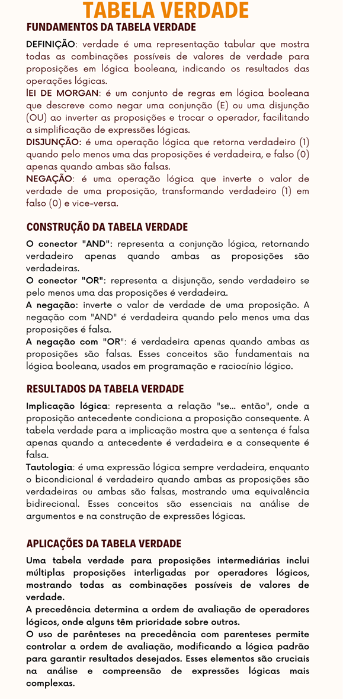

# Aula 5 — Tabela Verdade: Síntese da Unidade

## Ponto de Chegada

Olá, estudante! Para desenvolver a competência desta Unidade, que está relacionado à Tabela verdade, você deverá primeiramente conhecer os conceitos fundamentos sobre: Tabela verdade, Lei de Morgan, Disjunção, Negação, conectores (AND e OR), implicação lógica, tautologia, bicondicional e por fim regras de precedência.

Bom, então vamos lá.

### Tabela Verdade

A tabela verdade é uma representação sistemática de todas as combinações possíveis de valores de verdade para proposições em uma expressão lógica. Ela demonstra de maneira abrangente os resultados da expressão para todas as situações.

### Lei de Morgan

A Lei de Morgan é um princípio fundamental na lógica proposicional que descreve como a negação de uma conjunção (E) é equivalente à disjunção (OU) das negações das proposições individuais, e vice-versa. Em termos simples, é uma regra que relaciona negações e operadores lógicos.

### Disjunção

A disjunção é um operador lógico representado por "OU." Em uma expressão disjuntiva, se pelo menos uma das proposições é verdadeira, a expressão como um todo é verdadeira. Caso contrário, a expressão é falsa.

### Negação

A negação é um operador lógico representado por "¬" (não). Ele inverte o valor de verdade de uma proposição: se a proposição é verdadeira, a negação torna-se falsa, e vice-versa.

Estas definições fornecem uma visão sucinta dos conceitos de tabela verdade, Lei de Morgan, disjunção e negação na lógica proposicional.

### Conectores e operadores

| Operador | Expressão | É verdadeira quando... |
|---|:---:|---|
| **Conector "AND" (E)** — conjunção de duas proposições | A ∧ B | apenas se ambas as proposições A e B forem verdadeiras |
| **Conector "OR" (OU)** — disjunção de duas proposições | A ∨ B | pelo menos uma das proposições A ou B for verdadeira |
| **Negação ("NOT")** — operador unário que inverte o valor de verdade | ¬A | A é falsa (se A é verdadeiro, a negação é falsa, e vice-versa) |
| **Negação "AND" ("NOT AND")** — combinação da negação e do conector "AND" | ¬(A ∧ B) | pelo menos uma das proposições A ou B for falsa |
| **Negação "OR" ("NOT OR")** — combinação da negação e do conector "OR" | ¬(A ∨ B) | apenas quando ambas as proposições A e B são falsas |

### Implicação Lógica

A implicação lógica, representada por "A → B", indica que se a proposição A for verdadeira, então a proposição B também o é. Se A for falsa, a implicação é automaticamente verdadeira. Apenas quando A é verdadeira e B é falsa é que a implicação é falsa. Essa estrutura condicional é fundamental em lógica matemática e raciocínio condicional.

### Tabela verdade para condicional

A tabela verdade para a condicional (implicação) "A → B" revela que, se A for verdadeiro e B for verdadeiro, a condicional é verdadeira. Se A for verdadeiro e B for falso, a condicional é falsa. Quando A é falso, a condicional é sempre verdadeira, independentemente de B. Essa tabela esquematiza as relações lógicas entre A e B em contextos condicionais.

| A | B | A → B |
|:---:|:---:|:---:|
| V | V | V |
| V | F | F |
| F | V | V |
| F | F | V |

### Tautologia

Uma **tautologia** é uma proposição lógica sempre verdadeira, independentemente dos valores de verdade das variáveis envolvidas. Em uma tabela verdade, todas as linhas apresentam resultado "verdadeiro". Exemplo: "A ou não A" é uma tautologia, pois a afirmação "A ou não A" é verdadeira em todas as situações, já que A ou não A sempre é verdadeiro. Tautologias são fundamentais na lógica matemática e têm aplicações em raciocínio lógico e teoria dos conjuntos.

### Bicondicional

O operador **bicondicional**, representado por "A ↔ B", é uma afirmação lógica que é verdadeira quando ambas as proposições A e B têm o mesmo valor de verdade, seja verdadeira ou falsa. Em uma tabela verdade para o bicondicional, as únicas situações em que a expressão é verdadeira são quando A e B têm ambos os valores verdadeiros ou ambos os valores falsos. Se há uma disparidade nos valores de verdade entre A e B, o bicondicional é falso. Em resumo, o bicondicional expressa a equivalência lógica entre duas proposições.

| A | B | A ↔ B |
|:---:|:---:|:---:|
| V | V | V |
| V | F | F |
| F | V | F |
| F | F | V |

### Regras de Precedência

As regras de precedência em lógica estabelecem a ordem de avaliação dos operadores lógicos em expressões. Geralmente, a negação (¬) tem a mais alta precedência, seguida pela conjunção (∧), disjunção (∨), condicional (→), e bicondicional (↔). Parênteses podem ser usados para alterar a ordem padrão de avaliação.

> **Nota de revisão:** aqui a conjunção aparece **antes** da disjunção, mas nas Aulas 3 e 4 desta unidade (e na Unidade 3) a regra ensinada é que **∧ e ∨ têm a mesma precedência** e, entre eles, resolve-se primeiro o que está mais à esquerda. As duas convenções existem na literatura — por isso, na dúvida, **use parênteses** para deixar a ordem explícita.

---

## É Hora de Praticar!

### Estudo de Caso: Qualificação de candidatos

> Suponha que uma empresa de TI está conduzindo um teste para avaliar a qualificação dos candidatos. Eles têm dois critérios principais: habilidades de programação (A) e habilidades de comunicação (B). A empresa decidiu que um candidato é qualificado (Q) se tiver habilidades de programação e boas habilidades de comunicação, ou se não tiver habilidades de programação, mas ainda tiver habilidades de comunicação.

**Definição das Variáveis:**

- **A**: Habilidades de programação.
- **B**: Habilidades de comunicação.
- **Q**: Qualificação.

A expressão lógica para a qualificação (Q) pode ser escrita como:

$$Q = (A \land B) \lor (\neg A \land B)$$

**Análise da Expressão Lógica:**

- **(A ∧ B)**: Representa a condição em que um candidato possui habilidades tanto em programação quanto em comunicação.
- **(¬A ∧ B)**: Representa a condição em que um candidato não possui habilidades de programação (¬A), mas possui habilidades de comunicação.
- **(A ∧ B) ∨ (¬A ∧ B)**: Representa a condição geral de qualificação, em que um candidato será qualificado se atender a uma das condições acima.

Com base no que foi exposto, como podemos expressar essa condição usando uma expressão lógica? Além disso, qual seria o resultado dessa expressão para diferentes combinações de habilidades de programação e comunicação?

### Reflita

- Como a ordem de precedência dos operadores lógicos (¬, ∧, ∨) afeta a avaliação de expressões? Cite exemplos de como o uso de parênteses muda essa ordem e influencia o resultado.
- O que é uma tautologia em lógica? Cite exemplos práticos.
- O que caracteriza uma tautologia em lógica proposicional? Além disso, como o operador bicondicional (↔) opera na relação entre duas proposições, e qual é a sua representação em termos de tabela verdade?

### Resolução do Estudo de Caso

O teste de qualificação, baseado nessa lógica, destina-se a identificar candidatos que possuam habilidades em programação e/ou comunicação, refletindo os critérios específicos da empresa de TI para a posição em questão. O entendimento da expressão lógica e a interpretação da tabela verdade são essenciais para analisar a adequação dos candidatos à empresa.

Neste contexto, temos a seguinte expressão Lógica para Qualificação:

$$Q = (A \land B) \lor (\neg A \land B)$$

Para resolver esta expressão, dividiremos o processo em três etapas. Para cada uma delas, será elaborada uma Tabela Verdade para melhor ilustração.

**Etapa 1: Tabela verdade para (A ∧ B):**

| A | B | (A ∧ B) |
|:---:|:---:|:---:|
| V | V | V |
| V | F | F |
| F | V | F |
| F | F | F |

**Etapa 2: Tabela verdade para (¬A ∧ B):**

| A | B | ¬A | (¬A ∧ B) |
|:---:|:---:|:---:|:---:|
| V | V | F | F |
| V | F | F | F |
| F | V | V | V |
| F | F | V | F |

**Etapa 3: Tabela verdade para (A ∧ B) ∨ (¬A ∧ B):**

| A | B | (A ∧ B) | (¬A ∧ B) | (A ∧ B) ∨ (¬A ∧ B) |
|:---:|:---:|:---:|:---:|:---:|
| V | V | V | F | **V** |
| V | F | F | F | **F** |
| F | V | F | V | **V** |
| F | F | F | F | **F** |

> **Nota de revisão:** no material original, essas três tabelas saíram "transpostas" na extração (os valores de cada **coluna** aparecem em sequência, e não os de cada linha). Foram remontadas na orientação correta; os valores são os do original.
>
> **Observação:** repare que a última coluna é **idêntica à coluna B**. Ou seja, (A ∧ B) ∨ (¬A ∧ B) é **equivalente a B** — pela regra da empresa, quem tem habilidade de comunicação é qualificado, tenha ou não habilidade de programação. Em resumo, a habilidade de programação (A) não altera o resultado.

Por fim, este exemplo prático ilustra como a lógica, a tabela verdade e a interpretação são aplicadas em um contexto de teste para seleção de candidatos em uma empresa de TI, levando em consideração diferentes combinações de habilidades.

### Assimile

**Figura 1** | Tabela verdade

## Referências

- BISPO FILHO, C. A. F.; CASTANHEIRA, L. B.; SOUZA FILHO, O. M. Introdução à lógica matemática. São Paulo: Cengage Learning, 2017.
- FAJARDO, R. Lógica matemática. 1. ed. São Paulo: Edusp, 2017.
- MUNDIM, R. P. A Lógica Formal – princípios elementares. Revista Economia & Gestão, Belo Horizonte, v. 2, n. 3, jan./jun. 2002.
- SANTOS, M. da S. dos et al. Lógica computacional. Grupo A, 2021.
